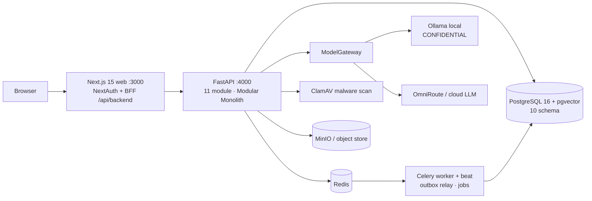

# Aureon v3 — AI-EOS (AI-First Enterprise Operating System)

> **"One Enterprise. One Source of Truth. One AI Operating Layer."**
> *CEO biết công ty đang đạt mục tiêu đến đâu, vì sao, và giao việc được ngay — với dữ liệu nhập vào dễ như gửi một file.*

Aureon v3 là **hệ điều hành doanh nghiệp lấy AI làm trung tâm**, nối liền một vòng lặp:
**Capture → Data → Intelligence → Decision → Action → Measurement → Feedback**. AI đóng vai
Assistant/Analyst/Advisor/Planner/Orchestrator/Agent tùy mức tự chủ (**Autonomy L0–L3**, L4 khóa)
doanh nghiệp cho phép. Mọi con số truy ngược được tới bản ghi và tài liệu gốc (grounding — không bịa số).

Nền code tái dùng từ Aureon v2.1 (Modular Monolith FastAPI + Next.js), đang refactor dần sang
model v3 theo từng phase có kiểm chứng FE→BE. Dữ liệu demo: công ty giả định **TNHH TM&DV ABC**
(~150 NV, 7 phòng ban, kỳ Q3/2026).

> Dòng sản phẩm chính thức **duy nhất** là Aureon v3 — AI-EOS. Aureon v2.1 đã **archived**
> (`docs/_archive/v2.1/`), chỉ tra cứu lịch sử. Canonical: `_reference/SOURCE-BRD-v1.1.md` (+ Bổ sung) + `SOURCE-UIUX.md`.

---

## Quick start

```bash
git clone https://github.com/hovikhanh/Aureon.git && cd Aureon
cp .env.example .env                    # điền giá trị dev (mật khẩu demo, NEXTAUTH_SECRET, ...)
./scripts/generate_keys.sh keys         # cặp khóa RS256 cho JWT (gitignored)
docker compose -f docker-compose.full.yml up -d --build
open http://localhost:3000              # Web · API: http://localhost:4000/health
```

Service `api` tự chạy `alembic upgrade head` + seed (idempotent) khi khởi động. 9 service
(`postgres, redis, minio, ollama, clamav, api, celery-worker, celery-beat, web`) healthy trong
~2 phút (ClamAV lần đầu tải signature lâu hơn). Reset dữ liệu demo: `./scripts/demo_reset.sh -y`.
Kịch bản trình diễn 5 phút: [docs/DEMO-SCRIPT.md](docs/DEMO-SCRIPT.md).

## Vai trò (R-DEC-08) — 7 role BRD + AI Agent

| ID | Vai trò | Phạm vi | ID | Vai trò | Phạm vi |
|---|---|---|---|---|---|
| ROLE-CEO | CEO | Toàn doanh nghiệp | ROLE-REV | Reviewer | Hàng chờ review |
| ROLE-DIR | Director/Executive | Khối/phòng ban | ROLE-ADM | Admin | Cấu hình nền tảng |
| ROLE-MGR | Manager | Team | ROLE-AI | AI Agent (actor) | Quyền agent ∩ người được phục vụ |
| ROLE-EMP | Employee | Cá nhân & việc được giao | | | |

**ROLE-DIR gộp 5 giám đốc khối** (R-DEC-12); khối phụ trách phân biệt bằng `scope_pillars`
(⊆ F.O.C.U.S), enforce ở server mỗi request (R-DEC-12a). Mọi business entity mang `tenant_id`
(single-tenant ở MVP, sẵn sàng đa tenant — R-DEC-07/13).

## Demo accounts

Mật khẩu lấy từ `.env` (`DEMO_<ROLE>_PASSWORD`) — không commit, không đặt vào `NEXT_PUBLIC_*`.
Ở `DEMO_MODE=true` màn hình login có dropdown chọn nhanh tài khoản (mật khẩu điền phía server).

| Email | Role v3 | Khối (scope_pillars) | Thấy gì |
|---|---|---|---|
| `ceo@abc.demo` | CEO | — (toàn bộ) | Cả 5 trụ F.O.C.U.S, 13 alert, AI Chat, phê duyệt |
| `cfo@abc.demo` | DIR | **F** (Finance) | Trụ F, Finance drill-down, hóa đơn; duyệt kế hoạch tuyển dụng (cổng ngân sách) |
| `sales@abc.demo` | DIR | **C** (Customer) | Trụ C (Customer & Growth) |
| `hr@abc.demo` | DIR | **O** (Operations) | Trụ O (Operations & People), quỹ lương |
| `reviewer@abc.demo` | REV | — | Hàng chờ review IDP |

Seed còn 5 tài khoản (`cpo@`→DIR{U}, `risk@`→DIR{S}, `manager@`→MGR, `employee@`→EMP, `admin@abc.demo`→ADM)
cho đủ 10 tài khoản demo (08 §2) ánh xạ vào 7 role v3.

## Tính năng

| Khối | Nội dung |
|---|---|
| **Dashboard F.O.C.U.S** | 5 trụ: **F** Finance · **O** Operations & People · **C** Customer & Growth · **U** Product & Innovation · **S** Strategy & Risk. **32 metric** tính sẵn (metric store), **13 alert** mở trong seed demo (11 WARNING + 2 CRITICAL). Layout demo: F🟢 C🟢 U🟡 O🟡 S🔴. Pillar card thu hẹp theo khối của DIR |
| **Finance drill-down** | 6 metric với sparkline 12 tháng, lineage 3 cấp: metric → bản ghi → tài liệu gốc |
| **AI Assistant** | Chat SSE, **43 tool** lọc theo quyền người hỏi, citation `[n]` → nguồn, không bịa số (P05), PII filter, Autonomy L0–L3 + undo + kill switch (L4 khóa) |
| **IDP (D03)** | **5 kênh upload C1–C5**, quét malware (ClamAV), text-layer/OCR, trích xuất + confidence band, validation, review song song → commit qua Action Registry vào Finance |
| **Governance** | RBAC 7 role (`<domain>:<action>`) + ABAC pillar-scope + field-level (mức 4), JWT RS256, `tenant_id` mọi entity, audit log append-only, Transactional Outbox + Celery |

## Kiến trúc



Health: `GET /health` (tổng + dependency), `/health/ready` (DB + Redis), `/health/live`, `/metrics` (Prometheus).

## Phát triển (app chạy trên host)

```bash
pnpm install && uv sync
docker compose up -d postgres redis minio ollama clamav
uv run alembic upgrade head && uv run python -m app.seed
uv run uvicorn app.main:app --reload --port 4000   # API
pnpm dev:web                                        # Web :3000
```

Gate: `pnpm lint && pnpm typecheck && pnpm test && uv run ruff check . && uv run mypy && uv run pytest && pnpm contract:validate`.

Reset dữ liệu demo (không xoá volume/schema): `./scripts/demo_reset.sh -y`.

## Chế độ AI (ModelGateway)

Mọi lời gọi LLM đi qua một điểm duy nhất là `ModelGateway`. Biến `MODEL_GATEWAY_MODE` trong `.env` quyết định nguồn:

| `MODEL_GATEWAY_MODE` | Hành vi | Cần key? |
|---|---|---|
| `fixture` (mặc định dev/CI) | Phát lại kết quả đã ghi sẵn; không có mạng, không gọi AI thật. Thiếu fixture → lỗi rõ ràng. | ❌ Không |
| `live` | Gọi LLM thật qua endpoint tương thích OpenAI tại `OMNIROUTE_BASE_URL`. | ✅ Có |

Chat demo (`DEMO_MODE=true`) phát lại các câu hỏi kịch bản trong ~1,2–1,3 s — **số liệu luôn lấy từ tool thật**, không bịa. Bật AI/chat thật:

```bash
# .env
MODEL_GATEWAY_MODE=live
OMNIROUTE_BASE_URL=<url-gateway>/v1       # vd http://localhost:20128/v1
OMNIROUTE_API_KEY=<key>                   # gửi dạng Authorization: Bearer <key>
CHAT_MODEL_PRIMARY=cc/claude-sonnet-5     # model chat chính (xem DEC-241)
```

Test gọi provider thật chỉ chạy khi cho phép: `RUN_LIVE_TESTS=true uv run pytest -m live`. Không commit key (`.env` đã gitignore).

## Test

| Bộ | Số lượng |
|---|---|
| Backend pytest | **770 passed** (+ 4 pre-existing contract fail — xem 14 §1.4) |
| Frontend Vitest | **18** |
| E2E Playwright | **30** (cần full stack docker để chạy) |

## Tài liệu

Spec sống ở `docs/` (00–14, bắt đầu từ `docs/1.CONTEXT/00-INDEX.md`); hợp đồng vận hành agent ở
`CLAUDE.md`; trạng thái build ở `STATE.md`; quyết định ở `docs/4.GOVERNANCE/13-DECISION-LOG.md`;
truy nguyên test ở `docs/4.GOVERNANCE/14-TEST-TRACEABILITY.md`.

## License

Proprietary — © CyEyes. All rights reserved. Dữ liệu demo hoàn toàn giả định (DEC-136).
