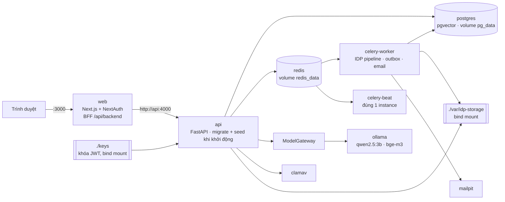

# Aureon v4 — AI-EOS (AI-First Enterprise Operating System)

> **"One Enterprise. One Source of Truth. One AI Operating Layer."**
> *CEO biết công ty đang đạt mục tiêu đến đâu, vì sao, và giao việc được ngay — với dữ liệu nhập vào dễ như gửi một file.*

**Phiên bản:** Aureon **v4 demo** = v3 AI-EOS + CRM (D-02). Môi trường: **demo nội bộ trên Docker một máy** (D-01), không phải production. Nhánh `v4/demo-readiness`. Số phiên bản API vẫn tự báo `3.0.0` (`GET /health`).

Mục lục: [Tổng quan](#1-tổng-quan) · [Kiến trúc](#2-kiến-trúc) · [Yêu cầu hệ thống](#3-yêu-cầu-hệ-thống) · [Cài đặt / dựng lại](#4-cài-đặt-lần-đầu--dựng-lại-trên-máy-mới) · [**Khởi động hằng ngày / sau khi bật máy**](#5-khởi-động-hằng-ngày--sau-khi-bật-máy) · [Truy cập](#6-truy-cập) · [Database](#7-quản-lý-database) · [Xử lý sự cố](#8-xử-lý-sự-cố) · [Phát triển & test](#9-phát-triển--kiểm-thử) · [Phiên bản & thay đổi](#10-phiên-bản--lịch-sử-thay-đổi)

---

## 1. Tổng quan

Aureon là hệ điều hành doanh nghiệp lấy AI làm trung tâm, nối vòng lặp **Capture → Data → Intelligence → Decision → Action → Measurement → Feedback**. Mọi con số truy ngược được tới bản ghi và tài liệu gốc; AI không được bịa số (grounding). Dữ liệu demo là công ty giả định **TNHH TM&DV ABC** (~150 nhân sự, 7 phòng ban), ngày nghiệp vụ cố định **20/10/2026**.

### Module nghiệp vụ

| Module | Chức năng chính (đã triển khai) |
|---|---|
| Trang chủ & báo cáo | Dashboard Executive / Department / Employee, chỉ số sức khỏe (Metric Store), cảnh báo, drill-down tới bản ghi và tài liệu gốc, Daily Briefing, Decision Log |
| Tài chính | Doanh thu, chi phí, hóa đơn + thanh toán, ngân sách, số dư tiền, dự báo dòng tiền, runway |
| Kinh doanh & CRM | Khách hàng, deal + pipeline Kanban, hợp đồng, chỉ tiêu, funnel; **Lead, Contact, Activity**, chuyển lead thành khách hàng (v4) |
| Nhân sự & tổ chức | Cây tổ chức theo ngày hiệu lực, phòng ban, team, vị trí, nhân viên, kế hoạch tuyển dụng có phê duyệt |
| Mục tiêu & công việc | Chiến lược, OKR, KPI, check-in, task, dự án, workload, họp, lịch, phê duyệt |
| Sản phẩm, Rủi ro | Đóng băng phát triển (R-DEC-16); quản lý bản ghi qua trang dữ liệu (v4) |
| Thu thập dữ liệu (IDP) | Tải tài liệu, quét malware, OCR, trích xuất bằng AI, review song song, ghi qua Action Registry, hoàn tác 7 ngày |
| AI Assistant | Chat có trích dẫn nguồn, tool lọc theo quyền người hỏi, Autonomy L0–L3 + kill switch, chạy **model local** |
| Quản trị | Người dùng, vai trò, audit log, cấu hình AI, onboarding |

**Quyền CEO (D-21):** CEO thêm, sửa, xóa được dữ liệu nghiệp vụ ở mọi module. Ràng buộc toàn vẹn vẫn giữ (ví dụ không xóa khách hàng còn deal; rủi ro, quyết định kết thúc bằng trạng thái). Ma trận đầy đủ: [deliverables/v4-demo/V4-DEMO-READINESS-REPORT.md](deliverables/v4-demo/V4-DEMO-READINESS-REPORT.md).

### Công nghệ

| Lớp | Công nghệ |
|---|---|
| Frontend | Next.js 15, React 19, TypeScript, Tailwind + shadcn/ui, TanStack Query, next-intl (VI/EN), NextAuth (BFF `/api/backend/*`) |
| Backend | Python 3.12, FastAPI, Pydantic v2, SQLAlchemy 2 async + psycopg 3, Alembic; JWT RS256 |
| Dữ liệu | PostgreSQL 16 + pgvector, Redis 7, MinIO (có trong stack, code lưu file ở `var/idp-storage`) |
| Nền | Celery worker + Celery Beat (outbox relay, job định kỳ), ClamAV, Mailpit (hộp thư dev) |
| AI | ModelGateway nội bộ → **Ollama local** `qwen2.5:3b-instruct` (chat, trích xuất), `bge-m3` (embedding) |
| Triển khai | Docker Compose (project `aureon`) |

## 2. Kiến trúc

Modular Monolith: một ứng dụng FastAPI chia module theo schema PostgreSQL; liên module qua service public hoặc event (Transactional Outbox → Celery).



| Service | Container | Port host | Phụ thuộc khi khởi động |
|---|---|---|---|
| `web` | `aureon-web-1` | 3000 | `api` healthy |
| `api` | `aureon-api-1` | 4000 | `postgres`, `redis` healthy; preflight (khóa, kho file, DB) |
| `celery-worker` | `aureon-celery-worker-1` | — | `api` healthy; preflight |
| `celery-beat` | `aureon-celery-beat-1` | — | `api` healthy; preflight |
| `postgres` | `aureon-postgres-1` | 5432 | — |
| `redis` | `aureon-redis-1` | 6379 | — |
| `ollama` | `ollama` | 11434 | — |
| `clamav` | `clamav` | 3310 | — (lần đầu tải signature vài phút) |
| `minio` | `aureon-minio-1` | 9000, 9001 | — |
| `mailpit` | `aureon-mailpit-1` | 1025 (SMTP), 8025 (UI) | — |

Mọi service có `restart: unless-stopped` và healthcheck, cùng mạng `aureon-net`.

**AI (D-11, D-19):** không provider cloud nào nhận dữ liệu nội bộ; chuỗi provider của demo chỉ có Ollama local (`MODEL_PROVIDER_PRIMARY=ollama`, không fallback). Câu trả lời kịch bản chỉ xuất hiện khi bật `AI_DEMO_REPLAY=true` và luôn mang nhãn "Kịch bản demo".

## 3. Yêu cầu hệ thống

Cấu hình đã kiểm chứng (máy demo hiện tại):

| Mục | Giá trị |
|---|---|
| Hệ điều hành | Windows + WSL2 (Ubuntu 22.04), repo nằm trong ổ WSL (`/home/...`) |
| Docker | Docker Desktop (engine 29.8), Docker Compose v2.29 trở lên (cần hỗ trợ `include`) |
| CPU, RAM | 4 CPU, 12 GB RAM cấp cho Docker; không GPU |
| Ổ đĩa | ~20 GB cho image (api 5,3 GB, ollama 8,4 GB, web 1,7 GB) + model Ollama (~4 GB) |
| Port trống | 3000, 4000, 5432, 6379, 9000, 9001, 11434, 3310, 1025, 8025 |

Với máy chỉ có CPU như trên, một lượt chat AI mất khoảng 13–67 giây (nhanh hơn khi câu hỏi lặp lại và máy rảnh). Có GPU thì có thể dùng `qwen2.5:7b-instruct`.

## 4. Cài đặt lần đầu / dựng lại trên máy mới

Dùng cho máy mới hoặc sau khi cài lại Windows. Những lần sau xem [mục 5](#5-khởi-động-hằng-ngày--sau-khi-bật-máy). Bản phát hành chuẩn là **tag `v4.0.0`** (commit `fb02460`, nhánh `v4/demo-readiness`); nhánh `main` vẫn là v3, đừng dùng.

### 4.1. Chuẩn bị máy

| Nền tảng | Cần cài |
|---|---|
| **Windows 11/10 + WSL2** | (1) PowerShell quản trị: `wsl --install -d Ubuntu-22.04`, khởi động lại. (2) Cài **Docker Desktop**, bật *Settings → Resources → WSL integration* cho Ubuntu. (3) Tạo/ sửa `%UserProfile%\.wslconfig` cấp ≥ 12 GB RAM, 4 CPU (`[wsl2]` / `memory=12GB` / `processors=4`), rồi `wsl --shutdown`. (4) Trong Ubuntu: `sudo apt update && sudo apt install -y git curl build-essential` |
| **Linux** (Ubuntu/Debian) | `sudo apt install -y git curl build-essential`, cài Docker Engine + plugin Compose v2 (`docker compose version` ≥ 2.29), `sudo usermod -aG docker $USER` rồi đăng nhập lại |

Công cụ dùng chung (chỉ cần để phát triển/kiểm thử trên host; **chạy demo bằng Docker không cần**): `uv` (`curl -LsSf https://astral.sh/uv/install.sh | sh`), Node.js 22 + `pnpm 12.6.0` (`corepack enable && corepack prepare pnpm@12.6.0 --activate`). Python 3.12 do `uv` tự cài theo `.python-version`.

> Luôn đặt repo **trong ổ WSL** (`~/Aureon`), không dưới `/mnt/c` (chậm, sai quyền file, hỏng bind mount `./keys`). Trên Windows chạy `git config --global core.autocrlf input` **trước khi clone** để script `.sh` không bị đổi sang CRLF.

### 4.2. Các bước

```bash
# 1. Mã nguồn + bản phát hành v4
git clone https://github.com/hovikhanh/Aureon.git ~/Aureon && cd ~/Aureon
git checkout v4.0.0                      # detached HEAD là bình thường; muốn commit thì: git switch -c <nhánh>

# 2. Cấu hình (.env KHÔNG nằm trong Git)
#    a) Có bản sao lưu:  cp /đường/dẫn/backup/.env .env        (xem mục 7.2)
#    b) Làm mới:        cp .env.example .env  rồi điền giá trị dev (POSTGRES_*, NEXTAUTH_SECRET,
#       DB_ENCRYPTION_KEY = `python3 -c "import secrets; print(secrets.token_hex(32))"`,
#       DEMO_*_PASSWORD, ADMIN_BOOTSTRAP_*). Giá trị có khoảng trắng/ký tự đặc biệt phải đặt trong '...'
./scripts/check_env.sh                   # chỉ in TÊN key; exit 0 = bash, dotenv và Compose đọc giống nhau

# 3. Khóa ký JWT RS256 → ./keys (gitignored)
#    a) Có bản sao lưu: tar xzf backup/aureon-secrets-*.tgz keys    b) Làm mới:
./scripts/generate_keys.sh keys          # khóa mới → mọi phiên đăng nhập cũ hết hiệu lực, KHÔNG mất dữ liệu

# 4. Build image và chạy toàn bộ stack (lần đầu lâu: tải image và image api bake sẵn model OCR)
docker compose config --quiet            # kiểm tra cấu hình hợp lệ
docker compose up -d --build

# 5. Model AI local (một lần; lưu trong volume aureon_ollama_data)
docker exec ollama ollama pull qwen2.5:3b-instruct
docker exec ollama ollama pull bge-m3

# 6. Kiểm tra
docker compose ps                        # chờ mọi service "healthy" (ClamAV lần đầu có thể mất vài phút)
curl -s localhost:4000/health/ready      # {"status":"ready", ... "signing_keys":"ok"}
```

`api` tự chạy `alembic upgrade head` rồi seed dữ liệu demo (idempotent) mỗi lần khởi động; không cần chạy migration hay seed bằng tay. Mở `http://localhost:3000` và đăng nhập (mục 6).

### 4.3. Cái gì không có trong Git

| Thành phần | Khôi phục |
|---|---|
| `.env` | Sao lưu (mục 7.2) hoặc tạo lại từ `.env.example` (bước 2) |
| `keys/*.pem` | Sao lưu hoặc `generate_keys.sh` (bước 3) |
| Dữ liệu DB (nghiệp vụ, người dùng đã nhập) | `pg_restore` từ bản dump (mục 7.2). Không có dump: dữ liệu demo tự dựng lại bằng seed, **dữ liệu nhập tay sẽ mất** |
| Model Ollama | `ollama pull` (bước 5) hoặc restore volume |
| `var/idp-storage` (file IDP đã tải lên) | Chỉ từ sao lưu (mục 7.2); tài liệu mẫu nằm ở `data/` |

## 5. Khởi động hằng ngày / sau khi bật máy

**Quy trình chuẩn (đã kiểm chứng 2026-11-09):**

1. Mở **Docker Desktop**, chờ biểu tượng báo "Engine running".
2. Các container Aureon **tự khởi động lại** (`restart: unless-stopped`). Chờ 1–2 phút.
3. Kiểm tra từ terminal WSL:

```bash
cd ~/Aureon
docker compose ps                        # 10 service "healthy"
curl -s localhost:4000/health/ready      # "status":"ready", db/redis/signing_keys "ok"
```

4. Mở `http://localhost:3000` và đăng nhập.

Mọi lệnh `docker compose ...` chạy **từ thư mục gốc repo**. `docker-compose.yml` include `docker-compose.full.yml`, nên `docker compose ...` và `docker compose -f docker-compose.full.yml ...` là một.

| Tình huống | Lệnh |
|---|---|
| Container đã dừng (`docker compose stop`, Docker Desktop đóng lâu) | `docker compose up -d` |
| Một service lỗi hoặc unhealthy | `docker compose restart <service>` (vd `api`) rồi `docker compose ps` |
| Mất kết nối giữa các service | `docker compose up -d` (tạo lại container lệch cấu hình, giữ nguyên dữ liệu) |
| Xem log | `docker compose logs -f api` (hoặc `web`, `celery-worker`, `postgres`) |
| Dừng toàn bộ (giữ dữ liệu) | `docker compose stop` |

**Về lần khởi động sau khi bật máy:** Docker Desktop có thể khởi động container trước khi ổ WSL sẵn sàng, khiến `./keys` và `./var/idp-storage` được gắn vào dưới dạng thư mục rỗng. Từ bản sửa ngày 2026-11-09, `api`, worker và beat chạy `python -m app.preflight` trước. Nếu khóa hoặc kho file chưa có, container thoát và Docker tự khởi động lại cho tới khi đủ. Nếu sau 3 phút vẫn lỗi, xem [Xử lý sự cố](#8-xử-lý-sự-cố).

**Không dùng** `docker compose down -v` (xóa volume, mất toàn bộ dữ liệu). Không cần `down` cho việc khởi động lại.

## 6. Truy cập

| Thành phần | URL |
|---|---|
| Ứng dụng web | `http://localhost:3000` |
| API | `http://localhost:4000/api/v1` |
| Tài liệu API (Swagger, OpenAPI) | `http://localhost:4000/docs`, `http://localhost:4000/openapi.json` |
| Health | `/health` (tổng), `/health/ready` (DB, Redis, khóa JWT), `/health/live`, `/metrics` |
| Hộp thư dev (Mailpit) | `http://localhost:8025` |
| MinIO console | `http://localhost:9001` |

### Tài khoản demo

Mật khẩu nằm trong `.env` (`DEMO_<ROLE>_PASSWORD`), **không** ghi ở đây. Khi `DEMO_MODE=true` và `DEMO_LOGIN_AUTOFILL=true`, trang đăng nhập có danh sách chọn nhanh tài khoản (mật khẩu được điền phía server).

| Email | Role | Khối | Trang đầu sau đăng nhập |
|---|---|---|---|
| `ceo@abc.demo` | CEO | toàn công ty | `/home` |
| `cfo@abc.demo` | DIR | F — Tài chính | `/home` |
| `sales@abc.demo` | DIR | C — Kinh doanh | `/home` |
| `hr@abc.demo` | DIR | O — Nhân sự | `/home` |
| `cpo@abc.demo` | DIR | U — Sản phẩm | `/home` |
| `manager@abc.demo` | MGR | phòng Dịch vụ | `/home` |
| `office@abc.demo` | MGR | phòng Hành chính | `/home` |
| `employee@abc.demo` | EMP | cá nhân | `/home` |
| `reviewer@abc.demo` | REV | hàng chờ review | `/data` |
| `admin@abc.demo` | ADM | cấu hình nền tảng | `/admin` |

Đăng nhập lại sau khi quyền thay đổi (quyền nằm trong token).

## 7. Quản lý database

| Việc | Lệnh / ghi chú |
|---|---|
| Dữ liệu lưu ở đâu | Volume Docker `aureon_pg_data` (Postgres), `aureon_redis_data`, `aureon_ollama_data`, `aureon_minio_data`, `aureon_clamav_data`; file tài liệu ở `./var/idp-storage` |
| Kiểm tra kết nối | `docker compose exec postgres sh -c 'pg_isready -U "$POSTGRES_USER" -d "$POSTGRES_DB"'` |
| Revision migration | `docker compose exec postgres sh -c 'psql -U "$POSTGRES_USER" -d "$POSTGRES_DB" -Atc "select version_num from platform.alembic_version"'` (hiện tại `0028_crm_leads_contacts_activity`) |
| Migration | Tự chạy khi `api` khởi động. Chạy tay: `docker compose exec api alembic upgrade head` |
| Seed dữ liệu demo | Tự chạy khi `api` khởi động, idempotent. Chạy tay: `docker compose exec api python -m app.seed` |
| Backup | `mkdir -p var/backup && docker compose exec -T postgres sh -c 'pg_dump -U "$POSTGRES_USER" -d "$POSTGRES_DB" -Fc' > var/backup/aureon-$(date +%Y%m%d-%H%M).dump` (thư mục `var/` đã gitignore) |
| Restore | `docker compose stop api celery-worker celery-beat web`, rồi `docker compose exec -T postgres sh -c 'pg_restore -U "$POSTGRES_USER" -d "$POSTGRES_DB" --clean --if-exists' < var/backup/<file>.dump`, rồi `docker compose up -d`. Restore vào một Postgres mới tinh sẽ báo 2 lỗi GRANT cho role `app_audit_writer` (role chưa tồn tại); dữ liệu vẫn được khôi phục đủ |

### 7.1. Dừng, khởi động lại, build lại, cập nhật phiên bản

| Việc | Lệnh |
|---|---|
| Dừng (giữ dữ liệu) | `docker compose stop` |
| Khởi động lại | `docker compose up -d` (hoặc `docker compose restart <service>`) |
| Build lại sau khi đổi code | `docker compose build api web && docker compose up -d --no-deps --force-recreate api celery-worker celery-beat web` |
| Build lại không cache | `docker compose build --no-cache api web` |
| Cập nhật lên phiên bản mới | **Backup trước (7.2)**, rồi `git fetch --tags && git checkout <tag mới>`, `./scripts/check_env.sh`, `docker compose up -d --build`; migration tự chạy. Quay lại: `git checkout v4.0.0`, `docker compose up -d --build` (nếu migration đã đi lên thì restore dump) |

### 7.2. Backup và restore khi chuyển máy / cài lại Windows

Làm **trước** khi cài lại, rồi chép thư mục `backup/` ra ổ ngoài hoặc cloud riêng tư (không đưa vào Git; `var/` và `.env` đã gitignore). Stack phải đang chạy.

```bash
mkdir -p ~/aureon-backup && cd ~/Aureon
# 1. Cấu hình + khóa (chứa secret: giữ nơi an toàn, không đẩy lên Git/public cloud)
tar czf ~/aureon-backup/aureon-secrets-$(date +%F).tgz .env keys
# 2. Database
docker compose exec -T postgres sh -c 'pg_dump -U "$POSTGRES_USER" -d "$POSTGRES_DB" -Fc' > ~/aureon-backup/aureon-db-$(date +%F).dump
# 3. File tài liệu IDP đã tải lên
tar czf ~/aureon-backup/aureon-idp-storage-$(date +%F).tgz var/idp-storage
# 4. (tùy chọn, ~4 GB) model Ollama để khỏi tải lại
docker run --rm -v aureon_ollama_data:/d -v ~/aureon-backup:/b alpine tar czf /b/ollama-$(date +%F).tgz -C /d .
# 5. Chắc chắn mọi nhánh/tag đã lên GitHub
git push origin --all && git push origin --tags
```

Phải đảm bảo bản sao lưu nằm **ngoài ổ đĩa sẽ bị format** (ổ WSL là một file `ext4.vhdx` trên ổ C: sẽ mất khi cài lại Windows).

**Restore trên máy mới** (sau mục 4.1 và bước 1 của 4.2):

```bash
cd ~/Aureon
tar xzf ~/aureon-backup/aureon-secrets-*.tgz              # trả .env + keys
./scripts/check_env.sh
tar xzf ~/aureon-backup/aureon-idp-storage-*.tgz          # trả var/idp-storage
docker compose up -d --build postgres                      # dựng DB rỗng trước
docker compose exec -T postgres sh -c 'pg_restore -U "$POSTGRES_USER" -d "$POSTGRES_DB" --clean --if-exists' < ~/aureon-backup/aureon-db-*.dump
docker compose up -d --build                               # dựng phần còn lại
# (tùy chọn) trả model Ollama; nếu bỏ qua thì chạy bước 5 của 4.2
docker volume create aureon_ollama_data && docker run --rm -v aureon_ollama_data:/d -v ~/aureon-backup:/b alpine tar xzf /b/ollama-*.tgz -C /d
```

Restore vào Postgres mới tinh báo 2 lỗi GRANT cho role `app_audit_writer`; dữ liệu vẫn đủ. Khi khôi phục `.env` cũ thì dùng đúng `DB_ENCRYPTION_KEY` cũ, nếu không các cột PII mã hóa không đọc được.

Lệnh **xóa dữ liệu**, chỉ dùng khi chủ động muốn:

- `docker compose down -v`: xóa mọi volume.
- `./scripts/demo_reset.sh -y`: xóa sạch dữ liệu các schema (TRUNCATE) rồi seed lại từ đầu, kể cả dữ liệu người dùng đã nhập. Hãy backup trước.

## 8. Xử lý sự cố

Luôn bắt đầu bằng: `docker compose ps` và `curl -s localhost:4000/health/ready`.

| Hiện tượng | Kiểm tra | Xử lý |
|---|---|---|
| `docker: command not found` / `Cannot connect to the Docker daemon` | Docker Desktop đã mở chưa | Mở Docker Desktop, chờ "Engine running"; container tự lên |
| Container `Exited` hoặc `Restarting` | `docker compose ps -a`; `docker compose logs --tail 100 <service>` | Sửa theo log, rồi `docker compose up -d` |
| Log có `PREFLIGHT FAILED: JWT signing keys unreadable` hoặc `IDP storage directory not writable` | `ls keys/`; `docker compose exec api ls /app/keys` | Thường gặp ngay sau khi bật máy (ổ WSL chưa sẵn sàng): container tự thử lại. Nếu `keys/` trên host trống: `./scripts/generate_keys.sh keys` (mọi phiên đăng nhập cũ hết hiệu lực). Nếu host có khóa mà container không thấy: `docker compose up -d --force-recreate api celery-worker celery-beat` |
| Web `localhost:3000` không mở | `docker compose ps web`; `docker compose logs --tail 50 web` | `docker compose up -d web`; web chỉ chạy khi `api` healthy |
| API không phản hồi | `curl -s localhost:4000/health/live`; `docker compose logs --tail 100 api` | `docker compose restart api` |
| Không đăng nhập được (lỗi 500 / "Không kết nối được") | `curl -s localhost:4000/health/ready`: `signing_keys` phải `ok`, `db` phải `ok` | `signing_keys` lỗi: xem dòng PREFLIGHT ở trên. `db` lỗi: xem dòng database bên dưới |
| Sai mật khẩu demo (401) | Mật khẩu trong `.env` có khớp tài khoản không; tài khoản bị khóa sau nhiều lần sai | Sửa `.env` (bỏ alias `DEMO_VP_SALES_PASSWORD`, `DEMO_HR_MANAGER_PASSWORD`), rồi `docker compose restart api` (seed ghi lại mật khẩu demo) |
| `db: unavailable` / lỗi kết nối database | `docker compose ps postgres`; `docker network inspect aureon-net` (mọi container Aureon phải nằm trong đó) | `docker compose up -d` (tạo lại container nằm sai mạng, giữ dữ liệu) |
| Lỗi migration | `docker compose logs api \| grep -i alembic`; xem revision ở mục 7 | Sửa nguyên nhân trong log, rồi `docker compose restart api`. Không xóa bảng bằng tay |
| AI trả lời chậm hoặc lỗi `AI_PROVIDER_TIMEOUT` | `curl -s localhost:11434/api/tags` (model `qwen2.5:3b-instruct` có trong danh sách); `uptime` (máy có đang tải nặng) | `docker exec ollama ollama pull qwen2.5:3b-instruct` nếu thiếu; tránh chạy test hay build trong lúc demo; hỏi một câu khởi động trước buổi demo |
| `port is already allocated` | `docker ps --format '{{.Names}} {{.Ports}}'`; trên Windows: `netstat -ano \| findstr :3000` | Dừng container hoặc tiến trình đang chiếm port (stack kiểm chứng `aureon-verify` dùng port khác: 3700, 4700) |
| Tài liệu tải lên đứng ở `UPLOADED`, email không gửi | `docker compose exec celery-worker celery -A app.worker inspect ping`; `docker compose logs --tail 100 celery-worker` | `docker compose restart celery-worker celery-beat` |

## 9. Phát triển & kiểm thử

### Chạy ứng dụng trên host (phát triển)

```bash
pnpm install && uv sync --extra ocr    # Python 3.12 (ghim bởi .python-version); --extra ocr cần cho mypy (numpy) và OCR paddle
docker compose up -d postgres redis minio ollama clamav mailpit   # chỉ hạ tầng, cùng định nghĩa với stack demo
uv run uvicorn app.main:app --reload --port 4000                  # API (dừng container api trước: docker compose stop api web)
pnpm dev:web                                                      # Web :3000
```

### Test

**Cảnh báo:** `pytest` đọc `DATABASE_URL` từ `.env`, tức DB demo đang chạy. Luôn chạy trên DB tạm: `docs/3.EXECUTION/16-OPERATIONS.md` §4.

```bash
# Frontend
pnpm lint && pnpm typecheck && pnpm test
# Backend (trên DB tạm)
uv run ruff check . && uv run ruff format --check . && uv run mypy
uv run pytest && uv run pytest -m contract
# E2E (stack kiểm chứng riêng, port 3700/4700): docs/3.EXECUTION/16-OPERATIONS.md §3.2, §4
```

| Bộ | Kết quả gần nhất |
|---|---|
| Backend pytest | 1709 passed, 0 failed (2026-11-09, sau bản khôi phục); contract 44 |
| Frontend Vitest | 590 passed |
| E2E Playwright (`real`, 136 test) | Lượt đầy đủ cuối 135 pass; test còn lại đã sửa, pass 2 lượt chạy riêng |

### Build và cập nhật stack

```bash
docker compose build api web
docker compose up -d --no-deps --force-recreate api celery-worker celery-beat web
```

Trước khi đưa bản mới lên stack có dữ liệu: backup (mục 7). Quy trình có hoàn tác: `docs/3.EXECUTION/16-OPERATIONS.md` §6.1.

### Kiểm tra API nhanh

```bash
curl -s localhost:4000/health
# đăng nhập → access token (thay <password> bằng mật khẩu trong .env)
curl -s -X POST localhost:4000/api/v1/auth/login -H 'content-type: application/json' \
  -d '{"email":"ceo@abc.demo","password":"<password>"}'
```

### CI (GitHub Actions)

Workflow `.github/workflows/ci.yml` chạy khi push lên `main` hoặc `v4/**`, khi push tag `v*`, mọi pull request và chạy tay (`workflow_dispatch`). Bốn job độc lập, **không** dùng secret thật (chỉ giá trị giả của CI):

| Job | Nội dung | Phiên bản |
|---|---|---|
| `secrets (gitleaks)` | quét toàn bộ lịch sử Git bằng gitleaks v8.24.3 | — |
| `web` | `pnpm lint`, `typecheck`, `test` (Vitest), `build:web` | Node 22, pnpm 12.6.0 (từ `packageManager`) |
| `api` | `uv sync --extra ocr`, ruff, ruff format, mypy, migrate + seed (2 lần), pytest + coverage ≥ 75%, contract (Postgres `pgvector/pgvector:pg16` + Redis service) | Python 3.12 (`.python-version`) |
| `docker` | `docker compose config` với `.env.example`; build image `api` và `web` (không push) | Buildx |

Chạy lại các bước tương tự ở local: lệnh trong mục "Test" phía trên. E2E Playwright cần stack đầy đủ nên **không** chạy trên CI (xem `16-OPERATIONS.md` §3.2).

### Git

Làm việc trên nhánh tính năng, Conventional Commits (`feat(scope): ...`), không commit `.env`, `keys/`, `var/`. Quy tắc đầy đủ: `CLAUDE.md` §5.10, §11.

## 10. Phiên bản & lịch sử thay đổi

| Mục | Giá trị |
|---|---|
| Phiên bản | Aureon v4 demo (API tự báo `3.0.0`) |
| Nhánh / tag | `v4/demo-readiness` · tag phát hành `v4.0.0` (`fb02460`), đã có trên GitHub |
| DB | Alembic `0028_crm_leads_contacts_activity` |
| Commit | Xem `git log --oneline -1`; mốc các đợt ghi ở bảng dưới |

| Ngày | Thay đổi | Commit |
|---|---|---|
| 2026-11-09 | **Khôi phục sau khi bật máy:** preflight khóa JWT, kho file, DB trước khi `api`, worker, beat chạy; `/health/ready` báo `signing_keys`; `docker-compose.yml` include stack đầy đủ (hết tình trạng tách hai mạng); test không phụ thuộc `.env` của host; README viết lại | `595e613`, `67c7218` + commit README |
| 2026-11-09 | CEO toàn quyền CRUD (D-21), MGR xem hóa đơn mình tạo (D-20), CRM Lead/Contact/Activity, AI local `qwen2.5:3b-instruct` (D-19), trang quản lý Sản phẩm, Rủi ro, Điều hành | `8f7ec68..cdc794a` |
| 2026-11-08 | Một ngày nghiệp vụ, số liệu Finance/Sales nhất quán, RBAC D-07, AI trung thực, Deep Navy | `15f4139..432126f` |
| 2026-11-04 | M8: CRM giai đoạn 1 | `9cad717` |

### Lỗi đã khắc phục ở bản khôi phục 2026-11-09

| Lỗi | Nguyên nhân | Sửa |
|---|---|---|
| Không đăng nhập được sau khi bật máy (HTTP 500 "JWT public key missing") | Docker Desktop khởi động container trước khi ổ WSL sẵn sàng: `./keys` gắn vào rỗng; healthcheck không kiểm khóa nên container vẫn báo healthy | `app.preflight` + kiểm `signing_keys` trong `/health/ready` |
| API mất database sau `docker compose up -d` | `docker-compose.yml` cũ định nghĩa riêng postgres/redis... cùng project `aureon` nhưng khác mạng | `docker-compose.yml` chỉ include `docker-compose.full.yml` |

### Giới hạn còn tồn tại

- Chat AI trên máy chỉ có CPU: 13–67 giây mỗi lượt khi máy đang tải.
- Trích xuất tài liệu không hiện tiến độ từng bước.
- CRM chưa có pipeline cấu hình, snapshot dự báo, deal nhiều sản phẩm.
- Hardening production (TLS, mạng, xoay secret, MFA) thuộc backlog Phase 8: [deliverables/v4-demo/10-PRODUCTION-BACKLOG.md](deliverables/v4-demo/10-PRODUCTION-BACKLOG.md).

## Tài liệu

Spec ở `docs/` (bắt đầu từ `docs/1.CONTEXT/00-INDEX.md`). Vận hành chi tiết: [docs/3.EXECUTION/16-OPERATIONS.md](docs/3.EXECUTION/16-OPERATIONS.md). Quyết định: `docs/4.GOVERNANCE/13-DECISION-LOG.md`. Truy nguyên test: `docs/4.GOVERNANCE/14-TEST-TRACEABILITY.md`. Báo cáo v4: `deliverables/v4-demo/`. Hợp đồng vận hành agent: `CLAUDE.md`.

## License

Proprietary — © CyEyes. All rights reserved. Dữ liệu demo hoàn toàn giả định (DEC-136).
