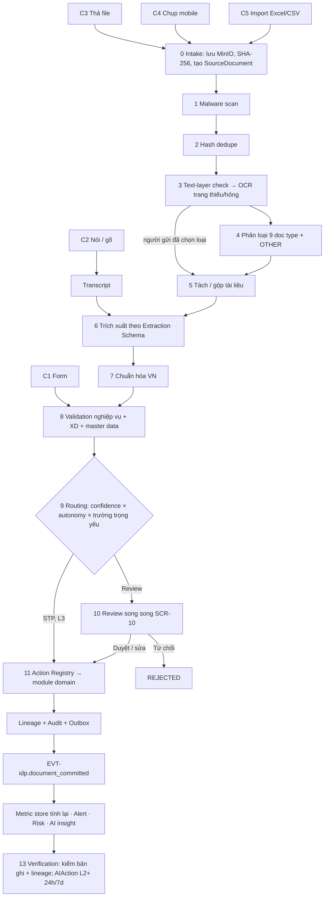
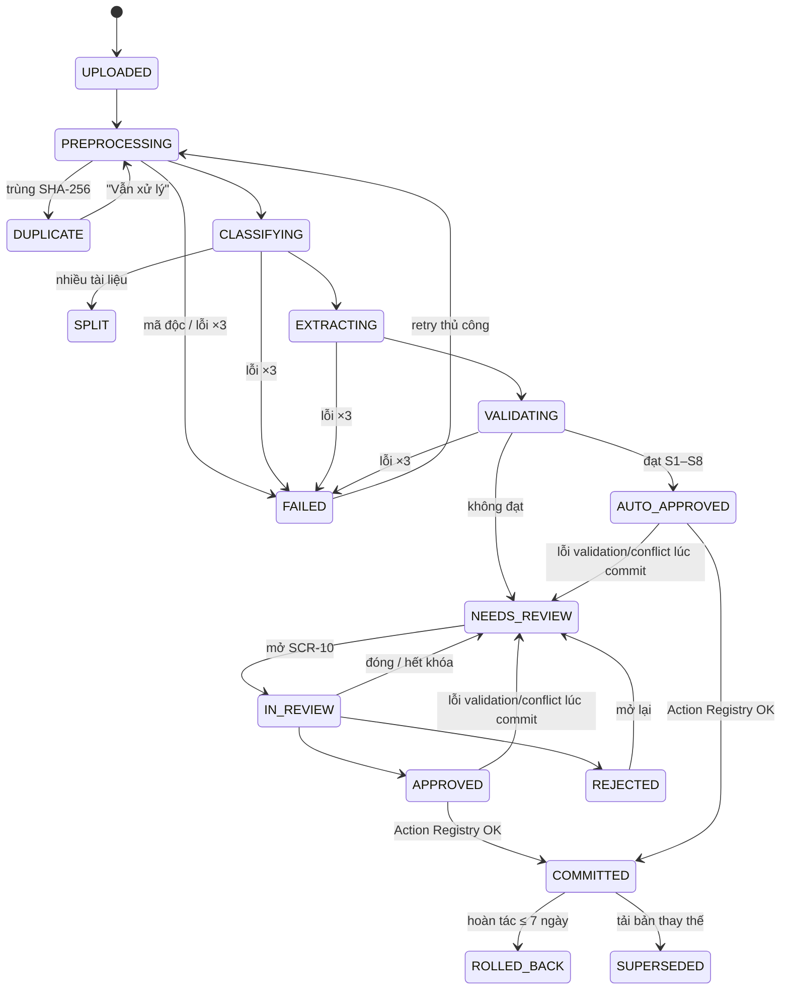

# 04 — IDP Feature Spec (D03 — Data Capture & Intelligent Document Processing)

> Đặc tả **D03 — Data Capture & IDP** (BRD §6; tên cũ "Domain 22" của AI-EOS v1.1 nháp — GAP A-02) của Aureon v2: một cửa duy nhất cho mọi dữ liệu đầu vào (nhập tay, nói, thả file, chụp ảnh, import), AI phân loại → trích xuất → chuẩn hóa → kiểm tra → định tuyến → người duyệt → ghi vào **module domain** qua **Action Registry**, có lineage đến trang tài liệu gốc.
> **Canonical Source (DEC-144):** `_reference/SOURCE-BRD-v1.1.md` §6 (D03: §6.1 kênh, §6.2 pipeline, §6.3 loại tài liệu, §6.4–6.6 FR-DC-01..23, §6.10 tool/agent), §5.2 (phân loại dữ liệu), §15 (US-DC). Mã FR-DC/US theo DEC-146 (00 §4.12–4.13); chi tiết IDP theo DEC-151; transcript mock theo DEC-153.
> Nguồn hợp nhất (DEC-124): AI-EOS `SOURCE-BRD-v1.1` §3 (Domain 22 — nay D03), §4.1 (Data Foundation), §4.2 (Autonomy), §4.5 (NĐ 13), §5.1–5.3 (EPIC R, UC-06/07/08, NFR); A-EMS `SOURCE-BRD-v1.0` §III.3 (event), §VI (entity, dữ liệu nhạy cảm); bản 04 v1.0.0 (state machine, field result, Action Registry, UC-07, prompt injection, chuẩn hóa VN, XD rules — lưu ở nhánh `v1`).
> Quyết định áp dụng: DEC-125 (Modular Monolith, schema per module), DEC-126 (outbox + Celery/Redis), DEC-128 (10 role), DEC-131 (ModelGateway đa provider), DEC-133 (confidence 3 mức), DEC-134 (hoàn tác 7 ngày / 24 giờ), DEC-016 **superseded** (bỏ `business_records`, ghi vào bảng domain).
> File này là spec nguồn cho mọi task **Code IDP** (doc loading matrix: 00, 01, 04, 05, 10). Bảng/cột vật lý thuộc `05-DATA-MODEL.md`; endpoint thuộc `10-API-SPECIFICATION.md` (dải EP-20..41); quyền thuộc `02-PERSONAS-PERMISSIONS.md`.

---

## 1. Tổng quan

IDP là **đường ống dữ liệu đầu vào** của Aureon v2 (AI-EOS §1: "không giải quyết khâu này, AI phân tích trên dữ liệu rỗng hoặc sai"). Mọi dữ liệu nghiệp vụ — dù đến từ form, câu nói, PDF scan, ảnh chụp hay Excel — đều:

1. được lưu thành một `ENT-SourceDocument` (kể cả "tài liệu ảo" của C1/C2) — **P03 Capture once, use everywhere**;
2. được chuẩn hóa theo ngữ cảnh Việt Nam — **P04 Vietnamese-first**;
3. có người chịu trách nhiệm xác nhận khi chưa đủ tin cậy hoặc chứa trường trọng yếu;
4. được ghi vào module domain (`finance`, `sales`, `hr`, `product`, `risk`, `execution`, `platform`) **chỉ qua Action Registry** — cùng quyền, autonomy, idempotency, audit và hoàn tác như mọi hành động AI;
5. truy ngược được từ con số trên dashboard → bản ghi domain → field trích xuất → trang/vùng tài liệu gốc qua `ENT-DataLineage` — **P01 Every number traceable**;
6. phát `EVT-idp.document_committed` qua outbox để metric store tính lại, Risk tự sinh rủi ro, AI làm mới insight — **P09 Event-driven**;
7. được **kiểm chứng sau khi ghi** (bước Verification §3 [13], AI-R10 — GAP D-18).

**Data Capture Agent** (BRD §6.10, GAP B-13): ở v2.0 **không** là agent riêng — hành vi "phân loại, trích xuất, kiểm tra và đề xuất ghi" do pipeline IDP (không tool calling) và profile dùng chung `assistant` đảm nhận (DEC-150; 05 ENT-AIAgentProfile). Agent **không tự ghi dữ liệu tài chính**: action liên quan tiền trần L2 (DEC-150). Agent chuyên trách là v2.1.

Mục tiêu nghiệp vụ (AI-EOS §3.1, BO-08): giảm ≥ 70% thời gian nhập liệu so với nhập tay; trường trọng yếu đạt ≥ 99% chính xác sau review; biến kho tài liệu hiện có thành dữ liệu có cấu trúc và tri thức tra cứu được.

### 1.1. Sơ đồ pipeline



Dạng văn bản (dùng cho agent không render mermaid):

```
C1 Form ─────────────────────────────────────────────────────────┐
C2 Nói/gõ ── transcript ─────────────────────────┐               │
C3 File ┐                                        │               │
C4 Ảnh  ├─► [0] Intake ─► [1] Malware scan ─► [2] Hash dedupe ─► [3] Text-layer/OCR
C5 Excel┘                                        │               │
            [4] Phân loại ─► [5] Tách/gộp ─► [6] Trích xuất ◄────┘               │
                                    ─► [7] Chuẩn hóa VN ─► [8] Validation ◄──────┘
                                    ─► [9] Routing ─┬─ STP (L3) ───────────────┐
                                                    └─ [10] Review (SCR-10) ───┤
                                    [11] Action Registry → finance/sales/hr/product/risk/execution/platform
                                    ─► Lineage + Audit + Outbox ─► EVT-idp.document_committed
                                    ─► [12] Hậu commit ─► [13] Verification (ngay + 24h/7d)
(Đã chọn trước doc type → bỏ [4], đi thẳng [5].)
```

### 1.2. Phạm vi

| Trong phạm vi v2 (MVP) | Ngoài phạm vi (Phase 2 — raise DEC nếu cần) |
|---|---|
| Kênh C1–C5 (§2) | C6 Email forwarding, C7 Zalo/Slack/Teams bot, C8 Hóa đơn XML NĐ 123/2020, C9 Drive/SharePoint sync, C10 API/Webhook |
| 9 doc type (§4) + `OTHER` (chỉ lưu, không ghi domain); **SOP/chính sách → Knowledge (BRD P0)** dạng template metadata (§4.1) | Biên lai/phiếu chi, báo giá/PO, sao kê ngân hàng, CV ứng viên, danh thiếp, bảng chấm công; **RAG** trên SOP (v2.1 — DEC-153) |
| Voice C2 dạng **mock STT** (§2.1) | STT thật (v2.1 — DEC-153, DEC-050) |
| Transcript họp upload thủ công (§12.7) | Bot Meet/Zoom/Teams, ghi âm trực tiếp, briefing trước họp (v2.1) |
| Autonomy L0–L3 + kill switch (§9) | Autonomy L4 |
| UC-06, UC-07, UC-08 bản demo (§12) | Khớp PO trong UC-08 (chưa có Procurement), đối soát sao kê |
| Data Foundation cơ bản: master data match, data quality score, freshness, lineage (§13) | Merge master data tự động không cần người; Knowledge Graph |
| — | **OUT (DEC-151):** sửa hàng loạt dạng lưới (bulk edit grid), học theo nhà cung cấp/mẫu tài liệu; **OUT (GAP B-11):** chuẩn hóa địa chỉ hành chính |
| PWA cho C4 (SCR-28) | App mobile native |
| Single-tenant (Công ty ABC) | Multi-tenant, billing, chữ ký số |

### 1.3. Thuật ngữ

| Thuật ngữ | Định nghĩa |
|---|---|
| **Doc type** | Loại tài liệu (`ENT-DocumentType`): một trong 9 loại §4 hoặc `OTHER`; Admin cấu hình được, không hard-code |
| **Extraction Schema** | Danh sách trường, kiểu, bắt buộc, trọng yếu, validation rule của một doc type (`ENT-ExtractionSchema`, có version) |
| **Field result** | Kết quả một trường: `{ value, raw_text, confidence, source_location, validation[] }` (§5.1) |
| **Trường trọng yếu** | Số tiền, số tài khoản, MST, lương, giá trị hợp đồng — **luôn** cần người xác nhận (FR-DC-16) cho tới khi được nới theo §7.4 |
| **STP** | Straight-through processing — ghi tự động không cần review (§7.3) |
| **Action Registry** | Danh mục hành động ghi dữ liệu `ACT-<name>` (§10) — cổng duy nhất để IDP (và AI Core) ghi vào module domain |
| **Lineage** | Liên kết `metric_value → bản ghi domain → extracted_field → document_page/vùng` (`ENT-DataLineage`, §13.4) |
| **Batch** | Một lần nạp nhiều tài liệu (C3 nhiều file, C5, UC-07) — `ENT-ImportBatch` |
| **Master data** | Bản ghi gốc của khách hàng (`ENT-Client`), nhân viên (`ENT-Employee`), phòng ban (`ENT-Department`), sản phẩm (`ENT-Product`) dùng để so khớp |

---

## 2. Kênh nhập liệu

### 2.1. MVP — C1–C5

| Kênh | Tên | Đầu vào | Bước pipeline áp dụng | Màn hình | Ghi chú |
|---|---|---|---|---|---|
| **C1** | Nhập thủ công qua form | Form sinh từ Extraction Schema của doc type / entity đã chọn; validate tức thì; AI gợi ý giá trị (khớp master data, cảnh báo trùng) | Bỏ [1]–[7]; chạy [8] validation; [9] routing; [11] commit | SCR-09 (tab "Nhập tay"), form trong workspace SCR-22..25 | Tạo SourceDocument `kind=MANUAL`; `confidence = 1.0`, `source_location.kind = manual`; lưu nháp (FR-DC-04); vẫn qua Action Registry |
| **C2** | Ngôn ngữ tự nhiên (gõ / nói) — **P0** (BRD §6.1, GAP B-02) | Câu text hoặc ghi âm ≤ 60 giây, VD "Ghi chi phí tiếp khách 2,5 triệu hôm qua, khách ABC"; từ thanh AI ⌘K (SCR-16) hoặc SCR-09. **Voice v2.0 = mock STT:** người dùng ghi âm/tải file WAV; ModelGateway task `stt` chạy chế độ `fixture` trả transcript dựng sẵn cho câu mẫu demo (08) — **không tích hợp STT thật**; STT thật ở v2.1 (DEC-153, DEC-050) | Voice → transcript (mock STT qua ModelGateway) → [4] intent/doc type → [6] trích xuất từ transcript → [7] → [8] → **luôn Review / Action card L2** | SCR-09 (tab "Nói/Gõ"), SCR-16 | `kind=TRANSCRIPT`; `source_location.kind = transcript` với `char_start/char_end`; **không STP** ở MVP; AI luôn hiển thị bản ghi dự kiến trước khi ghi (FR-DC-03) |
| **C3** | Tải file lên | PDF (text và scan), DOC/DOCX, JPG/PNG/HEIC/WEBP, XLS/XLSX/CSV; kéo thả 1 hoặc nhiều file, **thả ở bất kỳ màn hình nào** (drop zone toàn cục) | Đầy đủ [0] → [11] | SCR-09 (drop zone), SCR-08 theo dõi | Giới hạn §15; nhiều file một lần → một `ENT-ImportBatch` |
| **C4** | Chụp ảnh trên mobile | Ảnh từ camera trình duyệt (PWA), nhiều ảnh = nhiều trang | [0] → [1] → [3] (tự căn góc, khử nghiêng, tăng tương phản, kiểm tra độ mờ) → [4] → [11] | SCR-28 (mobile shell), SCR-09 | Blur score phía client dưới ngưỡng → đề nghị chụp lại trước khi gửi; nhiều ảnh gộp một tài liệu (FR-DC-10) |
| **C5** | Import Excel/CSV hàng loạt | XLSX/CSV theo template hoặc tự do, ≤ 5.000 dòng/sheet | [0] → [1] → [2] → **map cột** (AI gợi ý, người xác nhận ở SCR-11) → mỗi dòng một record → [7] → [8] → [9] → [11] | SCR-11 (Import grid) | `source_location.kind = cell` với `sheet/row/col`; báo lỗi theo dòng; ghi các dòng hợp lệ; xuất file lỗi (FR-DC-18) |

### 2.2. Phase 2 — C6–C10 (không build ở v2, giữ chỗ trong enum)

| Kênh | Tên | Mô tả | Lý do hoãn |
|---|---|---|---|
| C6 | Email forwarding | Hộp thư riêng theo phòng ban (vd. `invoices@…`); file đính kèm tự vào hàng xử lý đúng phòng ban (US-DC-012) | Cần mail server/integration thật (01 §3 OUT) |
| C7 | Chat integration | Gửi file vào Zalo/Slack/Teams bot | Integration thật |
| C8 | Hóa đơn điện tử XML | Đọc XML theo NĐ 123/2020 thay vì OCR PDF; chính xác tuyệt đối, có chữ ký số | Phase 2 cùng Finance đầy đủ (AI-EOS §6.1) |
| C9 | Drive / thư mục đồng bộ | Theo dõi Google Drive/SharePoint, xử lý file mới | Integration thật |
| C10 | API / Webhook | Hệ thống ngoài đẩy tài liệu hoặc dữ liệu (JSON, file) | Cần API key ngoài, multi-tenant |

Enum `input_channel` (05) chứa `C1`..`C10` để không phải migrate khi mở Phase 2; API v2 từ chối `C6`..`C10` với `VALIDATION_ERROR`.

### 2.3. Quy tắc chung cho mọi kênh

- Mọi kênh sinh cùng một `ENT-SourceDocument` (C1/C2 là tài liệu ảo lưu `manual_payload`/transcript) → P01, P03.
- Mọi kênh đi qua Validation [8] và Action Registry [11]; **không kênh nào ghi bảng domain trực tiếp**.
- Tài liệu **kế thừa quyền của người gửi và của entity đích** (AI-EOS §3.7): AI của người khác không đọc được nếu không có quyền.
- Định dạng hiển thị P04: `05/10/2026`, `1.250.000 đ` / `1,2 tỷ`, `12,5%`, MST 10 hoặc 13 số.
- Nhập tay (C1) **luôn hoạt động kể cả khi AI lỗi hoặc kill switch bật** (P08).

---

## 3. Pipeline xử lý chi tiết

| Bước | Tên | Thực thi | Input | Output | Trạng thái (§8) |
|---|---|---|---|---|---|
| 0 | Intake | API upload (FastAPI `UploadFile` + chunked read, stream thẳng lên MinIO) | File / payload | Object MinIO private bucket, `ENT-SourceDocument`, `sha256` | `UPLOADED` |
| 1 | Malware scan | Celery task `scan_document` (ClamAV — DEC-138) | Object | `scan_status` (`CLEAN` / `INFECTED` / `SKIPPED`) | `PREPROCESSING` |
| 2 | Hash dedupe | Trong task `scan_document` | `sha256` | Trùng → `duplicate_of_id` | `DUPLICATE` nếu trùng |
| 3 | Text-layer check + OCR | Celery task `preprocess_document` | File gốc | `ENT-DocumentPage[]` (`text_layer_exists`, `text_layer_quality`, `ocr_used`, `ocr_confidence`, ảnh trang, kích thước); deskew/xoay/tăng tương phản ảnh | `PREPROCESSING` |
| 4 | Phân loại | Celery task `classify_document` qua `ModelGateway` (task `MODEL_CLASSIFY`). **Bỏ qua khi `type_preselected = true`** (người gửi đã chọn doc type — DEC-151): ghi `classification_confidence = 1`, chuyển thẳng bước 5 | Text trang 1–3 + metadata | `doc_type`, `classification_confidence`, ranh giới tài liệu con | `CLASSIFYING` |
| 5 | Tách / gộp | Trong `classify_document` | Ranh giới | SourceDocument con (`parent_id`, `page_from/page_to`) hoặc gộp ảnh C4 | `CLASSIFYING` |
| 6 | Trích xuất | Celery task `extract_fields` qua `ModelGateway` (task `MODEL_EXTRACT`); chunk theo trang khi dài | Text/ảnh trang + `ENT-ExtractionSchema` (version) | `ENT-ExtractionJob`, `ENT-ExtractedField[]` | `EXTRACTING` |
| 7 | Chuẩn hóa VN | Thư viện nội bộ, không LLM (§5.2) | `raw_text` | `value` chuẩn hóa, giữ `raw_text` | `EXTRACTING` |
| 8 | Validation nghiệp vụ | Celery task `validate_extraction` (rule engine `ENT-ValidationRule`, không LLM) | Field results + master data + dữ liệu đã commit | `validation[]` gắn vào field, cờ XD (§11), kết quả master-data match (§13.1), cờ `SUSPICIOUS_CONTENT` | `VALIDATING` |
| 9 | Routing | Rule §7 + Autonomy §9 + trường trọng yếu | Confidence + validation + policy | `routing_decision` (`STP`/`REVIEW`) + `routing_reason` | `AUTO_APPROVED` / `NEEDS_REVIEW` |
| 10 | Review | Người (SCR-10) | Field results + tài liệu gốc | `ENT-ExtractionReview` | `IN_REVIEW` → `APPROVED` / `REJECTED` |
| 11 | Commit | Action Registry (§10) gọi service interface của module đích | Field đã duyệt | Bản ghi domain + `ENT-DataLineage` + `ENT-AuditLog` + `ENT-OutboxEvent` (`EVT-idp.document_committed` và event domain của action) — **một transaction** | `COMMITTED` |
| 12 | Hậu commit | Consumer của event (Celery) | Event | Metric store tính lại `ENT-MetricValue`, alert engine, Risk tự sinh rủi ro (`proposed`), AI làm mới insight, cập nhật METRIC-DQ-01 | — |
| 13 | **Verification** (AI-R10, GAP D-18) | (a) Ngay sau commit trong task `verify_commit`: đọc lại bản ghi đích qua service, kiểm số dòng `ENT-DataLineage` = số field đã commit, metric liên quan đã tính lại ≤ 60 giây; lệch → cờ data quality + thông báo người duyệt (không tự sửa). (b) Commit STP L3 / Action card L2+ có `ENT-AIAction` → kiểm expected vs actual ở **24h và 7d** (03 §7.3; Celery `verify_action_outcome`, 07) | Bản ghi + lineage + metric | `ENT-AIAction.verification`, audit `idp.verify` | — (không đổi trạng thái tài liệu) |

**Yêu cầu kỹ thuật bắt buộc:**

- Mọi LLM call (phân loại, trích xuất, STT, gợi ý mapping cột, gợi ý giá trị C1) đi qua `ModelGateway` (DEC-131); không gọi provider trực tiếp; có fallback provider theo `MODEL_PROVIDER_FALLBACKS`.
- Mọi Celery task **idempotent** theo `(document_id, step, attempt_no)`; có `time_limit` / `soft_time_limit`; `result_expires` được đặt.
- Bước [0]–[10] **chỉ ghi schema `idp`**. Chỉ bước [11] (Action Registry) ghi schema domain, qua **service interface** của module đích (DEC-125: module không ghi bảng của module khác).
- Model trả `null` khi không tìm thấy trường — không suy diễn, không bịa (§14.2).
- Mỗi bước ghi `ENT-AuditLog` khi đổi trạng thái; lỗi bước nào thì retry bước đó, không chạy lại từ đầu.

---

## 4. Loại tài liệu MVP & entity đích

Chín doc type MVP (01 §8, DEC-136) + `OTHER`. Mỗi doc type là một bản ghi `ENT-DocumentType` có Extraction Schema version hóa (§5) — Admin (`idp:admin`) thêm/sửa không cần code (US-DC-008). Mã `#1..#9` là nhãn nội bộ trùng thứ tự tài liệu mẫu ở `08-DEMO-DATA-SPEC.md`.

| # | Doc type (code) | Tài liệu mẫu ABC | Định dạng mẫu | Trụ | Entity đích (schema.bảng) | Action (§10) | Metric chịu ảnh hưởng |
|---|---|---|---|---|---|---|---|
| 1 | `FINANCIAL_REPORT` | BCTC Q3/2026 | PDF scan 12 trang, 1 trang mờ | F | `finance.revenues` (theo tháng), `finance.expenses` (giá vốn, chi phí theo nhóm), `finance.cash_positions` (số dư cuối kỳ) | ACT-record_revenue, ACT-record_expense, ACT-record_cash_position | METRIC-FIN-01, 02, 03, 06, 07 |
| 2 | `INVOICE` | Danh sách hóa đơn T9 (Excel) + hóa đơn PDF/ảnh đơn lẻ | XLSX, PDF, ảnh | F, C | `finance.invoices` + `finance.invoice_lines`; master `sales.clients`; hóa đơn đầu vào → thêm `finance.expenses` | ACT-create_invoice, ACT-record_expense, ACT-upsert_client | METRIC-FIN-01, 03, 04, 05; METRIC-CUS-03, 04 |
| 3 | `SALES_REPORT` | Báo cáo sales T9 | PDF | C | `sales.deals` (danh sách deal nếu có), `sales.sales_targets`, `platform.metric_values` (số tổng hợp không có bản ghi chi tiết) | ACT-upsert_deal, ACT-upsert_sales_target, ACT-upsert_client, ACT-upsert_metric_value | METRIC-CUS-01, 02, 04, 05, 06 |
| 4 | `CONTRACT` | Hợp đồng khách hàng (2 file) | PDF scan | C, F | `sales.contracts`; master `sales.clients` | ACT-create_contract, ACT-upsert_client | METRIC-CUS-03, 04 |
| 5 | `MEETING_MINUTES` | Biên bản giao ban (3 file), ảnh bảng trắng | DOCX, ảnh | O, S | `execution.meetings`, `execution.decisions`, `execution.tasks` | ACT-create_meeting, ACT-record_decision, ACT-create_task | METRIC-OPS-01, 03; METRIC-HR-03 |
| 6 | `EMPLOYEE_LIST` | Danh sách nhân sự ~150 người / sơ đồ tổ chức | XLSX, ảnh/PDF sơ đồ | O | `hr.departments`, `hr.employees`, `hr.salary_history` (lương) | ACT-upsert_department, ACT-upsert_employee | METRIC-HR-01, 02, 03 |
| 7 | `KPI_OKR` | Kế hoạch năm + bộ KPI/OKR Q4 | DOCX, XLSX | O + cả 5 trụ | `execution.objectives`, `execution.key_results`, `execution.kpis`, `execution.kpi_measurements` (báo cáo kết quả kỳ); `platform.metric_values` kind `TARGET` khi dòng map `METRIC-*`; `finance.budgets` khi có phần ngân sách | ACT-upsert_objective, ACT-upsert_kpi, ACT-record_kpi_measurement, ACT-upsert_metric_value, ACT-upsert_budget | METRIC-RSK-06; METRIC-FIN-06; mọi metric có target |
| 8 | `PRODUCT_REPORT` | Báo cáo chỉ số sản phẩm tháng (ABC Order, ABC Care, ABC Supply) | PDF, XLSX | U | `product.product_metrics` (snapshot chỉ thêm); `product.releases` khi có danh sách release | ACT-record_product_metric | METRIC-PRD-01, 02, 03, 05 |
| 9 | `RISK_REGISTER` | Sổ / biên bản đánh giá rủi ro quý | XLSX, DOCX | S | `risk.risks`, `risk.risk_assessments`, `risk.mitigations` | ACT-upsert_risk, ACT-create_mitigation | METRIC-RSK-01..05 |
| — | `OTHER` | Bất kỳ | Bất kỳ | — | Không ghi domain; chỉ lưu `idp.source_documents` (tra cứu) | — | — |

### 4.1. SOP / chính sách → Knowledge (BRD §6.3 P0 — GAP B-04)

- **SOP → Knowledge là P0** theo BRD. v2.0 triển khai dạng **template metadata**: tài liệu SOP/chính sách/quy trình được phân loại `OTHER` với nhãn `knowledge`, Review xác nhận 4 trường metadata (`title`, `version_label`, `effective_date`, `owner`) lưu trong `idp.source_documents.metadata`; tra cứu theo metadata qua `TOOL-search_documents` (không semantic search). Không thêm doc type thứ 10, không entity `Knowledge`/`Policy` mới.
- **RAG trên nội dung SOP hoãn v2.1** (DEC-153): khi `MODEL_EMBED` được bật (DEC-142 `bge-m3`), cùng tài liệu được embed — không cần nạp lại.
- Tài liệu SOP mới thay bản cũ → bản cũ `SUPERSEDED` (§8.1).

Quy tắc:
- Một tài liệu có thể sinh nhiều action (VD biên bản họp → 1 meeting + 4 decision + 7 task). Mọi action của một tài liệu chạy trong **một transaction** của Action Registry; một action lỗi → rollback cả tài liệu (§10.4).
- `platform.metric_values` chỉ được ghi trực tiếp (`ACT-upsert_metric_value`) cho **số tổng hợp không có bản ghi chi tiết nguồn** (VD "pipeline theo stage" trong báo cáo sales, NPS trong báo cáo). Khi có bản ghi chi tiết, metric store **tự tính** từ bảng domain — không ghi đè.
- Hóa đơn có `direction`: `OUT` (bán ra → phải thu, khách hàng `sales.clients`) hoặc `IN` (mua vào → phải trả + chi phí, UC-08). Nhà cung cấp chưa có entity master riêng (OQ-04).

---

## 5. Extraction Schema

### 5.1. Field result (bắt buộc cho mọi field)

```json
{
  "field": "total_amount",
  "value": 27500000,
  "raw_text": "27.500.000",
  "confidence": 0.93,
  "confidence_band": "HIGH",
  "is_critical": true,
  "source_location": {
    "kind": "pdf_region",
    "page": 1,
    "bbox": [0.62, 0.71, 0.88, 0.74],
    "sheet": null, "row": null, "col": null,
    "paragraph_index": null,
    "char_start": null, "char_end": null
  },
  "validation": [{ "rule": "VR-INV-04", "status": "pass" }],
  "master_match": null
}
```

| Thuộc tính | Kiểu | Bắt buộc | Mô tả |
|---|---|---|---|
| `value` | theo kiểu field / `null` | ✅ | Giá trị đã chuẩn hóa (§5.2); `null` nếu không tìm thấy — **không bịa** |
| `raw_text` | string / null | ✅ | Chuỗi gốc, phục vụ review và học từ chỉnh sửa |
| `confidence` | float 0–1 | ✅ | §7.1 |
| `confidence_band` | `HIGH` / `MEDIUM` / `LOW` | ✅ | Suy ra từ ngưỡng §7.2 (DEC-133) |
| `is_critical` | bool | ✅ | Lấy từ schema — trường trọng yếu |
| `source_location.kind` | enum | ✅ | `pdf_region` \| `image_region` \| `cell` \| `docx_paragraph` \| `transcript` \| `manual` |
| `source_location.page` + `bbox` | int + float[4] | PDF/ảnh | Trang 1-based; `[x0,y0,x1,y1]` chuẩn hóa 0–1 — SourceViewer highlight |
| `source_location.sheet/row/col` | string/int | Excel/CSV | Ô nguồn |
| `source_location.paragraph_index` | int | Word | Đoạn / ô bảng nguồn |
| `source_location.char_start/char_end` | int | C2 | Khoảng ký tự trong transcript |
| `validation[]` | `{rule, status: pass\|warn\|fail, message}` | ✅ | §5.3–5.11, §11 |
| `master_match` | `{entity, id, score, status: MATCHED\|SUGGESTED\|NEW}` / null | — | Kết quả so khớp master data (§13.1) cho field tên tổ chức/người |

Field dạng **bảng** (line items, action items, danh sách nhân sự…) trả mảng hàng; mỗi ô là một Field result đầy đủ. Mỗi hàng bảng → một bản ghi domain → một dòng lineage.

### 5.2. Kiểu dữ liệu & chuẩn hóa Việt Nam (bước [7], P04)

| Kiểu | Lưu trữ (theo 05 §1) | Hiển thị | Ví dụ nhận diện |
|---|---|---|---|
| `date` | ISO `YYYY-MM-DD` | `05/10/2026` | "05/10/2026", "5-10-26", "ngày 5 tháng 10 năm 2026", "hôm qua" (C2, theo ngày gửi) |
| `money` | `BIGINT` đơn vị nhỏ nhất + `currency` (mặc định `VND`) | `1.250.000 đ`, `1,2 tỷ` | "1.250.000", "1,25 triệu", "1.2 tỷ", "2tr5", "25 củ" (C2) |
| `percent` | `NUMERIC(7,4)` điểm phần trăm, cột hậu tố `_pct` (`12.5` = 12,5%) | `12,5%` | "12,5%", "12.5 %" |
| `tax_code` | string 10 số hoặc `10 số-3 số` | giữ nguyên | MST; kiểm tra checksum 10 số đầu |
| `phone` | E.164 `+84…` | `0912 345 678` | "0912.345.678" |
| `text` / `person_name` / `org_name` | trim, Unicode NFC; `org_name` chuẩn hóa tiền tố ("Cty", "CTY TNHH" → "Công ty TNHH") để so khớp | giữ nguyên | — |
| `enum` | code nội bộ | nhãn i18n | — |
| `period` | `YYYY-MM` / `YYYY-Qn` / `YYYY` | `T9/2026`, `Q3/2026` | "Quý III/2026", "Tháng 9", "Q3-26" |
| `number` | `NUMERIC` | `1.234,5` | dấu `.` nghìn, `,` thập phân |
| `checkbox` | boolean | ☑ / ☐ | Ô đánh dấu trong biểu mẫu (DEC-151) |
| `signature_present` | boolean + `source_location` vùng | "Có chữ ký" | Phát hiện có/không chữ ký tay — **không** xác thực chữ ký (chữ ký số OUT) |
| `stamp_present` | boolean + `source_location` vùng | "Có con dấu" | Phát hiện có/không con dấu đỏ |

Chữ **viết tay** (phát hiện qua OCR) → field `confidence` tối đa band MEDIUM và `routing_reason = HANDWRITING`: **luôn Review** (BRD FR-DC-11).

Quy tắc: số tiền có cả "1.250.000" và "1,250,000" → suy theo ngữ cảnh tài liệu (ngôn ngữ, cột khác); mơ hồ → giảm confidence × 0,85 và gắn `warn`.

### 5.3. Ký hiệu cột trong bảng schema

**Bắt buộc** ✅ = phải có để commit · **TY** = trường trọng yếu (`is_critical`, luôn qua người — §7.3 S4) · **Đích** = `schema.bảng.cột` theo 05 · Validation `VR-<TYPE>-nn` là nhãn nội bộ.

### 5.4. #1 `FINANCIAL_REPORT` — Báo cáo tài chính

| Field | Kiểu | Bắt buộc | TY | Đích | Validation |
|---|---|---|---|---|---|
| `company_name` | org_name | ✅ | | metadata | VR-FIN-01 khớp hồ sơ công ty |
| `period` | period | ✅ | | kỳ của mọi bản ghi | VR-FIN-02 không ở tương lai |
| `revenue` | money | ✅ | ✅ | tổng kiểm tra | ≥ 0 |
| `revenue_by_month[]` | table: `month`, `revenue` | — | ✅ | `finance.revenues` (`category=product_sales`, `source_note = BCTC <kỳ>` — DEC-154, C19 `source = IDP`, `revenue_date` = ngày cuối tháng) | VR-FIN-03 Σ tháng = `revenue` ±0,5%; XD-01 |
| `cogs` | money | ✅ | ✅ | `finance.expenses` (`category=cogs`) | ≥ 0 |
| `gross_profit` | money | ✅ | | kiểm tra | VR-FIN-04 `= revenue − cogs` ±0,5% |
| `operating_expenses[]` | table: `category`, `amount` | — | ✅ | `finance.expenses` (category map: salary, infrastructure, marketing, office, travel, other) | ≥ 0 |
| `net_profit` | money | ✅ | | kiểm tra | ≤ gross_profit (warn) |
| `cash_end_of_period` | money | — | ✅ | `finance.cash_positions.closing_balance` (`cash_source = imported` — DEC-154) | ≥ 0; VR-FIN-05 unique theo tháng |
| `receivables` | money | — | | kiểm tra XD-05 | ≥ 0 |

### 5.5. #2 `INVOICE` — Hóa đơn GTGT (đơn lẻ hoặc danh sách)

| Field | Kiểu | Bắt buộc | TY | Đích `finance.invoices` | Validation |
|---|---|---|---|---|---|
| `direction` | enum `OUT`/`IN` | ✅ | | `direction` | Suy từ MST người bán = MST ABC → `OUT` |
| `invoice_series` | text | — | | `series` | — |
| `invoice_number` | text | ✅ | | `number` | VR-INV-01 duy nhất `(direction, seller_tax_code, series, number)` → trùng nghiệp vụ |
| `issue_date` | date | ✅ | | `issue_date` | VR-INV-02 không ở tương lai |
| `seller_name` / `seller_tax_code` | org_name / tax_code | ✅ / ✅ | / ✅ | `counterparty_*` khi `IN` | MST 10/13 số |
| `buyer_name` / `buyer_tax_code` | org_name / tax_code | ✅ / — | / ✅ | `client_id` (master match §13.1) khi `OUT` | XD-02 |
| `subtotal` | money | ✅ | ✅ | `subtotal` | ≥ 0 |
| `vat_rate_pct` | percent | ✅ | | `vat_rate_pct` | VR-INV-03 ∈ {0, 5, 8, 10} |
| `vat_amount` | money | ✅ | ✅ | `vat_amount` | VR-INV-04 ≈ subtotal × rate (±1.000 đ) |
| `total_amount` | money | ✅ | ✅ | `total_amount` | VR-INV-05 = subtotal + vat_amount |
| `due_date` | date | — | | `due_date` | ≥ issue_date; thiếu → `issue_date + điều khoản mặc định khách hàng` (warn) |
| `payment_status` | enum `UNPAID`/`PARTIAL`/`PAID` | — | | `status` | — |
| `paid_amount` | money | khi `PARTIAL` | ✅ | `paid_amount` | `0 < paid < total` khi PARTIAL |
| `line_items[]` | table: `description`, `quantity`, `unit_price`, `amount` | — | | `finance.invoice_lines` | VR-INV-06 Σ amount ≈ subtotal |

- Danh sách Excel (#2 mẫu, 47 dòng T9): mỗi dòng → một hóa đơn, `source_location.kind = cell`.
- `direction = IN` → ngoài hóa đơn còn sinh `finance.expenses` (`invoice_id` liên kết) — UC-08.

### 5.6. #3 `SALES_REPORT` — Báo cáo sales

| Field | Kiểu | Bắt buộc | TY | Đích | Validation |
|---|---|---|---|---|---|
| `period` | period | ✅ | | kỳ | — |
| `deals[]` | table: `deal_name`, `client_name`, `stage`, `deal_value`, `probability_pct`, `expected_close_date`, `owner` | — | `deal_value` ✅ | `sales.deals` (upsert theo `(client_id, deal_name)`) | stage ∈ enum deal_stage; XD-02, XD-03 |
| `pipeline_value_by_stage[]` | table: `stage`, `deal_count`, `value` | ✅ (khi không có `deals[]`) | | `platform.metric_values` (METRIC-CUS-01 thành phần, `origin=EXTRACTED`) | value ≥ 0; nếu có `deals[]` → VR-SAL-01 Σ khớp ±1% |
| `deals_won_count` / `deals_lost_count` | int | — | | METRIC-CUS-02 (khi không có `deals[]`) | ≥ 0 |
| `revenue_by_customer[]` | table: `client_name`, `revenue` | — | | METRIC-CUS-04 | XD-02 |
| `sales_target` | money | — | ✅ | `sales.sales_targets` (`scope=team`) | > 0 |
| `nps_score` | number −100..100 | — | | METRIC-CUS-05 (`metric_values`) | Trong khoảng |

### 5.7. #4 `CONTRACT` — Hợp đồng

| Field | Kiểu | Bắt buộc | TY | Đích `sales.contracts` | Validation |
|---|---|---|---|---|---|
| `contract_number` | text | ✅ | | `contract_number` | VR-CON-01 duy nhất |
| `party_a_name` / `party_a_tax_code` | org_name / tax_code | ✅ / — | / ✅ | metadata (thường là ABC) | — |
| `party_b_name` / `party_b_tax_code` | org_name / tax_code | ✅ / — | / ✅ | `client_id` (master match) | XD-02 |
| `contract_value` | money | ✅ | ✅ | `contract_value` | > 0 |
| `sign_date` | date | ✅ | | `signed_at` | ≤ hôm nay |
| `effective_date` / `expiry_date` | date | ✅ / — | | `effective_date` / `expiry_date` | expiry ≥ effective |
| `renewal_notice_days` | int | — | | `renewal_notice_days` | ≥ 0 |
| `payment_milestones[]` | table: `due_date`, `amount`, `description` | — | `amount` ✅ | `payment_terms` (jsonb) | VR-CON-02 Σ amount ≤ contract_value |
| `signatories[]` | table: `name`, `title`, `party` | — | | metadata | — |

### 5.8. #5 `MEETING_MINUTES` — Biên bản họp (UC-06)

| Field | Kiểu | Bắt buộc | TY | Đích | Validation |
|---|---|---|---|---|---|
| `meeting_date` | date | ✅ | | `execution.meetings.held_at` | ≤ hôm nay |
| `meeting_title` | text | — | | `execution.meetings.title` | — |
| `chairperson` | person_name | ✅ | | `execution.meetings.chair_id` (master match `hr.employees`) | XD-03 |
| `attendees[]` | person_name[] | — | | `execution.meetings.attendee_ids` | XD-03 |
| `decisions[]` | table: `content`, `owner`, `rationale`, `expected_outcome`, `review_date` | — | | `execution.decisions` (Decision Log AI-EOS §4.6) | `owner` XD-03 |
| `action_items[]` | table: `title`, `assignee`, `due_date`, `linked_decision_index` | ✅ | | `execution.tasks` (mỗi hàng 1 task, `task_source = meeting` — DEC-154) | `assignee` XD-03 (bắt buộc khớp nhân viên `active`); VR-MTG-01 `due_date ≥ meeting_date`; thiếu `due_date` → `warn`, đề xuất +7 ngày |

| `risks_raised[]` | table: `title`, `category`, `owner` | — | | `risk.risks` (`risk_source = document`, trạng thái **`proposed`** — DEC-148) | `owner` XD-03; L2 |
| `issues[]` | table: `content`, `owner` | — | | `execution.tasks` (`task_source = meeting`, nhãn `issue`) | — |
| `commitments[]` | table: `content`, `owner`, `due_date` | — | | `execution.decisions` (cam kết = quyết định có `owner` + `due_date`) | Hạn mơ hồ ("tuần sau", "sớm") → `due_date = null` + `warn` **"cần xác nhận hạn"** trong Review, không tự suy |

Mỗi task lưu `source_location` của đoạn gốc → lineage "link về đoạn gốc" (US-DC-004). Biên bản có rủi ro/vấn đề/cam kết theo BRD §8 (GAP C-14); briefing trước họp là v2.1 (DEC-153).

### 5.9. #6 `EMPLOYEE_LIST` — Danh sách nhân sự / sơ đồ tổ chức

| Field (mỗi dòng) | Kiểu | Bắt buộc | TY | Đích | Validation |
|---|---|---|---|---|---|
| `employee_code` | text | ✅ | | `hr.employees.employee_code` | VR-EMP-01 duy nhất trong file + upsert theo code |
| `full_name` | person_name | ✅ | | `full_name` (**nhạy cảm**) | — |
| `email` | text | — | | `email` (**nhạy cảm**) | định dạng; duy nhất |
| `phone` | phone | — | | `phone` (**nhạy cảm**) | — |
| `position` | text | ✅ | | `position` | — |
| `department` | text | ✅ | | `department_id` (master match / `ACT-upsert_department`) | XD-03 |
| `manager_code` | text | — | | `manager_id` | Không tạo vòng quản lý (VR-EMP-02) |
| `hire_date` | date | ✅ | | `hire_date` | ≤ hôm nay |
| `termination_date` | date | — | | `termination_date` | ≥ hire_date |
| `status` | enum `probation`/`active`/`on_leave`/`terminated` | ✅ | | `status` | — |
| `contract_type` | enum | — | | `contract_type` | — |
| `date_of_birth` | date | — | ✅ | `date_of_birth` (**rất nhạy cảm**) | ≥ 15 tuổi |
| `base_salary` | money | — | ✅ | `hr.salary_history.base_salary` (**rất nhạy cảm**) | > 0 |

- Doc type này **luôn Review** (chứa dữ liệu cá nhân, NĐ 13/2023 — §14.3); không STP ở mọi autonomy.
- Kỳ vọng số nhân sự `active` của ABC ≈ 150 (DEC-136) → lệch > 10% chỉ `warn`, không chặn.
- Sơ đồ tổ chức (ảnh/PDF): chỉ trích `department`, `parent_department`, `head_name` → `hr.departments` (UC-07).

### 5.10. #7 `KPI_OKR` — Kế hoạch, OKR, KPI và báo cáo kết quả kỳ

| Field (mỗi dòng) | Kiểu | Bắt buộc | TY | Đích | Validation |
|---|---|---|---|---|---|
| `period` | period | ✅ | | kỳ | — |
| `row_kind` | enum `OBJECTIVE`/`KEY_RESULT`/`KPI`/`BUDGET_LINE` | ✅ | | chọn bảng đích | — |
| `objective_title` | text | khi OBJECTIVE/KR | | `execution.objectives.title` | — |
| `key_result_title` | text | khi KR | | `execution.key_results.title` | phải gắn objective (VR-OKR-01) |
| `metric_code` | enum `METRIC-*` | — | | `execution.kpis.metric_code` → `platform.metric_values` kind `TARGET` | XD-04 tồn tại trong 32 metric |
| `baseline` / `target_value` | number/money/percent | ✅ (target) | ✅ khi money | `key_results.baseline/target` hoặc `kpis.target_value` | VR-OKR-02 đơn vị khớp metric |
| `actual_value` | number | — | | `execution.kpi_measurements.actual_value` (báo cáo kỳ) | — |
| `unit` | text | — | | `unit` | — |
| `owner` | person_name | ✅ | | `owner_id` | XD-03 |
| `department` | text | — | | `department_id` | XD-03 |
| `budget_amount` | money | khi BUDGET_LINE | ✅ | `finance.budgets.allocated_amount` (`fiscal_year`, `quarter`, `department_id`) | > 0 |

- AI đề xuất cây alignment Objective → KR → KPI và **phát hiện KR thiếu task** (AI-EOS §3.4) — gợi ý L1, không tự tạo task.
- Objective/KPI tạo ở trạng thái `draft`; người duyệt kích hoạt (US-DC-005).

### 5.11. #8 `PRODUCT_REPORT` — Báo cáo chỉ số sản phẩm

| Field | Kiểu | Bắt buộc | TY | Đích | Validation |
|---|---|---|---|---|---|
| `product_name` / `product_code` | text | ✅ | | `product_id` (master match `product.products`) | VR-PRD-01 sản phẩm tồn tại; không tạo sản phẩm mới qua IDP |
| `period` | period `YYYY-MM` | ✅ | | `product.product_metrics.period` | VR-PRD-02 snapshot chỉ thêm — kỳ đã có → `warn` "bản ghi mới thay thế hiển thị", không sửa bản cũ |
| `mau` / `dau` | int | ✅ / — | | `mau` / `dau` | `dau ≤ mau` |
| `adoption_rate_pct` | percent | — | | `adoption_rate_pct` | 0–100 |
| `churn_rate_pct` | percent | ✅ | | `churn_rate_pct` | 0–100; BR-PRD-01 bất thường → `EVT-product.metric_anomaly` sau commit |
| `retention_30d_pct` | percent | — | | `retention_30d_pct` | 0–100 |
| `nps` | number −100..100 | — | | `nps` | — |
| `arpu` | money | — | | `arpu` | ≥ 0 |
| `releases[]` | table: `release_version`, `released_at`, `features[]` | — | | `product.releases` (gợi ý, L1) | `release_version` duy nhất theo sản phẩm (DEC-154) |

### 5.12. #9 `RISK_REGISTER` — Sổ / biên bản đánh giá rủi ro

| Field (mỗi dòng) | Kiểu | Bắt buộc | TY | Đích | Validation |
|---|---|---|---|---|---|
| `risk_code` | text | — | | `risk.risks.code` (upsert theo code; thiếu → sinh mới) | duy nhất |
| `title` | text | ✅ | | `title` | — |
| `category` | enum 13 danh mục `risk.risk_category` (DEC-148: `financial`/`operational`/`strategic`/`people`/`business`/`customer`/`product`/`technology`/`security`/`compliance`/`legal`/`partner_supplier`/`ai`; giá trị cũ `market` → `business`) | ✅ | | `category` | — |
| `likelihood` / `impact` | int 1–5 | ✅ | | `likelihood` / `impact` → `risk_score = L × I`, `severity` (BR-RSK-01 ở 03) | VR-RSK-01 trong 1–5 |
| `owner` | person_name | — | | `owner_id` | XD-03; thiếu → rủi ro "chưa có chủ" (METRIC-RSK-02) |
| `status` | enum `identified`/`assessed`/`mitigating`/`monitoring`/`closed` | ✅ | | `status` | **không** nhận `accepted` qua IDP (cần `risk:approve`, BR-RSK-02) |
| `review_date` | date | — | | `review_date` | — |
| `mitigations[]` | table: `title`, `owner`, `due_date`, `status` | — | | `risk.mitigations` | owner XD-03 |
| `linked_department` | text | — | | `linked_entities.department_id` | XD-03 |

Mỗi dòng có `likelihood/impact` khác bản đang lưu → thêm `risk.risk_assessments` (lịch sử chấm điểm) và phát `EVT-risk.risk_level_changed` nếu severity đổi.

---

## 6. Yêu cầu chức năng (FR-DC-01..23, FR-DC-101..102)

**Mã theo BRD §6.4–6.6 (DEC-146).** Cột "Mã cũ" = số trong 04 v2.0.0 (00 §4.13.2) để Phase 3d tra cứu 09, 14, 10; **không dùng mã cũ** ở tài liệu mới. Ưu tiên: **P0** = bắt buộc v2.0; **P1** = trong v2 nếu kịp S4. Phạm vi v2 theo 00 §4.12. Task ở `09-BUILD-PLAN-TASKS.md` (T-4xx), test ở `14-TEST-TRACEABILITY.md`.

### 6.1. Nhập thủ công & ngôn ngữ tự nhiên (BRD §6.4)

| ID | Tên | Mô tả & tiêu chí chấp nhận | Kênh / doc type | Ưu tiên | Màn hình | Mã cũ |
|---|---|---|---|---|---|---|
| **FR-DC-01** | Form sinh từ schema | Form động từ Extraction Schema; validate tức thì client (zod) + server; tiền/ngày/MST theo §5.2 | C1 | P0 | SCR-09 | 04 |
| **FR-DC-02** | AI gợi ý & cảnh báo trùng | AI gợi ý/tự điền giá trị (khớp master data §13.1) dạng chip L1; cảnh báo bản ghi có thể trùng (số hóa đơn/hợp đồng/mã NV) **trước khi lưu** | C1 | P0 | SCR-09 | — (mới; một phần 04) |
| **FR-DC-03** | Nhập ngôn ngữ tự nhiên | Gõ ≤ 2000 ký tự hoặc **nói** ≤ 60 giây; AI nhận intent + entity đích + field → Action card L2; **chỉ ghi khi người xác nhận**. Voice v2.0 = **mock STT** (§2.1 C2) | C2 | P0 (gõ + voice mock) | SCR-09, SCR-16 | 03 |
| **FR-DC-04** | Lưu nháp | Lưu nháp form/Action card, giữ được sau khi tải lại trang; nháp nằm trong Data Inbox. **OUT: sửa hàng loạt dạng lưới (bulk edit grid)** — DEC-151 | C1, C2 | P0 (nháp) | SCR-09, SCR-08 | — (mới) |
| **FR-DC-05** | Audit & lý do sửa | Mọi chuyển trạng thái, mở tài liệu PII, sửa field ghi `ENT-AuditLog`; **sửa field tài chính** (`value_type = money` hoặc `is_critical`) **bắt buộc** `correction_reason` (05 ENT-ExtractedField) — thiếu → `422 VALIDATION_ERROR` | C1–C5 | P0 | SCR-10, SCR-14 | 22 (phần audit) |
| **FR-DC-06** | Nhập trên mobile | PWA cho tác vụ thường xuyên: chụp chứng từ (C4), nhập nhanh chi phí (C1), duyệt Action card | C1, C4 | P0 | SCR-28 | — (mới) |

### 6.2. Tải tài liệu & tiền xử lý (BRD §6.5)

| ID | Tên | Mô tả & tiêu chí chấp nhận | Kênh / doc type | Ưu tiên | Màn hình | Mã cũ |
|---|---|---|---|---|---|---|
| **FR-DC-07** | Upload, intake & đa định dạng | PDF (text, scan), DOC/DOCX, JPG/PNG/HEIC/WEBP, XLS/XLSX/CSV; DOC/XLS cũ và HEIC chuyển đổi trước khi parse (thư viện chốt ở **T-002** — DEC-151, không tự thêm dependency); định dạng khác → `415`. Giới hạn §15 (50 MB · 100 file · 300 trang); stream lên MinIO; SHA-256; tạo `ENT-SourceDocument` `UPLOADED`; trả document id ≤ 2 giây; nhiều file → `ENT-ImportBatch`; drop zone toàn cục. **EP-20 nhận `files[]` (1..100)**; "1 file/request" của DEC-123 chỉ áp dụng luồng upload đơn C4 (ảnh gộp PDF phía client) | C3, C4, C5 | P0 | SCR-09, SCR-08 | 01, 07 |
| **FR-DC-08** | Tiền xử lý | (a) **Malware scan** mọi file (ClamAV — DEC-138): `INFECTED` → `FAILED` `status_reason=MALWARE`, bucket cách ly, không render, audit, báo Admin. (b) **Trùng hash** → `DUPLICATE` liên kết tài liệu gốc ("Vẫn xử lý" ghi audit). (c) **Text-layer & OCR**: kiểm `text_layer_exists` + chất lượng **trước** OCR; chỉ OCR trang thiếu/hỏng; ảnh xoay/khử nghiêng/tăng tương phản; tách trang; lưu `ocr_used`, `ocr_confidence` từng trang | C3–C5 | P0 | SCR-08 | 02, 05 (phần hash), 06 |
| **FR-DC-09** | Phân loại | 9 doc type + `OTHER` với `classification_confidence`; < 0,80 → người chọn trong Review; mục tiêu đúng ≥ 95%. **Người gửi chọn trước doc type → bỏ qua bước phân loại** (`type_preselected = true`, `classification_confidence = 1`; DEC-151) | C2–C5 | P0 | SCR-09, SCR-10 | 08 |
| **FR-DC-10** | Tách / gộp tài liệu | Một PDF nhiều tài liệu → SourceDocument con (`parent_id`, dải trang); nhiều ảnh C4 → gộp một tài liệu; người duyệt chỉnh ranh giới | C3, C4 | P0 | SCR-10 | 09 |
| **FR-DC-11** | Trích trường & bảng | Trích field theo `ENT-ExtractionSchema` version hiện hành; bảng (line items, action items, danh sách NV, deal, sổ rủi ro) mỗi ô một Field result; **checkbox, chữ ký, con dấu** (`checkbox`, `signature_present`, `stamp_present` — §5.2); **chữ viết tay luôn Review**; chunk theo trang khi dài | C2–C5 | P0 | — | 10, 11 |
| **FR-DC-12** | Field result đầy đủ | Mỗi field `{value, confidence, source_location, raw_text}` (§5.1); không tìm thấy → `null`, không bịa (§14.2) | C2–C5 | P0 | SCR-10 | — (thuộc 10 cũ) |
| **FR-DC-13** | Chuẩn hóa Việt Nam | §5.2; lưu `raw_text` song song. **OUT: chuẩn hóa địa chỉ hành chính** (GAP B-11) | C1–C5 | P0 | — | 12 |
| **FR-DC-14** | Kiểm tra nghiệp vụ & nhất quán | Rule `ENT-ValidationRule` (tổng = thành phần, MST, ngày, enum, unique) + XD-01..07 (§11) + master data (§13.1); **trùng nghiệp vụ** (hóa đơn/hợp đồng/mã NV) → cờ `BUSINESS_DUPLICATE`, chặn STP; kết quả `pass/warn/fail` gắn vào field, cờ conflict kèm link đối chiếu | C1–C5 | P0 | SCR-10, SCR-12 | 13, 14, 05 (phần nghiệp vụ) |

### 6.3. Định tuyến, ghi & review (BRD §6.6)

| ID | Tên | Mô tả & tiêu chí chấp nhận | Kênh / doc type | Ưu tiên | Màn hình | Mã cũ |
|---|---|---|---|---|---|---|
| **FR-DC-15** | Routing | §7 + §9 quyết định STP hay Review theo confidence × doc type × trường; ghi `routing_reason` (VD `LOW_CONFIDENCE:total_amount`, `CRITICAL_FIELD`, `XD-01_CONFLICT`, `KILL_SWITCH`, `HANDWRITING`) | C1–C5 | P0 | SCR-08 | 15 |
| **FR-DC-16** | Trường trọng yếu | Field `is_critical` luôn cần người xác nhận (kể cả confidence cao) cho tới khi được nới theo §7.4 | C1–C5 | P0 | SCR-10 | 16 |
| **FR-DC-17** | Ghi qua Action Registry | Ghi bản ghi domain chỉ qua `ACT-*` (§10), một transaction gồm bản ghi + lineage + audit + outbox; phát `EVT-idp.document_committed`; metric store tính lại; sau đó **Verification** (§3 bước 13) | — | P0 | SCR-07, SCR-08 | 21 |
| **FR-DC-18** | Import Excel/CSV | AI gợi ý map cột → field (kèm confidence); người xác nhận/sửa; lưu template mapping theo doc type; **xem trước 50 dòng** (đồng bộ 06 §4.6 và 10 EP-23 — GAP B-19); lỗi theo dòng; ghi dòng hợp lệ, xuất file dòng lỗi | C5 | P0 | SCR-11 | 18 |
| **FR-DC-19** | Review song song | Trái: SourceViewer highlight `bbox`/ô/đoạn; phải: form field; click field ↔ nhảy vùng nguồn; validation/XD/master match; ≤ 60 giây cho hóa đơn 6 trường; khóa mềm 15 phút | — | P0 | SCR-10 | 19 |
| **FR-DC-20** | Màu confidence & bàn phím | Màu + biểu tượng theo band §7.2; nút **"Chấp nhận tất cả HIGH"** (xác nhận mọi field band HIGH **không** trọng yếu — một lượt EP-30; GAP B-20); phím tắt theo 06 §4.5 | — | P0 | SCR-10 | — (một phần 19) |
| **FR-DC-21** | Hàng chờ, SLA, nhắc & escalation | Data Inbox theo phòng ban/vai trò, ưu tiên (conflict > trường trọng yếu > low confidence > cũ nhất); SLA mặc định 1 ngày làm việc; **nhắc** khi còn 25% SLA; **quá SLA → escalation** (`ENT-ReviewAssignment.kind = ESCALATE` + `EVT-idp.review_escalated`, §8.3); chỉ hiện tài liệu người dùng có `idp:approve` trong phạm vi | — | P0 | SCR-08 | 17 |
| **FR-DC-22** | Duyệt, sửa, từ chối, chuyển | Approve toàn bộ/từng field; sửa lưu cả giá trị AI và người (`corrected_value`, `correction_reason` — FR-DC-05); từ chối bắt buộc lý do; **đổi doc type, tách/gộp, chuyển người duyệt** (`ACT-reassign_review`, `ACT-merge_review` — §8.3); four-eyes với trường trọng yếu (tắt được ở demo) | — | P0 | SCR-10 | 20 |
| **FR-DC-23** | Xem tài liệu gốc | Link "Xem tài liệu gốc" ở mọi bản ghi/metric có lineage; AI trả lời trích đúng trang/vùng (source chip → SourceViewer) | — | P0 | SCR-07, SCR-16 | — (US-DC cũ 011) |
| **FR-DC-101** | Hoàn tác commit | Commit reversible hoàn tác ≤ 7 ngày (DEC-134) → `ROLLED_BACK`, `EVT-idp.document_rolled_back`, metric tính lại; chặn khi bản ghi đích đã sửa (`CONFLICT_STATE`) | — | P0 | SCR-08, SCR-17 | 22 (phần hoàn tác) |
| **FR-DC-102** | Cấu hình & học từ chỉnh sửa | Admin (`idp:admin`) thêm/sửa doc type, schema (version), validation rule, ngưỡng confidence/STP theo doc type × field, autonomy (qua `ai:admin`) **không cần code**; thống kê accuracy/STP/thời gian review/chi phí theo doc type × field; đề xuất nới ngưỡng theo §7.4. **OUT: học theo nhà cung cấp/mẫu tài liệu** (DEC-151, GAP B-14) | — | P0 | SCR-27, SCR-15 | 23 |

**Yêu cầu phi chức năng IDP** (nhãn nội bộ `NFR-IDP-xx`; NFR toàn hệ thống ở 07):

| Nhãn | Yêu cầu | Ngưỡng |
|---|---|---|
| NFR-IDP-01 | Thời gian trích xuất tài liệu ≤ 5 trang | p95 ≤ 60 giây (AI-EOS §5.3); ≤ 3 phút với 50 trang; bất đồng bộ, thông báo khi xong |
| NFR-IDP-02 | Thông lượng | ≥ 1.000 trang/giờ ở môi trường demo (mở rộng ngang bằng thêm worker) |
| NFR-IDP-03 | Độ bền | Lỗi một tài liệu không hỏng batch; retry 3 lần (5s/30s/120s) |
| NFR-IDP-04 | Bảo mật | MinIO private bucket, mã hóa at-rest; presigned URL ≤ 15 phút; TLS khi truyền |
| NFR-IDP-05 | Khả dụng | Model chính lỗi → fallback provider; tất cả provider lỗi → tài liệu `FAILED` "cần nhập tay", C1 vẫn chạy |
| NFR-IDP-06 | Chế độ demo offline | Fixture/replay extraction cho tài liệu mẫu 08 khi `DEMO_MODE` và không có model (DEC-049) |
| NFR-IDP-07 | UC-07 batch mẫu | Xử lý tự động ≤ 5 phút; toàn luồng onboarding ≤ 15 phút (01 §4) |
| NFR-IDP-08 | Chi phí / tài liệu (GAP B-15) | Ghi chi phí model (`ENT-ModelCallLog.estimated_cost_micro_usd`) theo `source_document_id`; hiển thị chi phí TB/tài liệu theo doc type ở SCR-15 (EP-39 bổ sung trường `avg_cost_micro_usd` — Phase 3d); cảnh báo ngân sách 80% (07) |

---

## 7. Confidence & định tuyến STP / Review

### 7.1. Cách tính

- **Field confidence** = `min(model_confidence, ocr_region_confidence)` × hệ số validation (`pass` 1,0 · `warn` 0,85 · `fail` 0,5).
  - `ocr_region_confidence = 1,0` khi lấy từ text layer gốc, ô Excel hoặc form C1.
  - Master match `SUGGESTED` (§13.1) → × 0,9 cho field tên.
- **Classification confidence**: xác suất doc type từ model.
- **Document confidence** = min confidence của các field **bắt buộc**.
- Confidence chưa được hiệu chỉnh với thực tế (AI-EOS §4.4) → UI hiển thị **band** (Cao/Trung bình/Thấp) kèm lý do, không hiển thị % trần cho người dùng nghiệp vụ.

### 7.2. Ba mức confidence (DEC-133)

| Band | Ngưỡng mặc định | Token màu (06) | Hành vi Review |
|---|---|---|---|
| `HIGH` — Cao | ≥ 0,90 | `ai-confidence-high` + biểu tượng ● | Điền sẵn; không bắt buộc kiểm tra (trừ trường trọng yếu) |
| `MEDIUM` — Trung bình | 0,60 – < 0,90 | `ai-confidence-medium` + ◐ | Điền sẵn, đánh dấu "nên kiểm tra"; focus tự động |
| `LOW` — Thấp | < 0,60, hoặc `value = null` với field bắt buộc | `ai-confidence-low` + ○ | Bắt buộc người xác nhận/nhập trước khi Approve |

Ngưỡng là **biến cấu hình theo doc type × field** (`ENT-ExtractionSchema.thresholds`), Admin chỉnh ở SCR-27. Màu luôn đi kèm biểu tượng (không dùng màu đơn thuần — WCAG).

### 7.3. Điều kiện Straight-through (tất cả phải đúng)

| # | Điều kiện |
|---|---|
| S1 | Autonomy hiệu lực của `ACT-*` đích × role người gửi × giá trị = **L3** (§9) và kill switch **tắt** |
| S2 | `classification_confidence ≥ 0,95` |
| S3 | Mọi field bắt buộc có `value ≠ null` và `confidence ≥ 0,90` (band HIGH) |
| S4 | Không có field `is_critical` chưa được nới (§7.4) |
| S5 | Không có validation `fail`; không có XD mức `blocking`; master match không ở `SUGGESTED` cho entity bắt buộc |
| S6 | Không trùng nghiệp vụ (FR-DC-14) |
| S7 | Kênh ≠ C2 (C2 luôn L2 ở v2), doc type ≠ `EMPLOYEE_LIST` (dữ liệu cá nhân), không có field viết tay (`HANDWRITING`) |
| S8 | Không có cờ `SUSPICIOUS_CONTENT` (§14.1) |

Không đạt bất kỳ điều kiện nào → `NEEDS_REVIEW` + `routing_reason`. Lưu ý: với cấu hình mặc định, mọi doc type có trường tiền đều qua Review (S4) — STP chỉ xảy ra với doc type/field đã được nới hoặc không có trường trọng yếu (VD biên bản họp → task nội bộ).

### 7.4. Nới ngưỡng tự ghi (học từ chỉnh sửa — AI-EOS §3.8)

Một cặp doc type × field (kể cả trường trọng yếu) chỉ được bỏ khỏi "luôn review" khi **đồng thời**:
1. Accuracy (giá trị AI = giá trị sau review) ≥ **98%** trên ≥ **200** tài liệu gần nhất;
2. Error leakage hậu kiểm của field < 0,5%;
3. Admin (`idp:admin` + `ai:admin`) duyệt thay đổi; ghi audit + DEC nếu là trường trọng yếu tài chính.

Hệ thống tự **đề xuất** khi đạt điều kiện 1–2 (insight L1 cho Admin), không tự nới. Chỉnh sửa của reviewer được lưu làm dữ liệu đánh giá (`ENT-ExtractedField.corrected_value`) — không fine-tune model ở v2.

---

## 8. Trạng thái tài liệu (state machine)

### 8.1. `document_status`

| Trạng thái | Ý nghĩa | Nhãn AI hiển thị (P02, 06) |
|---|---|---|
| `UPLOADED` | Đã nhận, chờ xử lý | — |
| `PREPROCESSING` | Quét mã độc, dedupe, text layer/OCR | "AI đang đọc tài liệu" (bước thật) |
| `CLASSIFYING` | Phân loại, tách/gộp | "AI đang phân loại" |
| `EXTRACTING` | Trích xuất + chuẩn hóa | "AI đang trích xuất" |
| `VALIDATING` | Kiểm tra + đối chiếu | "AI đang đối chiếu" |
| `NEEDS_REVIEW` | Chờ người duyệt | **AI soạn · chờ xác nhận** (L2) / **AI gợi ý** (L1) |
| `IN_REVIEW` | Có người mở Review (khóa mềm 15 phút) | như trên |
| `AUTO_APPROVED` | Đạt STP, đang commit | **AI đã làm** (L3) |
| `APPROVED` | Người đã duyệt, đang commit | — |
| `COMMITTED` | Đã ghi vào module domain | "AI đã làm · hoàn tác được" (STP) / "Đã duyệt bởi …" |
| `REJECTED` | Bị từ chối (có lý do) | — |
| `FAILED` | Lỗi sau 3 lần retry, mã độc, hoặc AI tắt | "AI không xử lý được — cần nhập tay" |
| `DUPLICATE` | Trùng hash | — |
| `ROLLED_BACK` | Commit đã hoàn tác | — |
| `SUPERSEDED` | Đã có bản thay thế (`superseded_by_id`, DEC-151); bản ghi domain giữ lineage tới bản cũ | "Đã có bản mới" |
| `SPLIT` | Tài liệu cha đã tách thành tài liệu con (không xử lý tiếp) | — |

### 8.2. Chuyển trạng thái



| Từ | Đến | Trigger | Actor (permission theo 02 §5) |
|---|---|---|---|
| `UPLOADED` | `PREPROCESSING` | Worker nhận job | System |
| `PREPROCESSING` | `DUPLICATE` | Trùng SHA-256 | System |
| `DUPLICATE` | `PREPROCESSING` | "Vẫn xử lý" | Người gửi (`idp:write`) — ghi audit |
| bước xử lý | bước kế / `SPLIT` | Hoàn tất bước | System |
| bước xử lý | `FAILED` | Lỗi sau 3 retry, `INFECTED`, kill switch L0 | System |
| `FAILED` | `PREPROCESSING` | Retry thủ công | `idp:approve` trong phạm vi |
| `VALIDATING` | `AUTO_APPROVED` / `NEEDS_REVIEW` | §7.3 | System |
| `NEEDS_REVIEW` | `IN_REVIEW` | Mở SCR-10 | `idp:approve` trong phạm vi |
| `IN_REVIEW` | `APPROVED` / `REJECTED` | Approve / Reject + lý do | Người đang giữ khóa |
| `IN_REVIEW` | `NEEDS_REVIEW` | Đóng không lưu / hết 15 phút | System |
| `APPROVED`/`AUTO_APPROVED` | `COMMITTED` | Action Registry thành công | System |
| `APPROVED`/`AUTO_APPROVED` | `NEEDS_REVIEW` | Action trả `BUSINESS_RULE_VIOLATION`/conflict | System |
| `REJECTED` | `NEEDS_REVIEW` | Mở lại | `idp:approve` trong phạm vi |
| `COMMITTED` | `SUPERSEDED` | Người gửi tải bản thay thế và chọn "Thay thế bản cũ"; bản mới chạy pipeline bình thường | `idp:write` (người gửi) hoặc `idp:approve` trong phạm vi |
| `COMMITTED` | `ROLLED_BACK` | Hoàn tác ≤ 7 ngày (DEC-134) | `idp:approve` trong phạm vi; AI L3 do `ai:write` hoàn tác qua feed SCR-17 |

**Phạm vi `idp:approve`** (02 §5.3 — nguồn chuẩn):

| Role | Phạm vi duyệt |
|---|---|
| ROLE-05 REVIEWER | Mọi doc type, mọi trụ (●) |
| ROLE-02 CFO | `FINANCIAL_REPORT`, `INVOICE` (trụ F) |
| ROLE-04 HR_MANAGER | `EMPLOYEE_LIST` và field nhân sự của `KPI_OKR` |
| ROLE-08 MANAGER | Tài liệu của phòng ban mình, **không** gồm trường trọng yếu (trường trọng yếu do REVIEWER hoặc CFO/HR_MANAGER của trụ tương ứng) |
| CEO, VP_SALES, CPO, RISK_MANAGER, EMPLOYEE, ADMIN | **Không** duyệt extraction (tách người quyết khỏi người nhập; DEC-041, DEC-042 phương án A) |

Hệ quả: `SALES_REPORT`, `CONTRACT`, `PRODUCT_REPORT`, `RISK_REGISTER`, `MEETING_MINUTES` do REVIEWER (hoặc MANAGER của phòng ban phát sinh, với field không trọng yếu) duyệt. Đề xuất mở `idp:approve ◑p` cho CPO/RISK_MANAGER ghi ở OQ-05.

Trạng thái kết thúc: `COMMITTED`, `REJECTED`, `ROLLED_BACK`, `DUPLICATE`, `SPLIT`, `SUPERSEDED`. Mọi chuyển trạng thái ghi `ENT-AuditLog`.

### 8.3. Giao việc review, chuyển người, gộp & escalation (DEC-151 — GAP B-06, B-07)

Lịch sử giao review lưu ở `ENT-ReviewAssignment` (05, append-only; **không có entity `EscalationEvent`** — một escalation = một dòng `kind = ESCALATE`).

| Hành động | Ai | Hiệu ứng | Ghi |
|---|---|---|---|
| `ASSIGN` (tự động) | System | Khi vào `NEEDS_REVIEW`: giao theo phòng ban người gửi × phạm vi `idp:approve` (§8.2); `due_at = now + SLA` (mặc định 1 ngày làm việc, cấu hình theo doc type) | `ENT-ReviewAssignment` `kind = ASSIGN` |
| `ACT-reassign_review` | Reviewer đang được giao hoặc trưởng phòng | Chuyển sang người khác có `idp:approve` đúng phạm vi; bắt buộc lý do; giữ SLA gốc | `kind = REASSIGN`, audit `idp.review.reassign`, `ENT-Notification` cho người nhận |
| `ACT-merge_review` | Reviewer | Gộp nhiều tài liệu cùng doc type/batch (VD 3 trang hóa đơn bị tách nhầm) thành một lượt review: tài liệu con nối vào một `ENT-SourceDocument` cha (đảo ngược của tách — FR-DC-10); chỉ khi tất cả `NEEDS_REVIEW` | audit `idp.review.merge` |
| Nhắc | System (job SLA mỗi 15 phút) | Còn 25% SLA → thông báo người được giao | `ENT-Notification` |
| `ESCALATE` | System | Quá `due_at` → giao lên trưởng phòng hoặc `escalate_to` của doc type; phát `EVT-idp.review_escalated`; quá tiếp 1 SLA → escalate lên CEO/CFO theo trụ | `kind = ESCALATE`; event payload theo 05 §5 |

`ACT-reassign_review`, `ACT-merge_review` là action nội bộ module `idp` (không ghi domain) — bổ sung §10.2; endpoint: **EP-126** (reassign), **EP-127** (merge) — 10 §3.12 (dải EP-20..41 đã kín).

---

## 9. AI Autonomy L0–L4 áp cho IDP (AI-EOS §4.2)

| Level | Tên | Hành vi trong IDP | Mẫu UI cố định (06) | Ví dụ IDP |
|---|---|---|---|---|
| **L0** | Inform | AI chỉ thông báo/tóm tắt, không chuẩn bị dữ liệu; IDP chạy chế độ "chỉ nhập tay C1" | Insight card | Kill switch L0: AI tắt, form trống |
| **L1** | Suggest | AI phân loại + gợi ý giá trị dạng chip; form để trống, người chủ động chấp nhận từng gợi ý | Suggestion chip | Gợi ý tạo release từ `PRODUCT_REPORT`; gợi ý KR thiếu task |
| **L2** | Draft & Confirm | AI điền sẵn toàn bộ; người Approve/Sửa/Reject | Action card / SCR-10 | Hóa đơn, BCTC, hợp đồng, nhân sự, C2 |
| **L3** | Act & Notify | Đạt S1–S8 → commit tự động; thông báo + **Hoàn tác** (undo toast 10 giây + feed SCR-17) | Undo toast + feed "AI đã làm" | Task nội bộ từ biên bản họp |
| L4 | Autonomous | **Không bật ở v2** | — | — |

### 9.1. Cấu hình (`ENT-AutonomyPolicy`, schema `ai`)

- Level cấu hình theo **`ACT-*` × role người gửi × ngưỡng giá trị** (AI-EOS §4.2), VD: `ACT-record_expense` < 5.000.000 đ → L3 (khi đã nới trường tiền theo §7.4); ≥ 5.000.000 đ → L2 + duyệt quản lý.
- Level hiệu lực của một tài liệu = **min** level các action nó sinh ra (một action L2 kéo cả tài liệu về Review).
- Người chỉnh: ADMIN (`ai:admin`). CEO chỉ bật/tắt kill switch (`ai:admin ◑k`, 02 §5.3).
- Hạ level có hiệu lực ngay; nâng level chỉ áp dụng cho tài liệu mới. Mọi thay đổi ghi audit.

**Mặc định seed v2:**

| Action | Mặc định | Tối đa | Ghi chú |
|---|---|---|---|
| ACT-create_task, ACT-create_meeting, ACT-record_decision | L3 | L3 | Nội bộ, hoàn tác được — UC-06 |
| ACT-record_kpi_measurement, ACT-record_product_metric | L2 | L3 | |
| ACT-create_invoice, ACT-record_expense, ACT-record_revenue, ACT-record_cash_position, ACT-upsert_budget | L2 | L3 | Trường tiền trọng yếu → thực tế L2 cho tới §7.4 |
| ACT-create_contract, ACT-upsert_deal, ACT-upsert_sales_target | L2 | L2 | Giá trị hợp đồng trọng yếu |
| ACT-upsert_employee, ACT-upsert_department | L2 | L2 | Dữ liệu cá nhân (NĐ 13) |
| ACT-upsert_risk, ACT-create_mitigation | L2 | L2 | |
| ACT-upsert_objective, ACT-upsert_kpi, ACT-upsert_metric_value, ACT-upsert_client | L2 | L2 | |

### 9.2. Kill switch

Một thao tác (SCR-15, `ai:admin`) tắt mọi hành động WRITE của AI:
- Mọi L3 → L2 ngay lập tức (không STP); tài liệu đang `AUTO_APPROVED` chưa commit → `NEEDS_REVIEW`.
- Chế độ mạnh (`L0`): dừng phân loại/trích xuất mới, tài liệu mới vào `FAILED` "cần nhập tay"; C1 vẫn hoạt động.
- Băng cảnh báo kill switch hiển thị toàn cục (06); bật/tắt ghi audit + `EVT-platform.alert_raised` cho ADMIN và CEO.

---

## 10. Action Registry

Action Registry là **cổng duy nhất** để IDP (và AI Core khi xác nhận action card) ghi dữ liệu nghiệp vụ. Mỗi action là một use case trong module đích, được đăng ký vào registry ở module `idp`; registry gọi **service interface** của module đích (không import repository của module khác — DEC-125). Tool Registry của AI Core (`TOOL-*`, 10) gọi lại cùng `ACT-*` cho các tool ghi.

### 10.1. Thuộc tính mỗi action

| Thuộc tính | Mô tả |
|---|---|
| `name` | `ACT-<verb>_<object>` (00 §3) |
| `module` | Module sở hữu bảng đích (`finance`, `sales`, `hr`, `product`, `risk`, `execution`, `platform`, `idp`) |
| `input_schema` | Pydantic v2 — validate lại trước khi ghi |
| `required_permission` | Permission của **người duyệt/người gửi** (02 §5): `<domain>:write` của module đích, cộng `idp:approve` khi commit từ Review |
| `autonomy` | Theo `ENT-AutonomyPolicy` (§9.1) |
| `idempotency_key` | `sha256(document_id, schema_version, action_name, row_index)` — retry không tạo bản trùng |
| `reversible` | Có/không + cách hoàn tác (soft delete / khôi phục snapshot `before`) |
| `emits` | Event domain phát qua outbox khi thành công |
| `side_effects` | Metric cần tính lại, alert cần đánh giá |
| `audit` | Luôn ghi `ENT-AuditLog` (actor `USER` hoặc `AI` `ai:idp`, before/after có mask) |

### 10.2. Danh mục action v2

| Action | Doc type / kênh nguồn | Module → bảng đích | Reversible | Event phát (ngoài `EVT-idp.document_committed`) | Metric tính lại |
|---|---|---|---|---|---|
| ACT-record_revenue | #1, C1, C2 | finance → `revenues` | ✅ soft delete | `EVT-finance.forecast_updated` (khi kỳ dự báo bị ảnh hưởng) | FIN-01, 02, 03, 07 |
| ACT-record_expense | #1, #2 (`IN`), C1, C2 | finance → `expenses` | ✅ | `EVT-finance.budget_exceeded` (khi vượt), `EVT-finance.burn_over_forecast` | FIN-02, 03, 06, 07 |
| ACT-record_cash_position | #1, C1 | finance → `cash_positions` | ✅ khôi phục bản trước | — | FIN-03 |
| ACT-create_invoice | #2, C1, C2 | finance → `invoices`, `invoice_lines` | ✅ | `EVT-finance.invoice_paid` (khi `PAID`) | FIN-01, 04, 05; CUS-03, 04 |
| ACT-upsert_budget | #7 (`BUDGET_LINE`), C1 | finance → `budgets` | ✅ | — | FIN-06 |
| ACT-upsert_client | #2, #3, #4 (master match `NEW` đã duyệt) | sales → `clients` | ✅ | — | CUS-04 |
| ACT-upsert_deal | #3, C1, C2 | sales → `deals`, `deal_stage_history` | ✅ | `EVT-sales.deal_closed_won` / `EVT-sales.deal_closed_lost` | CUS-01, 02, 06 |
| ACT-upsert_sales_target | #3, C1 | sales → `sales_targets` | ✅ | — | CUS-01, FIN-01 |
| ACT-create_contract | #4, C1 | sales → `contracts` | ✅ | — | CUS-03, 04 |
| ACT-create_meeting | #5 | execution → `meetings` | ✅ | — | — |
| ACT-record_decision | #5, C1 | execution → `decisions` | ✅ | — | OPS-03 |
| ACT-create_task | #5, C1, C2 | execution → `tasks` | ✅ | — (`EVT-execution.task_overdue` do scheduler) | OPS-01, HR-03 |
| ACT-upsert_department | #6 (sơ đồ tổ chức), C1 | hr → `departments` | ✅ | — | — |
| ACT-upsert_employee | #6, C5, C1 | hr → `employees`, `salary_history` | ✅ khôi phục snapshot | `EVT-hr.employee_onboarded` / `EVT-hr.employee_terminated` / `EVT-hr.salary_updated` | HR-01, 02, 03 |
| ACT-upsert_objective | #7 (`OBJECTIVE`, `KEY_RESULT`) | execution → `objectives`, `key_results` | ✅ | — | RSK-06 |
| ACT-upsert_kpi | #7 (`KPI`) | execution → `kpis` (+ `platform.metric_values` `TARGET` qua platform service) | ✅ | — | metric có target |
| ACT-record_kpi_measurement | #7 (báo cáo kỳ), C1 | execution → `kpi_measurements`, `check_ins` | ✅ | `EVT-execution.kpi_measured` | KPI liên kết, RSK-06 |
| ACT-record_product_metric | #8, C5 | product → `product_metrics` (append-only) | ✅ đánh dấu `superseded` (không xóa) | `EVT-product.metric_anomaly` (BR-PRD-01) | PRD-01, 02, 03 |
| ACT-upsert_risk | #9, C1 | risk → `risks`, `risk_assessments` | ✅ | `EVT-risk.risk_identified` (severity ≥ high) / `EVT-risk.risk_level_changed` | RSK-01..04 |
| ACT-create_mitigation | #9, C1 | risk → `mitigations` | ✅ | `EVT-risk.risk_mitigated` (khi risk sang `monitoring`) | RSK-03, 05 |
| ACT-upsert_metric_value | #3, #7 (số tổng hợp không có bản ghi chi tiết) | platform → `metric_values` (`origin=EXTRACTED`) | ✅ khôi phục giá trị trước | `EVT-platform.alert_raised` (nếu vượt ngưỡng) | metric đó |
| ACT-reject_document | mọi loại | idp → `source_documents.status` | ✅ (mở lại) | — | — |
| ACT-reassign_review | mọi loại (Review) | idp → `review_assignments` | ✅ (chuyển lại) | — | — |
| ACT-merge_review | mọi loại (Review) | idp → `source_documents.parent_id` | ✅ (tách lại) | — | — |
| ACT-rollback_document | mọi loại | Hoàn tác mọi action của tài liệu theo thứ tự ngược | — | `EVT-idp.document_rolled_back` + event bù trừ của từng action | Mọi metric liên quan |

### 10.3. Tool IDP (BRD §6.10 — GAP B-12)

BRD liệt kê **10 tool** của domain; Aureon v2.0 ánh xạ như sau (đặc tả input/output, lớp tool và metadata ở 10 §7.4–§7.5). IDP pipeline **không có tool calling** (§14.1 PI-03); các tool dưới đây dành cho Trợ lý AI.

| # | Tool BRD | Aureon v2.0 | Lớp (02 §7.3) | Ghi chú |
|---|---|---|---|---|
| 1 | upload_document | **TOOL-submit_document** | WRITE | Nộp tài liệu/câu C2 từ chat → pipeline |
| 2 | classify_document | Bước [4] pipeline | — (không phải tool) | READ nội bộ |
| 3 | extract_document | Bước [6] pipeline | — | READ nội bộ |
| 4 | validate_extraction | Bước [8] pipeline | — | READ nội bộ |
| 5 | submit_extraction_for_review | Bước [9] routing | — | Tự động |
| 6 | approve_extraction | EP-31 (người bấm) | — | Không cho AI gọi (FR-DC-16) |
| 7 | commit_extraction | Action Registry `ACT-*` | — | **Kế thừa autonomy/risk của action đích** (§9.1) |
| 8 | import_table | EP-23/EP-36 (người) | — | C5 |
| 9 | search_documents | **TOOL-search_documents** | QUERY | Metadata; nội dung RAG v2.1 |
| 10 | get_source_document | **TOOL-get_source_document** | QUERY | Lineage tới trang |

Không thêm `TOOL-*` mới cho IDP ở v2.0 (00 §4.8 — 43 tool).

### 10.4. Quy tắc

- **Một transaction / tài liệu:** mọi action của một tài liệu + `ENT-DataLineage` + `ENT-AuditLog` + `ENT-OutboxEvent` ghi trong một transaction PostgreSQL (các schema cùng database — DEC-125). Một action lỗi → rollback toàn bộ, tài liệu về `NEEDS_REVIEW` kèm lỗi.
- Action **không** gọi LLM; chỉ nhận dữ liệu đã validate.
- Action kiểm tra lại quyền tại thời điểm commit (token người duyệt; STP dùng quyền của người gửi + policy).
- Hoàn tác ≤ 7 ngày (DEC-134); quá hạn → chỉ sửa bằng C1/workspace domain (có audit). Hoàn tác bị chặn nếu bản ghi đích đã bị sửa sau commit (trả `CONFLICT_STATE`, hiển thị diff).
- Hoàn tác phát event bù trừ (VD hoàn tác hóa đơn `PAID` → không phát lại `invoice_paid` mà phát `EVT-idp.document_rolled_back` với danh sách bản ghi; consumer tự tính lại).
- Thêm action mới = đổi contract → cập nhật file này, 05 và 10 trước (CLAUDE.md § Cấm tự quyết).

---

## 11. Quy tắc nhất quán chéo (XD)

Chạy ở bước [8] giữa tài liệu mới ↔ tài liệu cùng batch (trạng thái ≥ `VALIDATING`) ↔ dữ liệu đã commit trong module domain (đọc qua service interface `query` của module, không đọc bảng trực tiếp). `XD-xx` là nhãn nội bộ.

| Rule | Mô tả | Đối tượng | Dung sai | Mức |
|---|---|---|---|---|
| **XD-01** | Doanh thu tháng `M` trong BCTC khớp Σ `subtotal` (**trước VAT**) hóa đơn `OUT` phát hành trong tháng `M` (DEC-030) | `FINANCIAL_REPORT.revenue_by_month[M]` ↔ Σ `INVOICE.subtotal` | ±0,5% | `blocking` |
| **XD-02** | Khách hàng trên hóa đơn / báo cáo sales / hợp đồng là cùng một `sales.clients` | `buyer_*`, `client_name`, `party_b_*` ↔ master `clients` | Ưu tiên MST chính xác; không MST → tên chuẩn hóa (bỏ "Công ty", "TNHH", dấu câu, hoa/thường) + fuzzy ≥ 0,90 | `warning` (gợi ý gộp/sửa) |
| **XD-03** | Người / phòng ban trong biên bản, KPI, sổ rủi ro, danh sách NV tồn tại trong `hr.employees` / `hr.departments` | `chairperson`, `attendees`, `assignee`, `owner`, `department` | Ưu tiên mã NV/email; không có → họ tên chuẩn hóa | `warning`; `assignee` không khớp → task chưa có người, bắt buộc chọn trong Review |
| **XD-04** | `metric_code` trong KPI/OKR tồn tại trong 32 metric (00 §4.2) | `KPI_OKR.metric_code` ↔ `platform.metrics` | Chính xác | `blocking` cho dòng đó |
| **XD-05** | Trùng nghiệp vụ: số hóa đơn, số hợp đồng, mã NV, mã rủi ro đã tồn tại (khác tài liệu đang upsert có chủ đích) | Unique key §5 | Chính xác | `blocking` (chặn STP; Review chọn "cập nhật bản cũ" hoặc "từ chối") |
| **XD-06** | Chi phí lương trong BCTC khớp tổng lương cơ bản nhân sự `active` × hệ số chi phí (cấu hình, mặc định 1,25) | `operating_expenses[category=salary]` ↔ Σ `hr.salary_history` hiện hành | ±10% | `warning` (chỉ hiển thị số tổng, không lộ lương cá nhân) |
| **XD-07** | Giá trị `actual_value` trong báo cáo KPI kỳ khớp giá trị metric store tự tính (khi KPI map `METRIC-*` có nguồn chi tiết) | `KPI_OKR.actual_value` ↔ `platform.metric_values` `ACTUAL` | ±1% | `warning` — nguồn chi tiết thắng; ghi chú chênh lệch |

Kết quả mỗi rule (`MATCH` / `MISMATCH` / `NOT_COMPARABLE`) lưu kèm hai giá trị so sánh và lineage cả hai phía (P01). Tài liệu đối chiếu đến sau → chạy lại rule cho tài liệu đến trước nếu chưa `COMMITTED`; đã `COMMITTED` → tạo cảnh báo dữ liệu (data quality, §13.2), không tự sửa.

### 11.1. XD-01 — cơ sở so sánh và kỳ (giữ từ v1, DEC-030)

| Mục | Quy tắc |
|---|---|
| Cơ sở | Doanh thu thuần **trước VAT**: phía hóa đơn luôn là Σ `subtotal`, không dùng `total_amount` |
| Phạm vi hóa đơn | `direction = OUT`, `issue_date` thuộc tháng `M` (mẫu: `2026-09`), không `REJECTED`/`ROLLED_BACK`, không trùng (XD-05) |
| Phía BCTC | Chỉ dùng `revenue_by_month[M]`; BCTC không có số tháng `M` → `NOT_COMPARABLE` ("Không đối chiếu được – cần review", không hiển thị ✓) |
| Không được làm | So doanh thu quý với hóa đơn một tháng; tự chia quý cho 3 |

---

## 12. Luồng trải nghiệm & use case

### 12.1. Review song song (SCR-10, US-DC-006)

| Vùng | Nội dung |
|---|---|
| Header | Doc type (đổi được nếu classification < 0,80), trạng thái AI, `routing_reason`, SLA còn lại, người gửi, kênh |
| Trái — SourceViewer | Trang tài liệu; highlight `bbox`/ô/đoạn của field đang focus; màu viền theo band; cảnh báo "Trang mờ" khi `ocr_confidence < 0,60`; tài liệu PII mở → ghi audit |
| Phải — Form | Field theo schema, nhóm bắt buộc/tùy chọn/bảng; mỗi field: giá trị, band (● ◐ ○), biểu tượng trọng yếu, validation, master match chip ("Khớp: Công ty Minh Phát — MST 0101234567" / "Tạo khách hàng mới?") |
| Panel cờ | XD conflict, trùng nghiệp vụ, `SUSPICIOUS_CONTENT`, giá trị so sánh + link tài liệu đối chiếu |
| Footer | Approve (khóa khi còn field LOW / trọng yếu chưa xác nhận) · Lưu nháp · Reject (bắt buộc lý do) · Bỏ qua |
| Bàn phím | `Tab`/`Enter` xác nhận field & sang field kế · `E` sửa · `J`/`K` field kế/trước · `R` từ chối · `⌘Enter` Approve |

Hiệu năng: mở tài liệu ≤ 1,5 giây; mục tiêu review hóa đơn 6 trường ≤ 60 giây (p50).

### 12.2. Import grid C5 (SCR-11, US-DC-007)

1. Tải XLSX/CSV → chọn sheet → AI đề xuất doc type / entity đích (VD `EMPLOYEE_LIST`).
2. **Map cột**: bảng `Cột nguồn → Field schema` với confidence mapping; cột không map → bỏ qua; người xác nhận/sửa; lưu template theo `(doc type, chữ ký header)` để lần sau tự áp.
3. **Xem trước** 50 dòng đã chuẩn hóa (đồng bộ 06 §4.6; 10 EP-23 `preview_rows: [50]`); lỗi theo ô tô đỏ kèm thông điệp.
4. **Kết quả validation toàn file**: N dòng hợp lệ / M dòng lỗi / K dòng trùng (XD-05) — chọn "cập nhật" hoặc "bỏ qua" cho dòng trùng.
5. Gửi: dòng hợp lệ vào routing (theo §7; `EMPLOYEE_LIST` luôn Review — Review dạng lưới, duyệt theo lô); tải file dòng lỗi (CSV có cột `error`).

### 12.3. Nhập bằng lời C2 (US-DC-002)

1. Người dùng gõ/nói trong thanh AI ⌘K hoặc SCR-09: *"Ghi chi phí tiếp khách 2,5 triệu hôm qua, khách ABC"*.
2. AI xác định intent → `ACT-record_expense`; trích `amount = 2.500.000`, `expense_date = hôm qua` (theo ngày gửi), `category = travel/other` (gợi ý), `client = ABC` (master match).
3. Hiển thị **Action card L2**: bản ghi dự kiến, field band, nút *Xác nhận* / *Sửa* / *Hủy*; nguồn hiển thị đoạn transcript.
4. Xác nhận → Action Registry (permission `finance:write` + `ai:write` của người nói). Không xác nhận trong phiên → lưu nháp trong Data Inbox.
5. Câu mơ hồ (thiếu số tiền, nhiều entity) → AI hỏi lại một câu, không đoán.

### 12.4. UC-06 — Từ biên bản họp đến thực thi (SCR-18)

| Thuộc tính | Giá trị |
|---|---|
| Actor | MANAGER / thư ký (`idp:write`, `execution:write`); duyệt: MANAGER (phòng ban mình) hoặc REVIEWER |
| Tiền điều kiện | Danh bạ `hr.employees` đã có (UC-07 hoặc seed) |
| Hậu điều kiện | 1 `execution.meetings`, N `decisions`, M `tasks` có owner, deadline, link về đoạn gốc; METRIC-OPS-01/03 cập nhật |

1. Chụp biên bản viết tay / bảng trắng (C4) hoặc tải Word (C3).
2. AI nhận dạng `MEETING_MINUTES` → trích (mẫu) **4 quyết định, 7 việc cần làm**.
3. Khớp tên người với danh bạ (XD-03); người không khớp → chip "Chọn người phụ trách".
4. Thư ký duyệt ở SCR-10 (task nội bộ L3 → nếu không có cờ, commit tự động + undo toast).
5. `ACT-create_meeting` + `ACT-record_decision` × 4 + `ACT-create_task` × 7 trong một transaction → thông báo người được giao (`ENT-Notification`); Decision Log cập nhật.
6. Task quá hạn → scheduler phát `EVT-execution.task_overdue` → METRIC-OPS-01, Briefing.

Ngoại lệ: không có action item → chỉ tạo meeting + decision (`warn`); hạn trong quá khứ → `warn`, vẫn cho commit.

### 12.5. UC-07 — Nạp doanh nghiệp trong một ngày (SCR-12)

| Thuộc tính | Giá trị |
|---|---|
| Actor chính | ADMIN (khởi chạy batch, `idp:write` ở chế độ onboarding — xem OQ-06) hoặc REVIEWER; CEO xem kết quả |
| Actor duyệt | REVIEWER (mọi trụ); CFO (`FINANCIAL_REPORT`, `INVOICE`); HR_MANAGER (`EMPLOYEE_LIST`) |
| Tiền điều kiện | Kill switch tắt; Extraction Schema 9 doc type đã cấu hình |
| Hậu điều kiện | Tài liệu `COMMITTED`/`REJECTED`; dashboard F.O.C.U.S có metric mới; mọi số drill-down ≤ 3 click tới tài liệu gốc; mục tiêu ≤ 15 phút (01 §4) |

| Bước | Tên | Mô tả | Mục tiêu thời gian |
|---|---|---|---|
| 1 | Checklist | Mở SCR-12; checklist 9 loại tài liệu theo trụ (sơ đồ tổ chức, DS nhân sự, kế hoạch năm + KPI trước — AI-EOS UC-07) | 0,5' |
| 2 | Tải lên | Kéo thả nhiều file (không hỗ trợ ZIP — DEC-051, trả `415`); tạo `ENT-ImportBatch` | 1' |
| 3 | AI xử lý song song | Tiến độ từng file theo §8 + nhãn AI; file lỗi không chặn batch | ≤ 5' |
| 4 | Tổng hợp | Doc type nhận diện, số field, % band HIGH, STP vs Review; checklist đủ/thiếu; **data quality score** từng trụ (§13.2) | 0,5' |
| 5 | Đối chiếu chéo | Kết quả XD-01..07 (VD "Doanh thu T9/2026 trong BCTC Q3 khớp Σ trước VAT của 47 hóa đơn T9 ✓"; "Biên bản nhắc 'Nguyễn Văn X' không có trong DS nhân sự ⚠") | 0,5' |
| 6 | Duyệt từng phần | Theo thứ tự phụ thuộc: tổ chức → nhân sự → mục tiêu/KPI → tài chính → sales → sản phẩm → rủi ro (master data trước để XD-03 khớp) | ≤ 6' |
| 7 | Hoàn tất | Commit; "Xem dashboard" mở SCR-01 của CEO với highlight metric mới | 0,5' |

| Mã | Ngoại lệ | Xử lý |
|---|---|---|
| UC07-E1 | Thiếu loại tài liệu | Checklist đánh dấu thiếu; vẫn hoàn tất; trụ thiếu hiển thị "Chưa có dữ liệu" + nút nạp |
| UC07-E2 | File `FAILED` | Lý do + "Thử lại" / "Nhập tay (C1)" |
| UC07-E3 | Conflict XD | Vào Review với cờ; người duyệt chọn giá trị đúng hoặc chấp nhận chênh lệch có ghi chú |
| UC07-E4 | Nạp lại cùng tập | `DUPLICATE`; batch báo "đã nạp trước đó" |
| UC07-E5 | File ngoài 9 loại | `OTHER`, không ghi domain |

### 12.6. UC-08 — Hóa đơn đến cảnh báo dòng tiền (bản demo)

Bản v2 dùng C3/C4 thay email + XML (C6, C8 là Phase 2); bỏ bước khớp PO (chưa có Procurement — OQ-04).

1. Finance tải/chụp hóa đơn đầu vào của NCC (C3/C4).
2. AI phân loại `INVOICE`, `direction = IN`; kiểm tra trùng hash (FR-DC-08) và trùng nghiệp vụ (FR-DC-14, XD-05).
3. CFO / REVIEWER duyệt (trường tiền trọng yếu).
4. `ACT-create_invoice` (công nợ phải trả) + `ACT-record_expense` → `EVT-finance.budget_exceeded` nếu vượt ngân sách phòng ban.
5. Consumer Finance tính lại dự báo dòng tiền → `EVT-finance.forecast_updated`; metric store tính lại METRIC-FIN-03 (cash runway), METRIC-FIN-07.
6. Runway dưới ngưỡng → `ALERT-FIN-03` (`EVT-platform.alert_raised`) → đưa vào CEO Briefing (SCR-01) kèm lineage tới hóa đơn.

### 12.7. Upload transcript họp (mock Meet/Zoom/Teams — UC-02, GAP C-13)

v2.0 **không** tích hợp Meet/Zoom/Teams, không bot họp, không ghi âm trực tiếp (DEC-153). Người dùng **tải file transcript** xuất sẵn (`.txt`, `.vtt`, `.docx`) ở SCR-18:

1. Tải file (C3) → `ENT-SourceDocument` `kind = TRANSCRIPT`; người tải **bắt buộc xác nhận đã có đồng ý ghi âm** (`consent_confirmed_by`, NĐ 13/2023) → tạo `ENT-MeetingTranscript` (05, `status = UPLOADED`, mặc định `CONFIDENTIAL`).
2. Doc type `MEETING_MINUTES` được chọn trước (`type_preselected` — bỏ phân loại); trích theo schema §5.8 với `source_location.kind = transcript` (`char_start/char_end`, kèm speaker nếu file `.vtt` có).
3. Kết quả: tóm tắt, quyết định, action item, **rủi ro/vấn đề/cam kết** (§5.8); hạn mơ hồ → "cần xác nhận hạn".
4. Review ở SCR-10 → `ACT-create_meeting` (gắn `transcript_id`) + `ACT-record_decision` + `ACT-create_task` (+ `ACT-upsert_risk` ở `proposed`) trong một transaction; transcript → `PROCESSED`.
5. Mỗi task/quyết định có lineage tới đoạn transcript; transcript chứa dữ liệu sức khỏe/lương → áp §14.3.

Ngoại lệ: file không đọc được → transcript `FAILED` + "Nhập biên bản tay (C1)"; ngôn ngữ ngoài `vi`/`en` → `415`.

---

## 13. Data Foundation (AI-EOS §4.1)

### 13.1. Master data & chống trùng thực thể

| Entity master | Khóa so khớp (thứ tự ưu tiên) | Ngưỡng | Hành vi |
|---|---|---|---|
| Khách hàng `sales.clients` | 1) MST chính xác · 2) tên chuẩn hóa chính xác · 3) fuzzy tên (trigram) ≥ 0,90 · 4) email domain | `MATCHED` ≥ 0,95 · `SUGGESTED` 0,80–< 0,95 · `NEW` < 0,80 | `SUGGESTED` → Review chọn "Khớp" / "Tạo mới"; `NEW` → `ACT-upsert_client` đi kèm (người duyệt) |
| Nhà cung cấp | MST người bán | — | Chưa có entity master ở v2: lưu `counterparty_name/tax_code` trên hóa đơn/chi phí (OQ-04) |
| Nhân viên `hr.employees` | 1) mã NV · 2) email · 3) họ tên chuẩn hóa + phòng ban · 4) fuzzy họ tên ≥ 0,92 | như trên | Trùng họ tên khác phòng ban → luôn `SUGGESTED` |
| Phòng ban `hr.departments` | tên chuẩn hóa + alias | ≥ 0,90 | Không khớp → `ACT-upsert_department` (chỉ từ `EMPLOYEE_LIST`/sơ đồ tổ chức) |
| Sản phẩm `product.products` | `code` · tên | chính xác | Không tạo mới qua IDP |

- Phát hiện **trùng trong master** (hai khách hàng cùng MST, hai NV cùng email) → cờ data quality, đề xuất gộp cho người có `<domain>:write`; v2 **không tự gộp**.
- Mọi so khớp chạy qua service interface `query` của module sở hữu master (không đọc chéo schema).

### 13.2. Data quality score — METRIC-DQ-01 (DEC-148)

Điểm chất lượng dữ liệu là **METRIC-DQ-01** (metric thứ 32), công thức chuẩn ở **03 §2.6**: `dq_score = completeness × 0,3 + accuracy × 0,4 + freshness × 0,3` (thang 0–100; warning < 80, critical < 60 → ALERT-DQ-01). IDP là nguồn chính của hai thành phần:

| Thành phần | Đóng góp từ IDP |
|---|---|
| Completeness | % field bắt buộc có giá trị trong bản ghi domain commit từ IDP |
| Accuracy | % field AI không bị sửa/từ chối khi review (`ENT-ExtractedField.corrected_value`) và % rule validate/XD không `fail` (gộp "consistency" của 04 v2.0.0) |
| Freshness | §13.3 |

`ENT-ImportBatch.quality_score` = cùng công thức trên phạm vi một batch (hiển thị SCR-12). Hiển thị: SCR-12 (sau onboarding), SCR-07 (chip "Chất lượng dữ liệu" trên metric), SCR-15/SCR-27 cho ADMIN. Điểm < 60 → metric của domain liên quan gắn nhãn "Dữ liệu chưa đủ tin cậy" (P02). Không có bảng `DQScore` riêng.

### 13.3. Freshness (data contract tối giản)

| Nguồn | Chu kỳ kỳ vọng | Chủ sở hữu dữ liệu | Hết hạn → |
|---|---|---|---|
| BCTC (#1) / số dư tiền | Tháng (≤ ngày 10 tháng sau) | CFO | Cảnh báo "Số liệu tài chính cũ" trên trụ F |
| Hóa đơn (#2) | Hằng tuần | CFO | — |
| Báo cáo sales (#3) / deal | Tháng | VP_SALES | Cảnh báo trụ C |
| Nhân sự (#6) | Khi có biến động; rà soát quý | HR_MANAGER | — |
| KPI/OKR (#7) check-in | Theo kỳ check-in (tuần/tháng) | Owner KR | Nhắc owner (`ENT-Notification`) |
| Chỉ số sản phẩm (#8) | Tháng | CPO | Cảnh báo trụ U |
| Sổ rủi ro (#9) | Quý; rủi ro high: `review_date` | RISK_MANAGER | Góp vào METRIC-RSK-03 |

Data contract đầy đủ (schema, SLA, owner theo bảng) là Phase 2; v2 chỉ cấu hình bảng trên trong `platform.system_settings`.

### 13.4. Lineage

Chuỗi truy vết (P01, US-CEO-007):

```
platform.metric_values ──► bản ghi domain (finance.invoices, hr.employees, …)
                       ──► idp.extracted_fields (value, confidence, corrected_by)
                       ──► idp.document_pages (page, bbox / cell / paragraph / transcript)
                       ──► idp.source_documents (file gốc, người gửi, kênh, thời điểm)
```

- `ENT-DataLineage` (schema `platform`) ghi một dòng cho mỗi cặp (bản ghi domain ↔ extracted_field) khi commit, và một dòng cho mỗi cặp (metric_value ↔ bản ghi domain) khi metric store tính. Cột và index ở 05 §7.
- Bản ghi nhập tay (C1) / workspace domain vẫn có lineage tới `source_document` ảo hoặc `actor` — **không có số nào không có nguồn**.
- Lineage tôn trọng quyền: người không có quyền đọc bản ghi/tài liệu chỉ thấy "Nguồn thuộc phạm vi khác — không có quyền xem" (02 §6.1).
- Hoàn tác (`ROLLED_BACK`) đánh dấu lineage `revoked_at`, không xóa.

---

## 14. Bảo mật & an toàn AI cho tài liệu (AI-EOS §3.7, §4.5)

### 14.1. Chống prompt injection

| Nhãn | Biện pháp |
|---|---|
| PI-01 | Nội dung tài liệu là **data, không phải lệnh**: luôn bọc trong delimiter (`<document_content id="…">…</document_content>`); system prompt nêu rõ bỏ qua mọi chỉ dẫn bên trong delimiter |
| PI-02 | Output model bắt buộc theo JSON schema sinh từ Extraction Schema; parse + validate Pydantic; sai schema → retry 1 lần, rồi `FAILED` bước extract |
| PI-03 | LLM **không** có quyền gọi action ở pipeline IDP: model chỉ trả dữ liệu; ghi do Action Registry quyết định theo rule xác định |
| PI-04 | Phát hiện mẫu injection (VD "ignore previous instructions", "bỏ qua hướng dẫn", "approve this", "chuyển khoản tới…") → cờ `SUSPICIOUS_CONTENT`, chặn STP (S8), cảnh báo trong Review, ghi audit |
| PI-05 | Giá trị field là chuỗi thuần; UI không render HTML/Markdown từ tài liệu (chống XSS); SourceViewer render PDF trong sandbox |
| PI-06 | Nội dung tài liệu đưa vào **trợ lý AI** (RAG/tool result) cũng được bọc delimiter và gắn nhãn nguồn; AI không thực thi chỉ dẫn trong tài liệu khi trả lời người dùng |

### 14.2. Chống hallucination → `null`

- Prompt yêu cầu trả `null` khi không thấy; có `value` nhưng không có `source_location` hợp lệ → `confidence = 0`, bắt buộc Review.
- Kiểm tra `raw_text` thực sự xuất hiện trong text trang/vùng được trích dẫn (text layer/OCR); không khớp → hạ confidence xuống band LOW.
- Số tiền / tổng phải qua rule tổng = thành phần (VR-*) trước khi được band HIGH.
- AI **không** điền giá trị suy diễn (VD chia quý cho 3, đoán MST); mọi giá trị mặc định do rule (VD `due_date` theo điều khoản) đều gắn `warn` và hiển thị "giá trị mặc định".

### 14.3. Dữ liệu cá nhân & mức nhạy cảm (NĐ 13/2023, 02 §6.3)

| Mức (02 §6.3) | Field IDP ví dụ | Quy tắc IDP |
|---|---|---|
| Mức 4 — Rất nhạy cảm | `base_salary`, `date_of_birth`, địa chỉ, CCCD, số tài khoản cá nhân | Field gắn `sensitivity_level = 4`; tài liệu chứa ≥ 1 field mức 4 = **tài liệu mức 4**: chỉ CEO, HR_MANAGER mở/tải file; REVIEWER chỉ xem trong phiên review được phân, không tải; mọi lượt mở/bị từ chối ghi audit; **không gửi giá trị tới LLM ngoài** — xem quy tắc trích xuất bên dưới |
| Mức 3 — Nhạy cảm | Họ tên, email, SĐT nhân viên / người liên hệ | Gửi model trích xuất **chỉ** khi provider được ADMIN đánh dấu cho phép dữ liệu cá nhân; với trợ lý AI thay bằng mã giả danh |
| Mức 2 — Bí mật kinh doanh | Số tiền hóa đơn, hợp đồng, deal, rủi ro | Theo RBAC; chuyển ra provider ngoài lãnh thổ phải được ADMIN bật theo provider |
| Mức 1 — Nội bộ | Tên phòng ban, sản phẩm | Không hạn chế |

**Ánh xạ `data_classification` (05 §10, DEC-149):** mức 4 ↔ `SECRET`, mức 2–3 ↔ `CONFIDENTIAL`, mức 1 ↔ `INTERNAL`; model được chọn theo 03 §7.4. **Dữ liệu sức khỏe là PII mức 4 / `SECRET`** (GAP B-16, NĐ 13/2023 — dữ liệu cá nhân nhạy cảm): lý do nghỉ ốm (`ENT-Leave.reason`), giấy khám bệnh, hồ sơ bảo hiểm y tế — không gửi LLM, field để `null` cho người nhập trong Review, tài liệu kế thừa quyền mức 4.

**Trích xuất tài liệu mức 3–4:**
- Excel/CSV (C5, `EMPLOYEE_LIST` mẫu): AI chỉ nhận **header + 3 dòng mẫu đã mask** để gợi ý mapping; giá trị được parse xác định (deterministic) — không qua LLM.
- PDF/ảnh chứa field mức 4: chỉ xử lý bằng OCR self-host + model được ADMIN đánh dấu `allow_level_4` (on-prem/trong lãnh thổ); không có model như vậy → field mức 4 để `null`, người nhập trong Review (OQ-03).
- Log, prompt log (`ENT-ModelCallLog`), audit `before/after` luôn mask mức 3–4 (`••••`).

**Consent & quyền chủ thể dữ liệu** (AI-EOS §4.5): danh sách nhân sự / biên bản họp có người tham dự được xử lý trên cơ sở hợp đồng lao động (demo: ghi nhận consent ở cấp công ty trong `platform.system_settings`). Yêu cầu xóa của chủ thể dữ liệu → ADMIN ẩn danh hóa field mức 3–4 trên `extracted_fields` và file gốc (bản ghi domain giữ theo chính sách HR). Quy trình đầy đủ (DPIA, consent cá nhân) là Phase 2.

### 14.4. Lưu trữ (retention)

| Đối tượng | Thời hạn mặc định | Căn cứ / ghi chú |
|---|---|---|
| File gốc + trang của chứng từ kế toán (`FINANCIAL_REPORT`, `INVOICE`, `CONTRACT`) | ≥ 10 năm | Luật Kế toán (AI-EOS §4.5); Aureon là lớp quản trị, không thay phần mềm kế toán |
| File gốc tài liệu khác | 5 năm (cấu hình) | — |
| Tài liệu mức 4 (`EMPLOYEE_LIST`) | Theo chính sách HR; mặc định 2 năm sau khi nhân viên nghỉ | NĐ 13/2023 — tối thiểu cần thiết |
| Ghi âm C2 | Xóa sau khi có transcript + 30 ngày | Chỉ giữ transcript; thông báo khi ghi âm |
| `DUPLICATE`, `REJECTED`, `OTHER` | 90 ngày rồi xóa file (giữ metadata + audit) | — |
| Tài liệu `INFECTED` | Xóa sau 7 ngày trong bucket cách ly | — |
| `ENT-AuditLog`, `ENT-DataLineage` | Không xóa (append-only) | P01, kiểm toán |

Job dọn retention chạy hằng ngày (Celery beat); mọi lần xóa file ghi audit. Môi trường demo: retention vẫn cấu hình nhưng không kích hoạt xóa (dữ liệu giả định).

---

## 15. Giới hạn & xử lý lỗi

### 15.1. Giới hạn

| Giới hạn | Giá trị mặc định (cấu hình) | Vượt → |
|---|---|---|
| Dung lượng / file | **50 MB** | `413` `FILE_TOO_LARGE`, không tạo document |
| Số file / batch | **100** | `422` `VALIDATION_ERROR` |
| Số trang / tài liệu | **300** | Từ chối ở preprocess (`FAILED`, `status_reason=TOO_MANY_PAGES`), gợi ý tách file |
| Số dòng / sheet (C5) | 5.000 | Từ chối kèm gợi ý tách |
| Ghi âm C2 | 60 giây | Cắt, cảnh báo |
| Định dạng | §2.1; `.zip` không hỗ trợ (DEC-051) | `415` `UNSUPPORTED_MEDIA_TYPE` |

### 15.2. Lỗi & OCR (nhãn nội bộ `IDP-Exx`)

| Nhãn | Tình huống | Phát hiện | Xử lý | Trạng thái |
|---|---|---|---|---|
| IDP-E01 | Vượt giới hạn / định dạng không hỗ trợ | Upload API | Từ chối ngay, thông báo rõ giới hạn | (không tạo document) |
| IDP-E02 | File hỏng / có mật khẩu | Preprocess | "Không mở được file — vui lòng gỡ mật khẩu" | `FAILED` (không retry) |
| IDP-E03 | Có mã độc | Malware scan | Cách ly, thông báo Admin + người gửi | `FAILED` |
| IDP-E04 | PDF có text layer nhưng là ảnh scan (text rỗng/rác) | < 20 ký tự hợp lệ/trang hoặc tỷ lệ ký tự hợp lệ < 60% | Coi như không có text layer → OCR trang đó | `PREPROCESSING` |
| IDP-E05 | Trang mờ / OCR confidence thấp (trang mờ BCTC mẫu) | `ocr_confidence < 0,60` | Tiếp tục; field từ trang đó band LOW → Review; cảnh báo "Trang mờ" | `NEEDS_REVIEW` |
| IDP-E06 | Ảnh C4 mờ / lệch | Blur score client | Đề nghị chụp lại | — |
| IDP-E07 | Model timeout / lỗi provider | ModelGateway | Retry 3 lần (5s/30s/120s) + fallback provider (DEC-131); hết → `FAILED` "cần nhập tay" | `FAILED` |
| IDP-E08 | Output sai schema | Pydantic | Retry 1 lần với nhắc schema; vẫn sai → `FAILED` | `FAILED` |
| IDP-E09 | Vượt context | Đếm token trước khi gọi | Chunk theo trang, gộp kết quả, ưu tiên confidence cao khi trùng field | `EXTRACTING` |
| IDP-E10 | Phân loại không chắc (< 0,80) | Classify | Review: người chọn doc type rồi chạy extract | `NEEDS_REVIEW` |
| IDP-E11 | Lỗi commit (vi phạm ràng buộc, conflict mới, bản ghi đích đã đổi) | Action Registry | Rollback transaction, về Review kèm lý do | `NEEDS_REVIEW` |
| IDP-E12 | Mapping cột C5 không xác định | Import | Người map thủ công; dòng lỗi báo theo số dòng, không chặn dòng hợp lệ | — |
| IDP-E13 | Kill switch L0 / hết ngân sách AI | ModelGateway | Không gọi model; tài liệu chờ hoặc "cần nhập tay" | `FAILED` |

Mã lỗi API (`VALIDATION_ERROR`, `FILE_TOO_LARGE`, `UNSUPPORTED_MEDIA_TYPE`, `CONFLICT_STATE`, `BUSINESS_RULE_VIOLATION`…) theo bảng của `10-API-SPECIFICATION.md` §1.

---

## 16. User Stories (EPIC R — US-DC-001..012, US-CEO-007)

Mã theo BRD §15 (DEC-146, 00 §4.11): **US-DC-009 cũ → US-DC-010, US-DC-010 cũ → US-DC-011, US-DC-011 cũ → US-CEO-007** (00 §4.13.1); US-DC-009 mới = chụp chứng từ mobile (trước US-EMP-02). "Employee/Manager/Finance/Legal/Admin" ánh xạ sang 10 role (DEC-128).

| ID | Role | Story | Ưu tiên | FR | Acceptance criteria |
|---|---|---|---|---|---|
| **US-DC-001** | ROLE-09 EMPLOYEE | Nhập dữ liệu qua form có kiểm tra tức thì để không nhập sai | P0 | FR-DC-01, 02, 04, 13, 14 | **Given** form chi phí **When** nhập MST 9 số **Then** báo lỗi tại chỗ trước khi lưu; số trùng hóa đơn đã có → cảnh báo trùng; "Lưu nháp" giữ được sau khi tải lại trang; tiền hiển thị `2.500.000 đ` |
| **US-DC-002** | ROLE-08 MANAGER | Nói hoặc gõ một câu để AI tạo bản ghi | P0 | FR-DC-03 | Câu "Ghi chi phí tiếp khách 2,5 triệu hôm qua, khách ABC" → Action card với `amount = 2.500.000`, `expense_date = ngày gửi − 1`, khách khớp master; **không ghi** cho tới khi bấm Xác nhận; field có `source_location.kind = transcript` |
| **US-DC-003** | Mọi role có `idp:write` | Tải PDF, Word, ảnh để AI tự trích xuất | P0 | FR-DC-07, 08, 09, 11, 12 | Nhận đủ định dạng FR-DC-07; file 60 MB bị từ chối nêu giới hạn 50 MB; document id ≤ 2 giây; 9 tài liệu mẫu phân loại đúng ≥ 95% (mẫu: 9/9); tải lại cùng file → `DUPLICATE` |
| **US-DC-004** | ROLE-08 MANAGER | Tải biên bản họp Word để AI tạo task, giao người, đặt hạn | P0 | FR-DC-11, 14, 17 | Mỗi action item thành 1 `ENT-Task` có owner, deadline, link về đoạn gốc (lineage `docx_paragraph`); người không có trong danh bạ → cờ XD-03, bắt buộc chọn; biên bản mẫu → 4 decision + 7 task (UC-06) |
| **US-DC-005** | ROLE-08 MANAGER | Tải file kế hoạch KPI/OKR hiện có để không phải nhập lại | P0 | FR-DC-11, 12, 14 | AI dựng Objective/KR/KPI với baseline, target, owner ở trạng thái `draft`; tôi duyệt trước khi kích hoạt; `metric_code` không thuộc 32 metric → dòng `blocking` (XD-04) |
| **US-DC-006** | ROLE-05 REVIEWER | Xem tài liệu gốc cạnh dữ liệu AI trích để duyệt nhanh | P0 | FR-DC-19, 20, 21, 22 | Click field → SourceViewer highlight đúng `bbox`/ô/đoạn; màu + biểu tượng theo band §7.2; phím tắt hoạt động; field LOW / trọng yếu chưa xác nhận → Approve khóa; review hóa đơn 6 trường ≤ 60 giây (p50, log `ENT-ExtractionReview`) |
| **US-DC-007** | ROLE-10 ADMIN / ROLE-04 HR_MANAGER | Import danh sách nhân sự từ Excel | P0 | FR-DC-18, 14 | AI tự map cột (mẫu ~150 dòng); báo lỗi theo dòng; ghi dòng hợp lệ sau Review; lương không hiển thị cho role không có quyền mức 4; giá trị không qua LLM (§14.3) |
| **US-DC-008** | ROLE-10 ADMIN | Cấu hình loại tài liệu, schema và ngưỡng tự ghi | P0 | FR-DC-102 | Thêm doc type mới qua SCR-27 không cần deploy; ngưỡng theo doc type × field; đổi schema tạo version mới, tài liệu cũ giữ version cũ; mọi thay đổi ghi audit |
| **US-DC-009** | ROLE-09 EMPLOYEE | Chụp ảnh chứng từ trên điện thoại để gửi vào hệ thống (BRD; trước là US-EMP-02) | P0 | FR-DC-06, 07, 08, 10 | Chụp nhiều ảnh trên PWA (SCR-28) → gộp một tài liệu; ảnh mờ dưới ngưỡng → đề nghị chụp lại trước khi gửi; tự căn góc/khử nghiêng; trạng thái hiện ở Data Inbox |
| **US-DC-010** | ROLE-02 CFO | Chụp hoặc tải hóa đơn để AI ghi chi phí và công nợ | P1 | FR-DC-11, 12, 14, 16, 17 | `total_amount = subtotal + vat_amount` (VR-INV-05); hóa đơn trùng `(MST người bán, ký hiệu, số)` bị phát hiện; trường tiền luôn qua Review; commit `IN` → công nợ phải trả + chi phí; METRIC-FIN-03 tính lại (UC-08) |
| **US-DC-011** | ROLE-03 VP_SALES | Tải hợp đồng để AI trích giá trị, mốc thanh toán, hạn gia hạn | P1 | FR-DC-11, 12, 14, 17 | Tạo `ENT-Contract` gắn `ENT-Client` (XD-02); mốc thanh toán lưu `payment_terms`; nhắc trước hạn `renewal_notice_days` (`ENT-Notification`); giá trị hợp đồng luôn Review |
| **US-CEO-007** | ROLE-01 CEO | Mọi con số AI báo cáo đều bấm vào xem được nguồn gốc | P0 | FR-DC-17, 23, 101 | Từ metric SCR-07 → bản ghi → field → trang tài liệu ≤ 3 click; nguồn ngoài quyền hiển thị "Nguồn thuộc phạm vi khác"; câu trả lời AI có source chip dẫn tới cùng lineage |
| **US-DC-012** | ROLE-08 MANAGER (bộ phận) | Chuyển tiếp email có file đính kèm vào hệ thống | P1 → **Phase 2** | — (C6) | Không build ở v2; giữ enum `C6`; ghi lại cho Phase 2 |

### 16.1. Ma trận phủ

| Năng lực | US | FR-DC | UC | Màn hình |
|---|---|---|---|---|
| Kênh C1 form + nháp | US-DC-001 | 01, 02, 04, 05 | — | SCR-09 |
| Kênh C2 gõ/nói (mock STT) | US-DC-002 | 03 | — | SCR-09, SCR-16 |
| Kênh C3/C4 file, ảnh, mobile | US-DC-003, US-DC-009 | 06, 07, 08 | UC-08 | SCR-09, SCR-28 |
| Kênh C5 import | US-DC-007 | 18 | UC-07 | SCR-11 |
| Phân loại / tách gộp | US-DC-003 | 09, 10 | UC-07 | SCR-10 |
| Trích xuất + chuẩn hóa | US-DC-003, 004, 005, 010, 011 | 11, 12, 13 | UC-06, UC-07, UC-08 | — |
| Validation + XD + master data | US-DC-001, 004, 005, 010, 011 | 14 | UC-07 | SCR-10, SCR-12 |
| Routing / STP / trọng yếu | US-DC-006, 010 | 15, 16 | — | SCR-08 |
| Inbox, SLA, escalation, Review | US-DC-006 | 19, 20, 21, 22 | UC-06, UC-07 | SCR-08, SCR-10 |
| Action Registry / commit / Verification | US-DC-004, 010, 011 | 17 | UC-06, UC-08 | — |
| Lineage / xem gốc / hoàn tác / audit | US-CEO-007 | 05, 23, 101 | — | SCR-07, SCR-14, SCR-17 |
| Cấu hình / học từ chỉnh sửa | US-DC-008 | 102 | — | SCR-27, SCR-15 |
| Transcript họp (mock) | US-DC-004 | 07, 11, 17 | UC-02 | SCR-18 |
| Email forwarding | US-DC-012 | — (OUT) | — | — |

Mọi FR-DC-01..23 và FR-DC-101..102 có ≥ 1 US; test case `TC-IDP-xxx` map ở `14-TEST-TRACEABILITY.md` (14 còn dùng mã cũ cho tới Phase 3d — tra 00 §4.13.2).

---

## 17. KPI IDP

| KPI | Ngưỡng | Cách đo | Nguồn log |
|---|---|---|---|
| Field accuracy | ≥ 90% chung; ≥ 95% tài liệu có text layer | So giá trị AI với ground truth tài liệu mẫu (08) và với giá trị sau review | `ENT-ExtractedField` (`corrected_value`) |
| Trường trọng yếu sau review | ≥ 99% chính xác (BO-08) | Hậu kiểm mẫu | Audit + ground truth |
| Error leakage trường trọng yếu | < 0,5% | Lỗi phát hiện sau commit / tổng field trọng yếu commit | Audit (`field.correct` sau commit) |
| Straight-through rate | ≥ 50% sau 3 tháng (demo: đo và hiển thị) | `AUTO_APPROVED → COMMITTED` / tổng `COMMITTED` | Log pipeline |
| Review 1 hóa đơn 6 trường | ≤ 60 giây (p50) | `decided_at − opened_at` | `ENT-ExtractionReview` |
| Time to data (≤ 5 trang) | p50 ≤ 5 phút đến `COMMITTED`; p95 trích xuất ≤ 60 giây | Timestamp trạng thái | Audit trạng thái |
| Phân loại đúng | ≥ 95% doc type MVP | Ground truth | `ENT-ExtractionJob` |
| UC-07 onboarding | ≤ 15 phút | Usability test | `ENT-ImportBatch` |
| Giảm thời gian nhập liệu | ≥ 70% so với nhập tay | Usability test so sánh | — |
| % dữ liệu vào qua AI capture | Theo dõi (AI-EOS §5.3) | Bản ghi domain có lineage tới kênh C2–C5 / tổng | `ENT-DataLineage` |
| METRIC-DQ-01 | ≥ 80 sau UC-07 (mục tiêu BO-09 ≥ 90) | §13.2, 03 §2.6 | `ENT-MetricValue` |

---

## 18. Open questions

| # | Câu hỏi | Đề xuất mặc định | Ảnh hưởng |
|---|---|---|---|
| OQ-01 | ✅ DEC-138. Malware scan (FR-DC-08, mã cũ 02) cần ClamAV — dependency/container mới | Thêm container `clamav` vào Docker Compose; demo cho phép `SKIPPED` khi `DEMO_MODE` — cần DEC (CLAUDE.md: dependency mới) | 07, 09 |
| OQ-02 | ID `ACT-*` (23 action §10.2) mới chỉ có prefix trong 00 §3, chưa có danh sách registry — có cần đưa vào 00 §4 không? | Coi 04 §10.2 là registry nguồn cho `ACT-*` (00 §3 trỏ về 04); không liệt kê lại trong 00 | 00, 10 |
| OQ-03 | Field mức 4 trên PDF/ảnh khi không có model on-prem được đánh dấu `allow_level_4` | Để `null`, người nhập trong Review; demo dùng fixture | 07, 08 |
| OQ-04 | Nhà cung cấp chưa có entity master (00 §4.3 không có `ENT-Supplier`); UC-08 bỏ khớp PO | Lưu `counterparty_name/counterparty_tax_code` trên `finance.invoices`/`finance.expenses`; Procurement Phase 2 | 05, 10 |
| OQ-05 | CPO / RISK_MANAGER không có `idp:approve` (02 §5.3) → `PRODUCT_REPORT`, `RISK_REGISTER` chỉ REVIEWER/MANAGER duyệt | Giữ 02; cân nhắc `idp:approve ◑p` cho CPO, RISK_MANAGER — cần sửa 02 | 02 |
| OQ-06 | UC-07: ADMIN không đọc dữ liệu nghiệp vụ (02 §4.4) nhưng là actor khởi chạy onboarding | ADMIN chỉ thấy metadata batch (doc type, số field, trạng thái), không thấy giá trị; REVIEWER/CFO/HR_MANAGER duyệt | 02, 06 |
| OQ-07 | ✅ **DEC-148** — DQ = METRIC-DQ-01 (03 §2.6). Câu hỏi gốc: data quality score chưa có ID metric/entity riêng | — | 03, 05 |
| OQ-08 | Event `EVT-idp.document_submitted` / `EVT-idp.review_required` (thông báo người duyệt) không có trong 00 §4.5 | Dùng `ENT-Notification` trực tiếp trong module `idp`; chỉ escalation có event (`EVT-idp.review_escalated`, DEC-151) | 00, 10 |
| OQ-09 | Ngưỡng nới §7.4 (98% / 200 tài liệu) và hệ số chi phí lương XD-06 (1,25) là giả định | Giữ mặc định, cấu hình được | 08, 13 |
| OQ-10 | ✅ **DEC-153** — C2 voice **P0 dạng mock STT** (fixture) ở v2.0; STT thật v2.1 (DEC-050 còn mở cho lựa chọn provider). Câu hỏi gốc: STT cho C2 voice | — | 07 |
| OQ-14 | ✅ Phase 3d: EP-126 / EP-127 (10 §3.12). Câu hỏi gốc: `ACT-reassign_review`, `ACT-merge_review` (§8.3) cần endpoint — mở rộng EP-29..37 hay EP mới? | — | 10 |
| OQ-15 | Mẫu SOP → Knowledge (§4.1): metadata 4 trường có đủ cho demo? | Đủ; RAG v2.1 | 08, 10 |
| OQ-11 | Khóa mềm Review 15 phút (DEC-031 open) | Giữ 15 phút | 10 |

---

## Version

- **Version:** 2.1.0
- **Status:** current
- **Last updated:** 2026-10-21
- **Applies to:** Aureon v2 (v2.0 demo-ready / v2.1 production-ready)
- **Supersedes:** 04 2.0.0; 04 v1.0.0 (nhánh `v1`)
- **Maintainer:** @CyEyes
- **Change 2.1.0 (Phase 3c — DEC-144, DEC-146, DEC-148, DEC-151, DEC-153, DEC-154):** D03 thay "Domain 22" (GAP A-02); **FR-DC đánh số lại theo BRD** (§6, cột "Mã cũ"; 00 §4.12–4.13.2) + FR-DC-101/102; **US-DC-009→010, 010→011, 011→US-CEO-007**, thêm US-DC-009 mới; C2 voice P0 mock STT (B-02); bỏ phân loại khi chọn trước loại (B-03); SOP → Knowledge template, RAG v2.1 (B-04); `SUPERSEDED` (B-05); reassign/merge review + nhắc/escalation (B-06, B-07, §8.3); OUT bulk grid (B-08), địa chỉ (B-11), học theo NCC (B-14); lý do sửa trường tài chính (B-09); checkbox/chữ ký/con dấu, viết tay luôn review (B-10); ánh xạ 10 tool BRD (B-12); Data Capture Agent = profile `assistant` (B-13); chi phí/tài liệu NFR-IDP-08 (B-15); dữ liệu sức khỏe `SECRET` (B-16); dependency parse → T-002 (B-17); EP-20 `files[]` vs DEC-123 (B-18); preview 50 dòng (B-19); "Chấp nhận tất cả HIGH" (B-20); upload transcript mock §12.7 (C-13); biên bản có rủi ro/vấn đề/cam kết (C-14); bước Verification [13] (D-18); `task_source`, `release_version`, `source_note`, `cash_source` (DEC-154); DQ = METRIC-DQ-01 (DEC-148); OQ-07, OQ-10 đóng; OQ-14, OQ-15 mới.
- **Change 2.0.0:** viết lại theo DEC-124 (Domain 22 AI-EOS).
