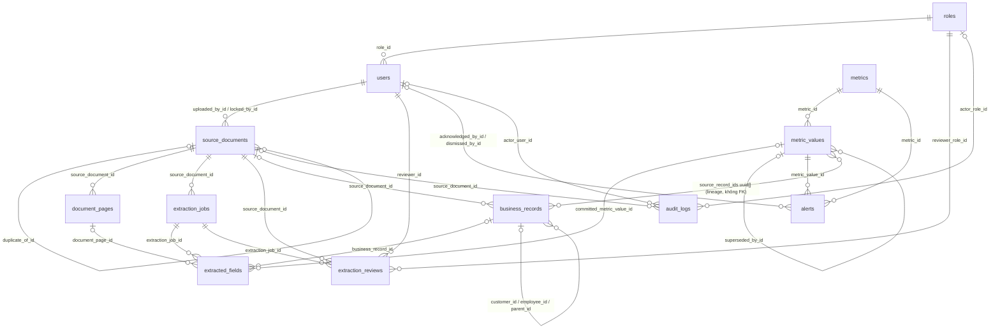

# 05 — DATA MODEL

> Mô hình dữ liệu vật lý (PostgreSQL 16 + pgvector) của Aureon Demo: ERD, **12 entity** `ENT-xxx`, lineage P01, mapping entity ↔ metric/IDP/role.
> Nguồn: `01-PROJECT-OVERVIEW.md`, `02-PERSONAS-PERMISSIONS.md`, `03-DASHBOARD-SPEC.md`, `04-IDP-FEATURE-SPEC.md` (đã Approved).
> Quy tắc: **không đổi schema mà không cập nhật file này trước** (CLAUDE.md § Database). Mọi migration qua Alembic, reversible.

---

## 1. Quy ước chung

| # | Quy ước | Chi tiết |
|---|---|---|
| C1 | Tên bảng | `snake_case`, số nhiều (`source_documents`) |
| C2 | Tên cột | `snake_case` (`uploaded_at`) |
| C3 | Khóa chính | `id uuid PRIMARY KEY DEFAULT gen_random_uuid()` cho **mọi bảng** |
| C4 | Timestamp | `created_at timestamptz NOT NULL DEFAULT now()`, `updated_at timestamptz NOT NULL DEFAULT now()` cho **mọi bảng** (cập nhật bởi SQLAlchemy `onupdate`) |
| C5 | Soft delete | `deleted_at timestamptz NULL` cho **mọi entity nghiệp vụ** (11/12 entity). Ngoại lệ duy nhất: `audit_logs` — append-only, không xóa, không sửa (§4.12) |
| C6 | Foreign key | Mọi FK có **index** riêng (tên `ix_<table>_<column>`); `ON DELETE RESTRICT` mặc định (xóa mềm, không xóa cứng) |
| C7 | Tiền | `bigint` = số nguyên VND (04 §5.2 `money`); không dùng `float` |
| C8 | Tỷ lệ / số đo | `numeric(20,6)`; phần trăm lưu dạng thập phân (`0.125` = 12,5%) theo 04 §5.2 |
| C9 | Ngày / kỳ | `date` cho ngày nghiệp vụ (ISO); kỳ lưu `period_key text` dạng `YYYY-MM` / `YYYY-Qn` + `period_type` enum |
| C10 | Enum | PostgreSQL `ENUM` type tên `snake_case` (vd. `document_status`); Python `Enum` PascalCase + giá trị SCREAMING (CLAUDE.md) |
| C11 | JSON | `jsonb` chỉ cho dữ liệu bán cấu trúc (attributes theo loại bản ghi, `source_location`, kết quả validation); field dùng để tính metric phải là cột có kiểu |
| C12 | Mã nghiệp vụ | ID spec (`METRIC-FIN-01`, `ALERT-FIN-01`, `ROLE-01`) lưu ở cột `code text UNIQUE`, **không** dùng làm PK |
| C13 | Tenant | Không multi-tenant (01 §3 OUT) → **không** có `tenant_id` |
| C14 | Nhạy cảm | Cột/field chứa lương cá nhân gắn nhãn `sensitivity = 'salary'` (02 §4.3); không có trong response model của role không có quyền |

Ký hiệu cột trong bảng entity: **Null** = `N` (NOT NULL) / `Y` (nullable); **Khóa** = `PK`, `FK → bảng`, `UQ` (unique).

---

## 2. Danh mục 12 entity

### 2.1. Danh sách

| # | Entity ID | Bảng | Nhóm | Mục đích | Spec dùng |
|---|---|---|---|---|---|
| 1 | ENT-User | `users` | Auth | 5 user demo (mỗi ROLE-01..05 một user), đăng nhập + JWT | 02 §5 |
| 2 | ENT-Role | `roles` | Auth | 5 role cố định + scope theo trụ (seed) | 02 §3, §4 |
| 3 | ENT-SourceDocument | `source_documents` | IDP | Tài liệu gốc / tài liệu ảo (C1, C2), trạng thái pipeline, batch UC-07 | 04 §2, §4, §8 |
| 4 | ENT-DocumentPage | `document_pages` | IDP | Trang/sheet sau tiền xử lý: text layer, OCR, ảnh trang | 04 FR-DC-07 |
| 5 | ENT-ExtractionJob | `extraction_jobs` | IDP | Một lần chạy phân loại + trích xuất + validation + routing | 04 §4, §7, §12 |
| 6 | ENT-ExtractedField | `extracted_fields` | IDP | Field result `{value, confidence, source_location}` + giá trị người sửa + liên kết commit | 04 §5.1, FR-DC-19/20 |
| 7 | ENT-ExtractionReview | `extraction_reviews` | IDP | Phiên review: người duyệt, quyết định, thời gian (KPI ≤ 60s) | 04 FR-DC-18/19 |
| 8 | ENT-BusinessRecord | `business_records` | Nghiệp vụ | **Bảng nghiệp vụ chung** (single-table, phân biệt bằng `record_type`): hóa đơn, hợp đồng, task, nhân sự, khách hàng, cơ hội, quyết định, dự án, dòng ngân sách, dòng BCTC, kết quả khảo sát | 03 §2, 04 §10.2 |
| 9 | ENT-Metric | `metrics` | Dashboard | Định nghĩa 18 metric + ngưỡng + alert 1-1 (seed) | 03 §2, §3 |
| 10 | ENT-MetricValue | `metric_values` | Dashboard | Giá trị metric theo kỳ (ACTUAL/TARGET) + lineage | 03 §1.2, §4.3 |
| 11 | ENT-Alert | `alerts` | Dashboard | Bản ghi alert sinh từ ngưỡng (OPEN → ACKNOWLEDGED → RESOLVED/DISMISSED) | 03 §3.1 |
| 12 | ENT-AuditLog | `audit_logs` | Governance | Nhật ký append-only mọi mutation, chuyển role, mở tài liệu PII | 02 §4.4, 04 FR-DC-22 |

### 2.2. Quyết định mô hình hóa (giữ đúng 12 entity)

| # | Vấn đề | Quyết định trong 05 | Lý do |
|---|---|---|---|
| M1 | 04 OQ-01, 03 OQ-01: cần đích cho Invoice, Contract, Task, Employee, Customer, Opportunity, Decision, Project, Budget, CashBalance, Survey | Gộp vào **ENT-BusinessRecord** (single-table inheritance, `record_type` enum §6). Các tên `ENT-Invoice`, `ENT-Contract`… ở 03/04 là **tên logic** = `business_records WHERE record_type = '<TYPE>'` (bảng ánh xạ §4.8.2) | Giữ đúng 12 entity; MVP chỉ 7 loại tài liệu, mỗi loại vài chục bản ghi; SQLAlchemy hỗ trợ `polymorphic_on`; một bảng giúp lineage/undo/soft delete đồng nhất (P03) |
| M2 | ENT-Permission (bản stub cũ) | **Bỏ bảng**. Ma trận quyền 02 §3 là hằng số trong code (`require_role(...)`) + `roles.pillar_scope` (seed) | 02 §3.6: không UI quản trị, không role tùy biến; bảng permission không có người sửa |
| M3 | Batch UC-07 | Thuộc tính `batch_id uuid` trên `source_documents` (không phải entity) | Theo mặc định 04 OQ-01 |
| M4 | Định nghĩa alert (18) | Nằm trong `metrics` (cột `alert_code`, ngưỡng) vì quan hệ 1-1; `alerts` chỉ chứa **bản ghi phát sinh** | 03 §3.2: mỗi metric đúng 1 alert |
| M5 | Lineage | Không dùng bảng liên kết: `metric_values.source_record_ids uuid[]` (metric tính từ bản ghi) + `extracted_fields.business_record_id` / `committed_metric_value_id` (bản ghi/giá trị → field → trang → tài liệu) | Giữ 12 bảng; lineage ghi một lần khi commit (03 §4.3) |
| M6 | Chuyển vai trò demo | 5 user seed, mỗi user 1 role (`users.role_id`); backend cấp JWT mới cho user đích khi `DEMO_MODE` bật; ghi `audit_logs` action `role.switch`. **Không** có bảng session | Theo hướng chốt ở 07 (02 OQ-6) |

---

## 3. ERD



### 3.1. Quan hệ

| Từ | Đến | Bội số | Cột | Ý nghĩa |
|---|---|---|---|---|
| users | roles | N–1 | `users.role_id` | 1 user demo = 1 role (switcher cấp JWT user đích) |
| source_documents | users | N–1 | `uploaded_by_id`, `locked_by_id` | Người upload; người đang giữ khóa Review |
| source_documents | source_documents | N–0..1 | `duplicate_of_id` | Trùng hash |
| document_pages | source_documents | N–1 | `source_document_id` | Trang của tài liệu |
| extraction_jobs | source_documents | N–1 | `source_document_id` | Lần xử lý (retry) |
| extracted_fields | extraction_jobs | N–1 | `extraction_job_id` | Field result của job |
| extracted_fields | document_pages | N–0..1 | `document_page_id` | Trang chứa giá trị |
| extracted_fields | business_records | N–0..1 | `business_record_id` | Lineage field → bản ghi |
| extracted_fields | metric_values | N–0..1 | `committed_metric_value_id` | Lineage field → giá trị metric (EXTRACTED) |
| extraction_reviews | source_documents / extraction_jobs / users / roles | N–1 | các FK | Phiên duyệt |
| business_records | business_records | N–0..1 | `customer_id`, `employee_id`, `parent_id` | Hóa đơn → khách; task → nhân sự, → quyết định/dự án |
| business_records | source_documents | N–0..1 | `source_document_id` | Tài liệu sinh bản ghi |
| metric_values | metrics | N–1 | `metric_id` | Giá trị theo kỳ |
| metric_values | business_records | N–N | `source_record_ids uuid[]` | Lineage metric → bản ghi (mảng, không FK; toàn vẹn kiểm ở service + test) |
| alerts | metrics / metric_values | N–1 | `metric_id`, `metric_value_id` | Alert từ ngưỡng |
| audit_logs | users / roles / source_documents | N–0..1 | các FK | Actor, role active, tài liệu |

---

## 4. Đặc tả entity

> Cột chung xuất hiện ở đầu mỗi bảng: `id`, `created_at`, `updated_at`, `deleted_at` (trừ `audit_logs` không có `deleted_at`).

### 4.1. ENT-User — `users`

| Cột | Kiểu PostgreSQL | Null | Khóa | Mô tả |
|---|---|---|---|---|
| id | uuid | N | PK | Định danh |
| email | text | N | UQ | Email đăng nhập, lưu lowercase (vd. `ceo@abc.demo`) |
| full_name | text | N | | Tên hiển thị; AI xưng hô "anh/chị" theo `salutation` |
| salutation | text | Y | | `anh` / `chị` (P04) |
| password_hash | text | N | | Hash (argon2/bcrypt); **không bao giờ** trong response model |
| role_id | uuid | N | FK → roles | Role cố định của user (1 user = 1 role) |
| is_demo_account | boolean | N | | `true` cho 5 user seed; chỉ user này được đích của role switcher |
| last_login_at | timestamptz | Y | | Lần đăng nhập/chuyển vai gần nhất |
| created_at | timestamptz | N | | |
| updated_at | timestamptz | N | | |
| deleted_at | timestamptz | Y | | Soft delete |

Index: `ix_users_role_id`; UQ `email` (partial `WHERE deleted_at IS NULL`).

### 4.2. ENT-Role — `roles`

| Cột | Kiểu PostgreSQL | Null | Khóa | Mô tả |
|---|---|---|---|---|
| id | uuid | N | PK | |
| code | text | N | UQ | `ROLE-01`..`ROLE-05` |
| key | role_key | N | UQ | `CEO`, `CFO`, `SALES_DIRECTOR`, `HR_MANAGER`, `REVIEWER` — giá trị dùng trong `require_role(...)` |
| name_i18n_key | text | N | | Khóa i18n tên role |
| pillar_scope | pillar[] | N | | Trụ mức `view` (02 §4.2), vd. CFO `{FIN,OPS}` |
| pillar_agg_scope | pillar[] | N | | Trụ mức `view-agg`, vd. CFO `{CUS,HR}` |
| review_pillars | pillar[] | N | | Trụ được duyệt/commit/undo (02 §3.4): CFO `{FIN}`, HR `{HR}`, Reviewer `{FIN,CUS,OPS,HR}`, còn lại `{}` |
| can_view_salary | boolean | N | | `true` chỉ HR Manager; Reviewer xử lý theo ngữ cảnh review (§10) |
| home_route | text | N | | Màn hình chính sau khi chuyển vai (ROLE-05 → hàng chờ IDP) |
| created_at | timestamptz | N | | |
| updated_at | timestamptz | N | | |
| deleted_at | timestamptz | Y | | |

> Seed only (02 §3.6). Cột scope là **dữ liệu tham khảo cho filter backend**; ma trận đầy đủ vẫn là hằng số code theo 02 §3 (M2).

### 4.3. ENT-SourceDocument — `source_documents`

| Cột | Kiểu PostgreSQL | Null | Khóa | Mô tả |
|---|---|---|---|---|
| id | uuid | N | PK | Document id trả về khi upload (FR-DC-01) |
| batch_id | uuid | Y | | Batch UC-07 (M3); không FK |
| channel | input_channel | N | | `C1`..`C5` |
| kind | document_kind | N | | `FILE` (C3/C4/C5) / `MANUAL` (C1) / `TRANSCRIPT` (C2) — "tài liệu ảo" (04 §2) |
| original_filename | text | Y | | Null với tài liệu ảo |
| mime_type | text | Y | | PDF/DOCX/XLSX/CSV/JPG/PNG/HEIC |
| size_bytes | bigint | Y | | ≤ 20 MB |
| page_count | integer | Y | | ≤ 50 |
| storage_key | text | Y | | Key object MinIO/S3 (không lưu URL ký sẵn) |
| sha256 | char(64) | Y | | Hash chống trùng (FR-DC-06) |
| duplicate_of_id | uuid | Y | FK → source_documents | Tài liệu gốc khi `DUPLICATE` |
| manual_payload | jsonb | Y | | Payload form (C1) / transcript (C2) |
| doc_type | doc_type | Y | | Kết quả phân loại (7 loại + `OTHER`); null trước bước [2] |
| pillars | pillar[] | N | | Trụ của tài liệu (02 §3.4 ghi chú: #7 = 4 trụ); dùng cho data scoping |
| status | document_status | N | | 14 trạng thái 04 §8.1 |
| status_reason | text | Y | | Lý do FAILED/REJECTED/routing |
| autonomy_level | autonomy_level | Y | | Level áp dụng tại thời điểm xử lý (snapshot) |
| contains_salary | boolean | N | | `true` nếu doc_type = `EMPLOYEE_LIST` hoặc có ≥ 1 field `sensitivity='salary'` (02 §4.3) |
| contains_pii | boolean | N | | Có dữ liệu cá nhân (#5, #6) → mở file ghi audit |
| uploaded_by_id | uuid | N | FK → users | Người upload/nhập |
| uploaded_at | timestamptz | N | | |
| locked_by_id | uuid | Y | FK → users | Khóa mềm Review (`IN_REVIEW`) |
| locked_until | timestamptz | Y | | Hết hạn khóa (mặc định +15 phút, 04 OQ-08) |
| committed_at | timestamptz | Y | | Thời điểm `COMMITTED` |
| undo_deadline | timestamptz | Y | | `committed_at + 7 ngày` |
| retry_count | smallint | N | | ≤ 3 (NFR-IDP-03) |
| created_at | timestamptz | N | | |
| updated_at | timestamptz | N | | |
| deleted_at | timestamptz | Y | | |

Index: `ix_source_documents_duplicate_of_id`, `ix_source_documents_uploaded_by_id`, `ix_source_documents_locked_by_id`, `ix_source_documents_batch_id`, `ix_source_documents_status`, `ix_source_documents_sha256` (không unique — `DUPLICATE` vẫn lưu bản ghi), GIN `ix_source_documents_pillars`.

### 4.4. ENT-DocumentPage — `document_pages`

| Cột | Kiểu PostgreSQL | Null | Khóa | Mô tả |
|---|---|---|---|---|
| id | uuid | N | PK | |
| source_document_id | uuid | N | FK → source_documents | |
| page_number | integer | N | | 1-based; với Excel = thứ tự sheet |
| sheet_name | text | Y | | Tên sheet (Excel/CSV) |
| text_layer_exists | boolean | N | | Kiểm tra trước OCR (CLAUDE.md § OCR) |
| text_layer_quality | numeric(5,4) | Y | | Tỷ lệ ký tự hợp lệ 0–1 (FR-DC-07) |
| ocr_used | boolean | N | | |
| ocr_confidence | numeric(5,4) | Y | | 0–1 |
| text_content | text | Y | | Text sau tiền xử lý (dữ liệu, không phải lệnh — PI) |
| image_storage_key | text | Y | | Ảnh trang cho SourceViewer |
| width_px | integer | Y | | Chiều rộng trang (chuẩn hóa `bbox`) |
| height_px | integer | Y | | Chiều cao trang |
| created_at | timestamptz | N | | |
| updated_at | timestamptz | N | | |
| deleted_at | timestamptz | Y | | |

Index: `ix_document_pages_source_document_id`; UQ `(source_document_id, page_number)`.

### 4.5. ENT-ExtractionJob — `extraction_jobs`

| Cột | Kiểu PostgreSQL | Null | Khóa | Mô tả |
|---|---|---|---|---|
| id | uuid | N | PK | |
| source_document_id | uuid | N | FK → source_documents | Một tài liệu có thể có nhiều job (retry, "Vẫn xử lý") |
| attempt_no | smallint | N | | 1..n |
| celery_task_id | text | Y | UQ | Idempotency Celery (CLAUDE.md § Celery) |
| doc_type | doc_type | Y | | Kết quả phân loại |
| classification_confidence | numeric(5,4) | Y | | |
| schema_version | text | N | | Phiên bản Extraction Schema (`field_set_version` trong idempotency key 04 §10.1) |
| model_route | text | Y | | Model qua ModelGateway/OmniRoute (không lưu key) |
| status | job_status | N | | `QUEUED`/`RUNNING`/`SUCCEEDED`/`FAILED` |
| error_code | text | Y | | `IDP-E01`..`IDP-E11` |
| validation_summary | jsonb | Y | | Kết quả rule nội tài liệu (`VR-*`): pass/warn/fail |
| cross_doc_results | jsonb | Y | | Kết quả XD-01..05: `{rule, result: MATCH/MISMATCH/NOT_COMPARABLE, severity, ref_document_ids[], values}` (04 §12, §12.1) |
| routing_decision | routing_decision | Y | | `STP` / `REVIEW` |
| routing_reason | text | Y | | Lý do định tuyến (FR-DC-15) |
| avg_confidence | numeric(5,4) | Y | | Hiển thị hàng chờ (metadata cho CEO, 02 §3.4) |
| started_at | timestamptz | Y | | |
| finished_at | timestamptz | Y | | p95 ≤ 60s (NFR-IDP-01) |
| token_cost_usd | numeric(12,6) | Y | | Theo dõi chi phí (kill switch) |
| created_at | timestamptz | N | | |
| updated_at | timestamptz | N | | |
| deleted_at | timestamptz | Y | | |

Index: `ix_extraction_jobs_source_document_id`.

### 4.6. ENT-ExtractedField — `extracted_fields`

Lưu **Field result** 04 §5.1: `{value, confidence, source_location}` cho mỗi field; field dạng bảng → một dòng/ô với `row_index`.

| Cột | Kiểu PostgreSQL | Null | Khóa | Mô tả |
|---|---|---|---|---|
| id | uuid | N | PK | |
| extraction_job_id | uuid | N | FK → extraction_jobs | |
| source_document_id | uuid | N | FK → source_documents | Phi chuẩn hóa để truy vấn lineage nhanh |
| document_page_id | uuid | Y | FK → document_pages | Trang chứa giá trị (null với cell/transcript/manual) |
| field_key | text | N | | Tên field schema (`subtotal`, `revenue_by_month.revenue`, `salary`…) |
| table_key | text | Y | | Tên field bảng cha (`revenue_by_month`, `action_items`, `line_items`) |
| row_index | integer | Y | | Hàng trong bảng / dòng Excel (47 dòng #2) |
| record_group | integer | Y | | Nhóm field thành 1 bản ghi đích (mỗi dòng hóa đơn = 1 nhóm) |
| value | jsonb | Y | | **value** đã chuẩn hóa (04 §5.2); `null` nếu không tìm thấy |
| raw_text | text | Y | | Chuỗi gốc |
| value_type | field_value_type | N | | `date`/`money`/`percent`/`tax_code`/`text`/`person_name`/`org_name`/`enum`/`period`/`number` |
| confidence | numeric(5,4) | N | | **confidence** 0–1 (C1 = 1.0) |
| source_location | jsonb | N | | **source_location** `{kind, page, bbox[4], sheet, row, col, paragraph_index, char_start, char_end}` (04 §5.1) |
| source_kind | source_location_kind | N | | Bản sao `source_location.kind` để index/lọc |
| validation | jsonb | Y | | `[{rule, status: pass/warn/fail}]` |
| sensitivity | sensitivity_label | N | | `NONE` / `PII` / `SALARY` (02 §4.3; 04 §13.3 `sensitivity=salary`) |
| corrected | boolean | N | | `true` nếu người sửa (FR-DC-19) |
| corrected_value | jsonb | Y | | Giá trị người nhập; giá trị AI giữ ở `value` |
| corrected_by_id | uuid | Y | FK → users | |
| final_value | jsonb | Y | | Giá trị được commit (= `corrected_value` nếu có, ngược lại `value`) |
| business_record_id | uuid | Y | FK → business_records | **Lineage**: bản ghi nghiệp vụ được tạo/cập nhật từ field |
| committed_metric_value_id | uuid | Y | FK → metric_values | **Lineage**: giá trị metric ghi trực tiếp từ field (BCTC, báo cáo sales, KPI) |
| created_at | timestamptz | N | | |
| updated_at | timestamptz | N | | |
| deleted_at | timestamptz | Y | | |

Index: `ix_extracted_fields_extraction_job_id`, `ix_extracted_fields_source_document_id`, `ix_extracted_fields_document_page_id`, `ix_extracted_fields_corrected_by_id`, `ix_extracted_fields_business_record_id`, `ix_extracted_fields_committed_metric_value_id`, `ix_extracted_fields_field_key`.

Ràng buộc: `CHECK (confidence BETWEEN 0 AND 1)`; `value IS NOT NULL → source_location->>'kind' IS NOT NULL` (04: có value mà không có vị trí → confidence 0, bắt buộc review — enforce ở service).

### 4.7. ENT-ExtractionReview — `extraction_reviews`

| Cột | Kiểu PostgreSQL | Null | Khóa | Mô tả |
|---|---|---|---|---|
| id | uuid | N | PK | |
| source_document_id | uuid | N | FK → source_documents | |
| extraction_job_id | uuid | N | FK → extraction_jobs | Job được duyệt |
| reviewer_id | uuid | N | FK → users | Người duyệt (Reviewer/CFO/HR theo `review_pillars`) |
| reviewer_role_id | uuid | N | FK → roles | Role active tại thời điểm duyệt |
| decision | review_decision | Y | | `APPROVED` / `REJECTED` / `ABANDONED` (đóng không lưu/hết khóa) |
| reject_reason_code | text | Y | | Bắt buộc khi `REJECTED` |
| reject_note | text | Y | | |
| fields_total | integer | N | | Số field hiển thị |
| fields_corrected | integer | N | | Số field sửa (accuracy) |
| opened_at | timestamptz | N | | KPI ≤ 60s |
| decided_at | timestamptz | Y | | |
| duration_ms | integer | Y | | `decided_at − opened_at` |
| created_at | timestamptz | N | | |
| updated_at | timestamptz | N | | |
| deleted_at | timestamptz | Y | | |

Index: `ix_extraction_reviews_source_document_id`, `ix_extraction_reviews_extraction_job_id`, `ix_extraction_reviews_reviewer_id`, `ix_extraction_reviews_reviewer_role_id`.

### 4.8. ENT-BusinessRecord — `business_records`

Bảng nghiệp vụ chung (M1). Cột có kiểu dùng cho tính metric; dữ liệu riêng từng loại không dùng tính toán đặt trong `attributes`. Chỉ ghi qua **Action Registry** (04 §10).

#### 4.8.1. Cột

| Cột | Kiểu PostgreSQL | Null | Khóa | Mô tả |
|---|---|---|---|---|
| id | uuid | N | PK | |
| record_type | record_type | N | | Loại bản ghi (§4.8.2) — `polymorphic_on` |
| pillar | pillar | N | | Trụ của bản ghi (data scoping 02 §4.1 mục 3) |
| code | text | Y | | Mã nghiệp vụ: số hóa đơn, số hợp đồng, mã NV, mã dự án |
| series | text | Y | | Ký hiệu hóa đơn |
| name | text | Y | | Tên: khách hàng, nhân sự (họ tên), task, cơ hội, dự án, khoản mục |
| tax_code | text | Y | | MST 10/13 số (khách hàng, bên B) |
| customer_id | uuid | Y | FK → business_records | Bản ghi `CUSTOMER` (hóa đơn, hợp đồng, cơ hội) |
| employee_id | uuid | Y | FK → business_records | Bản ghi `EMPLOYEE`: người phụ trách task/quyết định, owner |
| parent_id | uuid | Y | FK → business_records | Cha: task → `DECISION`/`PROJECT`; dòng BCTC/ngân sách → nhóm |
| period_key | text | Y | | Kỳ `YYYY-MM` / `YYYY-Qn` |
| issue_date | date | Y | | Ngày hóa đơn / ngày họp / ngày khảo sát |
| start_date | date | Y | | Ngày vào làm / hiệu lực hợp đồng |
| end_date | date | Y | | Ngày nghỉ việc / hết hạn hợp đồng |
| due_date | date | Y | | Hạn thanh toán / hạn task / hạn quyết định / mốc dự án / close date cơ hội |
| done_at | date | Y | | Ngày hoàn thành task/quyết định/dự án |
| signed_at | date | Y | | Ngày ký hợp đồng |
| subtotal | bigint | Y | | Tiền trước VAT (VND) |
| vat_rate | numeric(5,4) | Y | | `0`, `0.05`, `0.08`, `0.10` |
| vat_amount | bigint | Y | | |
| total_amount | bigint | Y | | Tổng (= subtotal + vat); giá trị hợp đồng; giá trị cơ hội; số tiền dòng BCTC/ngân sách |
| paid_amount | bigint | Y | | Đã thu (hóa đơn `PARTIAL`/`PAID`) |
| amount_due | bigint | Y | | **Generated** `total_amount − COALESCE(paid_amount,0)` (STORED) cho `INVOICE` |
| probability | numeric(5,4) | Y | | Xác suất cơ hội 0–1 |
| score | numeric(6,2) | Y | | Điểm khảo sát 0–10 / NPS tổng hợp |
| status | text | Y | | Trạng thái theo loại (enum hợp lệ ở §4.8.2, CHECK theo `record_type`) |
| department | text | Y | | Phòng ban (nhân sự) |
| title | text | Y | | Chức danh |
| salary | bigint | Y | | **Lương cá nhân — `sensitivity=SALARY`**; chỉ `EMPLOYEE`; loại khỏi response model trừ HR Manager / Reviewer-trong-review (§10) |
| is_critical | boolean | Y | | Task quan trọng (METRIC-OPS-02) |
| attributes | jsonb | N | | Dữ liệu phụ: `payment_terms`, `party_a`, `stage`, `meeting_title`, `line_items` hiển thị… (mặc định `{}`) |
| source_document_id | uuid | Y | FK → source_documents | Tài liệu sinh ra bản ghi (null nếu seed lịch sử) |
| created_by_action | text | Y | | Action Registry đã tạo (`invoice.create`…) |
| idempotency_key | text | Y | UQ | 04 §10.1 — retry không tạo trùng |
| previous_snapshot | jsonb | Y | | Ảnh bản ghi trước upsert — phục vụ undo `employee.upsert` (khôi phục bản trước) |
| created_at | timestamptz | N | | |
| updated_at | timestamptz | N | | |
| deleted_at | timestamptz | Y | | Soft delete (undo `invoice.create`/`contract.create`/`task.create_from_minutes`) |

Index FK: `ix_business_records_customer_id`, `ix_business_records_employee_id`, `ix_business_records_parent_id`, `ix_business_records_source_document_id`. Index truy vấn: `(record_type, period_key)`, `(record_type, due_date) WHERE deleted_at IS NULL`, `(record_type, issue_date)`. Unique nghiệp vụ (XD-05): `UQ (record_type, series, code) WHERE record_type IN ('INVOICE','CONTRACT') AND deleted_at IS NULL`; `UQ (record_type, code) WHERE record_type = 'EMPLOYEE' AND deleted_at IS NULL`.

#### 4.8.2. `record_type` ↔ tên logic ở 03/04

| `record_type` | Tên logic (03/04) | Pillar | Tài liệu nguồn | Cột dùng chính | `status` hợp lệ |
|---|---|---|---|---|---|
| `INVOICE` | ENT-Invoice | FIN | #2 (C3/C5), C1, C2 | code, series, issue_date, customer_id, tax_code, subtotal, vat_rate, vat_amount, total_amount, paid_amount, amount_due, due_date | `UNPAID` / `PARTIAL` / `PAID` |
| `CONTRACT` | ENT-Contract | CUS | #4 | code, customer_id, total_amount (giá trị), signed_at, start_date, end_date, attributes.payment_terms | `ACTIVE` / `EXPIRED` / `TERMINATED` |
| `CUSTOMER` | ENT-Customer | CUS | Sinh khi commit #2/#3/#4 (khớp theo MST, rồi tên chuẩn hóa) | name, tax_code | `ACTIVE` |
| `OPPORTUNITY` | ENT-Opportunity | CUS | #3 | name, customer_id, total_amount, probability, due_date (close date), attributes.stage | `OPEN` / `WON` / `LOST` |
| `SURVEY_RESPONSE` | ENT-Survey | CUS | #7 hoặc C1 | customer_id, score (0–10), issue_date | — |
| `TASK` | ENT-Task | OPS | #5 action items, C1 | name, employee_id (assignee), due_date, done_at, parent_id, is_critical | `OPEN` / `DONE` / `CANCELLED` |
| `DECISION` | ENT-Decision | OPS | #5 mục "Quyết định" | name (nội dung), employee_id (owner), due_date, done_at | `OPEN` / `DONE` |
| `PROJECT` | ENT-Project | OPS | #7 (dự án/OKR, mốc) | code, name, due_date (milestone), done_at | `OPEN` / `DONE` |
| `EMPLOYEE` | ENT-Employee | HR | #6 | code, name (họ tên), title, department, start_date, end_date, salary | `ACTIVE` / `ON_LEAVE` / `TERMINATED` |
| `BUDGET_LINE` | ENT-Budget | FIN | #7 | name (khoản mục), period_key, total_amount | — |
| `FINANCIAL_LINE` | ENT-CashBalance + dòng BCTC | FIN | #1 | name (`REVENUE`, `REVENUE_MONTH`, `COGS`, `GROSS_PROFIT`, `OPEX`, `OPEX:<khoản mục>`, `NET_PROFIT`, `CASH_END`, `CASH_OUT_NET`, `RECEIVABLES`, `PAYROLL_COST`), period_key, total_amount | — |

Quy ước `FINANCIAL_LINE` (BCTC #1):
- `revenue` kỳ quý → `name='REVENUE'`, `period_key='2026-Q3'`.
- **`revenue_by_month[]`** (04 §5.3, §12.1) → mỗi tháng một dòng `name='REVENUE_MONTH'`, `period_key='2026-07'|'2026-08'|'2026-09'`, `total_amount` = doanh thu trước VAT. XD-01 so `REVENUE_MONTH` kỳ `2026-09` với `SUM(subtotal) WHERE record_type='INVOICE' AND issue_date ∈ 2026-09` (±0,5%); không có dòng tháng → `NOT_COMPARABLE`. Không suy diễn chia quý cho 3.
- **Tổng chi phí nhân sự / quỹ lương** (nguồn view-agg cho CFO/CEO, 02 §4.2) → `name='PAYROLL_COST'`. Nguồn ưu tiên: dòng chi phí nhân sự trong BCTC #1; nếu không có → backend tính `SUM(salary) WHERE record_type='EMPLOYEE' AND status<>'TERMINATED'` và chỉ trả **giá trị tổng hợp** (không lineage xuống từng nhân sự cho CEO/CFO). Xem OQ-04.

Quy tắc hóa đơn `PARTIAL`: `paid_amount` bắt buộc khi `status='PARTIAL'` (`0 < paid_amount < total_amount`); `PAID` → `paid_amount = total_amount`; `UNPAID` → `paid_amount = 0`. Nếu #2 chỉ có trạng thái mà không có số đã thu → field `paid_amount` = null → bắt buộc Review (xem OQ-03).

### 4.9. ENT-Metric — `metrics`

Định nghĩa 18 metric + ngưỡng + alert 1-1 (seed, không sửa qua UI — 02 §3.3).

| Cột | Kiểu PostgreSQL | Null | Khóa | Mô tả |
|---|---|---|---|---|
| id | uuid | N | PK | |
| code | text | N | UQ | `METRIC-FIN-01`..`METRIC-HR-03` (18) |
| pillar | pillar | N | | `FIN`/`CUS`/`OPS`/`HR` |
| name_i18n_key | text | N | | Tên hiển thị qua i18n |
| formula_display | text | N | | Công thức đọc được (P01 #1) |
| formula_expr | text | N | | Biểu thức kỹ thuật (cột "Công thức" 03 §2) |
| source_record_types | record_type[] | N | | Entity nguồn (P01 #2), vd. `{INVOICE}` |
| unit | metric_unit | N | | `VND`/`PERCENT`/`DAYS`/`MONTHS`/`RATIO`/`COUNT`/`SCORE`/`TASKS_PER_PERSON`/`VND_PER_PERSON` |
| direction | threshold_direction | N | | `LOWER_IS_BAD` / `HIGHER_IS_BAD` |
| warning_threshold | numeric(20,6) | Y | | Ngưỡng vàng (03 §2) |
| critical_threshold | numeric(20,6) | Y | | Ngưỡng đỏ |
| threshold_rule | jsonb | Y | | Điều kiện phức hợp (vd. FIN-05 "hoặc khoản > 90 ngày", CUS-04 "1 khách > 15%", OPS-04) |
| chart_type | text | N | | `bar`/`line`/`gauge`/`sparkline`/`stacked_bar`/`pareto`/`funnel` |
| refresh_policy | text | N | | `ON_COMMIT`, `DAILY`, `WEEKLY`, `MONTHLY` (kết hợp) |
| alert_code | text | N | UQ | `ALERT-FIN-01`.. (1-1, M4) |
| alert_recipient_role_codes | text[] | N | | Role nhận alert (03 §3.2), vd. `{ROLE-01,ROLE-02}` |
| alert_suggestion_i18n_key | text | N | | Hành động gợi ý L1 |
| agg_visible_role_codes | text[] | N | | Role xem dạng `view-agg` (02 §3.2) |
| sort_order | smallint | N | | Thứ tự trên dashboard |
| created_at | timestamptz | N | | |
| updated_at | timestamptz | N | | |
| deleted_at | timestamptz | Y | | |

Index: UQ `code`, UQ `alert_code`, `ix_metrics_pillar`. Không có FK.

### 4.10. ENT-MetricValue — `metric_values`

| Cột | Kiểu PostgreSQL | Null | Khóa | Mô tả |
|---|---|---|---|---|
| id | uuid | N | PK | |
| metric_id | uuid | N | FK → metrics | |
| value_kind | metric_value_kind | N | | `ACTUAL` / `TARGET` (04 §10.2 `metric_value.upsert` / `metric_target.upsert`) |
| period_type | period_type | N | | `MONTH`/`QUARTER`/`YEAR`/`ROLLING_12M` |
| period_key | text | N | | `2026-09`, `2026-Q3`, `2026-Q4` |
| value | numeric(20,6) | Y | | Giá trị; `null` = "Chưa có dữ liệu nguồn" (03 §1.3, không hiển thị 0 giả) |
| breakdown | jsonb | Y | | Dữ liệu cho BreakdownTable/biểu đồ (theo khách, tháng, người, khoản mục) — chỉ chứa giá trị tổng hợp |
| computation | value_origin | N | | `COMPUTED` (tính từ bản ghi) / `EXTRACTED` (ghi thẳng từ field tài liệu) / `MANUAL` (C1) / `SEED` |
| source_record_ids | uuid[] | N | | **Lineage** tới `business_records` (mặc định `{}`); tổng khớp `value` (03 §4.3) |
| source_document_ids | uuid[] | N | | Tài liệu gốc liên quan (cache lineage, phục vụ drill-down nhanh) |
| status_color | threshold_status | Y | | `GREEN`/`YELLOW`/`RED` tại thời điểm tính |
| is_current | boolean | N | | Bản đang hiệu lực của `(metric, value_kind, period_key)` |
| superseded_by_id | uuid | Y | FK → metric_values | Bản thay thế (giữ lịch sử để undo) |
| computed_at | timestamptz | N | | Thời điểm cập nhật (P01 #3) |
| computed_by_action | text | Y | | Action/job sinh giá trị |
| created_at | timestamptz | N | | |
| updated_at | timestamptz | N | | |
| deleted_at | timestamptz | Y | | Soft delete khi undo |

Index: `ix_metric_values_metric_id`, `ix_metric_values_superseded_by_id`, UQ `(metric_id, value_kind, period_key) WHERE is_current AND deleted_at IS NULL`, GIN `ix_metric_values_source_record_ids`.

> Dashboard đọc giá trị tính sẵn (`is_current = true`) — không tính lại khi chuyển role (02 §5.2 R8).

### 4.11. ENT-Alert — `alerts`

| Cột | Kiểu PostgreSQL | Null | Khóa | Mô tả |
|---|---|---|---|---|
| id | uuid | N | PK | |
| metric_id | uuid | N | FK → metrics | `alert_code` lấy từ metric |
| metric_value_id | uuid | N | FK → metric_values | Giá trị gây alert (lần nâng cấp gần nhất) |
| period_key | text | N | | |
| severity | alert_severity | N | | `WARNING` / `CRITICAL` |
| status | alert_status | N | | `OPEN` → `ACKNOWLEDGED` → `RESOLVED` / `DISMISSED` |
| message_params | jsonb | N | | Tham số câu hiển thị (giá trị, % KH, kỳ) — i18n |
| suggestion_level | autonomy_level | N | | Luôn `L1` (P02, 03 §3.1) |
| triggered_at | timestamptz | N | | |
| acknowledged_by_id | uuid | Y | FK → users | |
| acknowledged_at | timestamptz | Y | | |
| resolved_at | timestamptz | Y | | Tự đóng khi về vùng xanh |
| dismissed_by_id | uuid | Y | FK → users | |
| dismissed_at | timestamptz | Y | | |
| created_at | timestamptz | N | | |
| updated_at | timestamptz | N | | |
| deleted_at | timestamptz | Y | | |

Index: `ix_alerts_metric_id`, `ix_alerts_metric_value_id`, `ix_alerts_acknowledged_by_id`, `ix_alerts_dismissed_by_id`; UQ `(metric_id, period_key) WHERE status IN ('OPEN','ACKNOWLEDGED') AND deleted_at IS NULL` (1 alert mở/metric/kỳ, 03 §3.1).

### 4.12. ENT-AuditLog — `audit_logs`

Append-only: không `UPDATE`/`DELETE` (enforce bằng quyền DB của app user + trigger chặn). **Không có `deleted_at`** (ngoại lệ C5 — không phải entity nghiệp vụ). `updated_at` vẫn có để tuân quy ước C4, luôn = `created_at`.

| Cột | Kiểu PostgreSQL | Null | Khóa | Mô tả |
|---|---|---|---|---|
| id | uuid | N | PK | |
| occurred_at | timestamptz | N | | Thời điểm hành động |
| actor_type | actor_type | N | | `USER` / `AI` (`ai:idp`) / `SYSTEM` |
| actor_user_id | uuid | Y | FK → users | Null khi AI/SYSTEM |
| actor_role_id | uuid | Y | FK → roles | Role active (02 §4.4) |
| action | text | N | | `document.upload`, `field.correct`, `review.approve`, `review.reject`, `invoice.create`, `document.rollback`, `alert.acknowledge`, `alert.dismiss`, `alert.resolve`, `role.switch`, `document.open_pii`, `document.open_denied`, `document.force_process`, `autonomy.change`… |
| target_type | text | N | | Tên bảng đích (`source_documents`, `business_records`, `alerts`, `users`…) |
| target_id | uuid | Y | | Id đối tượng (không FK — đa bảng) |
| source_document_id | uuid | Y | FK → source_documents | Tài liệu liên quan (FR-DC-22) |
| before | jsonb | Y | | Trạng thái trước (field lương được **mask** `••••`) |
| after | jsonb | Y | | Trạng thái sau (mask tương tự) |
| metadata | jsonb | Y | | Vd. `role.switch`: `{from_role, to_role, from_user_id, to_user_id}`; `idempotency_key`; `request_id` |
| ip_address | inet | Y | | |
| created_at | timestamptz | N | | |
| updated_at | timestamptz | N | | = created_at |

Index: `ix_audit_logs_actor_user_id`, `ix_audit_logs_actor_role_id`, `ix_audit_logs_source_document_id`, `(target_type, target_id)`, `ix_audit_logs_occurred_at`.

Sự kiện bắt buộc ghi (02 §4.4, 04 FR-DC-22): mọi mutation; mọi chuyển trạng thái tài liệu; mỗi lần chuyển vai trò demo (JWT mới cho user đích); mỗi lần mở tài liệu gốc chứa PII và mỗi lần bị từ chối mở tài liệu chứa lương. Ghi trong **cùng transaction** với mutation (Action Registry).

---

## 5. Bảng liên kết (association tables)

Không có bảng liên kết riêng trong MVP (giữ đúng 12 bảng). Quan hệ N–N duy nhất (metric_values ↔ business_records) lưu bằng `uuid[]` + GIN index (M5). Nếu cần FK cứng cho lineage → raise DEC (OQ-05).

---

## 6. Enum

| Enum type | Giá trị | Dùng ở |
|---|---|---|
| `pillar` | `FIN`, `CUS`, `OPS`, `HR` | roles, source_documents, business_records, metrics |
| `role_key` | `CEO`, `CFO`, `SALES_DIRECTOR`, `HR_MANAGER`, `REVIEWER` | roles |
| `input_channel` | `C1`, `C2`, `C3`, `C4`, `C5` | source_documents (C6–C10 ngoài phạm vi) |
| `document_kind` | `FILE`, `MANUAL`, `TRANSCRIPT` | source_documents |
| `doc_type` | `FINANCIAL_REPORT`, `INVOICE`, `SALES_REPORT`, `CONTRACT`, `MEETING_MINUTES`, `EMPLOYEE_LIST`, `KPI_OKR`, `OTHER` | source_documents, extraction_jobs |
| `document_status` | `UPLOADED`, `PREPROCESSING`, `CLASSIFYING`, `EXTRACTING`, `VALIDATING`, `NEEDS_REVIEW`, `IN_REVIEW`, `AUTO_APPROVED`, `APPROVED`, `COMMITTED`, `REJECTED`, `FAILED`, `DUPLICATE`, `ROLLED_BACK` | source_documents (04 §8.1) |
| `autonomy_level` | `L0`, `L1`, `L2`, `L3` | source_documents, alerts (L4 ngoài phạm vi) |
| `job_status` | `QUEUED`, `RUNNING`, `SUCCEEDED`, `FAILED` | extraction_jobs |
| `routing_decision` | `STP`, `REVIEW` | extraction_jobs |
| `field_value_type` | `date`, `money`, `percent`, `tax_code`, `text`, `person_name`, `org_name`, `enum`, `period`, `number` | extracted_fields (04 §5.2) |
| `source_location_kind` | `pdf_region`, `image_region`, `cell`, `docx_paragraph`, `transcript`, `manual` | extracted_fields (04 §5.1) |
| `sensitivity_label` | `NONE`, `PII`, `SALARY` | extracted_fields |
| `review_decision` | `APPROVED`, `REJECTED`, `ABANDONED` | extraction_reviews |
| `record_type` | `INVOICE`, `CONTRACT`, `CUSTOMER`, `OPPORTUNITY`, `SURVEY_RESPONSE`, `TASK`, `DECISION`, `PROJECT`, `EMPLOYEE`, `BUDGET_LINE`, `FINANCIAL_LINE` | business_records, metrics |
| `metric_unit` | `VND`, `PERCENT`, `DAYS`, `MONTHS`, `RATIO`, `COUNT`, `SCORE`, `TASKS_PER_PERSON`, `VND_PER_PERSON` | metrics |
| `threshold_direction` | `LOWER_IS_BAD`, `HIGHER_IS_BAD` | metrics |
| `metric_value_kind` | `ACTUAL`, `TARGET` | metric_values |
| `period_type` | `MONTH`, `QUARTER`, `YEAR`, `ROLLING_12M` | metric_values |
| `value_origin` | `COMPUTED`, `EXTRACTED`, `MANUAL`, `SEED` | metric_values |
| `threshold_status` | `GREEN`, `YELLOW`, `RED` | metric_values |
| `alert_severity` | `WARNING`, `CRITICAL` | alerts |
| `alert_status` | `OPEN`, `ACKNOWLEDGED`, `RESOLVED`, `DISMISSED` | alerts |
| `actor_type` | `USER`, `AI`, `SYSTEM` | audit_logs |

Thêm/đổi giá trị enum = đổi schema → cập nhật file này trước + migration Alembic reversible.

---

## 7. Lineage P01 — metric → bản ghi → tài liệu gốc

### 7.1. Chuỗi truy vết

```
metric_values (is_current, computed_at, period_key)          ← P01 #3 Thời điểm cập nhật
  │  metrics.formula_display / formula_expr                    ← P01 #1 Công thức
  │  metrics.source_record_types                               ← P01 #2 Nguồn dữ liệu
  ├─(COMPUTED) source_record_ids[] ──► business_records        ← P01 #4 Bản ghi gốc
  │                                      └─◄ extracted_fields.business_record_id
  └─(EXTRACTED) ◄── extracted_fields.committed_metric_value_id
                         │ source_location {kind, page, bbox | sheet,row,col | paragraph_index | char_start,char_end}
                         ├──► document_pages (page, ảnh trang)
                         ├──► extraction_jobs ──► source_documents (storage_key)   ← P01 #5 Tài liệu gốc
                         └──► extraction_reviews (người duyệt, decided_at)
```

### 7.2. Truy vấn theo click drill-down (03 §4.1)

| Click | Dữ liệu | Truy vấn chính |
|---|---|---|
| 0 | MetricCard | `metric_values WHERE metric_id=? AND is_current AND value_kind='ACTUAL'` (+ TARGET cùng kỳ cho % KH) |
| 1 | Metric Detail + panel P01 | `metrics` + `metric_values.breakdown` + lịch sử kỳ |
| 2 | Bản ghi gốc | `business_records WHERE id = ANY(source_record_ids)` (lọc scope §10), phân trang; tổng phải khớp `value` |
| 3 | Source Viewer | `extracted_fields WHERE business_record_id=?` → `source_location` + `document_pages` + `source_documents.storage_key` (URL ký ngắn hạn do API cấp) |

### 7.3. Quy tắc

| # | Quy tắc |
|---|---|
| L1 | Lineage ghi **một lần** trong transaction commit của Action Registry (03 §4.3); không tính lại khi xem |
| L2 | `metric_values.value` không null mà `source_record_ids` rỗng **và** không có `extracted_fields` trỏ tới → vi phạm P01 ("số mồ côi"); test bắt buộc (14) |
| L3 | Nhập tay C1: `source_documents.kind='MANUAL'`, `source_location.kind='manual'` → panel hiển thị "Nhập tay bởi … lúc …" |
| L4 | Seed lịch sử (kỳ gốc NRR, 03 OQ-03): `computation='SEED'`, `source_document_id` null, panel hiển thị "Dữ liệu seed lịch sử" |
| L5 | Undo (`document.rollback`): soft delete bản ghi/giá trị sinh từ tài liệu, khôi phục `previous_snapshot` / bản `superseded`, recompute metric; lineage cũ giữ lại để audit |

---

## 8. Chuẩn hóa tên cột (03/04 → tên chuẩn)

Thống nhất tên cột `ENT-Invoice` (ghi chú review 03) và các tên logic khác. Writer 03/04/10 dùng **tên chuẩn** khi sửa lần sau.

| Spec | Tên dùng trong spec | Tên chuẩn (05) | Ghi chú |
|---|---|---|---|
| 03 METRIC-FIN-01 | `ENT-Invoice.amount_before_vat` | `business_records.subtotal` (`record_type='INVOICE'`) | Doanh thu trước VAT; = field `subtotal` 04 §5.4 |
| 03 METRIC-FIN-05 | `ENT-Invoice.amount_due` | `business_records.amount_due` (generated = `total_amount − paid_amount`) | Hỗ trợ `PARTIAL` |
| 04 §5.4 | `ENT-Invoice.number` | `business_records.code` | |
| 04 §5.4 | `ENT-Invoice.series` | `business_records.series` | |
| 04 §5.4 | `ENT-Invoice.amount` (← `total_amount`) | `business_records.total_amount` | Tổng gồm VAT |
| 04 §5.4 | `ENT-Invoice.status` (← `payment_status`) | `business_records.status` ∈ `UNPAID/PARTIAL/PAID` | + `paid_amount` |
| 04 §5.4 | `ENT-Invoice.customer_name` / `customer_tax_code` | `business_records.customer_id` → bản ghi `CUSTOMER` (`name`, `tax_code`); tên gốc giữ ở `attributes.customer_name_raw` | XD-02 khớp tên/MST |
| 04 §5.4 | `ENT-Invoice.subtotal`, `vat_rate`, `vat_amount`, `issue_date`, `due_date` | giữ nguyên tên trên `business_records` | |
| 04 §5.6 | `ENT-Contract.number` / `value` / `signed_at` / `customer_name` / `payment_terms` | `code` / `total_amount` / `signed_at` / `customer_id` / `attributes.payment_terms` | `effective_date` → `start_date`, `expiry_date` → `end_date` |
| 04 §5.7 | `ENT-Task` (`title`, `assignee`, `due_date`, `status`) | `name`, `employee_id` (khớp XD-03; không khớp → `attributes.assignee_raw`), `due_date`, `status` | |
| 04 §5.8 | `ENT-Employee.code` / `full_name` / `title` / `department` / `start_date` / `end_date` / `status` / `salary` | `code` / `name` / `title` / `department` / `start_date` / `end_date` / `status` / `salary` | `salary` = SALARY |
| 04 §5.9 | `ENT-Metric.id` (← `metric_code`) | `metrics.code` | `id` là UUID (C12) |
| 03 §4.2 | `ENT-Metric.formula` / `source_entity` | `metrics.formula_display` + `formula_expr` / `metrics.source_record_types` | |
| 03 §1.2, 04 | `ENT-MetricValue.period` | `metric_values.period_key` + `period_type` | |
| 04 §5.3 | `revenue_by_month[]` | `business_records` `FINANCIAL_LINE` `name='REVENUE_MONTH'` + `metric_values` METRIC-FIN-01 `period_type=MONTH` | §4.8.2 |
| 03 | ENT-Customer / Opportunity / Decision / Project / Budget / CashBalance / Survey | `record_type` tương ứng §4.8.2 | Giải quyết 03 OQ-01 |

---

## 9. Mapping entity ↔ metric / IDP / role

### 9.1. Metric → nguồn dữ liệu

| Metric | `record_type` / bảng nguồn | Cột chính | Tài liệu |
|---|---|---|---|
| METRIC-FIN-01 Doanh thu tháng | INVOICE; TARGET từ metric_values | `SUM(subtotal)` theo `issue_date`; % KH | #2, #7; đối chiếu #1 (`REVENUE_MONTH`) |
| METRIC-FIN-02 Biên LN gộp | FINANCIAL_LINE | `REVENUE`, `COGS` | #1 |
| METRIC-FIN-03 Cash runway | FINANCIAL_LINE | `CASH_END`, `CASH_OUT_NET` | #1 |
| METRIC-FIN-04 DSO | FINANCIAL_LINE `RECEIVABLES`; INVOICE | `amount_due`, `subtotal` | #1, #2 |
| METRIC-FIN-05 Công nợ quá hạn | INVOICE; CONTRACT | `amount_due`, `due_date`, `status ≠ PAID` | #2, #4 |
| METRIC-FIN-06 Chênh ngân sách | FINANCIAL_LINE `OPEX:*`; BUDGET_LINE | `total_amount` | #1, #7 |
| METRIC-CUS-01 Pipeline coverage | OPPORTUNITY; TARGET | `total_amount × probability`, `due_date` | #3, #7 |
| METRIC-CUS-02 Tỷ lệ chuyển đổi | OPPORTUNITY; CONTRACT | `status ∈ {WON, LOST}` | #3, #4 |
| METRIC-CUS-03 NRR | INVOICE + CUSTOMER (+ seed kỳ gốc) | `subtotal`, `customer_id` | #2 |
| METRIC-CUS-04 Tập trung doanh thu | INVOICE + CUSTOMER | `subtotal` group `customer_id` | #2, #3, #4 |
| METRIC-CUS-05 NPS | SURVEY_RESPONSE (hoặc EXTRACTED từ `nps_score` #3) | `score` | #7 / C1 / #3 |
| METRIC-OPS-01 Task đúng hạn | TASK | `due_date`, `done_at`, `status` | #5 |
| METRIC-OPS-02 Dự án trễ | PROJECT, TASK | `due_date`, `done_at`, `is_critical` | #7, #5 |
| METRIC-OPS-03 Thực thi quyết định | DECISION, TASK | `due_date`, `done_at`, `status` | #5 |
| METRIC-OPS-04 Workload | TASK + EMPLOYEE | `employee_id`, `status='OPEN'` | #5, #6 |
| METRIC-HR-01 Doanh thu/nhân sự | INVOICE (qua METRIC-FIN-01) + EMPLOYEE | `subtotal`, headcount `status='ACTIVE'` | #2/#1, #6 |
| METRIC-HR-02 Tỷ lệ nghỉ việc | EMPLOYEE | `start_date`, `end_date` | #6 |
| METRIC-HR-03 Nhân sự quá tải | TASK + EMPLOYEE | task mở/trễ theo `employee_id` | #5, #6 |

### 9.2. IDP (doc type / action) → bảng ghi

| Doc type | Action Registry (04 §10.2) | Bảng ghi | Ghi chú |
|---|---|---|---|
| `INVOICE` | `invoice.create` | business_records (`INVOICE`, upsert `CUSTOMER`) | 47 dòng #2 → 47 bản ghi; `paid_amount` cho PARTIAL |
| `CONTRACT` | `contract.create` | business_records (`CONTRACT`, `CUSTOMER`) | |
| `MEETING_MINUTES` | `task.create_from_minutes` | business_records (`TASK`, `DECISION`) | Ghi `DECISION` cần xác nhận action (OQ-02) |
| `EMPLOYEE_LIST` | `employee.upsert` | business_records (`EMPLOYEE`) + `previous_snapshot` | Field `salary` = SALARY; doc `contains_salary=true` |
| `FINANCIAL_REPORT` | `metric_value.upsert` | metric_values (`EXTRACTED`) + business_records (`FINANCIAL_LINE`, gồm `REVENUE_MONTH`) | OQ-02 |
| `SALES_REPORT` | `metric_value.upsert` | metric_values + business_records (`OPPORTUNITY` theo stage, `CUSTOMER`) | OQ-02 |
| `KPI_OKR` | `metric_target.upsert` | metric_values (`TARGET`) + business_records (`BUDGET_LINE`, `PROJECT`, `SURVEY_RESPONSE`) | XD-04 với `metrics.code` |
| mọi loại | `document.reject`, `document.rollback` | source_documents.status; soft delete/khôi phục | audit_logs |
| mọi loại (pipeline) | — (không qua Action Registry, không phải dữ liệu nghiệp vụ) | source_documents, document_pages, extraction_jobs, extracted_fields, extraction_reviews | Extraction không ghi bảng nghiệp vụ (04 §4) |

### 9.3. Role → quyền đọc/ghi theo bảng

Ký hiệu: R = đọc (đã lọc scope), R-agg = chỉ giá trị tổng hợp, W = ghi (qua API/Action Registry), — = không.

| Bảng | ROLE-01 CEO | ROLE-02 CFO | ROLE-03 Sales Dir | ROLE-04 HR Mgr | ROLE-05 Reviewer |
|---|---|---|---|---|---|
| users / roles | R (bản thân + danh sách switcher) | như CEO | như CEO | như CEO | như CEO |
| metrics / metric_values | R 4 trụ | R FIN, OPS; R-agg CUS, HR | R CUS + METRIC-FIN-01; R-agg OPS | R HR, OPS; R-agg FIN-01 | — |
| alerts | R + W (ack/dismiss) mọi alert | R FIN, OPS; W FIN | R + W CUS | R + W HR | — |
| business_records | R 4 trụ (`salary` loại bỏ) | R FIN, OPS; W FIN (qua duyệt) | R CUS + INVOICE | R HR, OPS (gồm `salary`); W HR | W (qua duyệt), R trong ngữ cảnh review |
| source_documents | R tất cả; W upload; W UC-07 batch; mở file trừ `contains_salary` | R FIN + của mình; W upload | R của mình; W upload | R HR + của mình; W upload | R tất cả; W upload, UC-07, trạng thái |
| extracted_fields | R (SALARY → mask, loại khỏi response) | R + W FIN | — | R + W HR | R + W tất cả |
| extraction_reviews | R | W FIN | — | W HR | W tất cả |
| audit_logs | R | — | — | — | — |

> Ghi audit_logs là tác dụng phụ của mọi mutation, không phải quyền của role. Enforce ở backend (`require_role` + filter theo `roles.pillar_scope`, 02 §4.1).

---

## 10. Dữ liệu nhạy cảm & data scoping

| # | Quy tắc | Hiện thực ở data model |
|---|---|---|
| S1 | Lương cá nhân là `SALARY` (02 §4.3, NĐ 13/2023) | `business_records.salary` (EMPLOYEE) + `extracted_fields.sensitivity='SALARY'` + `source_documents.contains_salary=true` |
| S2 | CEO/CFO chỉ `view-agg` lương | API không select cột `salary`/field SALARY cho role không có quyền; chỉ trả `FINANCIAL_LINE PAYROLL_COST` hoặc tổng tính sẵn (OQ-04) |
| S3 | Tài liệu chứa lương: CEO/CFO không mở/tải file | Kiểm `source_documents.contains_salary` trước khi cấp URL ký; từ chối → audit `document.open_denied` |
| S4 | Reviewer chỉ xem lương trong ngữ cảnh review | Cho phép khi `source_documents.status='IN_REVIEW' AND locked_by_id = current_user`; không cấp URL tải |
| S5 | PII khác (họ tên, SĐT, CCCD, địa chỉ) trong #5, #6 | `sensitivity='PII'`; `contains_pii=true`; mở file → audit `document.open_pii` |
| S6 | Audit không lộ lương | `audit_logs.before/after` mask giá trị SALARY (`••••`) |
| S7 | Scope theo trụ | `business_records.pillar`, `source_documents.pillars`, `metrics.pillar` so với `roles.pillar_scope` / `pillar_agg_scope` |
| S8 | Không lưu credential trong DB ngoài `password_hash` | Không cột API key/token; `model_route` chỉ là tên route |

---

## 11. pgvector

| Hạng mục | Quyết định MVP |
|---|---|
| Extension | Bật `CREATE EXTENSION vector` (pgvector 0.7+) trong migration khởi tạo — đúng stack CLAUDE.md |
| Cột vector trong 12 bảng | **Không có** trong MVP: không spec Approved (02/03/04) nào yêu cầu semantic search/RAG cho luồng demo; XD-02/XD-03 so khớp theo MST/tên chuẩn hóa |
| Nếu cần (vd. so khớp tên khách mờ, hỏi đáp tài liệu bằng LlamaIndex) | Thêm cột `embedding vector(<dim>)` vào `document_pages` (chunk text) + index HNSW `vector_cosine_ops`; phải cập nhật file này + DEC trước (OQ-06) |

---

## 12. Migration & seed

| # | Quy tắc |
|---|---|
| G1 | Migration đầu tiên tạo extension (`pgcrypto` cho `gen_random_uuid()`, `vector`), enum types (§6), 12 bảng, index FK, partial unique, trigger chặn UPDATE/DELETE trên `audit_logs` |
| G2 | Mọi migration Alembic có `upgrade()` + `downgrade()`; review autogenerate (index/partial index/enum hay bị bỏ sót) |
| G3 | Thứ tự tạo bảng (theo FK): roles → users → source_documents → document_pages → extraction_jobs → business_records → metrics → metric_values → extracted_fields → extraction_reviews → alerts → audit_logs |
| G4 | Seed (`uv run python -m app.seed`, chi tiết `08-DEMO-DATA-SPEC.md`): 5 roles, 5 users demo, 18 metrics (kèm 18 alert definition), autonomy mặc định theo doc type (cấu hình, không phải bảng — 04 §9), business_records/metric_values lịch sử (kỳ gốc NRR, `computation='SEED'`) |
| G5 | `uv run python -m app.reset` xóa dữ liệu demo theo thứ tự ngược G3 (môi trường demo; không áp dụng trigger audit khi reset — cờ DEMO_MODE) |
| G6 | Mọi thay đổi schema: cập nhật 05 trước → migration → cập nhật `14-TEST-TRACEABILITY.md` |

---

## 13. Open questions

| # | Câu hỏi | Đề xuất mặc định (đã áp dụng trong 05) | Ảnh hưởng |
|---|---|---|---|
| OQ-01 | Giữ 12 entity vật lý bằng cách gộp Invoice/Contract/Task/Employee/Customer/Opportunity/Decision/Project/Budget/CashBalance/Survey vào `ENT-BusinessRecord` (single-table), hay tách bảng riêng (vượt 12 entity)? Gộp 04 OQ-01, 04 OQ-02, 03 OQ-01 | Single-table `business_records` + `record_type` (M1); bỏ ENT-Permission (M2). Cần human chốt qua DEC | 03, 04, 07, 10 |
| OQ-02 | Action Registry 04 §10.2 chưa có action ghi `DECISION`, `FINANCIAL_LINE`, `OPPORTUNITY`, `BUDGET_LINE`, `PROJECT`, `SURVEY_RESPONSE`. Mở rộng side effect của `metric_value.upsert` / `metric_target.upsert` / `task.create_from_minutes` hay thêm action mới? | Mở rộng side effect của action hiện có (không thêm action); nếu thêm → DEC theo 04 §10 | 04, 10 |
| OQ-03 | Danh sách hóa đơn #2 có cột "đã thu" để tính `paid_amount` với `PARTIAL` không? | 08 seed #2 có cột số đã thu; thiếu → `paid_amount` null, bắt buộc Review | 04 §5.4 (thêm field `paid_amount`), 08, METRIC-FIN-04/05 |
| OQ-04 | Nguồn "tổng chi phí nhân sự / quỹ lương" CFO xem `view-agg` (02 §4.2): dòng chi phí nhân sự BCTC #1 hay `SUM(salary)` từ #6? | Ưu tiên `FINANCIAL_LINE PAYROLL_COST` từ #1; fallback SUM(salary) chỉ trả tổng; cần thêm field `payroll_cost` vào schema `FINANCIAL_REPORT` (04) và hiển thị ở 03 | 02, 03, 04, 08 |
| OQ-05 | Lineage metric → bản ghi dùng `uuid[]` (không FK) có chấp nhận được không, hay cần bảng liên kết (bảng thứ 13)? | Chấp nhận `uuid[]` + GIN + test toàn vẹn | 05, 14 |
| OQ-06 | Có cần pgvector/embedding trong MVP (so khớp tên khách mờ, RAG)? | Không; chỉ bật extension | 07 |
| OQ-07 | Phạm vi seed lịch sử (kỳ gốc NRR, 12 tháng rolling HR-01/HR-02, CUS-04) | 08 seed business_records/metric_values 12 tháng trước `computation='SEED'` | 03 OQ-03, 08 |
| OQ-08 | Reset dữ liệu demo xóa `audit_logs` (mâu thuẫn append-only)? | Cho phép chỉ khi DEMO_MODE bật, qua lệnh `app.reset` | 07, 08 |

---

## 14. Liên kết

| Chủ đề | File |
|---|---|
| Tầm nhìn, P01–P04, 7 tài liệu mẫu | `01-PROJECT-OVERVIEW.md` |
| Role, scope, lương cá nhân, audit | `02-PERSONAS-PERMISSIONS.md` |
| 18 metric, 18 alert, lineage, drill-down | `03-DASHBOARD-SPEC.md` |
| Extraction Schema, state machine, Action Registry, XD-01 | `04-IDP-FEATURE-SPEC.md` |
| Stack, DEMO_MODE, storage | `07-TECH-ARCHITECTURE.md` |
| Seed ABC | `08-DEMO-DATA-SPEC.md` |
| DTO/response model theo bảng | `10-API-SPECIFICATION.md` |
| Test schema/lineage | `14-TEST-TRACEABILITY.md` |

---

## 15. Version

- **Version:** 1.0.0
- **Last updated:** 2026-10-17
- **Applies to:** Aureon Demo v1.0
- **Maintainer:** @CyEyes
