# 05 — Data Model

> Mô hình dữ liệu vật lý của **Aureon v2**: PostgreSQL 16 + pgvector, **một database, 10 schema** (một schema / module — DEC-125), entity `ENT-*` theo đúng registry `00-INDEX.md` §4.3 (bản 2.1.0: **79 entity** — DEC-147..153), outbox/event, lineage, phân loại dữ liệu nhạy cảm, migration.
> Nguồn hợp nhất (DEC-124): A-EMS `SOURCE-BRD-v1.0` §VI (entity theo database, dữ liệu nhạy cảm), §III.3 (event); AI-EOS `SOURCE-BRD-v1.1` (canonical — DEC-144) §13 Data Foundation (entity §13.2, trường chung §13.3), §11.6 autonomy, §7–§10 domain; bản 05 v1.0.0 (quy ước, lineage, audit append-only — nhánh `v1`).
> Quyết định: DEC-125 (Modular Monolith, schema per module), DEC-126 (outbox + Celery/Redis, envelope), DEC-127 (5 trụ, 31 metric), DEC-128 (10 role), DEC-133 (confidence), DEC-134 (undo), **v2.1:** DEC-147 (data model lite + trường chung), DEC-148 (risk/DQ/dòng tiền), DEC-149/150 (AI governance), DEC-151 (IDP), DEC-153 (approval, report, transcript); **DEC-016 superseded** — bỏ bảng chung `business_records`, mỗi domain có bảng riêng.
> Quy tắc: **không đổi schema mà không cập nhật file này trước** (CLAUDE.md § Database). Mọi migration qua Alembic, reversible. Hành vi nghiệp vụ (công thức metric, pipeline IDP, quyền) thuộc 03, 04, 02 — file này chỉ mô tả cấu trúc lưu trữ.

---

## 1. Quy ước chung

| # | Quy ước | Chi tiết |
|---|---|---|
| C1 | Database / schema | Một PostgreSQL database `aureon`; mỗi module sở hữu đúng một schema: `auth`, `finance`, `sales`, `hr`, `product`, `risk`, `execution`, `ai`, `idp`, `platform` (module `ai_core` ↔ schema `ai`; module `dashboard` **không** có schema riêng — đọc qua `platform`) |
| C2 | Tên bảng / cột | `snake_case`; bảng số nhiều (`finance.invoices`); tham chiếu đầy đủ `schema.table` trong code SQL |
| C3 | Khóa chính | `id uuid PRIMARY KEY DEFAULT gen_random_uuid()` (UUID v4) cho **mọi bảng** |
| C4 | Timestamp | `created_at timestamptz NOT NULL DEFAULT now()`, `updated_at timestamptz NOT NULL DEFAULT now()` cho mọi bảng; **lưu UTC**, hiển thị `Asia/Ho_Chi_Minh` ở frontend |
| C5 | Soft delete | `deleted_at timestamptz NULL` cho mọi entity nghiệp vụ. Ngoại lệ append-only (không `deleted_at`, không UPDATE/DELETE): `platform.audit_logs`, `platform.data_lineage` (chỉ đánh dấu `revoked_at`), `platform.outbox_events`, `platform.processed_events`, `product.product_metrics` (đánh dấu `superseded_by_id`), `ai.model_call_logs`, `ai.tool_call_logs`, `hr.salary_history`, `sales.deal_stage_history`, `risk.risk_assessments` |
| C6 | Foreign key **trong schema** | FK thật, `ON DELETE RESTRICT`; mọi cột FK có index `ix_<table>_<column>` |
| C7 | **Tham chiếu chéo schema** | **Không FK xuyên schema**, với **ngoại lệ "soft reference" duy nhất**: cột `*_user_id`/`created_by`/`owner_id`… trỏ `auth.users.id` và cột `department_id` trỏ `hr.departments.id` được phép có mặt ở mọi schema, kiểu `uuid`, **không khai báo FK constraint**, vẫn có index; toàn vẹn kiểm ở service + test. Mọi tham chiếu chéo khác (VD `finance.invoices.client_id` → `sales.clients`) cũng là soft reference uuid + index, chỉ được đọc/ghi qua service interface của module sở hữu (DEC-125) |
| C8 | Tiền | `bigint` = số nguyên **đơn vị nhỏ nhất** của tiền tệ + cột `currency char(3) NOT NULL DEFAULT 'VND'` trên cùng bảng (VND đơn vị nhỏ nhất = 1 đồng). Không dùng `float`/`numeric` cho tiền |
| C9 | Tỷ lệ phần trăm | Cột hậu tố `_pct`, kiểu `numeric(7,4)`, lưu **điểm phần trăm** (`12.5` = 12,5%) — khớp A-EMS (`tax_rate_pct`, `probability_pct`) |
| C10 | Số đo khác | `numeric(20,6)`; đếm `integer` |
| C11 | Ngày / kỳ | `date` cho ngày nghiệp vụ; kỳ `period_key text` dạng `YYYY-MM` / `YYYY-Qn` / `YYYY` kèm `period_type` enum |
| C12 | Enum | PostgreSQL `ENUM` đặt **trong schema sở hữu** (VD `finance.invoice_status`); Python `Enum` PascalCase. Enum dùng chung (`pillar`, `actor_type`…) đặt ở `platform` |
| C13 | JSON | `jsonb` chỉ cho dữ liệu bán cấu trúc (`source_location`, `payload`, `assumptions`); cột dùng để tính metric phải có kiểu riêng |
| C14 | Mã nghiệp vụ | ID spec (`METRIC-FIN-01`, `ROLE-01`) lưu ở `code text UNIQUE`, không dùng làm PK |
| C15 | Tenant | Single-tenant (01 §3 OUT) → không có `tenant_id` |
| C16 | Nhạy cảm | Cột có mức nhạy cảm 3–4 ghi trong bảng spec (cột "Mức"); danh mục ở §10; response model không chứa cột mức 4 với role không có quyền |
| C17 | Audit actor | Bảng nghiệp vụ có `created_by uuid` và `updated_by uuid` (soft ref `auth.users`; null khi SYSTEM); hành động của AI ghi `created_by` = user ủy quyền và audit `actor_type = AI` |
| C18 | Nguồn dữ liệu | Bảng nghiệp vụ nhận dữ liệu từ IDP có `source_document_id uuid NULL` (soft ref `idp.source_documents`) để lineage nhanh; lineage đầy đủ ở `platform.data_lineage` (§7) |

| C19 | **Trường chung BRD §13.3 (DEC-147, GAP D-23)** | Mọi **entity nghiệp vụ** có thêm 3 cột: `source platform.record_source NOT NULL` (`MANUAL`, `IDP`, `IMPORT`, `AI`, `EVENT`, `SEED` — kênh tạo bản ghi; cột nguồn chi tiết riêng của domain giữ làm chi tiết và **được đổi tên khi trùng**: `revenues.source_note`, `cash_positions.cash_source`, `risks.risk_source`, `tasks.task_source`, `releases.release_version`) · `data_classification platform.data_classification NOT NULL DEFAULT 'INTERNAL'` (`PUBLIC`, `INTERNAL`, `CONFIDENTIAL`, `SECRET` — 4 mức BRD, DEC-149; quyết định provider AI được xử lý, §10) · `version integer NOT NULL DEFAULT 1` (tăng mỗi UPDATE; optimistic locking — `PATCH` gửi `version`, lệch → `409 CONFLICT_STATE`). Phạm vi áp dụng và ngoại lệ ở §2.1 |

**Cột chuẩn** C3, C4, C5, C17, C19 (`id`, `created_at`, `updated_at`, `deleted_at`, `created_by`, `updated_by`, `source`, `data_classification`, `version`) **có mặt ở mọi bảng nghiệp vụ và không lặp lại** trong bảng spec §4 trừ khi khác quy ước.

Ký hiệu cột trong bảng spec: **Null** `N` = NOT NULL / `Y` = nullable · **Ràng buộc** `PK`, `FK → bảng` (cùng schema), `SR → schema.bảng` (soft reference, không constraint), `UQ`, `CK` (check) · **Mức** = mức nhạy cảm §10 (trống = mức 1–2 theo bảng).

---

## 2. Danh mục entity theo schema (00 §4.3)

| Schema | Module | Entity → bảng | Số bảng |
|---|---|---|---|
| `auth` | auth | ENT-User → `users` · ENT-Role → `roles` · ENT-RefreshToken → `refresh_tokens` | 3 |
| `finance` | finance | ENT-Revenue → `revenues` · ENT-Expense → `expenses` · ENT-Budget → `budgets` · ENT-Forecast → `forecasts` · ENT-ForecastLine → `forecast_lines` · ENT-Invoice → `invoices` · ENT-InvoiceLine → `invoice_lines` · ENT-CashPosition → `cash_positions` · **ENT-CashFlowForecast → `cash_flow_forecasts` · ENT-CashFlowForecastLine → `cash_flow_forecast_lines`** | 10 |
| `sales` | sales | ENT-Client → `clients` · ENT-Deal → `deals` · ENT-DealStageHistory → `deal_stage_history` · ENT-SalesTarget → `sales_targets` · ENT-Contract → `contracts` | 5 |
| `hr` | hr | ENT-Department → `departments` · ENT-Employee → `employees` · ENT-SalaryHistory → `salary_history` · ENT-HiringPlan → `hiring_plans` · **ENT-Team → `teams` · ENT-Position → `positions` · ENT-EmployeeSkill → `employee_skills` · ENT-Leave → `leaves`** | 8 |
| `product` | product | ENT-Product → `products` · ENT-Feature → `features` · ENT-RoadmapItem → `roadmap_items` · ENT-Release → `releases` · ENT-ProductMetric → `product_metrics` | 5 |
| `risk` | risk | ENT-Risk → `risks` · ENT-RiskAssessment → `risk_assessments` · ENT-Mitigation → `mitigations` · ENT-Scenario → `scenarios` | 4 |
| `execution` | execution | ENT-Meeting → `meetings` · ENT-Decision → `decisions` · ENT-Task → `tasks` · ENT-Project → `projects` · ENT-Objective → `objectives` · ENT-KeyResult → `key_results` · ENT-CheckIn → `check_ins` · ENT-KPI → `kpis` · ENT-KPIMeasurement → `kpi_measurements` · **ENT-Initiative → `initiatives` · ENT-Milestone → `milestones` · ENT-KPITarget → `kpi_targets` · ENT-MeetingTranscript → `meeting_transcripts`** | 13 |
| `ai` | ai_core | ENT-Conversation → `conversations` · ENT-Message → `messages` · ENT-ToolCallLog → `tool_call_logs` · ENT-Feedback → `feedback` · ENT-Insight → `insights` · ENT-AIAction → `ai_actions` · ENT-AutonomyPolicy → `autonomy_policies` · ENT-ModelCallLog → `model_call_logs` · **ENT-AIAgentProfile → `agent_profiles`** | 9 |
| `idp` | idp | ENT-SourceDocument → `source_documents` · ENT-DocumentPage → `document_pages` · ENT-DocumentType → `document_types` · ENT-ExtractionSchema → `extraction_schemas` · ENT-ExtractionJob → `extraction_jobs` · ENT-ExtractedField → `extracted_fields` · ENT-ExtractionReview → `extraction_reviews` · ENT-ValidationRule → `validation_rules` · ENT-ImportBatch → `import_batches` · **ENT-ReviewAssignment → `review_assignments`** | 10 |
| `platform` | platform | ENT-Metric → `metrics` · ENT-MetricValue → `metric_values` · ENT-Alert → `alerts` · ENT-DataLineage → `data_lineage` · ENT-AuditLog → `audit_logs` · ENT-Notification → `notifications` · ENT-OutboxEvent → `outbox_events` · ENT-ProcessedEvent → `processed_events` · ENT-SystemSetting → `system_settings` · **ENT-ApprovalRule → `approval_rules` · ENT-ApprovalRequest → `approval_requests` · ENT-Report → `reports`** | 12 |
| **Tổng** | | **79 entity / 79 bảng** (64 v2.0 + 15 mới v2.1 — 00 §4.3) | 79 |

Bảng phụ trợ **không phải entity** (không có ID `ENT-*`, xem OQ-01): `auth.user_roles` không cần (một user một role, DEC-128); `execution.task_assignees` không cần (một assignee). Vector embedding là **cột** trên bảng có sẵn (§11), không tạo bảng mới.

### 2.1. Phạm vi trường chung C19 (`source`, `data_classification`, `version` — DEC-147)

| Nhóm | Entity | C19 |
|---|---|---|
| **Entity nghiệp vụ** — dữ liệu doanh nghiệp, người dùng hoặc AI/IDP tạo/sửa | Mọi entity `finance`, `sales`, `hr`, `product`, `risk`, `execution` (**trừ** bảng liệt kê ở nhóm append-only bên dưới); `idp.source_documents`, `idp.extracted_fields`; `ai.insights`, `ai.ai_actions`; `platform.metric_values`, `platform.alerts`, `platform.approval_requests`, `platform.reports` | **Đủ 3 cột** |
| **Cấu hình / danh mục** — sửa qua `*:admin`, có version nghiệp vụ riêng | `auth.roles`, `platform.metrics`, `platform.approval_rules`, `platform.system_settings`, `idp.document_types`, `idp.extraction_schemas`, `idp.validation_rules`, `ai.autonomy_policies`, `ai.agent_profiles` | `version` + `data_classification`; **không** `source` (luôn `MANUAL`/`SEED`) |
| **Định danh** | `auth.users` | `version` + `data_classification` (= `CONFIDENTIAL`, mức 3) |
| **Append-only / log / kỹ thuật** — không UPDATE nên `version` vô nghĩa; nguồn = chính loại log | `auth.refresh_tokens`, `platform.audit_logs`, `platform.data_lineage`, `platform.outbox_events`, `platform.processed_events`, `platform.notifications`, `ai.conversations`, `ai.messages`, `ai.tool_call_logs`, `ai.model_call_logs`, `ai.feedback`, `idp.document_pages`, `idp.extraction_jobs`, `idp.extraction_reviews`, `idp.import_batches`, `idp.review_assignments`, `*_history`, `sales.deal_stage_history`, `risk.risk_assessments`, `execution.kpi_measurements`, `product.product_metrics`, `execution.check_ins` | **Miễn** — `data_classification` kế thừa bản ghi cha khi cần lọc |

Entity mới thêm sau Phase 3a phải khai báo nhóm ở bảng này.

---

## 3. ERD

### 3.1. ERD tổng thể — 10 schema, 79 bảng (nét đứt = soft reference §1 C7)

Module `dashboard` là module thứ 11, không có schema (đọc `platform` qua service — DEC-125). Bảng **mới v2.1** đánh dấu `*`.

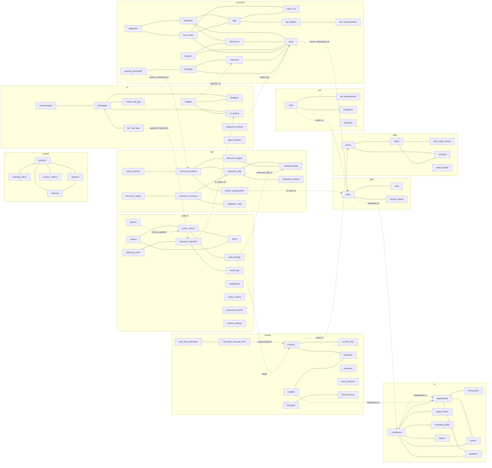

Quy tắc đọc: đường liền trong một subgraph = FK thật; mọi đường giữa hai subgraph = soft reference (uuid + index, không constraint). Quan hệ đầy đủ theo schema ở §3.2–3.11; danh sách cột ở §4.

### 3.2. `auth`

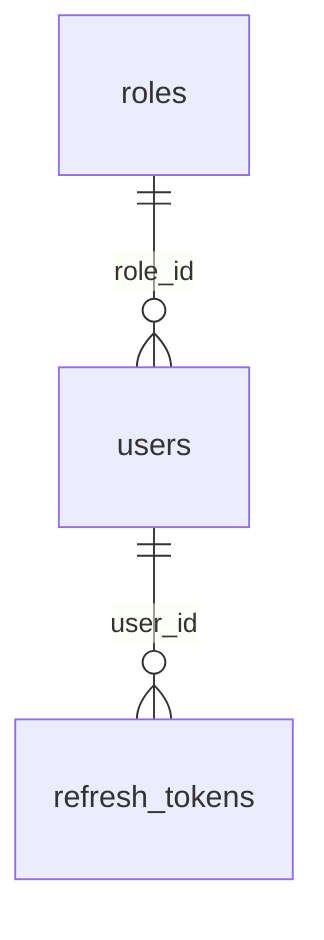

### 3.3. `finance`

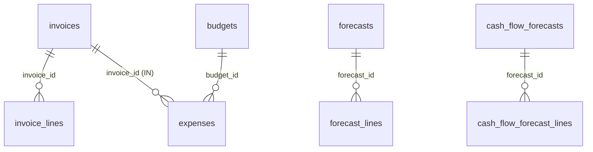

### 3.4. `sales`

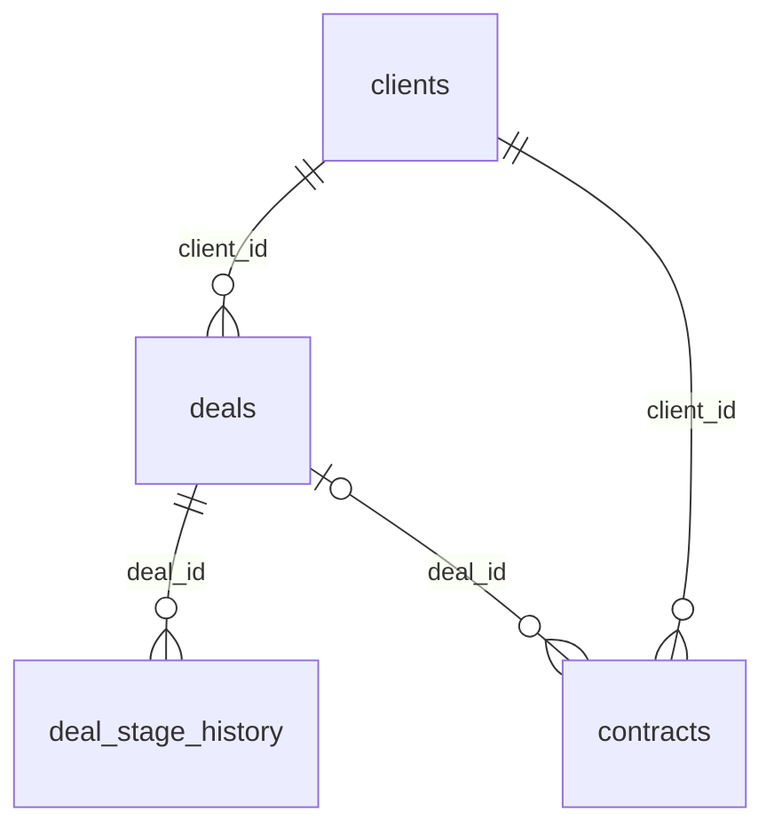

### 3.5. `hr`

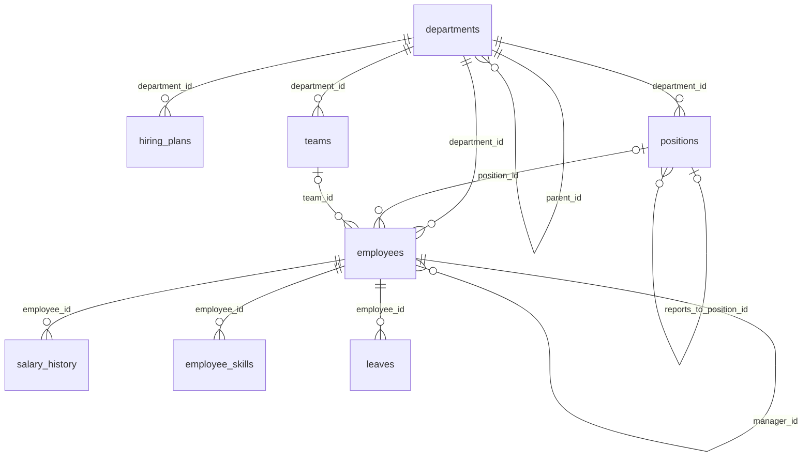

### 3.6. `product`

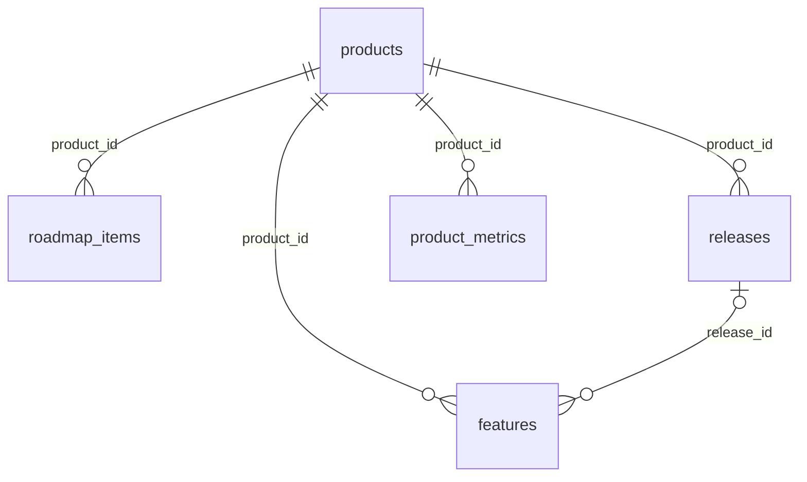

### 3.7. `risk`

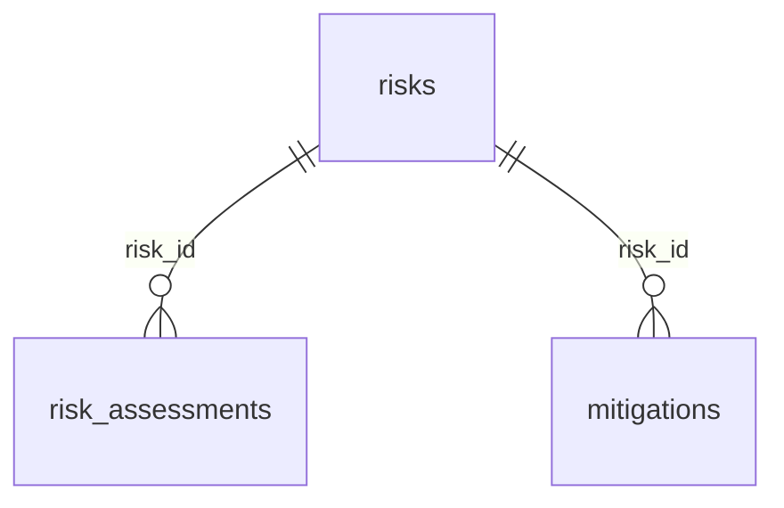

`scenarios.risk_ids uuid[]` (danh sách risk trong cùng schema, GIN index; không FK mảng).

### 3.8. `execution`

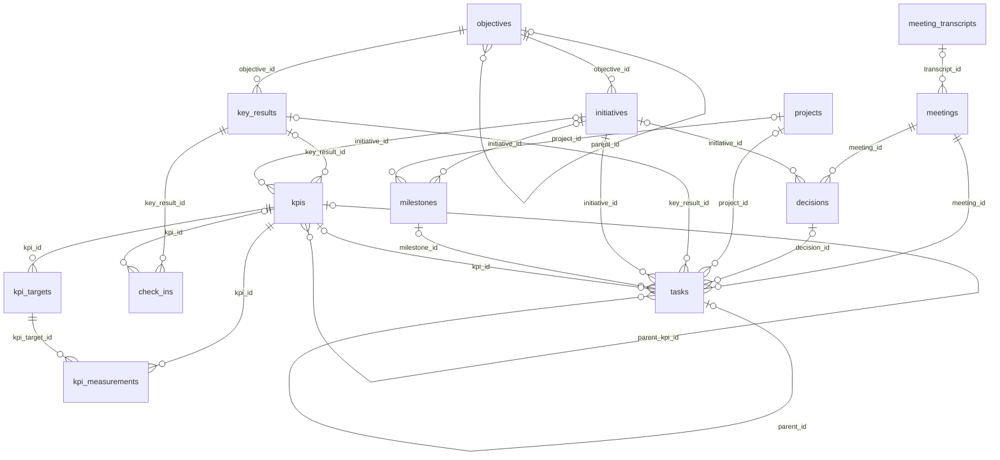

### 3.9. `ai`

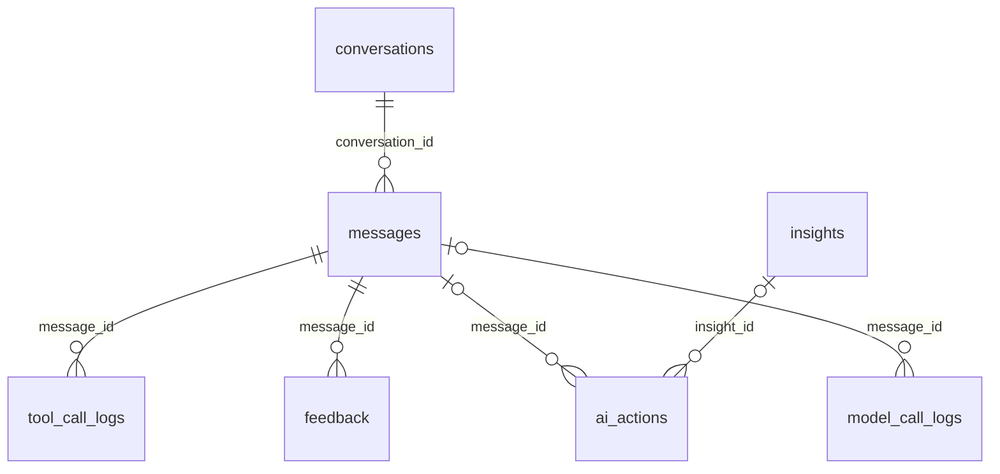

`agent_profiles.code` được tham chiếu bằng giá trị text `agent_profile_code` ở `tool_call_logs`, `ai_actions` (và `platform.audit_logs`) — không FK để log append-only không phụ thuộc cấu hình.

### 3.10. `idp`

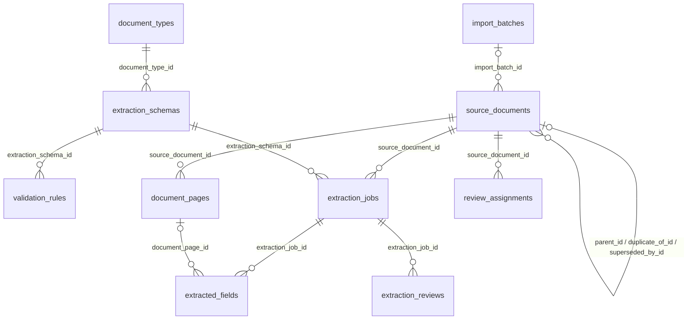

### 3.11. `platform`

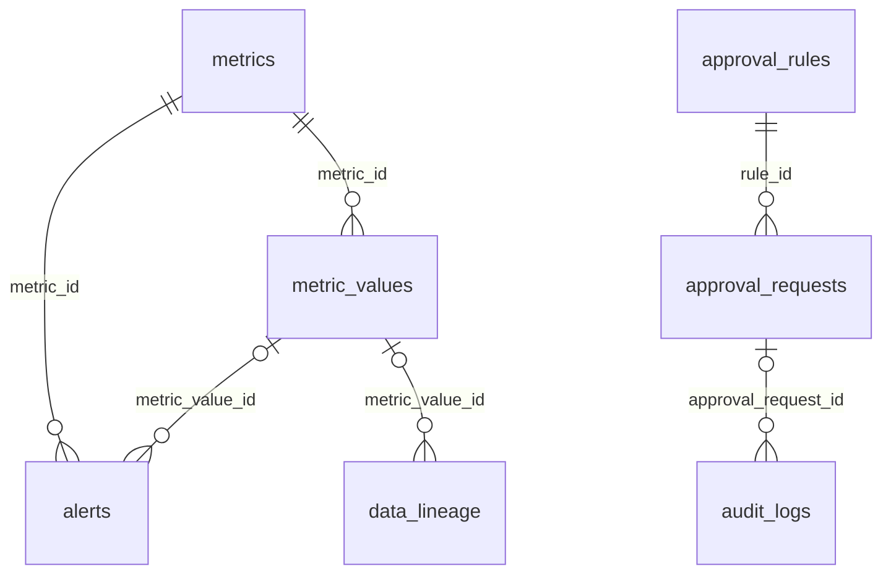

`reports.metric_snapshot` tham chiếu `metric_values` (jsonb, không FK); `approval_requests.ai_action_id` → `ai.ai_actions` (soft ref).

---

## 4. Đặc tả entity

Cột chuẩn (`id`, `created_at`, `updated_at`, `deleted_at`, `created_by`, `updated_by`) không lặp lại (§1). Index FK/SR ghi ở dòng "Index" dưới mỗi bảng; tên theo `ix_<table>_<column>`.

### 4.1. Schema `auth`

#### ENT-Role — `auth.roles`

| Cột | Kiểu | Null | Ràng buộc | Mô tả |
|---|---|---|---|---|
| code | auth.role_code | N | UQ | `CEO`…`ADMIN` (§6) |
| role_ref | text | N | UQ | `ROLE-01`..`ROLE-10` |
| name_vi / name_en | text | N | | Tên hiển thị (i18n seed) |
| permissions | text[] | N | | Permission string `<domain>:<action>` (02 §5.2) — nguồn sinh JWT `permissions[]` |
| scope_rules | jsonb | N | | Ký hiệu phạm vi theo permission (`{"finance:read":"r"}` — 02 §5.3) |
| pillars | platform.pillar[] | N | | Trụ dashboard (00 §4.1) |

Seed 10 bản ghi, không sửa qua UI (đổi quyền = đổi 02 + migration seed). Không `deleted_at`. **Không có entity `Permission` riêng** (v2.1): permission là mảng `permissions` của role; role tùy biến hoãn v2.1 (DEC-150) — khi có thì tách bảng.

#### ENT-User — `auth.users`

| Cột | Kiểu | Null | Ràng buộc | Mô tả | Mức |
|---|---|---|---|---|---|
| email | citext | N | UQ | Đăng nhập | 3 |
| password_hash | text | N | | bcrypt/argon2; **không bao giờ** trong response | HT |
| full_name | text | N | | | 3 |
| role_id | uuid | N | FK → roles | Một user một role (DEC-128) | |
| department_id | uuid | Y | SR → hr.departments | Phạm vi `d` (MANAGER) | |
| employee_id | uuid | Y | SR → hr.employees, UQ | Liên kết hồ sơ nhân sự (phạm vi `o`) | |
| locale | text | N | CK ∈ (`vi`,`en`) | Mặc định `vi` (DEC-135) | |
| is_active | boolean | N | | | |
| last_login_at | timestamptz | Y | | | |
| failed_login_count | smallint | N | | Khóa tạm sau 5 lần (02 §4) | |
| locked_until | timestamptz | Y | | | |

Index: `ix_users_role_id`, `ix_users_department_id`, `ix_users_employee_id`. **Service account (DEC-150):** đúng 1 user `is_service_account = true` (cột boolean N, mặc định false) chạy job theo lịch (briefing, báo cáo định kỳ, recompute); không đăng nhập được, không có mật khẩu dùng được; permission = `dashboard:read` + `platform:read` + quyền ghi tối thiểu của job; audit `actor_type = SYSTEM`.

#### ENT-RefreshToken — `auth.refresh_tokens`

| Cột | Kiểu | Null | Ràng buộc | Mô tả |
|---|---|---|---|---|
| user_id | uuid | N | FK → users | |
| token_hash | char(64) | N | UQ | SHA-256 của token (không lưu token thô) |
| family_id | uuid | N | | Xoay vòng; phát hiện reuse → thu hồi cả family |
| expires_at | timestamptz | N | | |
| revoked_at | timestamptz | Y | | Logout / đổi role |
| user_agent / ip_address | text / inet | Y | | |

Index: `ix_refresh_tokens_user_id`, `ix_refresh_tokens_family_id`. Không `deleted_at` (thu hồi = `revoked_at`).

### 4.2. Schema `finance`

#### ENT-Revenue — `finance.revenues`

| Cột | Kiểu | Null | Ràng buộc | Mô tả |
|---|---|---|---|---|
| source_note | text | N | | Mô tả nguồn (khách, hợp đồng, BCTC) — **đổi tên từ `source`** (v2.1, tránh trùng C19) |
| category | finance.revenue_category | N | | `product_sales`, `service`, `consulting`, `other` |
| amount | bigint | N | CK ≥ 0 | Trước VAT |
| currency | char(3) | N | | |
| revenue_date | date | N | | Ngày ghi nhận; BCTC theo tháng = ngày cuối tháng |
| period_key | text | N | | `YYYY-MM` (sinh từ `revenue_date`) |
| client_id | uuid | Y | SR → sales.clients | |
| product_id | uuid | Y | SR → product.products | Doanh thu theo sản phẩm (CPO) |
| invoice_id | uuid | Y | FK → invoices | Khi phát sinh từ hóa đơn `OUT` |
| origin | finance.record_origin | N | | `manual`, `invoice`, `financial_report`, `imported` |
| description | text | Y | | |
| source_document_id | uuid | Y | SR → idp.source_documents | |

Index: FK/SR; `(period_key, category)`.

#### ENT-Expense — `finance.expenses`

| Cột | Kiểu | Null | Ràng buộc | Mô tả |
|---|---|---|---|---|
| title | text | N | | |
| category | finance.expense_category | N | | `salary`, `cogs`, `infrastructure`, `marketing`, `office`, `travel`, `other` |
| department_id | uuid | Y | SR → hr.departments | So ngân sách |
| budget_id | uuid | Y | FK → budgets | |
| amount / currency | bigint / char(3) | N | CK ≥ 0 | |
| expense_date | date | N | | |
| period_key | text | N | | `YYYY-MM` |
| is_recurring | boolean | N | | |
| recurrence_period | finance.recurrence_period | Y | | `monthly`, `quarterly`, `yearly` |
| invoice_id | uuid | Y | FK → invoices | Hóa đơn đầu vào (UC-08) |
| counterparty_name / counterparty_tax_code | text | Y | | Nhà cung cấp (04 OQ-04) |
| origin | finance.record_origin | N | | |
| description | text | Y | | |
| source_document_id | uuid | Y | SR → idp.source_documents | |

Index: FK/SR; `(period_key, department_id)`, `(period_key, category)`.

#### ENT-Budget — `finance.budgets`

| Cột | Kiểu | Null | Ràng buộc | Mô tả |
|---|---|---|---|---|
| department_id | uuid | N | SR → hr.departments | |
| fiscal_year | smallint | N | | |
| quarter | finance.quarter | Y | | `Q1`..`Q4`; null = cả năm |
| allocated_amount / currency | bigint / char(3) | N | CK > 0 | |
| categories | jsonb | N | | `[{category, allocated_amount}]` |
| notes | text | Y | | |
| source_document_id | uuid | Y | SR | |

UQ `(department_id, fiscal_year, quarter) WHERE deleted_at IS NULL`. Index SR.

#### ENT-Forecast — `finance.forecasts`

| Cột | Kiểu | Null | Ràng buộc | Mô tả |
|---|---|---|---|---|
| horizon_months | smallint | N | CK ∈ (3, 6, 12) | |
| scenario | finance.forecast_scenario | N | | `base`, `optimistic`, `pessimistic` (3 kịch bản) |
| generated_at | timestamptz | N | | |
| generated_by | platform.actor_type | N | | `USER` / `AI` / `SYSTEM` |
| is_current | boolean | N | | Một bản current / scenario (partial UQ) |
| assumptions | jsonb | N | | Giả định (tăng trưởng, tuyển dụng đã duyệt…) |
| ai_insights | text | Y | | Diễn giải AI (có nguồn) |

UQ `(scenario) WHERE is_current AND deleted_at IS NULL`.

#### ENT-ForecastLine — `finance.forecast_lines`

| Cột | Kiểu | Null | Ràng buộc | Mô tả |
|---|---|---|---|---|
| forecast_id | uuid | N | FK → forecasts | |
| period_key | text | N | | `YYYY-MM` |
| projected_revenue / projected_expenses / projected_net_profit / projected_closing_cash | bigint | N | | |
| currency | char(3) | N | | |
| confidence_level | platform.confidence_band | N | | `HIGH`/`MEDIUM`/`LOW` |

UQ `(forecast_id, period_key)`; index `ix_forecast_lines_forecast_id`.

#### ENT-Invoice — `finance.invoices`

| Cột | Kiểu | Null | Ràng buộc | Mô tả |
|---|---|---|---|---|
| direction | finance.invoice_direction | N | | `OUT` (phải thu) / `IN` (phải trả) |
| series | text | Y | | Ký hiệu |
| number | text | N | | Số hóa đơn |
| issue_date | date | N | | |
| due_date | date | Y | CK ≥ issue_date | |
| client_id | uuid | Y | SR → sales.clients | Bắt buộc khi `OUT` (CK) |
| client_name_snapshot / client_tax_code | text | Y | | Ảnh chụp tại thời điểm xuất |
| counterparty_name / counterparty_tax_code | text | Y | | Người bán khi `IN` |
| subtotal | bigint | N | CK ≥ 0 | Trước VAT (XD-01) |
| vat_rate_pct | numeric(7,4) | N | CK ∈ (0,5,8,10) | |
| vat_amount | bigint | N | | |
| total_amount | bigint | N | CK = subtotal + vat_amount | |
| paid_amount | bigint | N | CK 0 ≤ paid ≤ total | |
| amount_due | bigint | N | GENERATED `total_amount − paid_amount` STORED | |
| currency | char(3) | N | | |
| status | finance.invoice_status | N | | `draft`, `sent`, `partial`, `paid`, `overdue`, `cancelled` |
| paid_at | timestamptz | Y | | Khi `paid` → `EVT-finance.invoice_paid` |
| notes | text | Y | | |
| source_document_id | uuid | Y | SR | |

UQ nghiệp vụ (XD-05): `(direction, COALESCE(counterparty_tax_code,''), COALESCE(series,''), number) WHERE deleted_at IS NULL`. Index SR; `(direction, status, due_date)`, `(issue_date)`. `overdue` do job hằng ngày đặt (METRIC-FIN-05).

#### ENT-InvoiceLine — `finance.invoice_lines`

| Cột | Kiểu | Null | Ràng buộc | Mô tả |
|---|---|---|---|---|
| invoice_id | uuid | N | FK → invoices | |
| line_no | smallint | N | | UQ `(invoice_id, line_no)` |
| description | text | N | | |
| quantity | numeric(20,6) | N | CK > 0 | |
| unit_price / amount | bigint | N | | `amount ≈ quantity × unit_price` |
| product_id | uuid | Y | SR → product.products | |

Index `ix_invoice_lines_invoice_id`, `ix_invoice_lines_product_id`.

#### ENT-CashPosition — `finance.cash_positions`

| Cột | Kiểu | Null | Ràng buộc | Mô tả |
|---|---|---|---|---|
| period_key | text | N | UQ (khi `deleted_at IS NULL`) | `YYYY-MM` |
| closing_balance / currency | bigint / char(3) | N | | |
| cash_source | finance.cash_source | N | | `bank_statement`, `manual`, `imported` — **đổi tên từ `source`** (v2.1, C19); field API EP-65 cập nhật ở 10 (Phase 3d) |
| note | text | Y | | |
| recorded_by | uuid | N | SR → auth.users | |
| source_document_id | uuid | Y | SR | |

Nguồn METRIC-FIN-03 (runway = closing_balance / net burn TB 3 tháng — 03).

#### ENT-CashFlowForecast — `finance.cash_flow_forecasts` (mới v2.1 — DEC-148, GAP C-18)

Dự báo dòng tiền **13 tuần** (CFO demo; UC-08). Khác ENT-Forecast (theo tháng, horizon 3/6/12, 3 kịch bản P&L).

| Cột | Kiểu | Null | Ràng buộc | Mô tả |
|---|---|---|---|---|
| start_week | date | N | | Thứ Hai đầu tuần 1 (ISO week) |
| weeks | smallint | N | CK = 13 | Cố định 13 (cấu hình được về sau) |
| opening_cash / currency | bigint / char(3) | N | | Từ `cash_positions` gần nhất |
| min_projected_cash | bigint | N | | Đáy dự báo trong 13 tuần |
| min_cash_week | smallint | N | CK 1..13 | Tuần chạm đáy |
| generated_at | timestamptz | N | | |
| generated_by | platform.actor_type | N | | `USER`/`AI`/`SYSTEM` |
| is_current | boolean | N | | UQ `(is_current) WHERE is_current AND deleted_at IS NULL` |
| assumptions | jsonb | N | | Tỷ lệ thu đúng hạn, chi cố định, lương… |

#### ENT-CashFlowForecastLine — `finance.cash_flow_forecast_lines` (mới v2.1 — DEC-148)

| Cột | Kiểu | Null | Ràng buộc | Mô tả |
|---|---|---|---|---|
| forecast_id | uuid | N | FK → cash_flow_forecasts | |
| week_no | smallint | N | CK 1..13 | UQ `(forecast_id, week_no)` |
| week_start | date | N | | |
| inflow_receivables / inflow_other | bigint | N | | Từ `invoices` OUT chưa thu theo `due_date` + khác |
| outflow_payables / outflow_payroll / outflow_opex / outflow_other | bigint | N | | `invoices` IN chưa trả, lương (tổng từ `hr` service — không lộ lương cá nhân), chi định kỳ |
| net_flow / closing_cash | bigint | N | | Tính sẵn |
| currency | char(3) | N | | |
| confidence_level | platform.confidence_band | N | | |

Index `ix_cash_flow_forecast_lines_forecast_id`. Tính lại khi `EVT-finance.invoice_created`, `EVT-finance.invoice_paid`, `EVT-hr.salary_updated`; phát `EVT-finance.cash_flow_forecast_updated`.

### 4.3. Schema `sales`

#### ENT-Client — `sales.clients` (master data khách hàng)

| Cột | Kiểu | Null | Ràng buộc | Mô tả | Mức |
|---|---|---|---|---|---|
| name | text | N | | Tên pháp lý | |
| normalized_name | text | N | | Chuẩn hóa để so khớp (04 §13.1); index trigram `gin_trgm_ops` | |
| tax_code | text | Y | UQ (khi không null, `deleted_at IS NULL`) | MST | |
| industry | text | Y | | | |
| company_size | sales.company_size | Y | | `startup`, `small`, `medium`, `enterprise` | |
| contact_person / contact_email / contact_phone | text | Y | | Người liên hệ | 3 |
| address / website | text | Y | | Địa chỉ doanh nghiệp (không phải cá nhân) | |
| account_owner_id | uuid | Y | SR → auth.users | Sales phụ trách | |
| status | sales.client_status | N | | `prospect`, `active`, `churned` | |
| merged_into_id | uuid | Y | FK → clients | Khi gộp trùng master (người duyệt) | |
| notes | text | Y | | | |

Index: `ix_clients_account_owner_id`, `ix_clients_merged_into_id`, GIN trigram `normalized_name`.

#### ENT-Deal — `sales.deals`

| Cột | Kiểu | Null | Ràng buộc | Mô tả |
|---|---|---|---|---|
| name | text | N | | |
| client_id | uuid | N | FK → clients | |
| deal_value / currency | bigint / char(3) | N | CK ≥ 0 | |
| stage | sales.deal_stage | N | | `lead`, `qualified`, `proposal`, `negotiation`, `closed_won`, `closed_lost` |
| probability_pct | numeric(7,4) | N | CK 0–100 | |
| weighted_value | bigint | N | GENERATED `deal_value × probability_pct / 100` STORED | |
| expected_close_date | date | Y | | |
| closed_at | timestamptz | Y | | Khi `closed_*` |
| lost_reason | text | Y | | |
| assigned_to | uuid | N | SR → auth.users | |
| department_id | uuid | Y | SR → hr.departments | |
| product_id | uuid | Y | SR → product.products | |
| tags | text[] | N | | |
| description | text | Y | | |
| source_document_id | uuid | Y | SR | |

Index: FK/SR; `(stage, expected_close_date)`. Đổi `stage` → thêm `deal_stage_history` + event `EVT-sales.deal_closed_won/lost`.

#### ENT-DealStageHistory — `sales.deal_stage_history` (append-only)

| Cột | Kiểu | Null | Ràng buộc | Mô tả |
|---|---|---|---|---|
| deal_id | uuid | N | FK → deals | |
| stage | sales.deal_stage | N | | |
| entered_at | timestamptz | N | | |
| exited_at | timestamptz | Y | | Null = giai đoạn hiện tại |

Index `ix_deal_stage_history_deal_id`. Nguồn METRIC-CUS-06 (chu kỳ bán TB).

#### ENT-SalesTarget — `sales.sales_targets`

| Cột | Kiểu | Null | Ràng buộc | Mô tả |
|---|---|---|---|---|
| period_type | platform.period_type | N | | `MONTH`, `QUARTER`, `YEAR` |
| period_key | text | N | | |
| scope | sales.target_scope | N | | `team`, `individual` |
| owner_id | uuid | Y | SR → auth.users | Bắt buộc khi `individual` |
| target_amount / currency | bigint / char(3) | N | CK > 0 | |

UQ `(period_key, scope, COALESCE(owner_id, '00000000-0000-0000-0000-000000000000')) WHERE deleted_at IS NULL`.

#### ENT-Contract — `sales.contracts`

| Cột | Kiểu | Null | Ràng buộc | Mô tả |
|---|---|---|---|---|
| contract_number | text | N | UQ (khi `deleted_at IS NULL`) | |
| client_id | uuid | N | FK → clients | |
| deal_id | uuid | Y | FK → deals | |
| contract_value / currency | bigint / char(3) | N | CK > 0 | Trường trọng yếu |
| signed_at | date | N | | |
| effective_date / expiry_date | date | N / Y | CK expiry ≥ effective | |
| renewal_notice_days | smallint | Y | | Nhắc gia hạn |
| payment_terms | jsonb | Y | | `[{due_date, amount, description}]` |
| status | sales.contract_status | N | | `draft`, `active`, `expired`, `terminated` |
| is_recurring | boolean | N | | Tính NRR (METRIC-CUS-03) |
| source_document_id | uuid | Y | SR | |

Index: FK/SR; `(status, expiry_date)`.

### 4.4. Schema `hr`

#### ENT-Department — `hr.departments` (soft-ref target toàn hệ thống)

| Cột | Kiểu | Null | Ràng buộc | Mô tả |
|---|---|---|---|---|
| code | text | N | UQ | |
| name | text | N | | |
| aliases | text[] | N | | Tên thay thế để so khớp IDP |
| parent_id | uuid | Y | FK → departments | Cây tổ chức (UC-07) |
| head_employee_id | uuid | Y | FK → employees | |
| cost_center | text | Y | | |

Index `ix_departments_parent_id`, `ix_departments_head_employee_id`. Mức 1 (đọc tham chiếu bởi mọi user).

#### ENT-Employee — `hr.employees`

| Cột | Kiểu | Null | Ràng buộc | Mô tả | Mức |
|---|---|---|---|---|---|
| employee_code | text | N | UQ (khi `deleted_at IS NULL`) | Mã NV | |
| full_name | text | N | | | 3 |
| normalized_name | text | N | | So khớp XD-03 (trigram) | 3 |
| email | citext | Y | UQ | | 3 |
| phone | text | Y | | | 3 |
| department_id | uuid | N | FK → departments | | |
| position_id | uuid | Y | FK → positions | **v2.1 (DEC-147)** — thay cột text `position`; migration map tên → ENT-Position | |
| team_id | uuid | Y | FK → teams | v2.1 (DEC-147) | |
| status | hr.employee_status | N | | `probation`, `active`, `on_leave`, `terminated` | |
| hire_date | date | N | | | |
| termination_date | date | Y | CK ≥ hire_date | Nguồn METRIC-HR-02 | |
| contract_type | hr.contract_type | Y | | `permanent`, `fixed_term`, `probation`, `intern`, `contractor` | |
| manager_id | uuid | Y | FK → employees | Không tạo vòng (check ở service) | |
| date_of_birth | date | Y | | | **4** |
| address | text | Y | | | **4** |
| national_id | text | Y | | CCCD — mã hóa cột (pgcrypto) | **4** |
| bank_account | text | Y | | Mã hóa cột | **4** |
| emergency_contact | jsonb | Y | | | **4** |
| source_document_id | uuid | Y | SR | | |

Index: FK; GIN trigram `normalized_name`; `(department_id, status)`. Không có cột lương — lương nằm ở `salary_history` (để tách quyền mức 4).

#### ENT-Team — `hr.teams` (mới v2.1 — DEC-147)

| Cột | Kiểu | Null | Ràng buộc | Mô tả |
|---|---|---|---|---|
| department_id | uuid | N | FK → departments | Một team thuộc một phòng ban (không ma trận — hoãn v2.1) |
| code / name | text / text | N | UQ code | |
| lead_employee_id | uuid | Y | FK → employees | |

Index FK. Mức 1.

#### ENT-Position — `hr.positions` (mới v2.1 — DEC-147)

| Cột | Kiểu | Null | Ràng buộc | Mô tả |
|---|---|---|---|---|
| department_id | uuid | N | FK → departments | |
| code / title | text / text | N | UQ code | Chức danh |
| level | smallint | Y | | Cấp bậc (tùy chọn) |
| headcount_budget | smallint | N | CK ≥ 0 | Định biên — so với `employees` đang giữ vị trí → **vị trí trống** (sơ đồ tổ chức, US-HR-002) |
| reports_to_position_id | uuid | Y | FK → positions | Reporting line theo vị trí |

Index FK. Không effective-dated, không kiêm nhiệm (một nhân viên một `position_id`) — hoãn v2.1 (DEC-147).

#### ENT-EmployeeSkill — `hr.employee_skills` (mới v2.1 — DEC-147, GAP C-12)

| Cột | Kiểu | Null | Ràng buộc | Mô tả |
|---|---|---|---|---|
| employee_id | uuid | N | FK → employees | |
| skill | text | N | | Danh mục tự do, chuẩn hóa lowercase |
| level | smallint | N | CK 1..5 | |
| verified_by | uuid | Y | SR → auth.users | |

UQ `(employee_id, skill) WHERE deleted_at IS NULL`. Không AI tự chấm (DEC-149). Phân tích thiếu hụt kỹ năng = v2.1 (US-HR-005).

#### ENT-Leave — `hr.leaves` (mới v2.1 — DEC-147, GAP C-12)

| Cột | Kiểu | Null | Ràng buộc | Mô tả |
|---|---|---|---|---|
| employee_id | uuid | N | FK → employees | |
| leave_type | hr.leave_type | N | | `annual`, `sick`, `unpaid`, `public_holiday`, `other` |
| start_date / end_date | date | N | CK end ≥ start | |
| hours | numeric(6,2) | N | | Giờ nghỉ — trừ vào capacity (METRIC-HR-03, GAP C-11) |
| status | hr.leave_status | N | | `requested`, `approved`, `rejected`, `cancelled` |
| reason | text | Y | | Mức 3; lý do sức khỏe = `SECRET` (DEC-149) |

Index `(employee_id, start_date)`. Chỉ `approved` trừ capacity.

#### ENT-SalaryHistory — `hr.salary_history` (append-only, **mức 4**)

| Cột | Kiểu | Null | Ràng buộc | Mô tả |
|---|---|---|---|---|
| employee_id | uuid | N | FK → employees | |
| base_salary | bigint | N | CK > 0 | **Mức 4** |
| currency | char(3) | N | | |
| effective_date | date | N | | UQ `(employee_id, effective_date)` |
| reason | text | Y | | |
| source_document_id | uuid | Y | SR | |

Index `ix_salary_history_employee_id`. Thêm bản ghi → `EVT-hr.salary_updated` (payload **không** chứa số lương — §5.3). Quỹ lương tổng cho CFO/CEO: view `hr.v_payroll_by_department` (chỉ tổng theo phòng ban, kỳ).

#### ENT-HiringPlan — `hr.hiring_plans`

| Cột | Kiểu | Null | Ràng buộc | Mô tả |
|---|---|---|---|---|
| title | text | N | | |
| department_id | uuid | N | FK → departments | |
| position | text | N | | |
| headcount / filled | smallint | N | CK 0 ≤ filled ≤ headcount | |
| priority | hr.hiring_priority | N | | `low`, `medium`, `high`, `critical` |
| status | hr.hiring_status | N | | `draft`, `submitted`, `approved`, `rejected`, `in_progress`, `completed`, `cancelled` (02 §8) |
| salary_range_min / salary_range_max | bigint | Y | | Dải lương chung của vị trí — mức 2 |
| currency | char(3) | N | | |
| start_date / target_fill_date | date | N | | |
| hiring_manager_id | uuid | N | SR → auth.users | |
| approved_by / approved_at | uuid / timestamptz | Y | SR → auth.users | ≠ `created_by` |
| reject_reason | text | Y | | Bắt buộc khi `rejected` |
| requirements | text | Y | | |
| budget_allocated / budget_spent | bigint | N | | |
| delayed_notified_at | timestamptz | Y | | Chống phát `EVT-hr.hiring_plan_delayed` lặp |

Index: FK/SR; `(status, target_fill_date)`. Nguồn METRIC-HR-04.

### 4.5. Schema `product`

#### ENT-Product — `product.products`

| Cột | Kiểu | Null | Ràng buộc | Mô tả |
|---|---|---|---|---|
| code | text | N | UQ | VD `ABC-ORDER` |
| name | text | N | | |
| description | text | Y | | |
| status | product.product_status | N | | `active`, `paused`, `retired` |
| lifecycle_stage | product.lifecycle_stage | N | | `idea`, `development`, `launched`, `growth`, `mature`, `sunset` |
| target_launch_date / launched_at | date | Y | | Release đầu → `EVT-product.product_launched` |
| owner_id | uuid | N | SR → auth.users | |

#### ENT-Feature — `product.features`

| Cột | Kiểu | Null | Ràng buộc | Mô tả |
|---|---|---|---|---|
| product_id | uuid | N | FK → products | |
| name | text | N | | |
| status | product.feature_status | N | | `planned`, `in_progress`, `released`, `deprecated` |
| release_id | uuid | Y | FK → releases | Sang `released` → `EVT-product.feature_released` |
| roadmap_item_id | uuid | Y | FK → roadmap_items | |

Index FK.

#### ENT-RoadmapItem — `product.roadmap_items`

| Cột | Kiểu | Null | Ràng buộc | Mô tả |
|---|---|---|---|---|
| product_id | uuid | N | FK → products | |
| title | text | N | | |
| quarter | text | N | | `YYYY-Qn` |
| planned_date / completed_at | date | Y | | METRIC-PRD-04 đúng tiến độ |
| status | product.roadmap_status | N | | `planned`, `in_progress`, `done`, `delayed`, `dropped` |

#### ENT-Release — `product.releases`

| Cột | Kiểu | Null | Ràng buộc | Mô tả |
|---|---|---|---|---|
| product_id | uuid | N | FK → products | |
| release_version | text | N | UQ `(product_id, release_version)` | Số phiên bản phát hành (VD `2.3.0`) — **đổi tên từ `version`** (v2.1, C19) |
| status | product.release_status | N | | `planned`, `in_progress`, `released`, `rolled_back` |
| released_at | timestamptz | Y | | METRIC-PRD-05 |
| release_notes | text | Y | | |

#### ENT-ProductMetric — `product.product_metrics` (snapshot append-only)

| Cột | Kiểu | Null | Ràng buộc | Mô tả |
|---|---|---|---|---|
| product_id | uuid | N | FK → products | |
| period_key | text | N | | `YYYY-MM` |
| mau / dau | integer | N / Y | CK dau ≤ mau | METRIC-PRD-01 |
| adoption_rate_pct / churn_rate_pct / retention_30d_pct | numeric(7,4) | Y / N / Y | CK 0–100 | METRIC-PRD-01..03 |
| nps | numeric(6,2) | Y | CK −100..100 | |
| arpu / currency | bigint / char(3) | Y | | |
| superseded_by_id | uuid | Y | FK → product_metrics | Bản ghi mới thay thế hiển thị (không UPDATE số) |
| source_document_id | uuid | Y | SR | |

Index FK; partial UQ `(product_id, period_key) WHERE superseded_by_id IS NULL`. Không `deleted_at`.

### 4.6. Schema `risk`

#### ENT-Risk — `risk.risks`

| Cột | Kiểu | Null | Ràng buộc | Mô tả |
|---|---|---|---|---|
| code | text | N | UQ | `RSK-2026-001` (sinh tự động) |
| title / description | text | N / Y | | |
| category | risk.risk_category | N | | **13 danh mục BRD (DEC-148):** `financial`, `operational`, `strategic`, `people`, `business`, `customer`, `product`, `technology`, `security`, `compliance`, `legal`, `partner_supplier`, `ai`. Migration: `market` → `business` |
| likelihood / impact | smallint | N | CK 1–5 | |
| risk_score | smallint | N | GENERATED `likelihood × impact` STORED | |
| severity | risk.risk_severity | N | | `low`, `medium`, `high`, `critical` (ngưỡng ở 03 BR-RSK) |
| status | risk.risk_status | N | | **`proposed`** (v2.1, DEC-148) → `identified` → `assessed` → `mitigating` → `monitoring` → `accepted` / `closed`; `proposed` → `rejected` (owner bác bỏ) |
| proposed_at / confirmed_by / confirmed_at | timestamptz / uuid / timestamptz | Y | SR → auth.users | v2.1: rủi ro AI/event đề xuất chờ owner xác nhận (BRD FR-RSK-05) |
| risk_source | risk.risk_source | N | | `manual`, `event`, `ai`, `document` — **đổi tên từ `source`** (v2.1, C19) |
| source_event_id | uuid | Y | | `event_id` gây sinh rủi ro (idempotent) |
| owner_id | uuid | Y | SR → auth.users | Null → METRIC-RSK-02 |
| department_id | uuid | Y | SR → hr.departments | |
| linked_entities | jsonb | N | | `{hiring_plan_id, budget_id, deal_id, product_id, client_id}` (soft ref) |
| review_date | date | Y | | |
| accepted_by / accepted_reason / accepted_at | uuid / text / timestamptz | Y | SR → auth.users | Bắt buộc lý do (`risk:approve`) |
| identified_at | timestamptz | N | | METRIC-RSK-03 (> 30 ngày không mitigation) |
| source_document_id | uuid | Y | SR | |

Index: SR; `(status, severity)`; UQ `(source_event_id) WHERE source_event_id IS NOT NULL`; GIN `linked_entities`.

**Trạng thái `proposed` (DEC-148):** rủi ro `risk_source ∈ (event, ai, document)` tạo ở `proposed`, phát `EVT-risk.risk_proposed`; METRIC-RSK-01..05 **không** đếm `proposed`/`rejected`. Owner (hoặc `risk:approve`) xác nhận → `identified`, set `confirmed_*`, phát `EVT-risk.risk_identified` (nếu severity ≥ high). Rủi ro nhập tay (`manual`) vào thẳng `identified`. Story R-12 (08) giữ: rủi ro tự sinh hiện ở hàng chờ đề xuất "chờ phân công".

#### ENT-RiskAssessment — `risk.risk_assessments` (append-only)

| Cột | Kiểu | Null | Ràng buộc | Mô tả |
|---|---|---|---|---|
| risk_id | uuid | N | FK → risks | |
| likelihood / impact / risk_score | smallint | N | | |
| severity | risk.risk_severity | N | | |
| assessed_at | timestamptz | N | | |
| assessed_by | uuid | Y | SR → auth.users | Null = AI/SYSTEM |
| rationale | text | Y | | |

#### ENT-Mitigation — `risk.mitigations`

| Cột | Kiểu | Null | Ràng buộc | Mô tả |
|---|---|---|---|---|
| risk_id | uuid | N | FK → risks | |
| title | text | N | | |
| owner_id | uuid | N | SR → auth.users | |
| status | risk.mitigation_status | N | | `planned`, `in_progress`, `done`, `cancelled` |
| due_date | date | N | | METRIC-RSK-05 quá hạn |
| progress_pct | numeric(7,4) | N | CK 0–100 | |
| completed_at | timestamptz | Y | | |
| task_id | uuid | Y | SR → execution.tasks | Biện pháp thực thi bằng task |

#### ENT-Scenario — `risk.scenarios`

| Cột | Kiểu | Null | Ràng buộc | Mô tả |
|---|---|---|---|---|
| name | text | N | | |
| risk_ids | uuid[] | N | | Risk trong schema (GIN) |
| horizon_months | smallint | N | | |
| assumptions | jsonb | N | | Biến what-if (VD tuyển thêm 3 sales) |
| impact_domains | text[] | N | | `finance`, `sales`, `hr`, `product` |
| results | jsonb | Y | | Kết quả theo miền (runway, doanh thu…) — có nguồn |
| run_at | timestamptz | Y | | |

### 4.7. Schema `execution`

#### ENT-Meeting — `execution.meetings`

| Cột | Kiểu | Null | Ràng buộc | Mô tả |
|---|---|---|---|---|
| title | text | N | | |
| held_at | timestamptz | N | | |
| chair_id | uuid | Y | SR → auth.users | |
| attendee_ids | uuid[] | N | | Soft ref users (GIN) |
| department_id | uuid | Y | SR → hr.departments | |
| summary | text | Y | | |
| source_document_id | uuid | Y | SR | Biên bản (UC-06) |
| transcript_id | uuid | Y | FK → meeting_transcripts | v2.1 (UC-02, DEC-153) |

#### ENT-Decision — `execution.decisions` (Decision Log)

| Cột | Kiểu | Null | Ràng buộc | Mô tả |
|---|---|---|---|---|
| meeting_id | uuid | Y | FK → meetings | |
| content | text | N | | |
| rationale / alternatives_rejected / expected_outcome | text | Y | | AI-EOS §4.6 |
| owner_id | uuid | Y | SR → auth.users | |
| decided_at | timestamptz | N | | |
| due_date | date | Y | | |
| review_at | date[] | N | | **v2.1 (GAP D-22):** mốc đối chiếu kết quả, mặc định `decided_at + {30,60,90} ngày` — thay `review_date`; khớp 10 EP-43 |
| actual_outcome / outcome_verified_at | text / timestamptz | Y | | Kết quả thực tế khi đối chiếu (BRD-P11, US-CEO-008) |
| initiative_id | uuid | Y | FK → initiatives | v2.1 |
| source_insight_id | uuid | Y | SR → ai.insights | Quyết định đến từ khuyến nghị AI |
| status | execution.decision_status | N | | `open`, `in_progress`, `done`, `cancelled` — METRIC-OPS-03 |
| done_at | timestamptz | Y | | |
| source_document_id | uuid | Y | SR | |

#### ENT-Task — `execution.tasks`

| Cột | Kiểu | Null | Ràng buộc | Mô tả |
|---|---|---|---|---|
| title / description | text | N / Y | | |
| owner_id | uuid | Y | SR → auth.users | **v2.1 (DEC-147):** người chịu trách nhiệm (giao/duyệt); có thể khác `assignee_id` |
| assignee_id | uuid | Y | SR → auth.users | Null = chưa có người (XD-03) |
| department_id | uuid | Y | SR → hr.departments | |
| project_id | uuid | Y | FK → projects | |
| meeting_id / decision_id | uuid | Y | FK → meetings / decisions | |
| key_result_id | uuid | Y | FK → key_results | |
| initiative_id / milestone_id | uuid | Y | FK → initiatives / milestones | v2.1 (DEC-147) |
| kpi_id | uuid | Y | FK → kpis | v2.1 — task khắc phục KPI (UC-03) |
| parent_id | uuid | Y | FK → tasks | |
| priority | execution.task_priority | N | | `low`, `medium`, `high`, `urgent` |
| status | execution.task_status | N | | **7 trạng thái BRD (DEC-147):** `backlog`, `todo`, `in_progress`, `blocked`, `in_review`, `done`, `cancelled` |
| start_date | date | Y | | v2.1 |
| blocked_reason | text | Y | | Bắt buộc khi `blocked` |
| due_date | date | Y | | |
| done_at | timestamptz | Y | | METRIC-OPS-01 đúng hạn |
| estimate_hours | numeric(6,2) | Y | | Workload (METRIC-HR-03); AI có thể gợi ý (L1) |
| actual_hours | numeric(6,2) | Y | | **v2.1 (DEC-147)** |
| evidence | jsonb | Y | | v2.1: `[{kind: file\|link\|note, ref}]` — bắt buộc khi cấu hình (BRD FR-TASK-04) |
| is_critical | boolean | N | | |
| task_source | execution.task_source | N | | `manual`, `meeting`, `ai`, `document`, `mitigation` — **đổi tên từ `source`** (v2.1, C19) |
| overdue_notified_at | timestamptz | Y | | Chống phát `EVT-execution.task_overdue` lặp |
| source_document_id | uuid | Y | SR | |

Index: FK/SR; `(assignee_id, status, due_date)`.

#### ENT-Project — `execution.projects`

| Cột | Kiểu | Null | Ràng buộc | Mô tả |
|---|---|---|---|---|
| code | text | N | UQ | |
| name | text | N | | |
| owner_id | uuid | N | SR → auth.users | |
| department_id | uuid | Y | SR | |
| start_date / planned_end_date / actual_end_date | date | Y | | METRIC-OPS-02 dự án trễ |
| status | execution.project_status | N | | `planned`, `active`, `on_hold`, `done`, `cancelled` |
| budget_amount / currency | bigint / char(3) | Y | | |

#### ENT-Objective — `execution.objectives`

| Cột | Kiểu | Null | Ràng buộc | Mô tả |
|---|---|---|---|---|
| title | text | N | | |
| period_key | text | N | | `YYYY-Qn` / `YYYY` |
| level | execution.objective_level | N | | `company`, `department`, `team` (v2.1), `individual` |
| okr_type | execution.okr_type | N | | **v2.1:** `committed`, `aspirational` (BRD FR-OKR-03) |
| weight_pct | numeric(7,4) | N | CK 0–100 | **v2.1 (GAP C-03)** — trọng số trong cha; tổng anh em = 100 (kiểm ở service) |
| team_id | uuid | Y | SR → hr.teams | |
| parent_id | uuid | Y | FK → objectives | Cây alignment |
| owner_id | uuid | N | SR → auth.users | |
| department_id | uuid | Y | SR | |
| pillar | platform.pillar | Y | | |
| status | execution.okr_status | N | | `draft`, `active`, `closed` |
| progress_pct | numeric(7,4) | N | | Tổng hợp từ KR (bình quân trọng số) |
| score | numeric(3,2) | Y | CK 0–1 | Chấm cuối kỳ 0,0–1,0 (BRD FR-OKR-03) |
| source_document_id | uuid | Y | SR | |

#### ENT-KeyResult — `execution.key_results`

| Cột | Kiểu | Null | Ràng buộc | Mô tả |
|---|---|---|---|---|
| objective_id | uuid | N | FK → objectives | |
| title | text | N | | |
| metric_code | text | Y | | `METRIC-*` khi KR gắn metric hệ thống (XD-04) |
| unit | text | N | | |
| baseline / target / current_value | numeric(20,6) | N / N / Y | | |
| owner_id | uuid | N | SR → auth.users | |
| status | execution.okr_status | N | | |
| confidence | platform.confidence_band | Y | | Tự đánh giá khi check-in |
| weight_pct | numeric(7,4) | N | CK 0–100 | v2.1; 2–5 KR / Objective (kiểm ở service — BRD FR-OKR-01) |

#### ENT-CheckIn — `execution.check_ins`

| Cột | Kiểu | Null | Ràng buộc | Mô tả |
|---|---|---|---|---|
| key_result_id | uuid | Y | FK → key_results | CK đúng một trong `key_result_id` / `kpi_id` |
| kpi_id | uuid | Y | FK → kpis | **v2.1 (GAP C-08)** — khớp 10 EP-48 |
| value | numeric(20,6) | N | | |
| note | text | Y | | |
| blocker / support_needed / next_action | text | Y | | **v2.1 (BRD FR-OKR-04)** |
| confidence | platform.confidence_band | N | | |
| checked_in_at | timestamptz | N | | F4 ≤ 30 giây |
| user_id | uuid | N | SR → auth.users | |

#### ENT-KPI — `execution.kpis`

| Cột | Kiểu | Null | Ràng buộc | Mô tả |
|---|---|---|---|---|
| code | text | N | UQ | |
| name | text | N | | |
| metric_code | text | Y | | Map 32 metric (00 §4.2) |
| key_result_id | uuid | Y | FK → key_results | |
| unit | text | N | | |
| period_type | platform.period_type | N | | |
| target_value | numeric(20,6) | N | | Target của kỳ hiện hành (chi tiết theo kỳ ở ENT-KPITarget) |
| direction | execution.kpi_direction | N | | **4 hướng v2.1 (GAP C-05):** `HIGHER_IS_BETTER`, `LOWER_IS_BETTER`, `WITHIN_RANGE`, `BINARY` |
| value_type | execution.kpi_value_type | N | | v2.1: `ratio`, `percentage`, `numeric`, `currency`, `duration`, `count` |
| data_source_kind | execution.kpi_data_source | N | | v2.1: `manual`, `document`, `automated`, `ai_assisted` (BRD FR-KPI-02) |
| parent_kpi_id | uuid | Y | FK → kpis | Cascade (BRD FR-KPI-06) |
| weight_pct | numeric(7,4) | N | CK 0–100 | Tổng anh em cùng cha = 100 |
| initiative_id | uuid | Y | FK → initiatives | v2.1 |
| owner_id | uuid | N | SR → auth.users | |
| department_id | uuid | Y | SR | |
| status | execution.okr_status | N | | |

#### ENT-KPIMeasurement — `execution.kpi_measurements`

| Cột | Kiểu | Null | Ràng buộc | Mô tả |
|---|---|---|---|---|
| kpi_id | uuid | N | FK → kpis | |
| period_key | text | N | | UQ `(kpi_id, period_key) WHERE deleted_at IS NULL` |
| actual_value | numeric(20,6) | N | | |
| achievement_pct | numeric(7,4) | N | | Theo hướng KPI; `LOWER_IS_BETTER` = target/actual; **trần 150%** (cấu hình ở KPITarget) → `EVT-execution.kpi_measured` |
| evaluation_band | execution.kpi_band | N | | v2.1: band tra từ ENT-KPITarget |
| kpi_target_id | uuid | N | FK → kpi_targets | Target/ngưỡng dùng để đánh giá |
| locked_at | timestamptz | Y | | Khóa khi đóng kỳ; sửa sau khóa → ApprovalRequest (BRD FR-KPI-08) |
| measured_at | timestamptz | N | | |
| source_document_id | uuid | Y | SR | |

#### ENT-KPITarget — `execution.kpi_targets` (mới v2.1 — DEC-147, GAP C-04)

Target và evaluation band theo kỳ (BRD FR-KPI-03/04/05).

| Cột | Kiểu | Null | Ràng buộc | Mô tả |
|---|---|---|---|---|
| kpi_id | uuid | N | FK → kpis | UQ `(kpi_id, period_key) WHERE deleted_at IS NULL` |
| period_key | text | N | | |
| baseline / minimum / target / stretch | numeric(20,6) | Y / Y / N / Y | | `WITHIN_RANGE` dùng `minimum`..`target` làm khoảng |
| band_thresholds | jsonb | N | | Mặc định `{"CRITICAL":0,"BELOW":70,"NEAR":90,"MEETS":100,"EXCEEDS":110}` (% achievement, cận dưới) |
| score_cap_pct | numeric(7,4) | N | | Mặc định 150 |
| locked_at | timestamptz | Y | | Khóa kỳ |

#### ENT-Initiative — `execution.initiatives` (mới v2.1 — DEC-147, GAP C-01)

Chuỗi BRD-P06: Strategy (Objective cấp `company`) → **Initiative** → Project/Task. Không có entity Pillar/Vision riêng (lite).

| Cột | Kiểu | Null | Ràng buộc | Mô tả |
|---|---|---|---|---|
| code | text | N | UQ | VD `INI-2026-03` |
| title / description | text | N / Y | | |
| objective_id | uuid | N | FK → objectives | Mục tiêu chiến lược được phục vụ |
| pillar | platform.pillar | Y | | |
| owner_id | uuid | N | SR → auth.users | |
| department_id | uuid | Y | SR → hr.departments | |
| start_date / planned_end_date | date | N | | |
| status | execution.initiative_status | N | | `planned`, `active`, `at_risk`, `done`, `cancelled` |
| progress_pct | numeric(7,4) | N | | Từ milestone/task |
| weight_pct | numeric(7,4) | N | CK 0–100 | Trong Objective |
| budget_amount / currency | bigint / char(3) | Y | | |

Index FK/SR, `(status, planned_end_date)`. Nguồn METRIC-RSK-06 SEI = % initiative `active` đúng tiến độ (GAP C-02 — công thức ở 03, Phase 3b).

#### ENT-Milestone — `execution.milestones` (mới v2.1 — DEC-147, GAP C-10)

| Cột | Kiểu | Null | Ràng buộc | Mô tả |
|---|---|---|---|---|
| initiative_id | uuid | Y | FK → initiatives | CK đúng một trong `initiative_id` / `project_id` |
| project_id | uuid | Y | FK → projects | |
| title | text | N | | |
| due_date | date | N | | |
| status | execution.milestone_status | N | | `planned`, `done`, `missed` |
| done_at | timestamptz | Y | | |

Index FK. Dependency task-task/đường găng, task định kỳ, template: hoãn v2.1.

#### ENT-MeetingTranscript — `execution.meeting_transcripts` (mới v2.1 — DEC-153, GAP C-13)

Transcript **upload thủ công** (file `.txt`/`.vtt`/`.docx` mock) — không tích hợp Meet/Zoom/Teams.

| Cột | Kiểu | Null | Ràng buộc | Mô tả |
|---|---|---|---|---|
| meeting_id | uuid | Y | FK → meetings | Gán khi tạo Meeting từ transcript |
| source_document_id | uuid | N | SR → idp.source_documents | File transcript (`document_kind = TRANSCRIPT`) |
| language | text | N | CK ∈ (`vi`,`en`) | |
| speaker_count | smallint | Y | | |
| text_content | text | N | | Mức theo nội dung (mặc định `CONFIDENTIAL`) |
| status | execution.transcript_status | N | | `UPLOADED`, `PROCESSED`, `FAILED` |
| consent_confirmed_by | uuid | N | SR → auth.users | Người upload xác nhận đã có đồng ý ghi âm (NĐ 13/2023) |

AI trích summary/decision/action item qua pipeline IDP (UC-02) → Decision/Task chờ duyệt.

### 4.8. Schema `ai`

AI Core **không lưu dữ liệu nghiệp vụ** (A-EMS §VI.2.7); chỉ hội thoại, log, insight, hành động, policy.

#### ENT-Conversation — `ai.conversations`

| Cột | Kiểu | Null | Ràng buộc | Mô tả |
|---|---|---|---|---|
| user_id | uuid | N | SR → auth.users | |
| role_code | auth.role_code | N | | Role tại thời điểm tạo (snapshot) |
| title | text | Y | | |
| last_message_at | timestamptz | Y | | |

#### ENT-Message — `ai.messages`

| Cột | Kiểu | Null | Ràng buộc | Mô tả |
|---|---|---|---|---|
| conversation_id | uuid | N | FK → conversations | |
| sender | ai.message_sender | N | | `user`, `assistant`, `system` |
| content | text | N | | Đã lọc PII mức 3–4 (02 §6.3) trước khi gửi model |
| sources | jsonb | N | | `[{type, id, label, lineage_url}]` — source chip |
| function_calls | jsonb | N | | Tóm tắt tool call |
| truncated | boolean | N | | Vượt ngân sách lượt |
| tokens_in / tokens_out | integer | Y | | |

Không `deleted_at` (xóa hội thoại = xóa mềm ở `conversations`).

#### ENT-ToolCallLog — `ai.tool_call_logs` (append-only)

| Cột | Kiểu | Null | Ràng buộc | Mô tả |
|---|---|---|---|---|
| message_id | uuid | N | FK → messages | |
| tool_name | text | N | | `TOOL-*` (10) |
| arguments | jsonb | N | | Mask mức 3–4 |
| status | ai.tool_call_status | N | | `ok`, `error`, `forbidden`, `timeout` |
| http_status | smallint | Y | | |
| latency_ms | integer | N | | |
| agent_profile_code | text | N | | v2.1 (DEC-149) — v2.0 luôn `assistant` |
| autonomy_level | ai.autonomy_level | Y | | Với tool ghi |
| why | text | Y | | Lý do AI gọi tool (tóm tắt, không prompt thô) |
| approval_request_id | uuid | Y | SR → platform.approval_requests | Khi tool cần phê duyệt |

#### ENT-Feedback — `ai.feedback`

| Cột | Kiểu | Null | Ràng buộc | Mô tả |
|---|---|---|---|---|
| message_id | uuid | Y | FK → messages | |
| insight_id | uuid | Y | FK → insights | Một trong hai bắt buộc (CK) |
| user_id | uuid | N | SR → auth.users | |
| rating | ai.feedback_rating | N | | `up`, `down` |
| reason / comment | text | Y | | |

#### ENT-Insight — `ai.insights`

| Cột | Kiểu | Null | Ràng buộc | Mô tả |
|---|---|---|---|---|
| kind | ai.insight_kind | N | | `anomaly`, `trend`, `risk`, `recommendation`, `briefing` |
| pillar | platform.pillar | Y | | |
| title / body | text | N | | |
| severity | platform.alert_severity | Y | | |
| confidence | platform.confidence_band | N | | |
| sources | jsonb | N | | Bắt buộc ≥ 1 nguồn (grounding) |
| structured | jsonb | Y | | **v2.1 — insight 9 phần (DEC-149, BRD AI-R04):** `{finding, evidence, root_cause, impact, recommendation, confidence, alternatives, owner_suggestion, next_action}`; bắt buộc với `kind ∈ (anomaly, risk, recommendation)` |
| decision_id | uuid | Y | SR → execution.decisions | Khi insight được chuyển thành quyết định (BRD-P05) |
| trigger_event_id | uuid | Y | | Event gây sinh |
| audience_roles | auth.role_code[] | N | | Lọc theo quyền khi hiển thị |
| expires_at | timestamptz | Y | | |
| status | ai.insight_status | N | | `active`, `dismissed`, `expired` |

#### ENT-AIAction — `ai.ai_actions`

| Cột | Kiểu | Null | Ràng buộc | Mô tả |
|---|---|---|---|---|
| action_name | text | N | | `ACT-*` (04 §10.2) |
| tool_name | text | Y | | `TOOL-*` gọi action |
| agent_profile_code | text | N | | v2.1 (DEC-149) |
| autonomy_level | ai.autonomy_level | N | | `L0`..`L3` hiệu lực; **tool liên quan tiền trần `L2`** (DEC-150) |
| confidence | numeric(5,4) | Y | | v2.1 (DEC-149) |
| why | text | Y | | v2.1 — lý do hiển thị trên ActionCard |
| approval_request_id | uuid | Y | SR → platform.approval_requests | v2.1 — finance > ngưỡng cần 2 người (DEC-149) |
| status | ai.ai_action_status | N | | `proposed`, `confirmed`, `executed`, `rejected`, `undone`, `failed` |
| on_behalf_of | uuid | N | SR → auth.users | |
| message_id / insight_id | uuid | Y | FK | |
| source_document_id | uuid | Y | SR → idp.source_documents | Khi do IDP sinh |
| input | jsonb | N | | Mask mức 3–4 |
| result_refs | jsonb | Y | | `[{schema, table, id}]` bản ghi đã ghi |
| idempotency_key | text | N | UQ | |
| executed_at | timestamptz | Y | | |
| undo_deadline | timestamptz | Y | | L3 = `executed_at + 24h`; IDP = `+7 ngày` (DEC-134) |
| undone_at / undone_by | timestamptz / uuid | Y | | |

Index: SR; `(status, undo_deadline)`. Nguồn feed SCR-17.

#### ENT-AutonomyPolicy — `ai.autonomy_policies`

| Cột | Kiểu | Null | Ràng buộc | Mô tả |
|---|---|---|---|---|
| action_name | text | N | | `ACT-*` hoặc `*` |
| role_code | auth.role_code | Y | | Null = mọi role |
| max_amount / currency | bigint / char(3) | Y | | Ngưỡng giá trị (VD < 5.000.000 đ) |
| level | ai.autonomy_level | N | | `L0`..`L3` (L4 cấm bằng CK) |
| max_level | ai.autonomy_level | N | | Trần (04 §9.1) |
| is_active | boolean | N | | |

UQ `(action_name, COALESCE(role_code::text,'*'), COALESCE(max_amount,-1)) WHERE deleted_at IS NULL`. Kill switch lưu ở `platform.system_settings` (`ai.kill_switch` toàn hệ thống; `ai.kill_switch_agents` theo agent — DEC-149).

#### ENT-AIAgentProfile — `ai.agent_profiles` (mới v2.1 — DEC-149, DEC-150)

Định danh agent để audit, kill switch và chi phí theo agent (US-AI-008). **v2.0 seed đúng 1 profile dùng chung** `assistant`; Orchestrator + 6 agent chuyên trách hoãn v2.1 (DEC-150) — khi đó thêm bản ghi, không đổi schema.

| Cột | Kiểu | Null | Ràng buộc | Mô tả |
|---|---|---|---|---|
| code | text | N | UQ | `assistant` (v2.0) |
| name_vi / name_en | text | N | | |
| allowed_tools | text[] | N | | `TOOL-*` agent được dùng; giao với quyền người hỏi (P06) — v2.0 = mọi tool trong 10 §7 |
| max_autonomy_level | ai.autonomy_level | N | | Trần mức của agent (≤ `L3`) |
| model_task | text | N | | Khóa `MODEL_<TASK>` của ModelGateway (VD `CHAT`) |
| prompt_version | text | Y | | Nhãn phiên bản prompt — quản lý version prompt là v2.1 (DEC-150) |
| monthly_budget_usd | numeric(10,2) | Y | | Null = dùng ngân sách chung |
| is_enabled | boolean | N | | Tắt = kill switch theo agent |

Không `deleted_at` (vô hiệu = `is_enabled = false`). Mọi thay đổi ghi audit `ai.agent_profile.change`.

#### ENT-ModelCallLog — `ai.model_call_logs` (append-only)

| Cột | Kiểu | Null | Ràng buộc | Mô tả |
|---|---|---|---|---|
| caller_module | text | N | | `ai_core`, `idp` |
| task_kind | text | N | | `chat`, `classify`, `extract`, `stt`, `mapping`, `insight` |
| provider / model | text | N | | DEC-131 |
| fallback_from | text | Y | | Provider lỗi trước đó |
| message_id | uuid | Y | FK → messages | |
| source_document_id | uuid | Y | SR | |
| user_id | uuid | Y | SR → auth.users | |
| tokens_in / tokens_out | integer | N | | |
| estimated_cost_micro_usd | bigint | N | | Ngân sách AI |
| latency_ms | integer | N | | |
| status | ai.tool_call_status | N | | |
| error_code | text | Y | | `AI_PROVIDER_ERROR`… |

Không lưu prompt/response thô (chỉ hash `prompt_sha256 char(64)`); bật lưu đầy đủ chỉ khi `DEMO_MODE` và đã mask.

### 4.9. Schema `idp`

#### ENT-DocumentType — `idp.document_types`

| Cột | Kiểu | Null | Ràng buộc | Mô tả |
|---|---|---|---|---|
| code | text | N | UQ | 9 doc type + `OTHER` (04 §4) |
| name_vi / name_en | text | N | | |
| pillars | platform.pillar[] | N | | |
| current_schema_id | uuid | Y | FK → extraction_schemas | |
| sensitivity_level | smallint | N | CK 1–4 | Mức tài liệu mặc định (`EMPLOYEE_LIST` = 4) |
| retention_years | smallint | N | | 04 §14.4 |
| is_active | boolean | N | | |

#### ENT-ExtractionSchema — `idp.extraction_schemas`

| Cột | Kiểu | Null | Ràng buộc | Mô tả |
|---|---|---|---|---|
| document_type_id | uuid | N | FK → document_types | |
| version | integer | N | UQ `(document_type_id, version)` | Bất biến sau khi publish |
| fields | jsonb | N | | `[{name, type, required, is_critical, sensitivity_level, target, table_of}]` (04 §5) |
| thresholds | jsonb | N | | `{high: 0.90, medium: 0.60, classification_stp: 0.95, per_field: {...}}` (DEC-133) |
| action_names | text[] | N | | `ACT-*` sinh ra |
| status | idp.schema_status | N | | `draft`, `published`, `retired` |
| published_at | timestamptz | Y | | |

#### ENT-ValidationRule — `idp.validation_rules`

| Cột | Kiểu | Null | Ràng buộc | Mô tả |
|---|---|---|---|---|
| extraction_schema_id | uuid | Y | FK → extraction_schemas | Null = rule XD toàn cục |
| code | text | N | | `VR-INV-05`, `XD-01` (nhãn nội bộ) |
| kind | idp.rule_kind | N | | `field`, `cross_field`, `cross_document`, `master_data` |
| expression | jsonb | N | | DSL rule (không thực thi code tùy ý) |
| severity | idp.rule_severity | N | | `warn`, `fail`, `blocking` |
| tolerance | numeric(10,6) | Y | | VD 0.005 (±0,5%) |
| is_active | boolean | N | | |

UQ `(COALESCE(extraction_schema_id, '0…0'), code)`.

#### ENT-ImportBatch — `idp.import_batches`

| Cột | Kiểu | Null | Ràng buộc | Mô tả |
|---|---|---|---|---|
| kind | idp.batch_kind | N | | `multi_upload`, `excel_import`, `onboarding` (UC-07) |
| title | text | Y | | |
| submitted_by | uuid | N | SR → auth.users | |
| total_documents / completed_documents / failed_documents | integer | N | | |
| column_mapping | jsonb | Y | | C5: `{source_col: field}` + `header_signature` |
| status | idp.batch_status | N | | `open`, `processing`, `completed`, `partially_failed` |
| quality_score | numeric(5,2) | Y | | 04 §13.2 |

#### ENT-SourceDocument — `idp.source_documents`

| Cột | Kiểu | Null | Ràng buộc | Mô tả |
|---|---|---|---|---|
| import_batch_id | uuid | Y | FK → import_batches | |
| parent_id | uuid | Y | FK → source_documents | Tài liệu cha khi tách (`SPLIT`) |
| page_from / page_to | integer | Y | | Dải trang của tài liệu con |
| channel | idp.input_channel | N | | `C1`..`C10` (v2 chỉ nhận C1–C5) |
| kind | idp.document_kind | N | | `FILE`, `MANUAL` (C1), `TRANSCRIPT` (C2) |
| original_filename / mime_type | text | Y | | |
| size_bytes | bigint | Y | CK ≤ 52.428.800 (50 MB) | |
| page_count | integer | Y | CK ≤ 300 | |
| storage_key | text | Y | | Key MinIO (không lưu URL ký) |
| sha256 | char(64) | Y | | Dedupe (không unique — `DUPLICATE` vẫn lưu) |
| duplicate_of_id | uuid | Y | FK → source_documents | |
| superseded_by_id | uuid | Y | FK → source_documents | **v2.1 (DEC-151):** bản thay thế (tài liệu sửa đổi/phiên bản mới); bản cũ → `SUPERSEDED`, bản ghi domain vẫn giữ lineage tới bản cũ |
| scan_status | idp.scan_status | N | | `PENDING`, `CLEAN`, `INFECTED`, `SKIPPED` |
| manual_payload | jsonb | Y | | Form C1 / transcript C2 |
| document_type_id | uuid | Y | FK → document_types | Null trước phân loại |
| classification_confidence | numeric(5,4) | Y | | |
| type_preselected | boolean | N | | **v2.1 (DEC-151, BRD FR-DC-09):** người dùng chọn loại trước → bỏ bước CLASSIFYING (`classification_confidence = 1`) |
| pillars | platform.pillar[] | N | | Data scoping |
| department_id | uuid | Y | SR → hr.departments | Phạm vi MANAGER |
| status | idp.document_status | N | | 16 trạng thái (04 §8.1 + `SUPERSEDED` — DEC-151) |
| status_reason / routing_reason | text | Y | | |
| autonomy_level | ai.autonomy_level | Y | | Snapshot |
| sensitivity_level | smallint | N | CK 1–4 | Max mức field (02 §6.3) |
| suspicious_content | boolean | N | | PI-04 |
| submitted_by | uuid | N | SR → auth.users | |
| submitted_at | timestamptz | N | | |
| locked_by / locked_until | uuid / timestamptz | Y | SR → auth.users | Khóa mềm 15 phút |
| committed_at / undo_deadline | timestamptz | Y | | `+7 ngày` (DEC-134) |
| retry_count | smallint | N | CK ≤ 3 | |
| retention_until | date | Y | | 04 §14.4 |
| embedding | vector(1024) | Y | | §11 (tóm tắt tài liệu) |

Index: FK/SR; `(status, submitted_at)`, `ix_source_documents_sha256`, GIN `pillars`, HNSW `embedding`.

#### ENT-DocumentPage — `idp.document_pages`

| Cột | Kiểu | Null | Ràng buộc | Mô tả |
|---|---|---|---|---|
| source_document_id | uuid | N | FK → source_documents | |
| page_number | integer | N | UQ `(source_document_id, page_number)` | 1-based; Excel = thứ tự sheet |
| sheet_name | text | Y | | |
| text_layer_exists | boolean | N | | Kiểm tra trước OCR |
| text_layer_quality | numeric(5,4) | Y | | |
| ocr_used | boolean | N | | |
| ocr_confidence | numeric(5,4) | Y | | |
| text_content | text | Y | | Data, không phải lệnh |
| image_storage_key | text | Y | | |
| width_px / height_px | integer | Y | | Chuẩn hóa `bbox` |

#### ENT-ExtractionJob — `idp.extraction_jobs`

| Cột | Kiểu | Null | Ràng buộc | Mô tả |
|---|---|---|---|---|
| source_document_id | uuid | N | FK → source_documents | |
| extraction_schema_id | uuid | N | FK → extraction_schemas | Version dùng |
| attempt_no | smallint | N | UQ `(source_document_id, attempt_no)` | |
| celery_task_id | text | Y | | |
| status | idp.job_status | N | | `QUEUED`, `RUNNING`, `SUCCEEDED`, `FAILED` |
| model_provider / model_name | text | Y | | |
| document_confidence | numeric(5,4) | Y | | Min field bắt buộc |
| routing_decision | idp.routing_decision | Y | | `STP`, `REVIEW` |
| routing_reasons | text[] | N | | |
| xd_results | jsonb | N | | `[{rule, result, left, right, refs}]` |
| started_at / finished_at | timestamptz | Y | | |
| error_code | text | Y | | `IDP-Exx` |

#### ENT-ExtractedField — `idp.extracted_fields`

| Cột | Kiểu | Null | Ràng buộc | Mô tả |
|---|---|---|---|---|
| extraction_job_id | uuid | N | FK → extraction_jobs | |
| document_page_id | uuid | Y | FK → document_pages | Trang nguồn |
| field_name | text | N | | |
| row_index | integer | Y | | Hàng bảng (null = field đơn) |
| value_type | idp.field_value_type | N | | 04 §5.2 |
| value | jsonb | Y | | Giá trị chuẩn hóa (null = không thấy) |
| raw_text | text | Y | | |
| confidence | numeric(5,4) | N | | |
| confidence_band | platform.confidence_band | N | | |
| is_critical | boolean | N | | |
| sensitivity_level | smallint | N | CK 1–4 | |
| source_location | jsonb | N | | `{kind, page, bbox, sheet, row, col, paragraph_index, char_start, char_end}` |
| validation | jsonb | N | | `[{rule, status, message}]` |
| master_match | jsonb | Y | | `{entity, id, score, status}` |
| corrected_value | jsonb | Y | | Giá trị người sửa (học từ chỉnh sửa) |
| corrected_by / corrected_at | uuid / timestamptz | Y | SR → auth.users | |
| correction_reason | text | Y | | **v2.1 (DEC-151, BRD FR-DC-05):** bắt buộc khi sửa field tài chính (`value_type = money` hoặc `is_critical`) |

Index: FK; `(extraction_job_id, field_name, row_index)` UQ. Giá trị mức 4 lưu mã hóa (`value` = ciphertext khi `sensitivity_level = 4`).

#### ENT-ExtractionReview — `idp.extraction_reviews`

| Cột | Kiểu | Null | Ràng buộc | Mô tả |
|---|---|---|---|---|
| source_document_id | uuid | N | FK → source_documents | |
| extraction_job_id | uuid | N | FK → extraction_jobs | |
| reviewer_id | uuid | N | SR → auth.users | |
| reviewer_role | auth.role_code | N | | Snapshot |
| decision | idp.review_decision | Y | | `APPROVED`, `REJECTED`, `ABANDONED` |
| reject_reason_code / reject_note | text | Y | | Bắt buộc khi `REJECTED` |
| fields_total / fields_corrected | integer | N | | Accuracy |
| opened_at / decided_at | timestamptz | N / Y | | KPI ≤ 60 giây |
| duration_ms | integer | Y | | |

#### ENT-ReviewAssignment — `idp.review_assignments` (mới v2.1 — DEC-151, append-only)

Lịch sử giao/chuyển/escalation hàng chờ review (BRD FR-DC-21/22). **Không có entity `EscalationEvent` riêng:** một escalation = một dòng `kind = ESCALATE` + `EVT-idp.review_escalated`.

| Cột | Kiểu | Null | Ràng buộc | Mô tả |
|---|---|---|---|---|
| source_document_id | uuid | N | FK → source_documents | |
| kind | idp.assignment_kind | N | | `ASSIGN` (tự động theo phòng ban/vai trò), `REASSIGN` (reviewer chuyển người khác), `ESCALATE` (quá SLA) |
| from_user_id | uuid | Y | SR → auth.users | |
| to_user_id | uuid | Y | SR → auth.users | Null khi giao cho role |
| to_role_code | auth.role_code | Y | | |
| reason | text | Y | | Bắt buộc với `REASSIGN` |
| due_at | timestamptz | N | | SLA mặc định 1 ngày làm việc (cấu hình theo doc type) |
| is_current | boolean | N | | Một dòng current / tài liệu (partial UQ) |

Index `(source_document_id, is_current)`, `(to_user_id, due_at) WHERE is_current`. Job SLA quét `due_at < now()` → nhắc lần 1, quá hạn tiếp → `ESCALATE` lên trưởng phòng / `escalate_to` của doc type.

### 4.10. Schema `platform`

#### ENT-Metric — `platform.metrics`

| Cột | Kiểu | Null | Ràng buộc | Mô tả |
|---|---|---|---|---|
| code | text | N | UQ | `METRIC-FIN-01`..`METRIC-RSK-06` (31) + `METRIC-DQ-01` (DEC-148) — 00 §4.2 |
| alert_code | text | N | UQ | `ALERT-*` cùng số (1-1) |
| pillar | platform.pillar | Y | | `F`,`O`,`C`,`U`,`S`; **null** = metric nền tảng (`METRIC-DQ-01`) — không vào trạng thái trụ |
| name_vi / name_en | text | N | | |
| unit | platform.metric_unit | N | | |
| direction | platform.threshold_direction | N | | |
| warning_threshold / critical_threshold | numeric(20,6) | N | | Cấu hình `dashboard:admin` |
| source_module | text | N | | Module tính (`finance`…) |
| formula_ref | text | N | | Tham chiếu công thức 03 |
| refresh_events | text[] | N | | `EVT-*` kích hoạt tính lại |

Seed **32** bản ghi; không `deleted_at`. METRIC-DQ-01 (DQ Score 0–100): `unit = SCORE`, `direction = LOWER_IS_BAD`, `source_module = platform`, `scope_type` ∈ (`company`, `department`); tính từ `idp.import_batches.quality_score` + tỷ lệ bản ghi thiếu/lỗi validate (công thức ở 03, Phase 3b). Không có bảng `DQScore` riêng (DEC-148).

#### ENT-MetricValue — `platform.metric_values`

| Cột | Kiểu | Null | Ràng buộc | Mô tả |
|---|---|---|---|---|
| metric_id | uuid | N | FK → metrics | |
| kind | platform.metric_value_kind | N | | `ACTUAL`, `TARGET`, `FORECAST` |
| period_type / period_key | platform.period_type / text | N | | |
| scope_type | platform.scope_type | N | | `company`, `department`, `product` |
| scope_id | uuid | Y | | Soft ref theo `scope_type` |
| value | numeric(20,6) | Y | | Null = không đủ dữ liệu |
| threshold_status | platform.threshold_status | Y | | `GREEN`, `YELLOW`, `RED` |
| origin | platform.value_origin | N | | `COMPUTED`, `EXTRACTED`, `MANUAL`, `SEED` |
| computed_at | timestamptz | N | | |
| is_current | boolean | N | | Bản mới nhất cho khóa |
| data_quality_score | numeric(5,2) | Y | | Điểm chất lượng của **chính giá trị này** (04 §13.2); tổng hợp lên METRIC-DQ-01 |

UQ `(metric_id, kind, period_key, scope_type, COALESCE(scope_id,'0…0')) WHERE is_current`. Index `(metric_id, period_key)`.

#### ENT-Alert — `platform.alerts`

| Cột | Kiểu | Null | Ràng buộc | Mô tả |
|---|---|---|---|---|
| metric_id | uuid | N | FK → metrics | |
| metric_value_id | uuid | N | FK → metric_values | |
| severity | platform.alert_severity | N | | `WARNING`, `CRITICAL` |
| status | platform.alert_status | N | | `OPEN`, `ACKNOWLEDGED`, `RESOLVED`, `DISMISSED` |
| period_key | text | N | | |
| message_vi / message_en | text | N | | |
| raised_at | timestamptz | N | | `EVT-platform.alert_raised` |
| acknowledged_by / acknowledged_at | uuid / timestamptz | Y | SR → auth.users | |
| dismissed_by / dismissed_at / dismiss_reason | | Y | SR | |
| resolved_at | timestamptz | Y | | |

UQ `(metric_id, period_key) WHERE status IN ('OPEN','ACKNOWLEDGED') AND deleted_at IS NULL`.

#### ENT-DataLineage — `platform.data_lineage` (append-only)

| Cột | Kiểu | Null | Ràng buộc | Mô tả |
|---|---|---|---|---|
| link_kind | platform.lineage_kind | N | | `RECORD_FROM_FIELD`, `METRIC_FROM_RECORD`, `METRIC_FROM_FIELD` |
| metric_value_id | uuid | Y | FK → metric_values | Khi kind `METRIC_*` |
| target_schema / target_table / target_id | text / text / uuid | Y | | Bản ghi domain (soft ref) |
| extracted_field_id | uuid | Y | SR → idp.extracted_fields | |
| document_page_id | uuid | Y | SR → idp.document_pages | |
| source_document_id | uuid | Y | SR → idp.source_documents | |
| target_column | text | Y | | Cột đích (VD `total_amount`) |
| contribution | numeric(20,6) | Y | | Phần đóng góp vào metric |
| action_name | text | Y | | `ACT-*` tạo liên kết |
| revoked_at | timestamptz | Y | | Hoàn tác |

Index: `(target_schema, target_table, target_id)`, `ix_data_lineage_metric_value_id`, `ix_data_lineage_extracted_field_id`, `ix_data_lineage_source_document_id`. Không `deleted_at` (§7).

#### ENT-AuditLog — `platform.audit_logs` (append-only)

| Cột | Kiểu | Null | Ràng buộc | Mô tả |
|---|---|---|---|---|
| occurred_at | timestamptz | N | | |
| actor_type | platform.actor_type | N | | `USER`, `AI`, `SYSTEM` |
| actor_user_id | uuid | Y | SR → auth.users | |
| on_behalf_of | uuid | Y | SR → auth.users | Khi `AI` |
| actor_role | auth.role_code | Y | | Snapshot |
| action | text | N | | `document.upload`, `field.correct`, `review.approve`, `ACT-create_invoice`, `document.open_level4`, `document.open_denied`, `role.change`, `autonomy.change`, `kill_switch.toggle`… |
| target_schema / target_table / target_id | text / text / uuid | Y | | |
| source_document_id | uuid | Y | SR | |
| before / after | jsonb | Y | | Mask mức 3–4 (`••••`) |
| why | text | Y | | **v2.1 (DEC-149):** lý do — người nhập hoặc AI (tóm tắt `reasoning`); bắt buộc khi sửa trường tài chính (DEC-151) |
| approval_request_id | uuid | Y | FK → approval_requests | Hành động đi qua phê duyệt (DEC-149, DEC-153) |
| agent_profile_code | text | Y | | Khi `actor_type = AI`: `AIAgentProfile.code` (v2.0 luôn `assistant`) |
| autonomy_level | ai.autonomy_level | Y | | Mức autonomy áp dụng khi AI hành động |
| confidence | numeric(5,4) | Y | | Confidence của AI / IDP cho hành động |
| metadata | jsonb | Y | | `request_id`, `idempotency_key`, `ip_address` |

Không `deleted_at`; app DB user chỉ có `INSERT, SELECT`; trigger chặn UPDATE/DELETE. Index: SR, `(target_table, target_id)`, `occurred_at`.

#### ENT-Notification — `platform.notifications`

| Cột | Kiểu | Null | Ràng buộc | Mô tả |
|---|---|---|---|---|
| recipient_id | uuid | N | SR → auth.users | |
| kind | platform.notification_kind | N | | `alert`, `review_assigned`, `task_assigned`, `ai_action`, `document_ready`, `reminder`, `system` |
| title / body | text | N | | i18n key + params |
| link | text | Y | | Route frontend |
| ref_schema / ref_table / ref_id | | Y | | |
| read_at | timestamptz | Y | | |

Index `(recipient_id, read_at)`.

#### ENT-ApprovalRule — `platform.approval_rules` (mới v2.1 — DEC-153, DEC-149)

Approval cơ bản theo giá trị + SLA (GAP A-06). Không phải workflow engine tổng quát (vẫn OUT — 01 §3).

| Cột | Kiểu | Null | Ràng buộc | Mô tả |
|---|---|---|---|---|
| code | text | N | UQ | VD `APR-EXPENSE-LARGE` (nhãn nội bộ, không phải ID registry) |
| target_kind | text | N | | Loại đối tượng: `ACT-*` (VD `ACT-record_expense`), `hiring_plan`, `budget`, `ai_action` |
| condition | jsonb | N | | Điều kiện đơn giản `{ "field": "amount", "op": ">=", "value": 50000000, "currency": "VND" }`; **không** biểu thức tự do |
| approver_role_codes | auth.role_code[] | N | | Bước 1 (một người trong các role) |
| second_approver_role_codes | auth.role_code[] | Y | | Bước 2 — **chỉ** rule tài chính vượt ngưỡng (2-sided, DEC-149); null = 1 approver |
| sla_hours | integer | N | CK > 0 | Mặc định 8 (1 ngày làm việc); quá hạn → nhắc + escalation |
| escalate_to_role_code | auth.role_code | Y | | Mặc định `CEO` |
| is_active | boolean | N | | |
| priority | smallint | N | | Rule khớp đầu tiên theo `priority` tăng dần |

Cấu hình qua `platform:admin` (SCR-29); thay đổi ghi audit. Ngưỡng tài chính mặc định do 03/08 chốt (Phase 3b/3d), là cấu hình (NFR-19).

#### ENT-ApprovalRequest — `platform.approval_requests` (mới v2.1 — DEC-153)

| Cột | Kiểu | Null | Ràng buộc | Mô tả |
|---|---|---|---|---|
| rule_id | uuid | N | FK → approval_rules | |
| target_schema / target_table / target_id | text / text / uuid | Y | | Bản ghi chờ duyệt (soft ref); null khi đối tượng chưa ghi (payload) |
| ai_action_id | uuid | Y | SR → ai.ai_actions | Khi yêu cầu do AI tạo (TOOL-request_approval) |
| payload | jsonb | N | | Snapshot thay đổi đề xuất (mask mức 4) |
| amount / currency | bigint / char(3) | Y | | Giá trị dùng để khớp rule (C8) |
| requested_by | uuid | N | SR → auth.users | |
| status | platform.approval_status | N | | `PENDING` → `APPROVED` / `REJECTED` / `CANCELLED` / `EXPIRED` |
| step | smallint | N | CK ∈ (1,2) | Bước hiện tại |
| first_decided_by / first_decided_at | uuid / timestamptz | Y | SR → auth.users | |
| second_decided_by / second_decided_at | uuid / timestamptz | Y | SR → auth.users | CK `second_decided_by <> first_decided_by` và `<> requested_by` |
| decision_reason | text | Y | | Bắt buộc khi `REJECTED` |
| due_at | timestamptz | N | | `created_at + sla_hours` |
| escalated_at | timestamptz | Y | | |

Index: `ix_approval_requests_rule_id`, `(status, due_at)`, `(target_table, target_id)`, `ix_approval_requests_ai_action_id`. Phát `EVT-platform.approval_requested` (tạo) và `EVT-platform.approval_decided` (APPROVED/REJECTED). Người duyệt không được là người yêu cầu.

#### ENT-Report — `platform.reports` (mới v2.1 — DEC-153)

Reporting tối thiểu (GAP D-21): báo cáo weekly/monthly xuất PDF + Excel; không BI.

| Cột | Kiểu | Null | Ràng buộc | Mô tả |
|---|---|---|---|---|
| kind | platform.report_kind | N | | `WEEKLY`, `MONTHLY` |
| period_key | text | N | | `2026-W42` / `2026-09` |
| scope_type / scope_id | platform.scope_type / uuid | N / Y | | `company` hoặc `department` (báo cáo phòng ban — US-RPT-002) |
| format | platform.report_format | N | | `PDF`, `XLSX` |
| status | platform.report_status | N | | `QUEUED` → `GENERATING` → `READY` / `FAILED` |
| storage_key | text | Y | | Object MinIO (bucket private) |
| requested_by | uuid | Y | SR → auth.users | Null = job định kỳ (service account) |
| generated_at | timestamptz | Y | | |
| metric_snapshot | jsonb | Y | | Mã metric + `metric_value_id` dùng trong báo cáo (lineage P01) |
| ai_summary_insight_id | uuid | Y | SR → ai.insights | Tóm tắt AI kèm nguồn (tùy chọn) |

UQ `(kind, period_key, scope_type, COALESCE(scope_id,'0…0'), format) WHERE deleted_at IS NULL`. Phát `EVT-platform.report_generated`. Quyền đọc = quyền đọc các trụ trong báo cáo (lọc khi sinh — 02 §6).

#### ENT-OutboxEvent — `platform.outbox_events`, ENT-ProcessedEvent — `platform.processed_events`

Xem §5.

#### ENT-SystemSetting — `platform.system_settings`

| Cột | Kiểu | Null | Ràng buộc | Mô tả |
|---|---|---|---|---|
| key | text | N | UQ | `ai.kill_switch`, `ai.kill_switch_mode`, `ai.kill_switch_agents` (danh sách `AIAgentProfile.code` bị tắt — DEC-149), `ai.budget_monthly`, `ai.providers`, `idp.limits`, `idp.freshness`, `privacy.consent` … |
| value | jsonb | N | | |
| is_secret | boolean | N | CK = false | Secret **không** lưu DB (env/secret store) |
| updated_reason | text | Y | | |

Mọi thay đổi ghi audit.

---

## 5. Outbox, processed events & domain event (DEC-126)

### 5.1. `platform.outbox_events` (append-only)

| Cột | Kiểu | Null | Ràng buộc | Mô tả |
|---|---|---|---|---|
| id | uuid | N | PK | = `event_id` của envelope |
| event_type | text | N | | `<domain>.<name>` (không có tiền tố `EVT-`), VD `finance.invoice_paid` |
| version | smallint | N | | Phiên bản payload (1); breaking → event `_v2` mới |
| aggregate_schema / aggregate_table / aggregate_id | text / text / uuid | N | | Bản ghi phát sinh |
| occurred_at | timestamptz | N | | |
| payload | jsonb | N | | §5.3 — **không chứa dữ liệu mức 3–4** |
| status | platform.outbox_status | N | | `PENDING`, `PUBLISHED`, `FAILED` |
| attempts | smallint | N | | |
| published_at | timestamptz | Y | | |
| last_error | text | Y | | |
| created_at | timestamptz | N | | |

Index `(status, occurred_at) WHERE status = 'PENDING'`. Ghi **cùng transaction** với thay đổi nghiệp vụ; relay (Celery beat 1 instance, `SELECT … FOR UPDATE SKIP LOCKED`) publish sau commit; giữ 30 ngày rồi archive.

### 5.2. `platform.processed_events`

| Cột | Kiểu | Null | Ràng buộc | Mô tả |
|---|---|---|---|---|
| id | uuid | N | PK | |
| event_id | uuid | N | | |
| consumer | text | N | | VD `risk.on_hiring_plan_delayed` |
| processed_at | timestamptz | N | | |
| status | platform.processing_status | N | | `DONE`, `DLQ` |
| attempts | smallint | N | | Retry 3 lần 5s/30s/120s rồi DLQ |
| last_error | text | Y | | |

UQ `(event_id, consumer)` — consumer idempotent. Một bảng chung trong `platform` (thay cho `processed_events` per service của A-EMS) vì cùng database (DEC-125).

### 5.3. Envelope & danh mục event

```json
{
  "event_id": "1b6c…",
  "event_type": "finance.invoice_paid",
  "occurred_at": "2026-10-19T03:15:00Z",
  "version": 1,
  "payload": { "invoice_id": "…", "client_id": "…", "amount_paid": 27500000, "currency": "VND", "paid_at": "…" }
}
```

| Event | Publisher | Consumer chính | Trigger | Payload chính (ngoài id bản ghi) |
|---|---|---|---|---|
| EVT-hr.employee_onboarded | hr | finance, platform, ai | Nhân viên → `active` | `employee_id`, `department_id`, `hire_date` |
| EVT-hr.employee_terminated | hr | finance, risk, platform, ai | → `terminated` | `employee_id`, `department_id`, `termination_date` |
| EVT-hr.salary_updated | hr | finance (dự báo), ai | Thêm `salary_history` | `employee_id`, `department_id`, `effective_date` — **không** có số lương; finance đọc tổng qua `hr` service |
| EVT-hr.hiring_plan_delayed | hr | risk, finance, platform | Trễ > 30 ngày | `hiring_plan_id`, `department_id`, `days_late`, `unfilled` |
| EVT-sales.deal_closed_won | sales | finance, product, platform | → `closed_won` | `deal_id`, `client_id`, `deal_value`, `currency`, `closed_at`, `product_id` |
| EVT-sales.deal_closed_lost | sales | finance, risk, platform | → `closed_lost` | `deal_id`, `client_id`, `deal_value`, `lost_reason` |
| EVT-finance.budget_exceeded | finance | hr, risk, platform | Chi tiêu > ngân sách | `budget_id`, `department_id`, `allocated_amount`, `spent_amount`, `period_key` |
| EVT-finance.invoice_paid | finance | sales, product, platform | → `paid` | `invoice_id`, `client_id`, `amount_paid`, `paid_at` |
| EVT-finance.forecast_updated | finance | risk, platform, ai | Tạo/cập nhật forecast | `forecast_id`, `scenario`, `horizon_months`, `runway_months` |
| EVT-finance.burn_over_forecast | finance | risk, platform | Net burn > dự báo (METRIC-FIN-07) | `period_key`, `actual_burn`, `forecast_burn`, `variance_pct` |
| **EVT-finance.invoice_created** (v2.1) | finance | finance (dòng tiền), risk, platform | Tạo invoice (thủ công/IDP) | `invoice_id`, `direction`, `client_id`, `total_amount`, `currency`, `due_date` |
| **EVT-finance.cash_flow_forecast_updated** (v2.1) | finance | risk, platform, ai | Tính lại 13 tuần | `forecast_id`, `min_projected_cash`, `min_cash_week`, `currency` |
| EVT-product.product_launched | product | sales, finance | Release đầu | `product_id`, `launched_at` |
| EVT-product.feature_released | product | sales | Feature → `released` | `feature_id`, `product_id`, `release_id` |
| EVT-product.metric_anomaly | product | risk, platform, ai | Chỉ số vượt ngưỡng bất thường (BR-PRD-01) | `product_metric_id`, `product_id`, `metric`, `value`, `baseline` |
| **EVT-risk.risk_proposed** (v2.1) | risk | platform, ai, notification | Rủi ro tự sinh ở `proposed` | `risk_id`, `category`, `severity`, `risk_source`, `linked_entities` |
| EVT-risk.risk_identified | risk | finance, hr, product, platform | Risk vào register (nhập tay hoặc owner xác nhận `proposed`) severity ≥ high | `risk_id`, `category`, `severity`, `risk_source`, `linked_entities` |
| EVT-risk.risk_level_changed | risk | finance, hr, platform | Severity đổi | `risk_id`, `from_severity`, `to_severity` |
| EVT-risk.risk_mitigated | risk | finance, hr, platform | → `monitoring`/`closed` | `risk_id`, `status` |
| EVT-execution.task_overdue | execution | platform, ai | Scheduler: quá hạn chưa xong | `task_id`, `assignee_id`, `department_id`, `due_date` |
| EVT-execution.kpi_measured | execution | platform, ai | Ghi `kpi_measurements` | `kpi_id`, `period_key`, `actual_value`, `achievement_pct` |
| EVT-idp.document_committed | idp | platform (metric store, quality score), ai, risk | Commit qua Action Registry | `source_document_id`, `document_type`, `channel`, `actions[]` (`{action_name, schema, table, ids[]}`), `committed_by`, `autonomy_level` |
| EVT-idp.document_rolled_back | idp | platform, ai, mọi module có bản ghi | Hoàn tác | `source_document_id`, `actions[]`, `rolled_back_by` |
| **EVT-idp.review_escalated** (v2.1) | idp | notification, platform | Review quá SLA → `ESCALATE` | `source_document_id`, `review_assignment_id`, `to_role_code`, `overdue_hours` |
| EVT-platform.alert_raised | platform | ai (briefing), notification | Alert mới / đổi severity | `alert_id`, `metric_code`, `severity`, `period_key`, `value` |
| **EVT-platform.approval_requested** (v2.1) | platform | notification, ai | Tạo ApprovalRequest | `approval_request_id`, `rule_code`, `target_table`, `target_id`, `amount`, `currency`, `due_at` |
| **EVT-platform.approval_decided** (v2.1) | platform | module sở hữu `target_*`, ai, notification | → `APPROVED` / `REJECTED` | `approval_request_id`, `status`, `step`, `target_table`, `target_id` |
| **EVT-platform.report_generated** (v2.1) | platform | notification | Report → `READY` | `report_id`, `kind`, `period_key`, `scope_type`, `format` |

Mỗi event có đúng một publisher (module sở hữu bảng). AI Core consume mọi event để làm mới insight nhưng **không** phát event nghiệp vụ. Không giả định thứ tự giữa loại event; consumer dựa vào `occurred_at`.

---

## 6. Enum

| Enum type | Giá trị | Dùng ở |
|---|---|---|
| `platform.pillar` | `F`, `O`, `C`, `U`, `S` | roles, metrics, document_types, source_documents, objectives, insights |
| `platform.actor_type` | `USER`, `AI`, `SYSTEM` | audit_logs, forecasts |
| `platform.confidence_band` | `HIGH`, `MEDIUM`, `LOW` | extracted_fields, forecast_lines, insights, key_results, check_ins |
| `platform.period_type` | `MONTH`, `QUARTER`, `YEAR`, `ROLLING_12M` | metric_values, sales_targets, kpis |
| `platform.metric_unit` | `VND`, `PERCENT`, `DAYS`, `MONTHS`, `RATIO`, `COUNT`, `SCORE`, `INDEX`, `VND_PER_PERSON` | metrics |
| `platform.threshold_direction` | `LOWER_IS_BAD`, `HIGHER_IS_BAD` | metrics (giữ nguyên v2.0) |
| `execution.kpi_direction` | `HIGHER_IS_BETTER`, `LOWER_IS_BETTER`, `WITHIN_RANGE`, `BINARY` | kpis (v2.1 — tách khỏi `platform.threshold_direction`) |
| `execution.kpi_value_type` / `kpi_data_source` | `ratio`, `percentage`, `numeric`, `currency`, `duration`, `count` / `manual`, `document`, `automated`, `ai_assisted` | kpis |
| `execution.kpi_band` | `CRITICAL`, `BELOW`, `NEAR`, `MEETS`, `EXCEEDS` | kpi_measurements |
| `execution.okr_type` | `committed`, `aspirational` | objectives |
| `execution.initiative_status` / `milestone_status` | `planned`, `active`, `at_risk`, `done`, `cancelled` / `planned`, `done`, `missed` | initiatives / milestones |
| `execution.transcript_status` | `UPLOADED`, `PROCESSED`, `FAILED` | meeting_transcripts |
| `hr.leave_type` / `leave_status` | `annual`, `sick`, `unpaid`, `public_holiday`, `other` / `requested`, `approved`, `rejected`, `cancelled` | leaves |
| `platform.metric_value_kind` | `ACTUAL`, `TARGET`, `FORECAST` | metric_values |
| `platform.scope_type` | `company`, `department`, `product` | metric_values |
| `platform.value_origin` | `COMPUTED`, `EXTRACTED`, `MANUAL`, `SEED` | metric_values |
| `platform.threshold_status` | `GREEN`, `YELLOW`, `RED` | metric_values |
| `platform.alert_severity` | `WARNING`, `CRITICAL` | alerts, insights |
| `platform.alert_status` | `OPEN`, `ACKNOWLEDGED`, `RESOLVED`, `DISMISSED` | alerts |
| `platform.lineage_kind` | `RECORD_FROM_FIELD`, `METRIC_FROM_RECORD`, `METRIC_FROM_FIELD` | data_lineage |
| `platform.notification_kind` | `alert`, `review_assigned`, `review_escalated`, `task_assigned`, `approval_requested`, `approval_decided`, `report_ready`, `ai_action`, `document_ready`, `reminder`, `system` | notifications |
| `platform.record_source` | `MANUAL`, `IDP`, `IMPORT`, `AI`, `EVENT`, `SEED` | mọi bảng C19 |
| `platform.data_classification` | `PUBLIC`, `INTERNAL`, `CONFIDENTIAL`, `SECRET` | mọi bảng C19, reports (§10) |
| `platform.approval_status` | `PENDING`, `APPROVED`, `REJECTED`, `CANCELLED`, `EXPIRED` | approval_requests |
| `platform.report_kind` / `report_format` / `report_status` | `WEEKLY`, `MONTHLY` / `PDF`, `XLSX` / `QUEUED`, `GENERATING`, `READY`, `FAILED` | reports |
| `platform.outbox_status` / `processing_status` | `PENDING`, `PUBLISHED`, `FAILED` / `DONE`, `DLQ` | outbox_events / processed_events |
| `auth.role_code` | `CEO`, `CFO`, `VP_SALES`, `HR_MANAGER`, `REVIEWER`, `CPO`, `RISK_MANAGER`, `MANAGER`, `EMPLOYEE`, `ADMIN` | roles, snapshots |
| `finance.revenue_category` | `product_sales`, `service`, `consulting`, `other` | revenues |
| `finance.expense_category` | `salary`, `cogs`, `infrastructure`, `marketing`, `office`, `travel`, `other` | expenses |
| `finance.record_origin` | `manual`, `invoice`, `financial_report`, `imported` | revenues, expenses |
| `finance.recurrence_period` | `monthly`, `quarterly`, `yearly` | expenses |
| `finance.quarter` | `Q1`..`Q4` | budgets |
| `finance.forecast_scenario` | `base`, `optimistic`, `pessimistic` | forecasts |
| `finance.invoice_direction` | `OUT`, `IN` | invoices |
| `finance.invoice_status` | `draft`, `sent`, `partial`, `paid`, `overdue`, `cancelled` | invoices |
| `finance.cash_source` | `bank_statement`, `manual`, `imported` | cash_positions |
| `sales.company_size` | `startup`, `small`, `medium`, `enterprise` | clients |
| `sales.client_status` | `prospect`, `active`, `churned` | clients |
| `sales.deal_stage` | `lead`, `qualified`, `proposal`, `negotiation`, `closed_won`, `closed_lost` | deals, deal_stage_history |
| `sales.target_scope` | `team`, `individual` | sales_targets |
| `sales.contract_status` | `draft`, `active`, `expired`, `terminated` | contracts |
| `hr.employee_status` | `probation`, `active`, `on_leave`, `terminated` | employees |
| `hr.contract_type` | `permanent`, `fixed_term`, `probation`, `intern`, `contractor` | employees |
| `hr.hiring_priority` | `low`, `medium`, `high`, `critical` | hiring_plans |
| `hr.hiring_status` | `draft`, `submitted`, `approved`, `rejected`, `in_progress`, `completed`, `cancelled` | hiring_plans |
| `product.product_status` / `lifecycle_stage` | `active`, `paused`, `retired` / `idea`, `development`, `launched`, `growth`, `mature`, `sunset` | products |
| `product.feature_status` | `planned`, `in_progress`, `released`, `deprecated` | features |
| `product.roadmap_status` | `planned`, `in_progress`, `done`, `delayed`, `dropped` | roadmap_items |
| `product.release_status` | `planned`, `in_progress`, `released`, `rolled_back` | releases |
| `risk.risk_category` | `financial`, `operational`, `strategic`, `people`, `business`, `customer`, `product`, `technology`, `security`, `compliance`, `legal`, `partner_supplier`, `ai` (13 — DEC-148) | risks |
| `risk.risk_severity` | `low`, `medium`, `high`, `critical` | risks, risk_assessments |
| `risk.risk_status` | `proposed`, `identified`, `assessed`, `mitigating`, `monitoring`, `accepted`, `closed`, `rejected` | risks |
| `risk.risk_source` | `manual`, `event`, `ai`, `document` | risks |
| `risk.mitigation_status` | `planned`, `in_progress`, `done`, `cancelled` | mitigations |
| `execution.decision_status` | `open`, `in_progress`, `done`, `cancelled` | decisions |
| `execution.task_status` / `task_priority` / `task_source` | `backlog`, `todo`, `in_progress`, `blocked`, `in_review`, `done`, `cancelled` / `low`, `medium`, `high`, `urgent` / `manual`, `meeting`, `ai`, `document`, `mitigation` | tasks |
| `execution.project_status` | `planned`, `active`, `on_hold`, `done`, `cancelled` | projects |
| `execution.objective_level` | `company`, `department`, `team`, `individual` | objectives |
| `execution.okr_status` | `draft`, `active`, `closed` | objectives, key_results, kpis |
| `ai.message_sender` | `user`, `assistant`, `system` | messages |
| `ai.tool_call_status` | `ok`, `error`, `forbidden`, `timeout` | tool_call_logs, model_call_logs |
| `ai.feedback_rating` | `up`, `down` | feedback |
| `ai.insight_kind` / `insight_status` | `anomaly`, `trend`, `risk`, `recommendation`, `briefing` / `active`, `dismissed`, `expired` | insights |
| `ai.autonomy_level` | `L0`, `L1`, `L2`, `L3` (L4 không có trong enum — ngoài scope) | ai_actions, autonomy_policies, source_documents |
| `ai.ai_action_status` | `proposed`, `confirmed`, `executed`, `rejected`, `undone`, `failed` | ai_actions |
| `idp.input_channel` | `C1`..`C10` (v2 nhận C1–C5) | source_documents |
| `idp.document_kind` | `FILE`, `MANUAL`, `TRANSCRIPT` | source_documents |
| `idp.document_status` | `UPLOADED`, `PREPROCESSING`, `CLASSIFYING`, `EXTRACTING`, `VALIDATING`, `NEEDS_REVIEW`, `IN_REVIEW`, `AUTO_APPROVED`, `APPROVED`, `COMMITTED`, `REJECTED`, `FAILED`, `DUPLICATE`, `ROLLED_BACK`, `SPLIT`, `SUPERSEDED` (v2.1) | source_documents (04 §8.1) |
| `idp.scan_status` | `PENDING`, `CLEAN`, `INFECTED`, `SKIPPED` | source_documents |
| `idp.job_status` | `QUEUED`, `RUNNING`, `SUCCEEDED`, `FAILED` | extraction_jobs |
| `idp.routing_decision` | `STP`, `REVIEW` | extraction_jobs |
| `idp.field_value_type` | `date`, `money`, `percent`, `tax_code`, `phone`, `text`, `person_name`, `org_name`, `enum`, `period`, `number`, `checkbox`, `signature_present`, `stamp_present` (3 giá trị cuối v2.1 — DEC-151) | extracted_fields (04 §5.2) |
| `idp.assignment_kind` | `ASSIGN`, `REASSIGN`, `ESCALATE` | review_assignments |
| `idp.review_decision` | `APPROVED`, `REJECTED`, `ABANDONED` | extraction_reviews |
| `idp.schema_status` | `draft`, `published`, `retired` | extraction_schemas |
| `idp.rule_kind` / `rule_severity` | `field`, `cross_field`, `cross_document`, `master_data` / `warn`, `fail`, `blocking` | validation_rules |
| `idp.batch_kind` / `batch_status` | `multi_upload`, `excel_import`, `onboarding` / `open`, `processing`, `completed`, `partially_failed` | import_batches |

Thêm/đổi giá trị enum = đổi schema → cập nhật file này trước + migration reversible (`ALTER TYPE … ADD VALUE` không reversible → downgrade tạo lại type).

---

## 7. Lineage — metric → bản ghi domain → field → trang tài liệu (P01)

`platform.data_lineage` thay `metric_values.source_record_ids uuid[]` của v1 (DEC-018/DEC-039 hết hiệu lực cùng DEC-016) vì v2 có nhiều bảng đích ở nhiều schema.

```
metric_values (METRIC-FIN-01, 2026-09)
   └─ data_lineage [METRIC_FROM_RECORD] ─► finance.invoices#id   (contribution = subtotal)
                                              └─ data_lineage [RECORD_FROM_FIELD] ─► idp.extracted_fields#id (field = subtotal)
                                                                                         └─ idp.document_pages#id (page 1, bbox)
                                                                                               └─ idp.source_documents#id (file gốc)
```

| Bước | Ghi khi | Ai ghi | Nội dung |
|---|---|---|---|
| Bản ghi ← field | Action Registry commit (04 §10.3) | module `idp` qua platform service, **cùng transaction** | 1 dòng / (bản ghi, cột đích, field); `source_document_id`, `document_page_id` |
| Metric ← bản ghi | Metric store tính lại sau event | module `platform` | 1 dòng / (metric_value, bản ghi đóng góp); với metric > 1.000 bản ghi đóng góp: lưu theo **nhóm** (target_id = null, `metadata` truy vấn tái tạo — OQ-05) |
| Metric ← field | `ACT-upsert_metric_value` (số tổng hợp từ báo cáo) | `idp` | Bỏ qua bản ghi domain |
| Nhập tay C1 / workspace | Mọi `ACT-*` | như trên | Field của tài liệu ảo C1; bản ghi sửa trực tiếp ở workspace → lineage `RECORD_FROM_FIELD` không có, audit là nguồn |

**Bảng đích v2.1 (DEC-147/148/153):** `target_table` hợp lệ gồm cả `finance.cash_flow_forecast_lines`, `hr.teams`, `hr.positions`, `hr.employee_skills`, `hr.leaves`, `execution.initiatives`, `execution.milestones`, `execution.kpi_targets`, `execution.meeting_transcripts` (bản ghi tạo từ tài liệu/transcript) và `platform.reports` (`METRIC_FROM_RECORD` ngược: báo cáo → metric_value qua `metric_snapshot`). Transcript UC-02: `decisions`/`tasks` ← `extracted_fields` ← `meeting_transcripts.source_document_id`.

Truy vấn drill-down (SCR-07, US-CEO-007 — mã cũ US-DC-011) đi ngược chuỗi; mỗi bước kiểm quyền của người xem (02 §6.1 quy tắc 4). Hoàn tác đặt `revoked_at`; truy vấn mặc định `WHERE revoked_at IS NULL`. Toàn vẹn soft reference kiểm bằng test định kỳ (test case ở 14).

---

## 8. Mapping entity ↔ metric ↔ doc type

| Metric (00 §4.2) | Bảng nguồn chính | Doc type IDP nạp (04 §4) |
|---|---|---|
| METRIC-FIN-01 Doanh thu vs kế hoạch | `finance.revenues`, `finance.invoices` (OUT) vs `sales.sales_targets` / `metric_values` TARGET | #1, #2, #3, #7 |
| METRIC-FIN-02 Biên LN gộp | `finance.revenues`, `finance.expenses` (`cogs`) | #1, #2 (IN) |
| METRIC-FIN-03 Cash runway | `finance.cash_positions`, `finance.expenses`, `finance.revenues` | #1, #2 |
| METRIC-FIN-04 DSO | `finance.invoices` (OUT, `amount_due`, `issue_date`) | #2 |
| METRIC-FIN-05 Công nợ quá hạn | `finance.invoices` (`overdue`) | #2 |
| METRIC-FIN-06 Chênh lệch ngân sách | `finance.budgets`, `finance.expenses` | #1, #7 |
| METRIC-FIN-07 Net burn vs dự báo | `finance.expenses`, `finance.revenues`, `finance.forecast_lines` | #1 |
| *(không phải metric — dòng tiền 13 tuần)* | `finance.cash_flow_forecasts`, `finance.cash_flow_forecast_lines` ← `finance.invoices`, `finance.cash_positions` | #2 |
| METRIC-OPS-01 Task đúng hạn | `execution.tasks` (`done_at` ≤ `due_date`; trạng thái `done`) | #5, transcript (UC-02) |
| METRIC-OPS-02 Dự án trễ | `execution.projects` | C1 |
| METRIC-OPS-03 Thực thi quyết định | `execution.decisions` | #5 |
| METRIC-HR-01 Doanh thu/nhân sự | `finance.revenues` + `hr.employees` (`active`) | #1, #6 |
| METRIC-HR-02 Turnover năm hóa | `hr.employees` (`termination_date`) | #6 |
| METRIC-HR-03 Quá tải | `execution.tasks` (`estimate_hours`, assignee) + `hr.employees` − `hr.leaves` (`approved`, GAP C-11) | #5, #6 |
| METRIC-HR-04 Kế hoạch tuyển dụng trễ | `hr.hiring_plans` | C1 |
| METRIC-CUS-01 Pipeline coverage | `sales.deals` (`weighted_value`) / `sales.sales_targets` | #3 |
| METRIC-CUS-02 Win rate | `sales.deals` | #3 |
| METRIC-CUS-03 NRR | `sales.contracts` (`is_recurring`), `finance.invoices` | #2, #4 |
| METRIC-CUS-04 Tập trung top 5 | `finance.invoices` / `finance.revenues` theo `client_id` | #2, #3 |
| METRIC-CUS-05 NPS | `platform.metric_values` (EXTRACTED) | #3 |
| METRIC-CUS-06 Chu kỳ bán TB | `sales.deal_stage_history` | #3 |
| METRIC-PRD-01..03 Adoption/MAU, Churn, Retention 30 ngày | `product.product_metrics` | #8 |
| METRIC-PRD-04 Roadmap đúng tiến độ | `product.roadmap_items` | C1 |
| METRIC-PRD-05 Tính năng release | `product.features`, `product.releases` | #8 |
| METRIC-RSK-01..04 Rủi ro mở, chưa chủ, > 30 ngày không mitigation, điểm tổng hợp | `risk.risks` (loại trừ `proposed`, `rejected`), `risk.mitigations` | #9 |
| METRIC-RSK-05 Biện pháp quá hạn | `risk.mitigations` | #9 |
| METRIC-RSK-06 Strategy execution index | `execution.initiatives`, `execution.milestones`, `execution.objectives`, `execution.key_results`, `execution.kpi_measurements` (+ `kpi_targets`) | #7 |
| METRIC-DQ-01 Data Quality Score | `platform.metric_values.data_quality_score`, `idp.import_batches.quality_score`, `idp.extracted_fields` (tỷ lệ sửa/từ chối) | mọi doc type |

Công thức chính xác thuộc `03-DASHBOARD-SPEC.md`; bảng này chỉ chỉ nguồn lưu trữ.

---

## 9. Role ↔ schema (đọc / ghi)

Ký hiệu: **R** đọc chi tiết (có scope 02 §6.2) · **A** chỉ tổng hợp (`:query`) · **W** ghi (API/Action Registry) · **—** không. Nguồn chuẩn là ma trận permission 02 §5.3; bảng này cho biết permission chạm schema nào.

| Schema | CEO | CFO | VP_SALES | HR_MGR | REVIEWER | CPO | RISK_MGR | MANAGER | EMPLOYEE | ADMIN |
|---|---|---|---|---|---|---|---|---|---|---|
| `auth` | W (user/role) | R bản thân | R bản thân | R bản thân | R bản thân | R bản thân | R bản thân | R bản thân | R bản thân | W |
| `finance` | R W | R W | A (FIN-01) | A | R (review) | A | A | R W (d) | — | — |
| `sales` | R W | A | R W | — | R (review) | A | A (liên kết) | R W (d) | — | — |
| `hr` (trừ mức 4) | R W | A | — | R W | R (review) | — | A (liên kết) | R (d) | R (bản thân) | — |
| `hr.salary_history` (mức 4) | R | A (quỹ lương) | — | R W | R (phiên review) | — | — | — | — | — |
| `product` | R W | A | A | — | R (review) | R W | A | R (d) | — | — |
| `risk` | R W + accept | R W | A (liên kết) | A (liên kết) | R (review) | A (liên kết) | R W | R (d) | — | — |
| `execution` | R W | R W (d) | R W (d) | R W (d) | — | R W (d) | R W (d) | R W (d) | R W (o) | — |
| `idp` | R W | R W (p) | R W (p) | R W (p) | R W | R W (p) | R W (p) | R W (d) | R W (o) | Cấu hình (`idp:admin`), metadata |
| `ai` | Hội thoại của mình; kill switch | Của mình | Của mình | Của mình | Của mình | Của mình | Của mình | Của mình | Của mình | Policy, log (không nội dung) |
| `platform` metric/alert | R (5 trụ) + ack | R (p) | R (p) | R (p) | — | R (p) | R (p) | — | — | Ngưỡng |
| `platform.audit_logs` | R | — | — | — | — | — | — | — | — | R |

Ghi `audit_logs`, `data_lineage`, `outbox_events` là tác dụng phụ của mutation, không phải quyền role.

---

## 10. Phân loại dữ liệu nhạy cảm (4 mức — 02 §6.3, A-EMS §VI.3, NĐ 13/2023)

**v2.1 (DEC-149, GAP A-15):** cột `data_classification` (C19) dùng 4 mức BRD FR-ADM-05. Ánh xạ với mức nhạy cảm hiện hành (dùng cho mask/field-level security) — cả hai cùng tồn tại: `data_classification` gắn **bản ghi** và quyết định provider AI được xử lý; "mức" bên dưới gắn **cột** và quyết định mask.

| `data_classification` (BRD) | Mức cột tương ứng | Mặc định cho | Provider AI được xử lý |
|---|---|---|---|
| `PUBLIC` — Công khai | — | Danh mục công khai, báo cáo đã phát hành ngoài | Mọi provider |
| `INTERNAL` — Nội bộ | 1 | Mặc định mọi bản ghi | Mọi provider được bật |
| `CONFIDENTIAL` — Mật | 2, 3 | `finance.*`, `sales.deals/contracts`, `risk.*`, `auth.users`, `hr.employees` | Theo cấu hình `ai.providers` (provider ngoài lãnh thổ phải được bật rõ; BRD L1221 "xử lý tại VN" — v2.1) |
| `SECRET` — Tuyệt mật | 4 | `hr.salary_history`, tài liệu IDP mức 4, dữ liệu sức khỏe (DEC-149, GAP B-16) | **Không** gửi LLM (PII filter bỏ); IDP chỉ provider được phép |

Bản ghi lấy mức cao nhất của các cột nó chứa; người dùng có thể nâng (không hạ dưới mức cột).


| Mức | Bảng.cột | Lưu trữ | Gửi LLM | Log / audit / event |
|---|---|---|---|---|
| **4 — Rất nhạy cảm** | `hr.salary_history.base_salary`; `hr.employees.date_of_birth, address, national_id, bank_account, emergency_contact`; `idp.extracted_fields` có `sensitivity_level = 4`; file gốc tài liệu mức 4 | `national_id`, `bank_account`, `extracted_fields.value` mức 4: mã hóa cột (`pgp_sym_encrypt`, khóa từ secret store); bảng `salary_history` có quyền DB riêng (role `aureon_hr_sensitive`) | **Không** | Mask `••••`; không có trong payload event |
| **3 — Nhạy cảm** | `auth.users.email, full_name`; `hr.employees.full_name, normalized_name, email, phone`; `sales.clients.contact_*` | Thường | Không (trợ lý AI dùng mã giả danh); IDP chỉ với provider được cho phép (04 §14.3) | Mask trong `model_call_logs`, `tool_call_logs`, `audit_logs.before/after`; event chỉ mang id |
| **2 — Bí mật kinh doanh** | `finance.*`, `sales.deals/contracts`, `risk.*`, `product.product_metrics`, `platform.metric_values` | Thường; TLS khi truyền | Có, theo quyền người hỏi; provider ngoài lãnh thổ phải được bật | Bình thường |
| **1 — Nội bộ** | `hr.departments`, `product.products`, `platform.metrics`, danh mục | Thường | Có | Bình thường |
| **Bảo mật hệ thống** | `auth.users.password_hash`, `auth.refresh_tokens.token_hash` | Chỉ hash | Không bao giờ | Không log; không có trong response model |

Quy tắc hiện thực:
- `idp.source_documents.sensitivity_level` = max mức field; cấp presigned URL kiểm mức 4 + role (02 §6.3) → từ chối ghi audit `document.open_denied`.
- Response model Pydantic tách theo mức (VD `EmployeeOut` vs `EmployeeSensitiveOut`); không chỉ che ở frontend.
- Hàm scope dùng chung REST, dashboard, export và tool AI.
- Không lưu credential trong DB (`system_settings.is_secret` luôn false).

---

## 11. pgvector

| Hạng mục | Quyết định v2 |
|---|---|
| Extension | `CREATE EXTENSION vector` (pgvector 0.7+) trong migration `platform` đầu tiên |
| Document embedding | `idp.source_documents.embedding vector(1024)` (tóm tắt tài liệu) — tìm tài liệu tương tự, gợi ý doc type |
| Knowledge embedding | `idp.document_pages.embedding vector(1024)` (chunk text từng trang, chỉ tài liệu mức ≤ 2) — RAG cho trợ lý AI (LlamaIndex) với nguồn = trang tài liệu (lineage) |
| Chiều vector | 1024 mặc định, cấu hình theo embedding model; đổi chiều = migration mới (OQ-04) |
| Index | HNSW `vector_cosine_ops` (`m = 16, ef_construction = 64`) |
| Quyền | Truy vấn vector luôn kèm filter scope (pillars, department, sensitivity) **trước** khi xếp hạng |
| Không nhúng | Tài liệu mức 3–4, `salary_history`, bất kỳ cột mức 4 |

Cột `embedding` bổ sung cho `idp.document_pages` (thêm vào spec §4.9):

| Cột | Kiểu | Null | Ràng buộc | Mô tả |
|---|---|---|---|---|
| embedding | vector(1024) | Y | HNSW | Null khi mức > 2 hoặc chưa nhúng |
| embedding_model | text | Y | | Tên model nhúng |

---

## 12. Migration

### 12.1. Alembic per schema

| # | Quy tắc |
|---|---|
| G1 | Một Alembic environment, **một nhánh version (`version_locations`) cho mỗi schema**: `alembic/versions/<schema>/`; `version_table_schema` = schema đó (mỗi schema có `alembic_version` riêng) |
| G2 | Thứ tự `upgrade head`: `platform` (extension `pgcrypto`, `vector`, `pg_trgm`, `citext`, enum chung) → `auth` → `hr` → `finance` → `sales` → `product` → `risk` → `execution` → `idp` → `ai`. Không phụ thuộc thứ tự giữa module vì không có FK xuyên schema |
| G3 | Mọi migration có `upgrade()` + `downgrade()`; review autogenerate (partial index, enum, generated column, HNSW hay bị bỏ sót) |
| G4 | Quyền DB: mỗi module có DB role `aureon_<schema>` chỉ `USAGE` + DML trên schema của mình; app runtime dùng role tổng hợp nhưng test kiến trúc (import-linter) chặn truy cập chéo; `audit_logs` chỉ `INSERT, SELECT` |
| G5 | Seed (`uv run python -m app.seed`, 08): 10 roles, user demo + 1 service account, **32 metrics**, 1 agent profile `assistant`, approval rules mặc định, document types + schema v1, autonomy policies mặc định (04 §9.1), dữ liệu ABC ~150 nhân sự (DEC-136) |
| G6 | `uv run python -m app.reset` chỉ khi `DEMO_MODE`; truncate theo thứ tự ngược G2 (kể cả `audit_logs` — DEC-055 phương án A) |
| G7 | Mọi đổi schema: cập nhật 05 → migration → cập nhật `14-TEST-TRACEABILITY.md` |

### 12.2. Chuyển từ v1 (`business_records`)

Code trên `main` là v1 (12 bảng, schema `public`). v2 là **schema mới hoàn toàn**; dữ liệu demo được seed lại từ 08 v2, nên **không có migration dữ liệu production**. Hướng dẫn cho môi trường dev đang chạy v1:

| v1 | v2 | Ghi chú |
|---|---|---|
| `public.business_records` `record_type=INVOICE` | `finance.invoices` (`direction=OUT`) | `subtotal, vat_rate→vat_rate_pct (×100), vat_amount, total_amount, paid_amount`; `status` UNPAID/PARTIAL/PAID → `sent`/`partial`/`paid` |
| `CONTRACT` | `sales.contracts` | `attributes.payment_terms` → `payment_terms` |
| `CUSTOMER` | `sales.clients` | |
| `OPPORTUNITY` | `sales.deals` | `attributes.stage` → `stage` |
| `SURVEY_RESPONSE` | `platform.metric_values` (METRIC-CUS-05) | Không có entity khảo sát ở v2 |
| `TASK` / `DECISION` / `PROJECT` | `execution.tasks` / `decisions` / `projects` | |
| `EMPLOYEE` | `hr.employees` + `hr.salary_history` | Tách lương sang bảng mức 4 |
| `BUDGET_LINE` | `finance.budgets` | |
| `FINANCIAL_LINE` | `finance.revenues` / `finance.expenses` / `finance.cash_positions` | `REVENUE_MONTH` → revenues; `COGS`/`OPEX:*` → expenses; `CASH_END` → cash_positions |
| `public.metric_values.source_record_ids` | `platform.data_lineage` | |
| `public.users`, `roles` | `auth.users`, `auth.roles` | 5 role → 10 role (`SALES_DIRECTOR` → `VP_SALES`) |
| `public.source_documents` … `extraction_reviews` | `idp.*` | `doc_type` enum → `document_type_id`; thêm cột mới |
| `public.alerts`, `audit_logs`, `metrics` | `platform.*` | 18 metric → 31 |

Thực hiện: migration v2 tạo schema mới song song `public`; script một lần `app.migrate_v1` (tùy chọn, chỉ dev) copy theo bảng trên; sau khi xác nhận, migration riêng drop bảng `public` v1 (downgrade = tạo lại rỗng). Nhánh `v1` giữ nguyên lịch sử.

---

## 13. Open questions

| # | Câu hỏi | Đề xuất mặc định | Ảnh hưởng |
|---|---|---|---|
| OQ-01 | 79 bảng đúng 79 entity registry (v2.1); view `hr.v_payroll_by_department` không phải entity — chấp nhận view không có ID `ENT-*`? | Chấp nhận (view chỉ đọc, không lưu dữ liệu) | 00, 03 |
| OQ-02 | Soft reference xuyên schema (C7) không có FK constraint — chấp nhận rủi ro toàn vẹn? | Chấp nhận; test toàn vẹn định kỳ + xóa mềm (không xóa cứng) | 07, 14 |
| OQ-03 | Nhà cung cấp không có entity (`counterparty_*` trên invoices/expenses) — 04 OQ-04 | Giữ đến Phase 2 (Procurement) | 04, 10 |
| OQ-04 | ✅ DEC-142 (`bge-m3`, 1024 chiều). Chiều vector 1024 và embedding model nào (dependency/provider)? | 1024, model qua ModelGateway; cần DEC khi chọn | 07 |
| OQ-05 | Lineage metric → bản ghi với metric tổng hợp rất nhiều bản ghi (VD METRIC-FIN-01 cả năm) — lưu từng dòng hay theo nhóm? | Từng dòng khi ≤ 1.000 bản ghi; lớn hơn lưu nhóm + truy vấn tái tạo | 03, 10 |
| OQ-06 | ✅ DEC-148 — DQ Score = METRIC-DQ-01, lưu ở `metric_values` (+ `data_quality_score`, `import_batches.quality_score`); không bảng riêng | Đã chốt | 03, 04 |
| OQ-07 | `processed_events` một bảng chung ở `platform` (khác A-EMS per service) — module consumer ghi vào schema `platform` | Chấp nhận (ngoại lệ hạ tầng, giống outbox) | 07 |
| OQ-08 | Mã hóa cột mức 4 bằng `pgcrypto` — quản lý khóa (KMS/secret store) cho demo | Khóa qua env `PII_ENCRYPTION_KEY`; KMS Phase 2 | 07 |
| OQ-09 | `ai.autonomy_level` không có `L4` — khi mở L4 phải `ALTER TYPE` | Chấp nhận | 04 |
| OQ-10 | Đổi tên cột trùng C19 (`revenues.source`→`source_note`, `cash_positions.source`→`cash_source`, `risks.source`→`risk_source`, `tasks.source`→`task_source`, `releases.version`→`release_version`) làm lệch field API ở 10 (EP-65 …) | Sửa 10 theo 05 ở Phase 3d; chưa có code v2 nên không có migration dữ liệu | 10, 14 |
| OQ-11 | Ngưỡng tài chính mặc định cho ApprovalRule 2 người duyệt (DEC-149) | 03/08 chốt ở Phase 3b/3d; mặc định đề xuất ≥ 500.000.000 đ | 03, 08 |

---

## 14. Liên kết

| Chủ đề | File |
|---|---|
| ID registry (ENT, EVT, METRIC, ROLE) | `00-INDEX.md` §4 |
| Phạm vi, 9 doc type, ABC | `01-PROJECT-OVERVIEW.md` |
| Permission, scope, 4 mức nhạy cảm | `02-PERSONAS-PERMISSIONS.md` §5–6 |
| Công thức 32 metric, ngưỡng, BR | `03-DASHBOARD-SPEC.md` |
| Pipeline IDP, Extraction Schema, Action Registry `ACT-*` | `04-IDP-FEATURE-SPEC.md` |
| Kiến trúc module, outbox relay, ModelGateway | `07-TECH-ARCHITECTURE.md` |
| Seed ABC | `08-DEMO-DATA-SPEC.md` |
| DTO / response model | `10-API-SPECIFICATION.md` |

---

## Version

- **Version:** 2.1.0 (đề xuất — human promote ở 12)
- **Status:** draft (Phase 3a)
- **Last updated:** 2026-10-20
- **Applies to:** Aureon v2 (v2.0 demo-ready / v2.1 production-ready)
- **Supersedes:** 05 2.0.0; 05 v1.0.0 (nhánh `v1`; DEC-016 superseded)
- **Maintainer:** @CyEyes

### Changelog 2.1.0 (Phase 3a — DEC-146..153)

| # | Thay đổi | Lý do / DEC |
|---|---|---|
| 1 | 64 → **79 entity** (+15): CashFlowForecast, CashFlowForecastLine, Team, Position, EmployeeSkill, Leave, Initiative, Milestone, KPITarget, MeetingTranscript, AIAgentProfile, ReviewAssignment, ApprovalRule, ApprovalRequest, Report | DEC-147, 148, 149/150, 151, 153 |
| 2 | Trường chung C19 `source`, `data_classification`, `version` + phạm vi §2.1; đổi tên 5 cột trùng tên (OQ-10) | DEC-147, BRD §13.3 (GAP D-23) |
| 3 | **Rủi ro đề xuất = trạng thái `proposed` của ENT-Risk**, không entity `ProposedRisk` — một register, một vòng đời, metric chỉ cần lọc trạng thái | DEC-148 (tối giản) |
| 4 | **Không có `RiskAlert`** — cảnh báo rủi ro dùng ENT-Alert (ALERT-RSK-*) của platform như mọi trụ | DEC-148 (tối giản) |
| 5 | **Không có bảng `DQScore`** — METRIC-DQ-01 là metric thứ 32 lưu ở ENT-MetricValue; `data_quality_score` giữ cho điểm từng giá trị | DEC-148, OQ-06 đóng |
| 6 | **Không có entity `Permission`** — ma trận permission vẫn là `roles.permissions` (10 role cố định; role tùy biến v2.1) | DEC-150 (tối giản) |
| 7 | **Giữ tên ENT-ToolCallLog** (BRD gọi FunctionCallLog) — tránh đổi 528 tham chiếu; bổ sung `agent_profile_code`, `autonomy_level`, `why`, `approval_request_id` | DEC-146, DEC-149 |
| 8 | **ENT-CashFlowForecast tách riêng** (dòng theo tuần) thay vì mở rộng ENT-Forecast — khác chu kỳ (tuần vs tháng), khác nguồn (công nợ vs P&L) | DEC-148 (GAP C-18) |
| 9 | Escalation review = dòng `ESCALATE` trong ENT-ReviewAssignment, không entity `EscalationEvent`; `SUPERSEDED` + `superseded_by_id`; `type_preselected`; `correction_reason`; field type checkbox/chữ ký/con dấu | DEC-151 |
| 10 | Task 7 trạng thái + `owner_id`, `actual_hours`, `evidence`; KPI 4 hướng, cascade, trọng số, band, khóa kỳ; OKR committed/aspirational, trọng số, check-in blocker; Decision `review_at[]` + kết quả thực tế | DEC-147 (GAP C-03..10, D-22) |
| 11 | Risk 13 danh mục BRD (`market` → `business`) | DEC-148 |
| 12 | Insight 9 phần (`structured`); audit `why`/`approval`/`agent`/`autonomy`/`confidence`; kill switch theo agent; 4 mức `data_classification` ↔ mức cột (§10) | DEC-149 |
| 13 | Event mới: `finance.invoice_created`, `finance.cash_flow_forecast_updated`, `risk.risk_proposed`, `platform.approval_requested`, `platform.approval_decided`, `platform.report_generated`, `idp.review_escalated` (00 §4.5) | DEC-148, 151, 153 |
| 14 | ERD tổng thể vẽ lại cho 10 schema / 79 bảng; §7 lineage và §8 metric ↔ entity cập nhật bảng mới (32 metric) | — |
