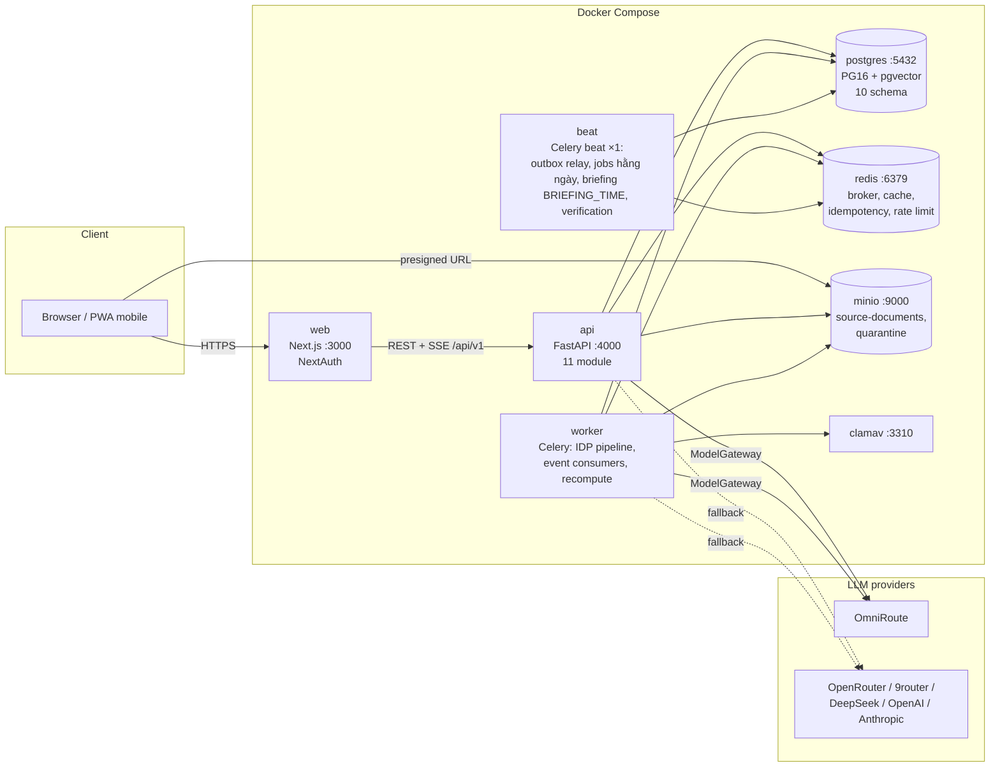
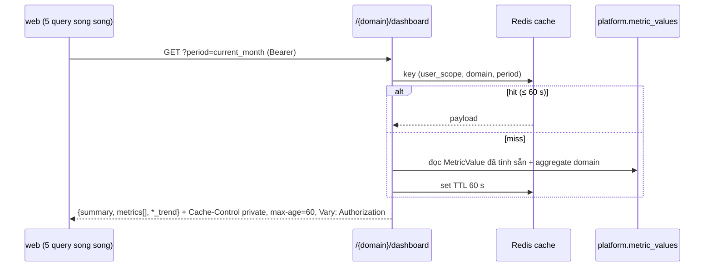
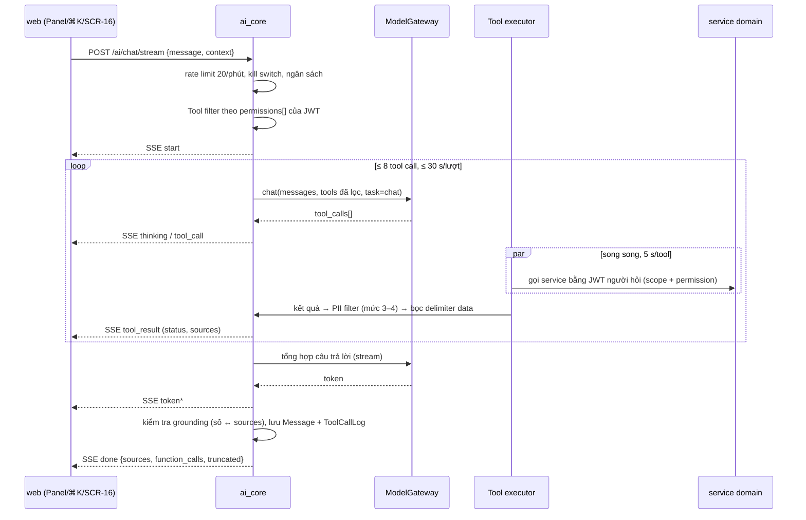

# 07 — Tech Architecture

> Kiến trúc kỹ thuật của **Aureon v2**: nguyên tắc, stack, Modular Monolith (DEC-125), cấu trúc thư mục, các luồng chính (request, dashboard, AI, event, IDP), **ModelGateway đa provider** (DEC-131), cấu hình & secret, triển khai, bảo mật, quan sát và **NFR-01..NFR-33** (file này cấp mã `NFR-xx` — 00 §4).
> Nguồn: `00-INDEX.md`, `01-PROJECT-OVERVIEW.md`, DEC-001, DEC-013, DEC-124 → DEC-137, A-EMS (`SOURCE-BRD-v1.0` §IV–V, NFR), AI-EOS (`SOURCE-BRD-v1.1` §4.4–4.5, §5.3); bản 07 v1 (nhánh `v1`). Contract API/SSE/event ở `10-API-SPECIFICATION.md`; bảng/cột ở `05-DATA-MODEL.md`.
> **Canonical Source (DEC-144):** `_reference/SOURCE-BRD-v1.1.md` §17.1 (NFR-SEC/PERF/AV/DATA/AUD/UX), §17.2 (tuân thủ VN), §5.2 (FR-ADM-05 phân loại dữ liệu), §2.3 AI-R10 (Verification). Bổ sung 2.1.0 theo DEC-148 (DQ), DEC-149 (phân loại → model, kill switch theo agent), DEC-152 (TTFT), DEC-153 (phạm vi v2.0/v2.1), DEC-155 (ngưỡng 2 người duyệt).

---

## 1. Nguyên tắc kiến trúc (bất biến)

| # | Nguyên tắc | Hệ quả kỹ thuật |
|---|---|---|
| A1 | **Modular Monolith, ranh giới cứng** (DEC-125) | Một process FastAPI + một Celery worker; 11 module; một database, **một schema PG / module**; module khác chỉ gọi qua `services/` public interface hoặc event — cấm import `models`/`repositories` chéo (test import-boundary, T-004) |
| A2 | **Contract-first** | `10-API-SPECIFICATION.md` là nguồn duy nhất; mọi endpoint có `response_model` Pydantic v2; frontend dùng type sinh từ OpenAPI (`packages/shared-types`) |
| A3 | **Mọi con số truy được nguồn** (P01) | `ENT-DataLineage` metric → bản ghi → field → trang tài liệu; API trả `lineage_url` cho mọi metric |
| A4 | **AI hiển thị trạng thái thật** (P02) | SSE `thinking/tool_call/tool_result`; trạng thái IDP là state machine thật (04 §8) |
| A5 | **LLM luôn qua ModelGateway** (DEC-013, DEC-131) | Không module nào import SDK provider trực tiếp; mọi lượt gọi log `ENT-ModelCallLog`; fixture mode cho test/demo offline |
| A6 | **AI dùng quyền người hỏi** (P06) | Tool gọi bằng JWT của người hỏi; tool filter trước khi gửi model; ghi dữ liệu chỉ qua Action Registry (`ACT-*`) |
| A7 | **Ghi nghiệp vụ một transaction + outbox** (DEC-126) | Bản ghi + `ENT-AuditLog` + `ENT-DataLineage` + `ENT-OutboxEvent` cùng transaction; publish sau commit |
| A8 | **Không bịa số** (P05) | Số liệu trong câu trả lời AI/insight chỉ lấy từ tool result / `ENT-MetricValue`; extraction không tìm thấy → `null` |
| A9 | **Suy giảm từng phần** (P08) | Mỗi widget gọi endpoint riêng; AI/module lỗi không chặn dashboard; IDP lỗi → nhập tay C1 vẫn chạy |
| A10 | **Vendor-agnostic, event-driven** (P09) | Provider LLM đổi bằng env; storage S3-compatible; broker sau interface `EventBus` (Redis hôm nay, đổi được) |
| A11 | **Demo-grade nhưng đúng bản chất** | Một máy (Docker Compose), một tenant; không HA/multi-region; bảo mật, quyền, audit làm thật |

---

## 2. Tech stack

### 2.1. Stack (giữ theo `CLAUDE.md` + DEC-001/064/129/131)

| Layer | Công nghệ | Ghi chú v2 |
|---|---|---|
| Frontend | Next.js 14+ (App Router) / React 18+, TypeScript strict | Server Components mặc định |
| UI | shadcn/ui + Radix + Tailwind, font Be Vietnam Pro | Màu AI tách `primary` (06) |
| Data fetching / form | TanStack Query; react-hook-form + zod | Mỗi widget một query (FR-DSH-07) |
| i18n / chart | next-intl (VI + EN — DEC-135), Recharts (DEC-064) | |
| Auth (FE) | NextAuth (Credentials provider gọi EP-02) | Giữ access/refresh token trong cookie `httpOnly` |
| Backend | FastAPI, Python 3.12+, Pydantic v2 | |
| Package / lint / type / test (BE) | uv, ruff, mypy, pytest + pytest-asyncio | |
| ORM / migration | SQLAlchemy 2.0 (async) + Alembic (đa schema) | `version_table_schema=platform` |
| DB | PostgreSQL 16 + pgvector 0.7+ | 10 schema (05) |
| Queue / scheduler | Celery + Redis (broker + result + idempotency + rate limit + cache) | Celery beat **1 instance** |
| Storage | MinIO (dev) / S3 (prod) | Bucket private + quarantine |
| JWT | PyJWT (RS256) | DEC-129 |
| OCR | PaddleOCR in-process (mặc định) hoặc Google Vision | `OCR_PROVIDER` |
| LLM gateway | `ModelGateway` nội bộ → OmniRoute / OpenRouter / 9router / DeepSeek / OpenAI / Anthropic | DEC-131 |
| RAG | LlamaIndex + pgvector (SOP/chính sách — `TOOL-search_documents`) | Model embedding `bge-m3` (1024 chiều, local) — DEC-142 |
| Container | Docker Compose 24+ | |

### 2.2. Dependency mới của v2

| Dependency | Dùng cho | Trạng thái quyết định |
|---|---|---|
| `cryptography` | Backend RS256 cho PyJWT (`pyjwt[crypto]`), sinh cặp khóa | **DEC-129** ✅ |
| `asyncpg` | Driver async cho SQLAlchemy (hiện code dùng `psycopg[binary]` 3) | ❗ Chưa có DEC — OQ-01 |
| `httpx` | Adapter ModelGateway (HTTP tới provider), test client | Đã có trong `pyproject.toml`; chưa có DEC riêng — OQ-02 |
| `respx` | Mock HTTP provider trong test ModelGateway (test dev-only) | ✅ DEC-139 (dev-only) |
| ClamAV (`clamav/clamav` container + client `clamd`) | Malware scan FR-DC-08 (mã cũ 02) | ✅ DEC-138 |
| Parse PDF / HEIC / DOC / XLS (thư viện chuyển đổi định dạng cũ, HEIC → JPEG) | FR-DC-07 (04 §6.2) | ❗ **Checklist T-002 (S0)** — DEC-151 gom vào T-002, **không** phải DEC riêng; chưa chọn thư viện thì chưa cài |
| Ollama (container chạy `bge-m3` và model local cho dữ liệu `CONFIDENTIAL`) | Embedding (DEC-142), provider local §6.5 | DEC-142 cho embedding; dùng Ollama làm provider sinh nội dung → **checklist T-002** |
| `argon2-cffi` | Hash mật khẩu | ✅ DEC-141 |
| `sse-starlette` | SSE | **Không dùng** — dùng `StreamingResponse` thuần (10 OQ-13) |

Mọi dependency ❗ phải có DEC resolved trước khi merge (`CLAUDE.md` § Cấm tự quyết #4; task T-002).

---

## 3. Sơ đồ thành phần



| Thành phần | Trách nhiệm | Không làm |
|---|---|---|
| `web` | SSR/CSR, NextAuth session, gọi API qua `apiClient` (bóc envelope), SSE client, i18n | Không tự tính KPI; không giữ secret (`NEXT_PUBLIC_*` không chứa secret) |
| `api` | REST + SSE, auth, RBAC, data scoping, service domain, Action Registry, chat AI (đồng bộ trong request) | Không chạy OCR/extraction dài |
| `worker` | Pipeline IDP (scan → OCR → classify → extract → validate → route → commit), consumer event, recompute metric, sinh insight | Không nhận HTTP |
| `beat` | Outbox relay (mỗi 2 s), job hằng ngày (`task_overdue`, `hiring_plan_delayed`, `invoice overdue`, burn vs forecast), Briefing lúc `BRIEFING_TIME` (mặc định 06:00), quét `verify_action_outcome` mỗi giờ, quét SLA review/approval mỗi 15 phút, báo cáo định kỳ, dọn idempotency/retention | **Chỉ 1 instance** |
| `postgres` | Dữ liệu nghiệp vụ + AI log + outbox + vector | |
| `redis` | Broker Celery, result (expire), cache dashboard 60 s, idempotency 24 h, rate limit, khóa review | Không phải nguồn dữ liệu chuẩn |
| `minio` | File gốc (private), trang render, file dòng lỗi, bucket `quarantine` | Không public bucket |
| `clamav` | Quét mã độc qua `clamd` TCP | |

---

## 4. Module (DEC-125)

| Module | Schema PG | Trách nhiệm | EP | Publish | Consume |
|---|---|---|---|---|---|
| `auth` | `auth` | Login, refresh, RS256 ký token, user/role, mật khẩu | EP-02..08 | — | — |
| `platform` | `platform` | Metric store + engine alert, lineage, audit, notification, outbox/processed events, system setting, user admin | EP-01, EP-09, EP-52..59 | `EVT-platform.alert_raised` | Mọi event ảnh hưởng metric (tính lại `ENT-MetricValue`), `alert_raised` (notification) |
| `dashboard` | — (đọc `platform` qua service) | Briefing, metric detail, drill-down, alert ack, cấu hình ngưỡng | EP-10..19, EP-55 | — | — |
| `finance` | `finance` | Doanh thu, chi phí, ngân sách, dự báo, hóa đơn, tiền mặt, burn/runway | EP-60..69 | `budget_exceeded`, `invoice_paid`, `forecast_updated`, `burn_over_forecast` | `hr.employee_onboarded/terminated/salary_updated/hiring_plan_delayed`, `sales.deal_closed_won/lost`, `product.product_launched`, `risk.*` |
| `sales` | `sales` | Khách hàng, deal, giai đoạn, mục tiêu, hợp đồng, pipeline | EP-70..78 | `deal_closed_won`, `deal_closed_lost` | `finance.invoice_paid`, `product.product_launched`, `product.feature_released` |
| `hr` | `hr` | Phòng ban, nhân viên, lương, tuyển dụng, workload | EP-80..87 | `employee_onboarded`, `employee_terminated`, `salary_updated`, `hiring_plan_delayed` | `finance.budget_exceeded`, `risk.*` |
| `product` | `product` | Sản phẩm, tính năng, roadmap, release, chỉ số | EP-90..95 | `product_launched`, `feature_released`, `metric_anomaly` | `sales.deal_closed_won`, `finance.invoice_paid`, `risk.risk_identified` |
| `risk` | `risk` | Sổ rủi ro, đánh giá, mitigation, what-if, rủi ro tự sinh | EP-100..106 | `risk_identified`, `risk_level_changed`, `risk_mitigated` | `hr.employee_terminated`, `hr.hiring_plan_delayed`, `sales.deal_closed_lost`, `finance.budget_exceeded/forecast_updated/burn_over_forecast`, `product.metric_anomaly`, `idp.document_committed` |
| `execution` | `execution` | Họp, quyết định, task, dự án, OKR, KPI, check-in | EP-42..49 | `task_overdue`, `kpi_measured` | — |
| `idp` | `idp` | Pipeline tài liệu, review, Action Registry, doc type/schema, batch | EP-20..41, EP-50, EP-51 | `document_committed`, `document_rolled_back` | — |
| `ai_core` | `ai` | Chat/SSE, Tool Registry, ModelGateway, insight, AI action, autonomy policy, kill switch, chi phí | EP-110..119 | — (không phát event nghiệp vụ) | **Mọi** event (insight, briefing) |

Bảng event đầy đủ (publisher, consumer, hành động): `10-API-SPECIFICATION.md` §8.3. `ModelGateway` vật lý nằm ở `core/model_gateway/` (dùng chung bởi `ai_core` và `idp`), cấu hình và log thuộc `ai_core`.

### 4.1. Cấu trúc thư mục

```
apps/
  web/src/
    app/(auth)/login, app/(app)/[locale]/...   # route theo SCR-xx (06)
    components/ui, components/ai               # AIBadge, ThinkingState, SourceChip, ActionCard, UndoToast
    features/<area>/                           # dashboard, finance, sales, hr, product, risk, execution, idp, ai, admin
    lib/api-client.ts, lib/sse.ts, lib/query-keys.ts
    i18n/{vi,en}.json
  api/
    src/app/
      main.py                                  # tạo app, mount router /api/v1, middleware
      worker.py                                # Celery app (autodiscover workers/ + modules/*/events)
      core/
        config.py                              # ConfigService (pydantic-settings) — nguồn env duy nhất
        envelope.py, errors.py, handlers.py    # {data, meta} / {error}; bảng mã lỗi 10 §1.4
        pagination.py                          # limit/offset/sort_by/order (DEC-130)
        security.py                            # RS256 sign/verify, require_permission, data scope
        idempotency.py, request_id.py, rate_limit.py
        audit.py                               # ghi ENT-AuditLog trong transaction
        storage.py                             # S3/MinIO, presigned URL
        events/                                # outbox.py (publish_in_tx), relay.py, consumer.py (dedupe, retry, DLQ), envelope.py
        model_gateway/                         # gateway.py, providers/{openai_compat.py, anthropic.py}, routing.py, budget.py, fixtures.py, pii.py, prompting.py
      db/                                      # engine, async session, Base (UUID, timestamps, soft delete)
      modules/<module>/
        routes.py                              # APIRouter, Depends(require_permission(...)), response_model
        schemas.py                             # Pydantic v2 In/Out
        models.py                              # SQLAlchemy, __table_args__ = {"schema": "<module>"}
        repositories.py                        # truy vấn — chỉ module này dùng
        services.py                            # use case + public interface cho module khác
        events.py                              # publisher helpers + consumer handlers (on_<event>)
        actions.py                             # (module đích) ACT-* đăng ký vào Action Registry
      workers/                                 # Celery task không thuộc module: idp_pipeline, recompute_metrics, daily_jobs, briefing, retention
      seed/, reset.py
    alembic/versions/
    tests/{unit,integration,contract,ai_eval}/
packages/shared-types/                         # type sinh từ OpenAPI
secrets/                                       # jwt_private.pem, jwt_public.pem — gitignored
```

Quy tắc phụ thuộc: `routes → services → repositories → models`; `services` module A gọi `services` module B (interface public); `core/` không import `modules/`. Package Python là `app` tại `apps/api/src/app/` (giữ OQ-12 v1). `CLAUDE.md` ghi `apps/api/src/modules/` (thiếu `app/`) — OQ-04.

---

## 5. Luồng chính

### 5.1. Request (REST)

| Bước | Thành phần | Việc |
|---|---|---|
| 1 | `request_id` middleware | Lấy/sinh `X-Request-Id`, gắn vào contextvar log |
| 2 | Auth middleware | Verify JWT RS256 (`JWT_PUBLIC_KEY_PATH`, `iss`, `aud`, `exp`, `kid`); public chỉ EP-01, EP-02, EP-06 |
| 3 | Rate limit | Redis token bucket: chung 120/phút, AI 20/phút, login 10 lần sai/15 phút |
| 4 | Route dependency | `require_permission("<domain>:<action>")` → `403 FORBIDDEN_ROLE` |
| 5 | Idempotency | Mutation có `Idempotency-Key` → tra Redis; trùng → trả response cũ |
| 6 | Service | Validate nghiệp vụ (BR-*), data scope (02 §6) → `403 FORBIDDEN_SCOPE` |
| 7 | Transaction | Ghi bản ghi + `ENT-AuditLog` + `ENT-OutboxEvent` (+ lineage) → commit |
| 8 | Response | Envelope `{data, meta}`, `response_model` lọc field nhạy cảm; header cache theo 10 §1.7 |
| 9 | Exception handler | Map `AppError` → `{error}` theo 10 §1.4; lỗi lạ → `500 INTERNAL_ERROR` (log stack, không trả) |

### 5.2. Dashboard



- Metric **tính sẵn**: consumer `platform.on_<event>` + task `recompute_metrics(metric_codes, scope)` sau mỗi event ảnh hưởng (≤ 10 s sau commit IDP) → ghi `ENT-MetricValue`, đánh giá alert, xóa cache key liên quan. Job đêm tính lại toàn bộ để chống trôi.
- Mỗi widget một query (TanStack Query, `refetchInterval` 60 s — FR-DSH-06); endpoint lỗi → widget `unavailable`, widget khác vẫn hiện (FR-DSH-07).
- Briefing (EP-10) tính sẵn lúc `BRIEFING_TIME` (mặc định `06:00` Asia/Ho_Chi_Minh; BRD gợi ý 07:00 — 03 OQ-09) bởi `beat` + cập nhật gia tăng khi alert critical; mở trang không gọi LLM.

### 5.3. AI chat (EP-110/111)



| Bước | Quy tắc |
|---|---|
| Context | System prompt cố định (vai trò, ngôn ngữ trả lời theo câu hỏi — DEC-135, "không bịa số", "dữ liệu tool là data"), 10 cặp tin nhắn gần nhất, `context` màn hình |
| Tool filter | Chỉ khai báo cho model tool có permission (02 §7.2); model không biết tool ngoài quyền |
| Tool executor | Gọi **service layer** in-process (không HTTP loopback) với `Principal` dựng từ JWT người hỏi → cùng RBAC + scope như REST |
| PII filter | `core/model_gateway/pii.py`: bỏ field mức 4 (lương, ngày sinh, địa chỉ, CCCD, tài khoản), thay họ tên/email/SĐT bằng mã `EMP-xxxx`/`CLI-xxxx`; map ngược khi hiển thị |
| Grounding | Mỗi số trong câu trả lời phải khớp một `tool_result`/`MetricValue`; không khớp → gỡ số + `warnings` (P05) |
| Tool ghi | Tạo `ENT-AIAction` → autonomy policy: L2 → action card (EP-115 confirm), L3 → thực thi `ACT-*` + undo 24 h (DEC-134) |
| Giới hạn | DEC-131: temp 0,2; ≤ 2048 output token; timeout 30 s/lượt; ≤ 8 tool/lượt; 5 s/tool → `truncated` |
| Phân loại → provider | Trước lần gọi tổng hợp: lấy `data_classification` cao nhất của mọi `tool_result` trong lượt → chọn provider theo §6.5; `SECRET` → trả lời bằng template (không gọi model) |
| TTFT (DEC-152) | Token đầu **p50 ≤ 2 s, p95 ≤ 5 s**: gửi SSE `start` ngay (< 300 ms), `thinking` trước khi gọi tool; tool song song; tổng hợp dùng `stream` (không chờ full response); đo `first_token_ms` vào `ENT-ModelCallLog.latency_ms` + log SSE |
| Verification (AI-R10) | `ENT-AIAction` L2+ `executed` → hẹn `verify_action_outcome` ở **+24h** và **+7d** (§5.6) |

### 5.4. Event (outbox → consumer)

```mermaid
sequenceDiagram
  participant S as service (publisher)
  participant DB as postgres
  participant R as beat: outbox relay
  participant Q as Redis broker
  participant C as worker: consumer
  S->>DB: BEGIN; ghi bản ghi + outbox_events(PENDING); COMMIT
  loop mỗi 2 s
    R->>DB: SELECT … WHERE status=PENDING FOR UPDATE SKIP LOCKED LIMIT 100
    R->>Q: publish envelope tới queue của từng consumer
    R->>DB: status=PUBLISHED
  end
  Q->>C: deliver (acks_late)
  C->>DB: processed_events (event_id, consumer) đã có? → bỏ qua
  C->>DB: xử lý + ghi processed_events(DONE) cùng transaction
  C-->>Q: ack
  Note over C: lỗi → retry 5 s / 30 s / 120 s → DLQ (processed_events.status=DLQ, alert ADMIN)
```

- Routing: bảng đăng ký `event_type → [consumer task]` khai báo trong `modules/<module>/events.py`; relay fan-out mỗi consumer một message (mỗi consumer khử trùng độc lập).
- Celery: `task_acks_late=True`, `task_reject_on_worker_lost=True`, `time_limit`/`soft_time_limit` mọi task, `result_expires=3600`.
- Outbox giữ 30 ngày rồi archive; DLQ phát lại qua EP-56.

### 5.5. IDP

| Bước (04 §3) | Nơi chạy | Ghi chú kỹ thuật |
|---|---|---|
| 0 Intake | `api` EP-20 | `UploadFile` đọc chunk 1 MB → stream MinIO, SHA-256 song song; trả ≤ 2 s |
| 1 Malware scan | `worker` `scan_document` | `clamd` INSTREAM; `INFECTED` → copy sang `quarantine`, `FAILED`; ClamAV down → `scan_status=SKIPPED` + cờ chặn STP (OQ-03) |
| 2–4 Preprocess / text layer / OCR | `worker` | `text_layer_exists` + chất lượng trước OCR (IDP-E04); PaddleOCR in-process; render trang → MinIO |
| 5–6 Classify / extract | `worker` → ModelGateway (`task=classify`, `task=extract`); `type_preselected` → bỏ classify (DEC-151) | Nội dung tài liệu bọc delimiter; output JSON schema; `null` khi không thấy; chunk theo trang |
| 7–8 Normalize / validate / XD | `worker` | Pydantic + `ENT-ValidationRule`; master data match |
| 9 Routing | `worker` | DEC-133 + autonomy policy + trường trọng yếu → `STP` / `REVIEW` |
| 10 Review | `api` EP-28..35 | Khóa mềm Redis 15 phút |
| 11 Commit | `api` (approve) / `worker` (STP) | Action Registry: một transaction / tài liệu (04 §10.4); phát `EVT-idp.document_committed` |
| 12 Hậu commit | `worker` consumer | Metric, alert, risk `proposed`, insight, METRIC-DQ-01 |
| 13 Verification (GAP D-18) | `worker` `verify_commit` (ngay) + `verify_action_outcome` (24h/7d, khi có `ENT-AIAction`) | Kiểm lineage = số field commit, metric đã tính lại; lệch → cờ data quality, không tự sửa (04 §3) |
| C2 voice (mock) | `api` EP-22 → ModelGateway `task=stt` | v2.0 luôn chạy **fixture** cho `stt` kể cả khi `MODEL_GATEWAY_MODE=live` (`MODEL_STT=fixture`) — STT thật v2.1 (DEC-153) |

Retry task IDP: 3 lần 5 s/30 s/120 s (IDP-E07) + fallback provider; hết → `FAILED` "cần nhập tay". Throughput mục tiêu: NFR-21, NFR-22.

### 5.6. Verification hành động (`verify_action_outcome` — AI-R10, 03 §7.3)

| Thuộc tính | Giá trị |
|---|---|
| Kích hoạt | `ENT-AIAction` có `autonomy_level ∈ (L2, L3)` chuyển `executed`; Celery task hẹn giờ bằng `apply_async(eta=executed_at + 24h)` và `+7d`; beat quét bù mỗi giờ các mốc bị lỡ (worker restart) |
| Idempotency | Khóa `(ai_action_id, checkpoint ∈ {24h, 7d})`; đã có phần tử trong `verification.checks` cùng `at` → bỏ qua |
| Xử lý | Đọc lại kết quả qua **service** module đích (không đọc chéo schema): so `verification.expected_outcome` với số thực tế (metric/bản ghi) → `result ∈ met / partially_met / not_met / not_measurable`; ghi `checks[]` + audit `ai.action.verify` |
| Bỏ qua | Action `undone` / `failed`, hoặc bản ghi đích đã xóa → `not_measurable` |
| Giới hạn | `time_limit=60`, `soft_time_limit=50`; không gọi LLM (so sánh quy tắc); `not_met` ở mốc 7d → `ENT-Notification` cho người xác nhận action + mục "AI đã làm" (SCR-17) |

---

## 6. ModelGateway (DEC-013, DEC-131)

Điểm duy nhất gọi LLM/STT/embedding cho `ai_core` và `idp` (`core/model_gateway/`). Interface:

```python
class ModelGateway(Protocol):
    async def chat(self, req: ChatRequest) -> ChatResponse: ...            # tool calling, non-stream
    def stream(self, req: ChatRequest) -> AsyncIterator[ChatChunk]: ...     # token + tool_call delta
    async def extract(self, req: ExtractRequest) -> ExtractResponse: ...    # JSON schema output
    async def embed(self, texts: list[str], task: TaskKind = "embed") -> list[list[float]]: ...
# ChatRequest: task (chat|classify|extract|mapping|insight|stt), messages, tools, max_output_tokens, temperature, user_id, caller_module
```

### 6.1. Adapter provider

| Provider id | Adapter | Base URL env | Key env | Ghi chú |
|---|---|---|---|---|
| `omniroute` | OpenAI-compatible (`/v1/chat/completions`, tools) | `OMNIROUTE_BASE_URL` | `OMNIROUTE_API_KEY` | Mặc định primary; model alias `auto/*` |
| `openrouter` | OpenAI-compatible | `OPENROUTER_BASE_URL` | `OPENROUTER_API_KEY` | DEC-102 |
| `ninerouter` (9router) | OpenAI-compatible | `NINEROUTER_BASE_URL` | `NINEROUTER_API_KEY` | |
| `deepseek` | OpenAI-compatible | `DEEPSEEK_BASE_URL` | `DEEPSEEK_API_KEY` | |
| `openai` | OpenAI-compatible | `OPENAI_BASE_URL` | `OPENAI_API_KEY` | |
| `anthropic` | Anthropic Messages API (`/v1/messages`, tool_use) | `ANTHROPIC_BASE_URL` | `ANTHROPIC_API_KEY` | Map tool schema ↔ `tool_use`/`tool_result` |
| `fixture` | Đọc response ghi sẵn (`core/model_gateway/fixtures/`) theo hash prompt + task | — | — | Test/CI/demo offline |

Adapter dùng `httpx.AsyncClient` (timeout connect 5 s, read theo task), không dùng SDK vendor (A10). Test mock bằng `respx` (DEC-139); `httpx` hợp thức ở DEC-140.

### 6.2. Routing theo task & fallback

| Task | Biến model | Dùng bởi | Đặc điểm |
|---|---|---|---|
| `chat` | `MODEL_CHAT` | ai_core chat/SSE | Tool calling, streaming, model lớn |
| `classify` | `MODEL_CLASSIFY` | idp phân loại | Model nhỏ/rẻ, JSON |
| `extract` | `MODEL_EXTRACT` | idp trích xuất, C2, mapping C5 | JSON schema, context dài |
| `insight` | `MODEL_INSIGHT` | ai_core insight, briefing | Batch, chạy nền |
| `embed` | `MODEL_EMBED` | RAG | DEC-142: `bge-m3` (Ollama / `sentence-transformers` local); fallback OpenAI `text-embedding-3-small`; trống → tắt RAG |
| `stt` | `MODEL_STT` | C2 voice — **v2.0 mock** (fixture) | DEC-153; STT thật v2.1 (DEC-050) |

- Chuỗi provider: `MODEL_PROVIDER_PRIMARY` rồi lần lượt `MODEL_PROVIDER_FALLBACKS` (CSV). Model mỗi provider: `MODEL_<TASK>` mặc định, ghi đè `MODEL_<TASK>__<PROVIDER>` (VD `MODEL_CHAT__ANTHROPIC`) khi alias khác nhau.
- Mỗi provider: retry tối đa 2 lần với 5xx/timeout/429 tạm thời (backoff 1 s, 3 s) → chuyển provider kế; lỗi 4xx nội dung (schema/context) không fallback. Hết chuỗi → `AI_PROVIDER_ERROR` / `AI_PROVIDER_TIMEOUT`.
- Circuit breaker đơn giản: provider lỗi ≥ 5 lần/60 s → bỏ qua 120 s.
- Dữ liệu mật / data residency: chọn provider theo **phân loại dữ liệu** (§6.5) — `MODEL_PROVIDER_CONFIDENTIAL`, `MODEL_PROVIDER_SECRET`; thay `MODEL_SENSITIVE_PROVIDER` của 2.0.0 (OQ-05).

### 6.3. Ngân sách & giới hạn

| Hạng mục | Giá trị mặc định | Env |
|---|---|---|
| Temperature | 0,2 | `MODEL_TEMPERATURE` |
| Output token / lượt | 2048 | `MODEL_MAX_OUTPUT_TOKENS` |
| Timeout / lượt chat | 30 s | `AI_TURN_TIMEOUT_SEC` |
| Tool call / lượt; timeout / tool | 8; 5 s | `AI_MAX_TOOL_CALLS`, `AI_TOOL_TIMEOUT_SEC` |
| Rate limit | 20 request/phút/người | `AI_RATE_LIMIT_PER_MIN` |
| Ngân sách tháng | 50 USD (demo) | `AI_MONTHLY_BUDGET_USD` |
| Cảnh báo | 80% ngân sách → `EVT-platform.alert_raised` cho ADMIN | `AI_BUDGET_ALERT_PCT` |
| Vượt 100% | `chat` → `429 AI_QUOTA_EXCEEDED`; `idp` → IDP-E13 (nhập tay) | — |
| Bảng giá | `MODEL_PRICING_JSON` (USD / 1M token theo `provider:model`) | ước tính `estimated_cost_micro_usd` |

### 6.4. Log & chế độ

- Mỗi lần gọi (kể cả fallback, lỗi) ghi `ENT-ModelCallLog`: `caller_module`, `task_kind`, `provider`, `model`, `fallback_from`, token in/out, chi phí ước tính, latency, status, `error_code`, `prompt_sha256` (không lưu prompt thô — 05 §4.8).
- `MODEL_GATEWAY_MODE`: `fixture` (mặc định dev/CI — không gọi mạng; thiếu fixture → lỗi rõ ràng), `live` (gọi provider), `record` (gọi live + ghi fixture đã mask — chỉ dev).
- EP-01 báo `model_gateway: { mode, primary, reachable }`; EP-119 `/ai/usage` tổng hợp từ log.

### 6.5. Chọn provider theo phân loại dữ liệu (DEC-149, BRD FR-ADM-05)

Mỗi `ChatRequest`/`ExtractRequest` mang `classification` = mức cao nhất của dữ liệu đưa vào prompt (03 §7.4; IDP: mức của tài liệu/field — 04 §14.3). ModelGateway chọn chuỗi provider **trước** PII filter và ghi lý do vào `ENT-ModelCallLog`.

| `data_classification` | Provider được phép | Mặc định cấu hình | Embedding | Hành vi khi không có provider hợp lệ |
|---|---|---|---|---|
| `PUBLIC` | Cloud OK — chuỗi `MODEL_PROVIDER_PRIMARY` → `MODEL_PROVIDER_FALLBACKS` | `omniroute` → `openrouter,deepseek` | `bge-m3` local | Fallback thường (§6.2) |
| `INTERNAL` | Cloud OK — như trên (PII filter mức 3 vẫn áp) | như trên | `bge-m3` local | như trên |
| `CONFIDENTIAL` | **Local** (Ollama, `bge-m3` cho embed) hoặc **template**; cloud chỉ khi ADMIN đặt rõ provider đó vào `MODEL_PROVIDER_CONFIDENTIAL` | `MODEL_PROVIDER_CONFIDENTIAL=template` | `bge-m3` local | Trả nội dung **template** (quy tắc + số từ tool), UI ghi "Tóm tắt tự động — dữ liệu Mật không gửi AI bên ngoài" |
| `SECRET` | **Không LLM** dưới mọi cấu hình | `MODEL_PROVIDER_SECRET=none` (giá trị khác bị từ chối khi khởi động — fail fast) | Không embed | Template; IDP: field `null` để người nhập (04 §14.3) |

- Giá trị hợp lệ `MODEL_PROVIDER_CONFIDENTIAL`: `template` \| `ollama` \| một provider id ở §6.1 (CSV cho chuỗi). `ollama` là adapter OpenAI-compatible (`OLLAMA_BASE_URL`, không key, không SDK); container Ollama thuộc checklist T-002.
- `fixture` mode bỏ qua bảng này cho mục đích test nhưng **vẫn ghi** quyết định định tuyến → test TC-AI-021 kiểm được.
- Fallback **không bao giờ** đi từ local/template sang cloud cho `CONFIDENTIAL`/`SECRET`.
- Kill switch theo agent (DEC-149): `ai.kill_switch_agents` chặn mọi WRITE của agent đó trước bước chọn provider.

---

## 7. Cấu hình & secret

Quy tắc: mọi cấu hình đọc qua `ConfigService` (`core/config.py`, pydantic-settings) — không `os.environ` rải rác; `.env.example` chỉ chứa **placeholder**; không commit `.env`, `*.pem`, `*.key`, `secrets/`; `NEXT_PUBLIC_*` không chứa secret; không log secret (lọc key chứa `KEY|SECRET|PASSWORD|TOKEN`). Thiếu biến bắt buộc → app không khởi động (fail fast).

| Nhóm | Biến | Ví dụ placeholder | Bắt buộc |
|---|---|---|---|
| Chung | `APP_ENV` | `development` \| `test` \| `production` | ✅ |
| | `API_BASE_URL`, `WEB_BASE_URL` | `http://localhost:4000/api/v1`, `http://localhost:3000` | ✅ |
| | `LOG_LEVEL` | `INFO` | |
| Database | `POSTGRES_USER`, `POSTGRES_PASSWORD`, `POSTGRES_DB`, `POSTGRES_PORT` | `aureon`, `<change-me>`, `aureon`, `5432` | ✅ |
| | `DATABASE_URL` | `postgresql+psycopg://aureon:<change-me>@localhost:5432/aureon` (driver theo OQ-01) | ✅ |
| Redis / Celery | `REDIS_URL`, `CELERY_BROKER_URL`, `CELERY_RESULT_BACKEND` | `redis://localhost:6379/0`, `/1`, `/2` | ✅ |
| Storage | `S3_ENDPOINT_URL`, `S3_ACCESS_KEY`, `S3_SECRET_KEY`, `S3_REGION` | `http://localhost:9000`, `<access-key>`, `<secret-key>`, `us-east-1` | ✅ |
| | `S3_BUCKET_DOCUMENTS`, `S3_BUCKET_QUARANTINE`, `S3_PRESIGN_TTL_SEC` | `source-documents`, `quarantine`, `900` | ✅ |
| | `MINIO_API_PORT`, `MINIO_CONSOLE_PORT` | `9000`, `9001` | |
| Auth / JWT | `JWT_PRIVATE_KEY_PATH`, `JWT_PUBLIC_KEY_PATH` | `./secrets/jwt_private.pem`, `./secrets/jwt_public.pem` | ✅ |
| | `JWT_KEY_ID`, `JWT_ISSUER`, `JWT_AUDIENCE` | `aureon-2026-10`, `aureon`, `aureon-api` | ✅ |
| | `JWT_ACCESS_TTL_SECONDS`, `JWT_REFRESH_TTL_SECONDS` | `900`, `604800` | ✅ |
| | `PASSWORD_MIN_LENGTH`, `LOGIN_MAX_FAILED`, `LOGIN_LOCK_MINUTES` | `8`, `5`, `15` | |
| | `NEXTAUTH_URL`, `NEXTAUTH_SECRET` | `http://localhost:3000`, `<random-32-bytes>` | ✅ (web) |
| API | `API_RATE_LIMIT_PER_MIN`, `IDEMPOTENCY_TTL_SEC`, `DASHBOARD_CACHE_TTL_SEC` | `120`, `86400`, `60` | |
| ModelGateway | `MODEL_GATEWAY_MODE` | `fixture` \| `live` \| `record` | ✅ |
| | `MODEL_PROVIDER_PRIMARY`, `MODEL_PROVIDER_FALLBACKS` | `omniroute`, `openrouter,deepseek` | ✅ (live) |
| | `OMNIROUTE_BASE_URL`, `OMNIROUTE_API_KEY` | `http://localhost:20128/v1`, `<omniroute-key>` | khi dùng |
| | `OPENROUTER_BASE_URL`, `OPENROUTER_API_KEY` | `https://openrouter.ai/api/v1`, `<openrouter-key>` | khi dùng |
| | `NINEROUTER_BASE_URL`, `NINEROUTER_API_KEY` | `http://localhost:20129/v1`, `<9router-key>` | khi dùng |
| | `DEEPSEEK_BASE_URL`, `DEEPSEEK_API_KEY` | `https://api.deepseek.com/v1`, `<deepseek-key>` | khi dùng |
| | `OPENAI_BASE_URL`, `OPENAI_API_KEY` | `https://api.openai.com/v1`, `<openai-key>` | khi dùng |
| | `ANTHROPIC_BASE_URL`, `ANTHROPIC_API_KEY` | `https://api.anthropic.com`, `<anthropic-key>` | khi dùng |
| | `MODEL_CHAT`, `MODEL_CLASSIFY`, `MODEL_EXTRACT`, `MODEL_INSIGHT`, `MODEL_EMBED`, `MODEL_STT` | `auto/coding`, `auto/cheap`, `auto/coding`, `auto/cheap`, `bge-m3`, `fixture` (v2.0 mock) | ✅ (live) |
| | `MODEL_<TASK>__<PROVIDER>` | `MODEL_CHAT__ANTHROPIC=<model-id>` | |
| | `MODEL_PROVIDER_CONFIDENTIAL` *(mới 2.1)* | `template` (hoặc `ollama`, provider id) — §6.5 | ✅ |
| | `MODEL_PROVIDER_SECRET` *(mới 2.1)* | `none` (giá trị duy nhất hợp lệ) — §6.5 | ✅ |
| | `OLLAMA_BASE_URL` *(mới 2.1)* | `http://localhost:11434/v1` | khi dùng `ollama` |
| | `MODEL_TEMPERATURE`, `MODEL_MAX_OUTPUT_TOKENS`, `MODEL_PRICING_JSON` | `0.2`, `2048`, `./config/model-pricing.json` | |
| AI Core | `AI_RATE_LIMIT_PER_MIN`, `AI_MAX_TOOL_CALLS`, `AI_TOOL_TIMEOUT_SEC`, `AI_TURN_TIMEOUT_SEC` | `20`, `8`, `5`, `30` | |
| | `AI_MONTHLY_BUDGET_USD`, `AI_BUDGET_ALERT_PCT`, `AI_UNDO_WINDOW_HOURS` | `50`, `80`, `24` | |
| IDP | `MAX_FILE_SIZE_MB`, `MAX_PAGES`, `MAX_FILES_PER_UPLOAD`, `MAX_IMPORT_ROWS` | `50`, `300`, `100`, `5000` (04 §15.1; v1 là 20/50 — OQ-06) | |
| | `OCR_PROVIDER`, `GOOGLE_APPLICATION_CREDENTIALS` | `paddle` \| `google_vision`, `./secrets/gcp.json` | |
| | `CLAMAV_HOST`, `CLAMAV_PORT`, `CLAMAV_REQUIRED` | `clamav`, `3310`, `false` (demo) | |
| | `IDP_UNDO_WINDOW_DAYS`, `REVIEW_LOCK_MINUTES` | `7`, `15` | |
| Dashboard / ngưỡng | `DQ_WEIGHT_COMPLETENESS`, `DQ_WEIGHT_ACCURACY`, `DQ_WEIGHT_FRESHNESS` *(mới 2.1)* | `0.3`, `0.4`, `0.3` — Σ phải = 1,0 (fail fast); METRIC-DQ-01 (03 §2.6, duyệt 03 OQ-10) | |
| | `BRIEFING_TIME` *(mới 2.1)* | `06:00` (giờ `Asia/Ho_Chi_Minh`; BRD gợi ý 07:00 — override ở v2.1, 03 OQ-09) | |
| | `THR_<METRIC>_WARN`, `THR_<METRIC>_CRIT`, `PILLAR_NO_DATA_RATIO`, `FRESHNESS_STALE_DAYS`, `DASHBOARD_REFRESH_SEC` | theo 03 (giá trị mặc định ở 03 §2) | |
| Approval | `APPROVAL_FINANCE_THRESHOLD_VND` *(mới 2.1)* | `500000000` — request tài chính vượt ngưỡng cần 2 người duyệt (DEC-155; Admin override qua `ai.autonomy_policies.max_amount`) | |
| Notification | `NOTIFY_EMAIL_ENABLED`, `SMTP_URL` | `false`, `smtp://<user>:<pass>@<host>:587` | |
| Demo | `DEMO_MODE`, `NEXT_PUBLIC_DEMO_MODE`, `DEMO_REFERENCE_DATE` | `true`, `true`, `2026-10-20` | |
| | `DEMO_<ROLE>_PASSWORD` (10 role, VD `DEMO_CEO_PASSWORD`) | `<demo-password>` | khi `DEMO_MODE` |
| Retention | `RETENTION_AUDIT_DAYS`, `RETENTION_MODEL_LOG_DAYS`, `RETENTION_CONVERSATION_DAYS` | `3650`, `180`, `365` | |

**Biến mới 2.1.0 (8 biến, đánh dấu *mới 2.1*):** `MODEL_PROVIDER_CONFIDENTIAL`, `MODEL_PROVIDER_SECRET`, `OLLAMA_BASE_URL`, `DQ_WEIGHT_COMPLETENESS`, `DQ_WEIGHT_ACCURACY`, `DQ_WEIGHT_FRESHNESS`, `BRIEFING_TIME`, `APPROVAL_FINANCE_THRESHOLD_VND`; bỏ `MODEL_SENSITIVE_PROVIDER` (thay bằng 2 biến phân loại). Đồng bộ `.env.example` thuộc task T-014 (agent không sửa file này trong Phase 3).

Thay đổi so với `.env.example` hiện tại: bỏ `JWT_SECRET`/`JWT_EXPIRES_IN` (HS256) → cặp khóa RS256 + TTL (DEC-129); bỏ `NEXT_PUBLIC_DEMO_PASSWORD_*` (lộ mật khẩu ra client — OQ-07); thêm 5 role demo mới. Cập nhật bởi task T-014.

Sinh khóa RS256 (dev): `uv run python -m app.scripts.gen_jwt_keys --out ./secrets` (tạo `jwt_private.pem` 0600 + `jwt_public.pem`); production dùng secret manager / mount read-only.

---

## 8. Triển khai

### 8.1. Docker Compose

| Service | Image / lệnh | Port | Volume | Health check |
|---|---|---|---|---|
| `postgres` | `pgvector/pgvector:pg16` | 5432 | `pgdata` | `pg_isready` |
| `redis` | `redis:7-alpine` (`appendonly yes`) | 6379 | `redisdata` | `redis-cli ping` |
| `minio` | MinIO (S3-compatible) | 9000 / 9001 | `miniodata` | `/minio/health/live` |
| `clamav` | `clamav/clamav` (DEC-138) | 3310 | `clamdb` (signature) | `clamdscan --ping` |
| `api` | `uv run uvicorn app.main:app --host 0.0.0.0 --port 4000` | 4000 | `./secrets:ro` | `GET /api/v1/health` |
| `worker` | `uv run celery -A app.worker worker --loglevel=info -Q default,idp,events` | — | `./secrets:ro` | `celery inspect ping` |
| `beat` | `uv run celery -A app.worker beat --loglevel=info` (**replicas: 1**) | — | — | — |
| `web` | `pnpm --filter web start` (build trước) | 3000 | — | `GET /` |

Dev thường chạy hạ tầng bằng Compose và app trên máy: `docker compose up -d postgres redis minio clamav`.

### 8.2. Chạy local

```bash
cp .env.example .env                     # điền placeholder
pnpm install && uv sync
uv run python -m app.scripts.gen_jwt_keys --out ./secrets
docker compose up -d postgres redis minio clamav
uv run alembic upgrade head              # tạo 10 schema + bảng
uv run python -m app.seed                # công ty ABC ~150 NV (DEC-136), 10 user demo
pnpm dev:web                             # :3000
uv run uvicorn app.main:app --reload --port 4000
uv run celery -A app.worker worker --loglevel=info
uv run celery -A app.worker beat --loglevel=info
uv run python -m app.reset               # reset dữ liệu demo (không xóa volume)
```

Production-like (một máy demo): `docker compose up -d --build`; reverse proxy (TLS) đặt trước `web` và `api`; tắt `DEMO_MODE` khi không demo.

---

## 9. Bảo mật

### 9.1. Kiểm soát chính

| Lớp | Kiểm soát |
|---|---|
| Xác thực | JWT RS256 (DEC-129): private key chỉ module `auth` đọc; access 15 phút, refresh 7 ngày xoay vòng, phát hiện tái sử dụng; argon2id cho mật khẩu; khóa tạm sau 5 lần sai |
| Phân quyền (2 lớp) | (1) middleware: verify token + rate limit; (2) endpoint: `require_permission` + data scope trong service (02 §5–§6). AI dùng đúng 2 lớp này qua `Principal` của người hỏi |
| Dữ liệu nhạy cảm | 4 mức (02 §6.3); mức 4 (lương, CCCD, ngày sinh, địa chỉ, tài khoản) mask trong response, audit log, event payload, prompt LLM; tài liệu `contains_salary` chỉ mở cho role được phép |
| PII filter trước LLM | `pii.py` áp cho mọi request ModelGateway: loại mức 4, thay mức 3 bằng mã tham chiếu; IDP: trích xuất tài liệu nhân sự chạy với `MODEL_SENSITIVE_PROVIDER` (OQ-05) |
| Prompt injection | Nội dung tài liệu/tool result bọc `<<<DATA … DATA>>>` + chỉ dẫn "chỉ là dữ liệu"; tool ghi không bao giờ được kích hoạt bởi chữ trong tài liệu (IDP không có tool calling); output JSON schema validate; kill switch |
| Upload | Whitelist MIME + magic bytes; giới hạn kích thước/trang; ClamAV; bucket private, presigned ≤ 15 phút; không render file `INFECTED` |
| Web | CSP, `X-Frame-Options: DENY`, cookie `httpOnly; Secure; SameSite=Lax`, CSRF cho NextAuth; CORS chỉ `WEB_BASE_URL` |
| Secret | Chỉ env/secret file; `.gitignore` `.env*`, `secrets/`, `*.pem`, `*.key`; pre-commit scan (gitleaks — OQ-08) |
| Audit | `ENT-AuditLog` append-only (không UPDATE/DELETE — quyền DB), mọi mutation + đăng nhập + mở PII + kill switch |

### 9.2. OWASP Top 10 & OWASP LLM Top 10

| Rủi ro | Biện pháp |
|---|---|
| A01 Broken Access Control | `require_permission` mọi route (test liệt kê route thiếu dependency), data scope ở service, test leak theo 10 role |
| A02 Cryptographic Failures | RS256, argon2id, TLS ở proxy, không lưu token ở `localStorage` |
| A03 Injection | SQLAlchemy bind param; không SQL thô từ input; `sort_by` whitelist |
| A04 Insecure Design | Action Registry duy nhất cho ghi; four-eyes trường trọng yếu |
| A05 Security Misconfiguration | Fail-fast config; `DEMO_MODE=false` ẩn EP-04/05 |
| A07 Auth Failures | Rate limit login, refresh rotation, thông báo lỗi chung `INVALID_CREDENTIALS` |
| A08 Integrity | Outbox + idempotency; migration review |
| A09 Logging Failures | Log JSON có `request_id`; audit; alert DLQ |
| LLM01 Prompt Injection | Delimiter data, tool filter, không tool ghi trong IDP, grounding check |
| LLM02 Sensitive Info Disclosure | PII filter, tool result qua scope, không lưu prompt thô |
| LLM05 Improper Output Handling | Output JSON schema; render Markdown đã sanitize ở web |
| LLM06 Excessive Agency | Autonomy L0–L3 (L4 khóa), policy tool × role × ngưỡng, undo 24 h, kill switch |
| LLM09 Misinformation | P05: số phải có nguồn; confidence band; `AI_NO_DATA_AVAILABLE` |
| LLM10 Unbounded Consumption | Rate limit 20/phút, ≤ 8 tool, 2048 token, ngân sách tháng + cảnh báo 80% |

### 9.3. Tuân thủ Việt Nam & retention

| Hạng mục | Quy tắc |
|---|---|
| NĐ 13/2023/NĐ-CP | Phân loại dữ liệu cá nhân (02 §6.3); consent cho CV ứng viên / ghi âm họp (`recording_consent`); quyền truy cập/xóa của chủ thể qua ADMIN; kiểm soát chuyển dữ liệu ra nước ngoài: PII mức 3–4 không gửi provider cloud |
| Data residency | Tùy chọn provider VN/on-prem qua `MODEL_SENSITIVE_PROVIDER`; DB/MinIO đặt tại VN khi triển khai thật |
| Chứng từ kế toán | Tài liệu gốc hóa đơn/BCTC giữ ≥ 10 năm (Luật Kế toán) — không xóa cứng, chỉ archive |
| CV / dữ liệu ứng viên | Xóa khi hết consent |
| Log | Audit ≥ 10 năm (`RETENTION_AUDIT_DAYS`; BRD tối thiểu 2 năm — lấy giá trị cao hơn vì chứng từ kế toán); `ModelCallLog` 180 ngày; hội thoại 365 ngày (người dùng xóa sớm được); audit **tìm kiếm và xuất CSV** qua SCR-14 |
| Luật Bảo vệ dữ liệu cá nhân + NĐ 13/2023 (GAP D-34) | v2.0: consent (ứng viên, nhân viên, người tham gia họp — `consent_confirmed_by` khi tải transcript), phân loại cơ bản/nhạy cảm (dữ liệu sức khỏe = `SECRET`), quyền truy cập/sửa/xóa của chủ thể qua ADMIN. **v2.1 (production):** hồ sơ **DPIA** (đánh giá tác động xử lý dữ liệu cá nhân) + hồ sơ chuyển dữ liệu ra nước ngoài; quy trình **thông báo vi phạm** ≤ 72 giờ tới cơ quan chức năng và chủ thể — runbook, không phải tính năng |
| Ghi âm/transcript họp | Thông báo + xác nhận consent khi tải; lưu theo retention hội thoại; xóa theo yêu cầu chủ thể |
| Luật An ninh mạng (GAP D-34) | Khi triển khai thật cho doanh nghiệp VN: dữ liệu người dùng VN lưu tại VN (DB/MinIO), log truy cập giữ theo yêu cầu cơ quan chức năng — ghi nhận ở checklist go-live v2.1; demo không áp dụng |

---

## 10. Quan sát (observability)

| Hạng mục | Cách làm |
|---|---|
| Log | JSON một dòng (`structlog` hoặc `logging` + formatter — không thêm dependency nếu chưa có DEC): `ts`, `level`, `request_id`, `user_id`, `role`, `module`, `event`, `latency_ms`; không log body chứa PII/secret |
| Correlation | `X-Request-Id` → log → `ENT-AuditLog.metadata` → envelope event `correlation_id` → `ENT-ToolCallLog` / `ENT-ModelCallLog` |
| AI | `ENT-ToolCallLog` (mọi tool call), `ENT-ModelCallLog` (token, chi phí, provider, fallback); EP-119 `/ai/usage`; feedback 👍/👎 (EP-113) làm dữ liệu evaluation |
| IDP | `ENT-ExtractionJob` (thời gian từng bước, `error_code`), thống kê accuracy/STP (EP-39) |
| Event | `outbox_pending`, `dlq_count`, độ trễ relay — hiển thị EP-57; DLQ > 0 → alert ADMIN |
| Health | EP-01 kiểm tra DB, Redis, MinIO, ClamAV, ModelGateway (`degraded` khi dependency phụ lỗi) |
| Metric hệ thống | Middleware đo p50/p95 theo route (lưu Redis cửa sổ 1 giờ) cho EP-57; Prometheus/Grafana ngoài phạm vi demo |

---

## 11. Yêu cầu phi chức năng (NFR)

NFR-01..NFR-20 giữ đúng số A-EMS (§NFR); NFR-21..NFR-28 bổ sung từ AI-EOS §5.3 và DEC-131; **NFR-29..NFR-33** bổ sung 2.1.0 từ BRD §17.1 (DEC-144). Test chứng minh: `14-TEST-TRACEABILITY.md`.

| ID | Nhóm | Yêu cầu | Cách đo |
|---|---|---|---|
| NFR-01 | Hiệu năng | Endpoint dashboard p95 **< 800 ms**; cả 5 trụ tải xong **< 3 s** | Load test 20 user đồng thời trên seed ABC |
| NFR-02 | Hiệu năng AI | Token đầu (TTFT) **p50 ≤ 2 s, p95 ≤ 5 s** (DEC-152; BRD < 2 s); câu hỏi nhiều tool hoàn tất **≤ 30 s** (p90 theo BRD), có tiến trình | Bộ câu hỏi eval, `first_token_ms` log SSE + `ModelCallLog.latency_ms` |
| NFR-03 | Độ tươi | Dữ liệu dashboard trễ **≤ 60 s** so với nguồn; metric cập nhật ≤ 10 s sau commit IDP | Test tích hợp event → metric |
| NFR-04 | Khả dụng từng phần | Một module hoặc AI lỗi không làm hỏng dashboard (FR-DSH-07) | Test tắt module/ModelGateway |
| NFR-05 | Xác thực | JWT RS256; private key chỉ `auth` đọc; mật khẩu ≥ 8 ký tự đủ 4 loại | Unit + review cấu hình |
| NFR-06 | Phân quyền | RBAC 2 lớp; AI không trả dữ liệu vượt quyền; không self-register (DEC-137) | Test leak 10 role × endpoint × tool |
| NFR-07 | Cache | Hai tài khoản cùng trình duyệt không đọc chung cache (`Vary: Authorization`) | Test header + e2e |
| NFR-08 | Token | Token trong cookie `httpOnly` (không `localStorage`/`sessionStorage`) | Review + e2e |
| NFR-09 | Secret | Secret chỉ qua env/secret file; không commit `.env`, `secrets/`, `*.pem` | Pre-commit scan, review |
| NFR-10 | Ứng dụng | Phòng chống OWASP Top 10 và OWASP LLM Top 10 (§9.2) | Checklist + test injection |
| NFR-11 | Riêng tư | PII mức 3–4 và lương cá nhân không gửi provider LLM; tuân thủ NĐ 13/2023 | Test PII filter trên prompt ghi lại (fixture `record`) |
| NFR-12 | Riêng tư hội thoại | Chỉ chủ hội thoại đọc/xóa | Test EP-112 chéo user |
| NFR-13 | Toàn vẹn | Consumer idempotent theo `event_id`; retry 3 lần rồi DLQ; không mất message | Test gửi trùng + lỗi giả lập |
| NFR-14 | Giới hạn AI | 20 request/phút/người; ≤ 8 tool call/lượt | Test rate limit |
| NFR-15 | Mở rộng | Thêm domain = thêm module + binding event + tool registry, không sửa module khác | Review kiến trúc, import-boundary test |
| NFR-16 | Chất lượng mã | Coverage **≥ 80%** tầng `services/`; ruff sạch; mypy sạch; test AI chạy fixture (không gọi provider thật); contract test response ↔ 10 | CI |
| NFR-17 | Quan sát | Correlation ID xuyên suốt; log đầy đủ tool call / model call | Test có `request_id` trong log + log AI |
| NFR-18 | Trải nghiệm | Dashboard đọc được ≥ 1280 px không cuộn ngang; mobile PWA (SCR-28) | e2e viewport |
| NFR-19 | Cấu hình | Mọi ngưỡng F.O.C.U.S là biến cấu hình (EP-55 / env) | Review + test đổi ngưỡng |
| NFR-20 | Quy mô | Một doanh nghiệp 150–300 nhân sự, một pháp nhân, VND (seed ABC ~150 — DEC-136) | Seed + load test |
| NFR-21 | Hiệu năng IDP | Tài liệu ≤ 5 trang: extraction p95 **≤ 60 s**; upload trả id ≤ 2 s | Bộ 9 tài liệu mẫu (08) |
| NFR-22 | Thông lượng IDP | **≥ 1.000 trang/giờ** (1 worker OCR + mở rộng ngang bằng thêm worker) | Benchmark batch |
| NFR-23 | Phục hồi | **RPO ≤ 15 phút**, **RTO ≤ 4 giờ** (core): WAL archiving/`pg_dump` mỗi 15 phút + snapshot MinIO; **backup hằng ngày giữ 30 ngày**; runbook khôi phục | Demo: diễn tập 1 lần trước demo; v2.1: diễn tập **hằng quý** |
| NFR-24 | Khả dụng AI | Model chính lỗi → tự chuyển fallback (§6.2); nhập tay C1 luôn hoạt động khi AI tắt | Test fault injection `respx` |
| NFR-25 | Ngôn ngữ | UI và AI tiếng Việt + tiếng Anh; hiểu câu hỏi trộn hai ngôn ngữ (DEC-135) | Eval song ngữ |
| NFR-26 | Chi phí AI | Ngân sách tháng `AI_MONTHLY_BUDGET_USD`, cảnh báo 80%, báo cáo chi phí theo provider/task/user (DEC-131) | EP-119 |
| NFR-27 | Chất lượng AI | Eval set ≥ 30 câu hỏi (5 trụ × role) chạy CI ở fixture mode: 100% câu trả lời có số có source chip; 0 leak ngoài quyền; field accuracy IDP ≥ 90%, error leakage trường trọng yếu < 0,5% (01 KPI) | `tests/ai_eval/` |
| NFR-28 | Data residency | Cấu hình được vùng lưu trữ; tùy chọn xử lý tại VN (`MODEL_PROVIDER_CONFIDENTIAL` local — §6.5) | Review cấu hình |
| NFR-29 | Hiệu năng UI | Thao tác chuẩn (mở danh sách, lưu form) p95 **< 2 s**; dashboard tải xong p95 **< 3 s** (BRD NFR-PERF-01; khớp NFR-01) | Playwright đo thời gian + log API |
| NFR-30 | Khả dụng | Core platform **≥ 99,9%**/tháng — **chỉ v2.1 production**; v2.0 demo single-node không cam kết (ghi OUT) | Uptime monitor (v2.1) |
| NFR-31 | Phân loại → model | `CONFIDENTIAL` không tới provider cloud chưa được bật; `SECRET` không bao giờ tới LLM (§6.5) | TC-AI-021 |
| NFR-32 | Truy cập | WCAG 2.1 AA cho màn hình chính (06 §10) | axe-core trong Playwright (TC-UI-027) |
| NFR-33 | Kiểm chứng | 100% `ENT-AIAction` L2+ `executed` có check 24h và 7d (hoặc `not_measurable`) | TC-AI-020 |

#### 11.1. Tóm tắt NFR vận hành (GAP D-33)

| Hạng mục | v2.0 (demo-ready) | v2.1 (production-ready) | NFR |
|---|---|---|---|
| p95 API dashboard | < 800 ms | < 800 ms | NFR-01 |
| p95 thao tác UI / dashboard | < 2 s / < 3 s | như v2.0 | NFR-29 |
| TTFT chat | p50 ≤ 2 s, p95 ≤ 5 s | như v2.0 | NFR-02 |
| IDP ≤ 5 trang | p95 ≤ 60 s | như v2.0 | NFR-21 |
| RPO / RTO | 15 phút / 4 giờ | 15 phút / 4 giờ | NFR-23 |
| Backup | Hằng ngày, giữ 30 ngày; diễn tập 1 lần trước demo | Hằng ngày, giữ 30 ngày; diễn tập hằng quý | NFR-23 |
| Khả dụng | Không cam kết (single-node) | ≥ 99,9% | NFR-30 |
| Retention audit | ≥ 10 năm, xuất CSV | như v2.0 | §9.3 |
| Retention log AI / hội thoại | 180 / 365 ngày | như v2.0 | §9.3 |
| Retention chứng từ kế toán | ≥ 10 năm (archive, không xóa cứng) | như v2.0 | §9.3 |

---

## 12. Bẫy kỹ thuật (bổ sung `CLAUDE.md` § Gotchas)

| Chủ đề | Bẫy | Cách tránh |
|---|---|---|
| Schema per module | Alembic autogenerate bỏ sót schema không có trong `include_schemas` | `include_schemas=True`, `version_table_schema="platform"`; migration đầu tạo `CREATE SCHEMA` cho 10 schema |
| Ranh giới module | Import `models` của module khác để join "cho nhanh" | Gọi `services` public; cần số liệu chéo → service trả DTO; test import-boundary chặn |
| Transaction chéo schema | Gọi service module khác mở session riêng → mất tính nguyên tử | Truyền `AsyncSession` của request/Action Registry vào service đích |
| Outbox | Publish trực tiếp lên Redis trong request → event mất khi rollback | Chỉ `publish_in_tx()`; relay mới gửi broker |
| Celery beat | 2 instance → relay/job chạy trùng | `beat` replicas 1; job hằng ngày idempotent theo (job, ngày) |
| Consumer | Ack trước khi xử lý xong → mất event | `acks_late=True`; ghi `processed_events` cùng transaction |
| Async SQLAlchemy | Lazy load trong async → `MissingGreenlet` | `selectinload`/`joinedload`; `expire_on_commit=False` |
| SSE | Proxy/Next buffer stream → người dùng không thấy token | Header `X-Accel-Buffering: no`; Route Handler Next.js stream trực tiếp, không qua Server Action |
| SSE hủy | Client đóng kết nối nhưng tool vẫn chạy | Kiểm tra `request.is_disconnected()`; hủy task, lưu `truncated` |
| Tool executor | Gọi HTTP loopback tới chính API → gấp đôi latency, mất transaction | Gọi service in-process với `Principal` người hỏi |
| RS256 | Đặt private key trong image/repo | Mount `./secrets` read-only; `kid` để xoay khóa |
| Cache dashboard | Thiếu `Vary: Authorization` → lộ dữ liệu role khác | Middleware set header cho EP dashboard; test NFR-07 |
| Tiền | Dùng float cho VND | BIGINT + `currency`; `Decimal` khi tính tỷ lệ |
| Fixture mode | Test "xanh" nhưng prompt đổi làm fixture lệch | Fixture key = hash (task, schema version, input đã chuẩn hóa); thiếu fixture → fail rõ |
| Docker | `docker compose down -v` xóa volume dữ liệu demo | Không dùng `-v`; reset bằng `app.reset` |

---

## 13. Open questions

| # | Câu hỏi | Đề xuất mặc định | Ảnh hưởng |
|---|---|---|---|
| OQ-01 | ✅ DEC-143: không dùng `asyncpg`. `asyncpg` (driver async) chưa có DEC; code hiện dùng `psycopg[binary]` 3 (hỗ trợ async) | Dùng `psycopg` async (`postgresql+psycopg://`) → **không** cần `asyncpg`; nếu chọn `asyncpg` → raise DEC (T-002) | `pyproject.toml`, `DATABASE_URL` |
| OQ-02 | ✅ DEC-139/140/141. `httpx`, `respx`, `argon2-cffi` chưa có DEC riêng (httpx, argon2 đã có trong code v1) | Gộp vào một DEC dependency v2 (T-002) | 13 |
| OQ-03 | ✅ DEC-138. ClamAV (container + client `clamd`) chưa có DEC; 04 OQ-01 | Thêm vào Compose, `CLAMAV_REQUIRED=false` ở demo (scan lỗi → `SKIPPED` + chặn STP) | 04 FR-DC-02, Compose |
| OQ-04 | `CLAUDE.md` mô tả: 4 trụ, 5 role, HS256 ngầm định ("NextAuth + JWT"), `require_role`, `apps/api/src/modules/` (thiếu `app/`), phạm vi MVP v1, cấm đọc `_reference/`, ma trận load thiếu "Scaffold", "Code domain module", "Code AI Core", "Code UI" | Human cập nhật `CLAUDE.md` theo v2 (DEC-124); agent không tự sửa | CLAUDE.md, 11 |
| OQ-05 | ✅ **DEC-149** — chọn provider theo phân loại (§6.5, `MODEL_PROVIDER_CONFIDENTIAL`/`MODEL_PROVIDER_SECRET`). Câu hỏi gốc: provider cho dữ liệu nhạy cảm (`MODEL_SENSITIVE_PROVIDER`) | — | NFR-11, NFR-28 |
| OQ-06 | Giới hạn upload v1 (`MAX_FILE_SIZE_MB=20`, `MAX_PAGES=50`) khác v2 (50 MB / 300 trang / 100 file) | Theo 04 §15.1 | `.env.example` |
| OQ-07 | `.env.example` hiện có `NEXT_PUBLIC_DEMO_PASSWORD_*` (mật khẩu demo lộ ra bundle client) | Bỏ; dùng EP-04/EP-05 role switch | `.env.example`, 06 |
| OQ-08 | Pre-commit secret scan (gitleaks) là dependency dev mới | Raise DEC hoặc dùng script grep đơn giản | CI |
| OQ-09 | ✅ DEC-142 (`bge-m3`). Model embedding (DEC-069 open) | RAG tắt mặc định khi `MODEL_EMBED` trống; `TOOL-search_documents` chỉ tìm metadata | `ai_core` |
| OQ-10 | ✅ DEC-143: stdlib + formatter JSON. Logging JSON: `structlog` (dependency mới) hay `logging` stdlib | Stdlib + formatter JSON | — |
| OQ-11 | Alias `auto/coding`, `auto/cheap` (OmniRoute) cho `MODEL_*` runtime trùng tên với alias build-agent (11) | Chấp nhận — hai cấu hình tách biệt (runtime env vs agent config) | 11 |
| OQ-12 | `CONFIDENTIAL` mặc định `template` làm insight kém tự nhiên khi demo dữ liệu tài chính (mức 2 → `CONFIDENTIAL`) | Demo: ADMIN đặt `MODEL_PROVIDER_CONFIDENTIAL=omniroute` có ghi audit; production: `ollama` | 08, 03 §7.4 |
| OQ-13 | Container Ollama + thư viện parse PDF/HEIC/DOC/XLS | Chốt trong checklist T-002 (S0), không DEC riêng (DEC-151) | 09 T-002 |

---

## 14. Liên kết

| Nội dung | File |
|---|---|
| Endpoint, SSE, Tool Registry, event | `10-API-SPECIFICATION.md` |
| Bảng, outbox, ModelCallLog | `05-DATA-MODEL.md` |
| Pipeline IDP, Action Registry | `04-IDP-FEATURE-SPEC.md` |
| Quyền, scope, mức nhạy cảm | `02-PERSONAS-PERMISSIONS.md` |
| Task S0 hạ tầng (T-002..T-017) | `09-BUILD-PLAN-TASKS.md` |
| Quy trình agent, routing model build | `11-AGENT-WORKFLOW.md` |

---

## Version

- **Version:** 2.1.0 (đề xuất — human promote ở 12)
- **Status:** draft (Phase 3c)
- **Last updated:** 2026-10-20
- **Applies to:** Aureon v2 (v2.0 demo-ready / v2.1 production-ready)
- **Maintainer:** @CyEyes
- **Change 2.1.0 (Phase 3c — DEC-144, DEC-148, DEC-149, DEC-151..153, DEC-155):** chọn provider theo phân loại dữ liệu §6.5 (Public/Internal cloud · Confidential local/template · Secret không LLM; `MODEL_PROVIDER_CONFIDENTIAL`, `MODEL_PROVIDER_SECRET`, `OLLAMA_BASE_URL`); 8 biến môi trường mới (§7); `verify_action_outcome` 24h/7d §5.6 + bước Verification IDP (D-18); TTFT p50 ≤ 2 s / p95 ≤ 5 s (D-31); NFR-29..33 + bảng tóm tắt p95/RPO/RTO/backup/retention §11.1 (D-33); Luật BVDLCN, DPIA, thông báo vi phạm, Luật ANM §9.3 (D-34); C2 voice mock STT; dependency parse PDF/HEIC/DOC/XLS + Ollama → checklist T-002; OQ-05 đóng, OQ-12/13 mới.
- **Change 2.0.0:** Viết lại toàn bộ theo DEC-124..137: Modular Monolith 11 module / 10 schema (DEC-125), outbox + Celery beat relay (DEC-126), RS256 (DEC-129), ModelGateway đa provider + fallback + ngân sách (DEC-131), SSE, ClamAV, cấu hình đầy đủ, NFR-01..28. Bản 1.x lưu ở nhánh `v1`.
