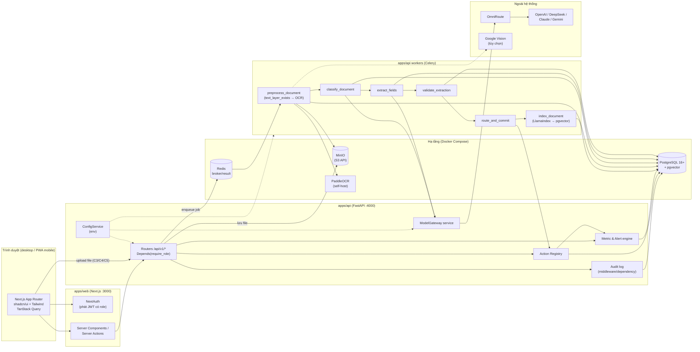
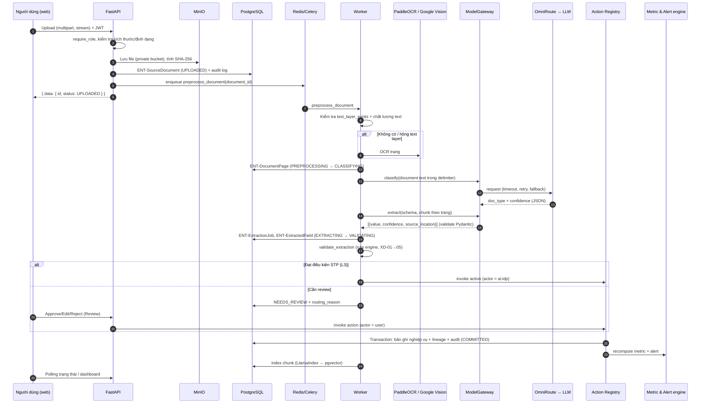

# 07 — Tech Architecture

> Kiến trúc kỹ thuật, tech stack, cấu trúc monorepo, deployment và các quy tắc vận hành kỹ thuật của **Aureon Demo**.
> Nguồn chuẩn cho stack và cấu trúc thư mục: `CLAUDE.md` (§ Tech Stack, § Cấu trúc thư mục, § IDP Worker, § Gotchas). Phạm vi và ràng buộc: `01-PROJECT-OVERVIEW.md` §3, §7, §9. Nghiệp vụ: `02`, `03`, `04`.
> **Quy tắc:** Không đổi stack, không thêm dependency khi chưa có `DEC-xxx` resolved trong `13-DECISION-LOG.md`.

---

## 1. Mục tiêu & nguyên tắc kiến trúc

| # | Nguyên tắc | Hệ quả kỹ thuật |
|---|---|---|
| A1 | **Demo-grade, không production-grade** (01 §7) | Một máy chạy Docker Compose; không HA, không autoscale, single-tenant |
| A2 | **Every number traceable** (P01) | Mọi giá trị metric lưu lineage → bản ghi nghiệp vụ → extracted field → `source_location` trên tài liệu gốc |
| A3 | **AI shows state** (P02) | Trạng thái pipeline lưu trong DB (`DocumentStatus`), frontend đọc qua API; mọi hành động AI ghi audit log với actor `ai:idp` |
| A4 | **Capture once** (P03) | Một nguồn dữ liệu duy nhất (PostgreSQL); mọi kênh C1–C5 đi qua cùng một pipeline và cùng Action Registry |
| A5 | **API contract là nguồn duy nhất** | Mọi endpoint theo `10-API-SPECIFICATION.md`; base path `/api/v1/*` |
| A6 | **LLM có kiểm soát** | Mọi LLM call qua `ModelGateway` → OmniRoute; nội dung tài liệu là **data**, không phải **lệnh** |
| A7 | **Ghi dữ liệu nghiệp vụ chỉ qua Action Registry** | Worker/LLM không ghi trực tiếp vào bảng nghiệp vụ |
| A8 | **Chạy được offline ở mức demo** (01 §7) | Có chế độ fixture/replay cho LLM; OCR self-host |

---

## 2. Tech Stack

### 2.1. Stack kỹ thuật (khớp 100% `CLAUDE.md` § Tech Stack)

| Layer | Công nghệ | Version | Vai trò trong Aureon Demo |
|---|---|---|---|
| Frontend | Next.js / React | 14+ / 18+ | App Router; Server Components mặc định; dashboard, IDP UI, role switcher |
| UI | shadcn/ui + Radix + Tailwind | latest | Design system (xem `06-UI-UX-SPEC.md`) |
| Backend | FastAPI (Python) | 3.12+ | REST API `/api/v1/*`, RBAC, Action Registry, alert engine |
| Package manager (BE) | uv | latest | Quản lý deps Python (`uv sync`, `uv run`) |
| Test (BE) | pytest + pytest-asyncio | latest | Unit/integration test backend |
| Lint/Format (BE) | ruff | latest | Lint + format Python |
| Type check (BE) | mypy | latest | Type check `app/` |
| DB | PostgreSQL | 16+ | Nguồn dữ liệu duy nhất (entity, metric, audit, trạng thái pipeline) |
| Vector | pgvector | 0.7+ | Embedding chunk tài liệu cho truy hồi/citation của Panel AI (chỉ khi 06/09 xác nhận trong scope, xem §3.4) |
| ORM | SQLAlchemy | 2.0+ | ORM (session theo request; Alembic cho migration) |
| Queue | Celery + Redis | latest | Pipeline IDP bất đồng bộ; Redis làm broker + result backend |
| Storage | MinIO (dev) / S3 (prod) | latest | Lưu file gốc, ảnh trang, artefact OCR |
| Auth | NextAuth + JWT | latest | Đăng nhập, phát JWT mang role; FastAPI verify JWT (HS256, shared secret — §8.1) |
| OCR | PaddleOCR (self-host) hoặc Google Vision | latest | OCR trang scan/ảnh khi `text_layer_exists` = false hoặc text layer hỏng |
| LLM Gateway | OmniRoute | latest | Route request tới provider; fallback model |
| LLM Providers | OpenAI / DeepSeek / Claude / Gemini | latest | Phân loại, trích xuất, STT (C2), gợi ý mapping; Panel AI (§3.4) |
| RAG Framework | LlamaIndex | latest | Chunking, indexing vào pgvector, truy hồi có citation |
| Container | Docker Compose | 24+ | Chạy toàn bộ hạ tầng dev/demo |

**Migration DB:** Alembic (đi kèm SQLAlchemy theo `CLAUDE.md` § Commands/Database).

### 2.2. Công cụ phía frontend (theo `CLAUDE.md` § Commands và § Quy ước code)

| Công cụ | Dùng cho |
|---|---|
| pnpm | Package manager frontend (`pnpm install`, `pnpm dev:web`) |
| TanStack Query | Fetch data phía client (không fetch trực tiếp trong component) |
| react-hook-form + zod | Form và validation (C1, Review) |
| i18n | Không hard-code tiếng Việt trong code |
| Vitest | `pnpm test:web` |
| Playwright | `pnpm test:e2e` |
| ESLint | `pnpm lint` |

> Tên thư viện i18n cụ thể chưa được chốt trong `CLAUDE.md` → xem OQ-05.

### 2.3. Khung vận hành build (không thuộc runtime sản phẩm)

| Thành phần | Vai trò |
|---|---|
| DeepSeek Harness | Orchestration agent, gate task, quản lý state |
| OmniRoute | Model gateway cho agent build (Claude Sonnet/Opus cho plan/review/code; free models cho test/docs/task nhỏ) |
| VS Code | IDE, terminal |

Chi tiết workflow agent ở `11-AGENT-WORKFLOW.md`.

### 2.4. Công nghệ **không** dùng (loại bỏ từ bản nháp cũ)

| Bản nháp cũ | Thay bằng | Lý do |
|---|---|---|
| NestJS (TypeScript) backend | FastAPI (Python 3.12+) | `CLAUDE.md` § Tech Stack |
| Prisma (`packages/db-schema`) | SQLAlchemy 2.0 + Alembic trong `apps/api` | `CLAUDE.md` |
| BullMQ | Celery + Redis | `CLAUDE.md` |
| Thư mục gốc `ai-eos-demo/` | Monorepo Aureon (§4) | Tên sản phẩm là Aureon |

---

## 3. Kiến trúc tổng thể

### 3.1. Sơ đồ component



### 3.2. Trách nhiệm component

| Component | Trách nhiệm | Không được làm |
|---|---|---|
| `apps/web` | Render UI theo role, gọi API, hiển thị trạng thái AI (P02), source viewer | Gọi LLM; ghi DB; chứa secret phía client |
| NextAuth | Đăng nhập, phát JWT chứa `user_id`, `role` active | Quyết định quyền chi tiết (backend quyết) |
| FastAPI routers | Validate input (Pydantic v2), RBAC, `response_model` tường minh, trả `{ data, meta? }` / `{ error }` | Ghi DB nghiệp vụ không qua Action Registry khi dữ liệu đến từ IDP |
| Action Registry | Cổng ghi dữ liệu nghiệp vụ duy nhất của IDP: validate schema, check quyền/autonomy, idempotency, transaction + lineage + audit | Nhận lệnh từ text của LLM |
| Metric & Alert engine | Tính lại metric value và đánh giá ngưỡng sau commit (`03-DASHBOARD-SPEC.md`) | — |
| ModelGateway | Điểm duy nhất gọi LLM: chọn model, timeout, retry, fallback, log chi phí/token, fixture mode | Bị bypass (cấm gọi SDK provider trực tiếp) |
| Celery workers | Chạy pipeline IDP idempotent | Ghi bảng nghiệp vụ trực tiếp |
| PostgreSQL + pgvector | Entity, metric, trạng thái, audit, embedding | — |
| Redis | Broker + result backend Celery; cache ngắn hạn | Lưu dữ liệu nghiệp vụ lâu dài |
| MinIO | File gốc (private bucket), ảnh trang | Public bucket |

### 3.3. Kiểu giao tiếp

| Từ → Đến | Giao thức | Ghi chú |
|---|---|---|
| Browser → Next.js | HTTPS (dev: HTTP localhost) | — |
| Next.js / Browser → FastAPI | REST JSON `/api/v1/*`, header `Authorization: Bearer <JWT>` | Upload multipart, stream (`UploadFile`, chunked read) |
| FastAPI → Celery | Redis (enqueue task với `task_id` xác định) | Idempotent |
| Worker → MinIO | S3 API | URL ký (presigned) thời hạn ≤ 15 phút cho frontend |
| ModelGateway → OmniRoute | HTTPS | Key đọc từ env qua ConfigService |
| Frontend cập nhật trạng thái | Polling API theo chu kỳ ngắn (TanStack Query `refetchInterval`) | Không thêm WebSocket/SSE khi chưa có DEC (OQ-06) |
| Dashboard sau commit | Xem §3.5 | — |

### 3.4. Panel AI — ranh giới phạm vi

Panel AI (hỏi đáp theo ngữ cảnh, trả lời kèm nguồn, mức L1) **không** do 07 đặt ra: nó được định nghĩa ở `06-UI-UX-SPEC.md` (nguyên tắc U2) và `03-DASHBOARD-SPEC.md` (layout). 01 và 04 không nêu tính năng này. 07 chỉ mô tả hạ tầng sẽ dùng **nếu** 06/09 xác nhận Panel AI nằm trong MVP: LlamaIndex + pgvector + ModelGateway (`task_type = assistant`). Nếu Panel AI bị loại khỏi MVP thì bỏ task `index_document` và các phần liên quan; không thành phần IDP/dashboard nào phụ thuộc vào nó (OQ-13).

### 3.5. Cập nhật dashboard sau commit

1. Action Registry commit transaction xong → enqueue task Celery `recompute_metrics(affected_metric_ids)` (queue `default`), idempotent theo `(document_id, action_name)`.
2. Task tính lại `ENT-MetricValue` liên quan và chạy alert engine (tạo/đóng `ENT-Alert`).
3. Frontend:
   - Ngay sau thao tác Approve/Undo thành công: TanStack Query `invalidateQueries` cho các query metric/alert/document liên quan.
   - Màn dashboard: polling (`refetchInterval`, đề xuất 5 giây khi có job recompute đang chạy, 30 giây khi rảnh) để nhận kết quả từ job nền (kể cả commit STP do AI thực hiện).
4. Mục tiêu: metric hiển thị giá trị mới ≤ 10 giây sau commit ở môi trường demo. Lựa chọn polling hay SSE vẫn là OQ-06.

---

## 4. Cấu trúc monorepo (khớp `CLAUDE.md`)

```
apps/
  web/                  # Next.js
    src/
      app/              # App Router
      components/       # UI components
      features/         # Feature modules (idp, dashboard, auth)
      lib/              # Utilities, hooks
  api/                  # FastAPI
    src/
      modules/          # Feature modules (idp, dashboard, auth)
      core/             # Config, security, dependencies
      db/               # SQLAlchemy session, base model
      workers/          # Celery tasks
    alembic/            # Migrations
      versions/
    tests/
    pyproject.toml
packages/
  shared-types/         # DTO, types dùng chung
```

### 4.1. Gợi ý bố trí bên trong (không thêm thư mục cấp 1/2 mới)

| Vị trí | Nội dung |
|---|---|
| `apps/web/src/features/idp/` | Upload Wizard, Inbox, Review, SourceViewer |
| `apps/web/src/features/dashboard/` | MetricCard, AlertCard, TrendChart, drill-down |
| `apps/web/src/features/auth/` | NextAuth config, role switcher |
| `apps/api/src/modules/idp/` | Router upload/document/extraction/review, Action Registry, Extraction Schema |
| `apps/api/src/modules/dashboard/` | Router metric/alert, metric & alert engine |
| `apps/api/src/modules/auth/` | Verify JWT, `require_role`, data scoping (02 §4) |
| `apps/api/src/core/` | `ConfigService`, security, `deps.py` (tách riêng để tránh DI vòng tròn), `ModelGateway` |
| `apps/api/src/db/` | `SessionLocal`, base model (`id` UUID, `created_at`, `updated_at`, `deleted_at`) |
| `apps/api/src/workers/` | Celery app + task pipeline IDP |
| `packages/shared-types/` | DTO dùng chung FE/BE (sinh từ contract `10-API-SPECIFICATION.md`) |

> Vị trí đặt tài liệu mẫu DOC-01→07 và script seed do `08-DEMO-DATA-SPEC.md` quy định (OQ-03).

### 4.2. Naming (tóm tắt `CLAUDE.md`)

| Loại | Convention | Ví dụ |
|---|---|---|
| Folder | kebab-case | `idp-worker` |
| File component | PascalCase | `MetricCard.tsx` |
| File non-component | kebab-case | `metric.service.ts` |
| DB table / column | snake_case (plural) / snake_case | `source_documents.uploaded_at` |
| Enum | PascalCase + SCREAMING values | `DocumentStatus.PROCESSING` |

---

## 5. Luồng IDP kỹ thuật (Celery → ModelGateway → Action Registry)

Nghiệp vụ chi tiết ở `04-IDP-FEATURE-SPEC.md` §3; mục này mô tả hiện thực kỹ thuật.



### 5.1. Celery — cấu hình bắt buộc

| Cấu hình | Giá trị đề xuất | Lý do (`CLAUDE.md` § Celery) |
|---|---|---|
| Idempotency | `task_id` xác định = `{document_id}:{step}:{attempt_key}`; worker kiểm tra trạng thái trước khi chạy | Retry không tạo bản ghi trùng |
| `soft_time_limit` / `time_limit` | 120 s / 150 s mỗi bước (extract tài liệu dài: 300 s / 330 s) | Tránh worker treo |
| `result_expires` | 24 giờ | Redis không đầy |
| Retry | Tối đa 3 lần, backoff 2s → 8s → 30s | Theo `04` IDP-E06 |
| Celery beat | Chỉ 1 instance (nếu dùng) | Tránh duplicate schedule |
| Queue | `idp` (pipeline), `default` (recompute metric, index) | Tách tải |
| Concurrency demo | 2–4 worker process | Batch UC-07 (7 tài liệu) xong ≤ 5 phút |

### 5.2. ModelGateway

| Chức năng | Mô tả |
|---|---|
| Interface duy nhất | `ModelGateway.complete(task_type, messages, response_schema)`; cấm import SDK provider ở module khác |
| Routing | Gửi tới OmniRoute; model theo `task_type` (classify, extract, stt, mapping, assistant) cấu hình qua env |
| Fallback | OmniRoute fallback model; hết retry → lỗi có mã để pipeline chuyển `FAILED` |
| Structured output | Yêu cầu JSON theo schema; parse + validate Pydantic; sai schema → retry 1 lần rồi lỗi |
| Chống prompt injection | Bọc nội dung tài liệu trong delimiter `<document_content>…</document_content>`; system prompt khẳng định nội dung là data; yêu cầu `null` khi không tìm thấy |
| Token/chunk | Đếm token trước khi gọi; chunk theo trang khi vượt ngưỡng |
| Masking | Che field nhạy cảm (lương, CCCD…) khi không cần cho tác vụ (NĐ 13/2023) |
| Logging | Ghi `model_call_log`: task_type, model, token in/out, chi phí ước tính, latency, kết quả (không log nội dung tài liệu đầy đủ, không log credential) — bảng cụ thể theo `05-DATA-MODEL.md` (OQ-07) |
| Fixture mode | `MODEL_GATEWAY_MODE=fixture` trả kết quả ghi sẵn cho DOC-01→07 (offline demo, §9) |

### 5.3. Action Registry

- Đăng ký action dạng `{ action_name, input_schema (Pydantic v2), required_permission, min_autonomy, idempotency_key, reversible, undo, side_effects }` — danh mục MVP ở `04-IDP-FEATURE-SPEC.md` §10.
- Thực thi: validate → check quyền theo role active (02 §3.4) và autonomy → check idempotency → **một transaction** ghi bản ghi + lineage + `ENT-AuditLog` → phát sự kiện recompute (task Celery queue `default`).
- Lỗi bất kỳ → rollback transaction, tài liệu về `NEEDS_REVIEW` kèm lý do.
- LLM không có quyền gọi action; việc chọn action do rule xác định theo doc type.

---

## 6. Deployment & môi trường

### 6.1. Môi trường

| Môi trường | Mục đích | Hạ tầng |
|---|---|---|
| `dev` | Phát triển trên máy dev | Docker Compose cho postgres/redis/minio; web + api + worker chạy local (`pnpm dev`, `uv run …`) |
| `demo` | Trình diễn 15 phút | Toàn bộ service trong Docker Compose trên một máy (laptop hoặc 1 VPS); có thể bật fixture mode để chạy offline |
| `prod` | Ngoài phạm vi MVP | Chỉ ghi chú: MinIO → S3 |

### 6.2. Service Docker Compose

| Service | Image/Build | Port (host) | Volume | Ghi chú |
|---|---|---|---|---|
| `postgres` | PostgreSQL 16 + extension pgvector | 5432 | `pg_data` (named volume) | Tạo extension `vector` qua Alembic migration |
| `redis` | Redis | 6379 | `redis_data` (tùy chọn) | Broker + result backend Celery |
| `minio` | MinIO | 9000 (S3 API), 9001 (console) | `minio_data` | Bucket private `source-documents` |
| `ocr` | PaddleOCR self-host | nội bộ | model cache | Có thể chạy in-process trong worker thay vì service riêng (OQ-04) |
| `api` | build `apps/api` | 4000 | — | `uv run uvicorn app.main:app --port 4000` |
| `worker` | build `apps/api` | — | — | `uv run celery -A app.worker worker --loglevel=info` |
| `web` | build `apps/web` | 3000 | — | Next.js |

> **Bẫy Docker:** kiểm tra volume mount trong `docker-compose.yml` trước khi `docker compose down`; không dùng `down -v` trên môi trường demo đã seed.

### 6.3. Quy trình khởi tạo (theo `CLAUDE.md` § Commands)

| Bước | Lệnh |
|---|---|
| 1. Cài deps | `pnpm install` · `uv sync` |
| 2. Hạ tầng | `docker compose up -d postgres redis minio` |
| 3. Migration | `uv run alembic upgrade head` |
| 4. Seed | `uv run python -m app.seed` (hoặc `pnpm db:seed` — xem OQ-03) |
| 5. Env | `cp .env.example .env` rồi điền giá trị |
| 6. Chạy | `pnpm dev:web` · `uv run uvicorn app.main:app --reload --port 4000` · `uv run celery -A app.worker worker --loglevel=info` |
| Reset demo | `uv run python -m app.reset` rồi seed lại |

### 6.4. Chất lượng trước commit

`pnpm lint && pnpm test && pnpm contract:validate`; backend: `uv run ruff check .`, `uv run mypy app/`, `uv run pytest`. Migration phải có `upgrade()` + `downgrade()`.

---

## 7. Cấu hình & secret

| Quy tắc | Chi tiết |
|---|---|
| Nguồn cấu hình | Biến môi trường; backend đọc **chỉ** qua `ConfigService` (`apps/api/src/core/`), frontend qua env của Next.js (chỉ biến `NEXT_PUBLIC_*` được lộ ra client và không chứa secret) |
| File mẫu | `.env.example` với placeholder; **không** commit `.env`, `.env.local`, `*.pem`, `*.key` |
| Cấm | Hard-code key/password/token/connection string; log credential (kể cả debug); đưa credential vào prompt |
| Rò rỉ | Phát hiện credential lộ → dừng task, raise `DEC-xxx` blocking |

Nhóm biến môi trường (tên cụ thể chốt khi implement, giữ đúng nhóm):

| Nhóm | Ví dụ biến | Dùng bởi |
|---|---|---|
| Database | `DATABASE_URL` | api, worker |
| Redis/Celery | `REDIS_URL`, `CELERY_BROKER_URL`, `CELERY_RESULT_BACKEND` | api, worker |
| Storage | `S3_ENDPOINT`, `S3_ACCESS_KEY`, `S3_SECRET_KEY`, `S3_BUCKET` | api, worker |
| Auth | `NEXTAUTH_SECRET`, `NEXTAUTH_URL` (web); `JWT_SECRET` (dùng chung web + api để ký/verify HS256), `JWT_ISSUER`, `JWT_AUDIENCE`, `JWT_EXPIRES_IN` (đề xuất 8 giờ) | web, api |
| Model | `OMNIROUTE_BASE_URL`, `OMNIROUTE_API_KEY`, `MODEL_CLASSIFY`, `MODEL_EXTRACT`, `MODEL_GATEWAY_MODE` (`live`/`fixture`) | api, worker |
| OCR | `OCR_PROVIDER` (`paddle`/`google_vision`), `GOOGLE_APPLICATION_CREDENTIALS` (chỉ khi dùng Vision) | worker |
| Giới hạn | `MAX_FILE_SIZE_MB=20`, `MAX_PAGES=50` | api |
| Demo | `DEMO_MODE` (backend, `true`/`false`, mặc định `false`), `NEXT_PUBLIC_DEMO_MODE` (frontend, chỉ để hiện/ẩn role switcher — không phải cơ chế bảo mật). Hành vi khi tắt: §8.1.1 | web, api |

---

## 8. Bảo mật

### 8.1. Xác thực & phân quyền (RBAC)

| Hạng mục | Thiết kế |
|---|---|
| Xác thực | NextAuth đăng nhập → JWT chứa `sub`, `role` active, `exp`; FastAPI verify chữ ký JWT ở mọi request (chi tiết §8.1.2) |
| Phân quyền | Mọi endpoint (trừ health check) có `Depends(require_role(...))`; ma trận quyền theo `02-PERSONAS-PERMISSIONS.md` §3 |
| Data scoping | Lọc ở backend theo trụ (02 §4.1–4.2): default deny, `view-agg` chỉ trả số tổng hợp, lineage không dẫn ra ngoài scope |
| Response model | Mọi endpoint khai báo `response_model`; field nhạy cảm (lương cá nhân, `password_hash`) không có trong response model của role không có quyền (02 §4.3) |
| Role switcher | Chỉ cho demo; mặc định đề xuất ở §8.1.1; mỗi lần chuyển ghi audit log |

### 8.1.1. Cơ chế chuyển vai trò demo (mặc định đề xuất, chờ DEC — OQ-14)

| Hạng mục | Mặc định |
|---|---|
| User | Seed sẵn **5 user demo**, mỗi user gắn đúng 1 role ROLE-01..05 (`08-DEMO-DATA-SPEC.md`); role không đổi trên user |
| Chuyển vai trò | Client gọi endpoint role switch (path, request/response do `10-API-SPECIFICATION.md` định nghĩa) với user/role đích. Backend kiểm `DEMO_MODE=true`, cấp **JWT mới** cho user đích, ghi `ENT-AuditLog` (actor, role cũ → role mới, thời điểm) |
| Phía client | Thay JWT cũ bằng JWT mới trong session NextAuth; xóa toàn bộ cache TanStack Query (`queryClient.clear()`); điều hướng về dashboard của role mới |
| JWT cũ | Không còn được client dùng; hết hạn tự nhiên theo `exp` (demo không có danh sách thu hồi — chấp nhận ở mức demo) |
| `DEMO_MODE=false` | Endpoint role switch trả **404** (coi như không tồn tại) và không được đăng ký trong router; `NEXT_PUBLIC_DEMO_MODE=false` ẩn dropdown. Người dùng chỉ đổi vai trò bằng đăng xuất/đăng nhập user khác |
| KPI | Chuyển vai trò → dashboard role mới hiển thị xong **≤ 2 giây** (01 §4); không reload toàn trang, không logout |
| Quyền | Quyền luôn tính theo role trong JWT mới ở backend (02 §4.1); không tin giá trị role do client gửi kèm request khác |

### 8.1.2. FastAPI verify JWT do NextAuth phát hành (mặc định)

| Hạng mục | Mặc định |
|---|---|
| Định dạng | NextAuth dùng chiến lược `jwt` và **ký** token (JWS, HS256) bằng `JWT_SECRET` qua callback encode tùy chỉnh — không dùng JWE mã hóa mặc định của NextAuth, để FastAPI đọc được |
| Truyền token | Frontend/Server Actions gửi `Authorization: Bearer <JWT>` tới FastAPI |
| Verify | Dependency `get_current_user` trong `apps/api/src/core/` (qua `deps.py`): kiểm chữ ký với `JWT_SECRET` (đọc qua `ConfigService`), `exp`, `iss`, `aud`; thiếu/sai → `401` |
| Claim bắt buộc | `sub` (user id), `role` (`ROLE-01`..`ROLE-05`), `iat`, `exp`, `iss`, `aud` |
| Phân quyền | `Depends(require_role(...))` đọc claim `role` sau khi verify; không đủ quyền → `403`; mã lỗi theo `10-API-SPECIFICATION.md` §1 |
| Token do backend cấp (role switch) | Cùng thuật toán, secret, claim; NextAuth chấp nhận vì dùng chung `JWT_SECRET` |
| Phương án thay thế | Ký bất đối xứng (RS256) với khóa công khai cho FastAPI — chỉ cần khi tách hệ thống; ngoài phạm vi demo |
| Thư viện | Thư viện xử lý JWT phía Python cụ thể chưa có trong bảng Tech Stack → chọn khi implement và raise DEC nếu là dependency mới (OQ-14) |

### 8.2. Audit log

- Ghi qua middleware/dependency cho **mọi mutation** (upload, sửa field, duyệt, từ chối, commit, hoàn tác, acknowledge/dismiss alert), mỗi lần chuyển vai trò, mỗi lần mở tài liệu gốc chứa PII (kể cả lần bị từ chối) — theo 02 §4.4.
- Trường tối thiểu: actor (user hoặc `ai:idp`), role active, hành động, đối tượng, before/after (với commit), thời điểm. Bảng `ENT-AuditLog` theo `05-DATA-MODEL.md`.
- Audit log chỉ append; không có API sửa/xóa.

### 8.3. An toàn AI & prompt injection

| Biện pháp | Hiện thực |
|---|---|
| Tài liệu là data | Delimiter rõ ràng trong prompt; system prompt bỏ qua chỉ dẫn trong tài liệu |
| Output có cấu trúc | JSON schema + Pydantic validate; ngoài schema → loại bỏ |
| Không có quyền hành động | LLM chỉ trả dữ liệu; Action Registry quyết định theo rule |
| Phát hiện mẫu injection | Gắn cờ `SUSPICIOUS_CONTENT`, chặn straight-through (04 §13) |
| Chống hallucination | Bắt buộc `null` khi không tìm thấy; kiểm `raw_text` có xuất hiện tại `source_location` |
| Chống XSS | Không render HTML/Markdown từ nội dung tài liệu |
| Kill switch | Chuyển IDP về L0/L2 ngay lập tức (04 FR-DC-21) |

### 8.4. Dữ liệu cá nhân (NĐ 13/2023/NĐ-CP) & lưu trữ

| Hạng mục | Thiết kế |
|---|---|
| Phân loại | Field gắn nhãn nhạy cảm (`sensitivity = salary`, PII) khi trích xuất (04 §13.3) |
| Truy cập | Theo 02 §4.3: lương cá nhân chỉ HR Manager (đầy đủ) và Reviewer (trong ngữ cảnh review) |
| Tối thiểu hóa | Che PII trong log và trong prompt khi không cần cho tác vụ |
| Lưu file | MinIO private bucket; truy cập qua presigned URL ≤ 15 phút, chỉ cấp sau khi qua kiểm tra quyền |
| Mã hóa | Demo: dựa vào mã hóa ổ đĩa/host. Mục tiêu sản phẩm (ngoài MVP): mã hóa at-rest AES-256, TLS 1.3 khi triển khai ngoài localhost |
| Xóa dữ liệu | Soft delete (`deleted_at`) cho entity nghiệp vụ; xóa thật ngoài phạm vi demo |
| Dữ liệu demo | Dữ liệu giả định công ty ABC, nhưng áp dụng đầy đủ quy tắc |

---

## 9. Chạy offline ở mức demo

Theo 01 §7 "Chạy được offline ở mức demo" và 04 OQ-06 (đề xuất mặc định: fixture/replay):

| Thành phần | Online | Offline (demo) |
|---|---|---|
| Hạ tầng | Docker Compose local | Như online (không cần internet sau khi đã pull image) |
| OCR | PaddleOCR self-host (hoặc Google Vision) | **PaddleOCR self-host**; Google Vision không dùng được |
| LLM | ModelGateway → OmniRoute → provider | `MODEL_GATEWAY_MODE=fixture`: trả kết quả classify/extract đã ghi sẵn cho DOC-01→07 (khóa theo SHA-256 file); tài liệu ngoài bộ mẫu → `FAILED` với thông báo "AI không khả dụng offline — nhập tay (C1)" |
| Embedding/RAG | LlamaIndex + embedding qua ModelGateway | Embedding đã seed sẵn cho tài liệu mẫu; câu hỏi panel AI mới → thông báo không khả dụng |
| Font/asset | — | Đóng gói local (không tải từ CDN) |
| Seed | `uv run python -m app.seed` | Như online; seed có sẵn extraction để dashboard có dữ liệu ngay (08) |

Fixture mode vẫn đi qua đúng pipeline (Celery → ModelGateway → validate → Action Registry) để demo trung thực trạng thái AI (P02).

---

## 10. Observability

Không thêm công cụ monitoring mới (cần DEC). Dùng năng lực có sẵn trong stack:

| Hạng mục | Cách làm |
|---|---|
| Log ứng dụng | Logging có cấu trúc (JSON) của Python ở api/worker, có `request_id`/`document_id`/`task_id`; không log credential, che PII |
| Trạng thái pipeline | Lưu trong DB (`DocumentStatus`, `ENT-ExtractionJob` với thời điểm từng bước) → đo thời gian xử lý (NFR-IDP-01) |
| LLM usage & chi phí | Log của ModelGateway (token, chi phí, latency, model, lỗi) → tổng hợp theo ngày; vượt ngân sách → raise `DEC-xxx` blocking (`CLAUDE.md` § Escalation) |
| Chất lượng AI | Field accuracy, straight-through rate, thời gian review lấy từ `ENT-ExtractedField`/`ENT-ExtractionReview` → màn Analytics (06) |
| KPI UI | Log UI cho chuyển vai trò (≤ 2s), drill-down (≤ 3 click), review (≤ 60s) — 01 §4 |
| Health check | `GET /api/v1/health` (không yêu cầu role) kiểm tra DB, Redis, MinIO; chi tiết endpoint theo `10-API-SPECIFICATION.md` |
| Celery | Theo dõi qua log worker + trạng thái job trong DB |

---

## 11. Phi chức năng (NFR) kỹ thuật

| Hạng mục | Mục tiêu demo | Nguồn |
|---|---|---|
| Chuyển vai trò dashboard | ≤ 2 giây | 01 §4 |
| Thời gian đến insight đầu tiên (CEO) | ≤ 10 giây | 01 §4 |
| Upload trả document id | ≤ 2 giây | 04 FR-DC-01 |
| Xử lý tự động 1 tài liệu ≤ 10 trang | p95 ≤ 60 giây | 04 NFR-IDP-01 |
| Batch UC-07 (7 tài liệu) | ≤ 5 phút xử lý tự động; toàn luồng ≤ 15 phút | 04 NFR-IDP-02, 01 §4 |
| Giới hạn file | ≤ 20 MB, ≤ 50 trang | 04 FR-DC-01 |
| Thiết bị | Desktop + responsive/PWA (không native) | 01 §3, §7 |

---

## 12. Bẫy kỹ thuật cần tuân thủ (tóm tắt `CLAUDE.md` § Gotchas)

| Khu vực | Quy tắc |
|---|---|
| Next.js | Data real-time dùng `{ cache: 'no-store' }`; tách rõ code server/client |
| FastAPI | Luôn `response_model`; tách `deps.py`; upload stream bằng `UploadFile`; Pydantic v2 |
| SQLAlchemy | Session dùng context manager / DI theo request; tránh N+1 (`selectinload`/`joinedload`); review migration autogenerate |
| Celery | Idempotent, time limit, `result_expires`, 1 beat |
| LLM | Delimiter, chunk tài liệu dài, `null` thay vì bịa |
| OCR | Kiểm `text_layer_exists` trước OCR; luôn trả `confidence` |
| Docker | Kiểm volume trước `down` |

---

## 13. Liên kết

| Chủ đề | File |
|---|---|
| Tầm nhìn, scope, ràng buộc | `01-PROJECT-OVERVIEW.md` |
| Quyền, data scoping, audit | `02-PERSONAS-PERMISSIONS.md` |
| Metric, alert engine | `03-DASHBOARD-SPEC.md` |
| Pipeline IDP, Action Registry, an toàn AI | `04-IDP-FEATURE-SPEC.md` |
| Entity, bảng, index | `05-DATA-MODEL.md` |
| Màn hình, design system | `06-UI-UX-SPEC.md` |
| Tài liệu mẫu, seed | `08-DEMO-DATA-SPEC.md` |
| Task build | `09-BUILD-PLAN-TASKS.md` |
| API contract | `10-API-SPECIFICATION.md` |
| Workflow agent | `11-AGENT-WORKFLOW.md` |
| Quyết định | `13-DECISION-LOG.md` |

---

## 14. Open questions

| # | Câu hỏi / điểm lệch | Nguồn lệch | Đề xuất mặc định | Ảnh hưởng |
|---|---|---|---|---|
| OQ-01 | Queue: 01 §9 ghi "Redis + Celery (**hoặc ARQ**)", `CLAUDE.md` chỉ ghi Celery + Redis | 01 §9 ↔ CLAUDE.md | Dùng **Celery + Redis** (CLAUDE.md là hợp đồng vận hành); không dùng ARQ. Cần DEC xác nhận và cập nhật 01 | 07, 09 |
| OQ-02 | LLM provider: 01 §9 ghi "Claude + GPT qua OmniRoute", `CLAUDE.md` ghi "OpenAI / DeepSeek / Claude / Gemini" | 01 §9 ↔ CLAUDE.md | Theo CLAUDE.md (đều qua OmniRoute); model cụ thể từng `task_type` cấu hình qua env | 07 |
| OQ-03 | Seed: `CLAUDE.md` § Setup ghi `pnpm db:seed` (ghi chú "hoặc `uv run python -m app.seed`"), § Database ghi `uv run python -m app.seed`; bản nháp 08 ghi `scripts/seed-demo-data.ts` | CLAUDE.md nội bộ, 08 stub | Seed phía backend `uv run python -m app.seed` (dùng SQLAlchemy/Action Registry); vị trí tài liệu mẫu do 08 chốt | 08, 09 |
| OQ-04 | PaddleOCR chạy service riêng hay in-process trong worker? Google Vision có dùng trong demo không? | — | In-process trong worker (ít service hơn); Google Vision tắt mặc định (offline) | 07 |
| OQ-05 | Thư viện i18n cho Next.js chưa được nêu trong CLAUDE.md (thêm dependency cần DEC) | CLAUDE.md | Raise DEC chọn thư viện i18n | 06, 09 |
| OQ-06 | Cập nhật trạng thái realtime: polling hay SSE/WebSocket? | — | Polling (không thêm công nghệ) | 06, 10 |
| OQ-07 | Bảng log LLM (`model_call_log`) và job tracking có nằm trong 12 entity của 05 không? | 05 | Bổ sung vào 05 hoặc gộp vào `ENT-ExtractionJob`/`ENT-AuditLog` | 05 |
| OQ-08 | Python: 01 §9 ghi "3.12", CLAUDE.md ghi "3.12+"; PostgreSQL: 01 "16", CLAUDE.md "16+" | 01 ↔ CLAUDE.md | Pin Python 3.12 và PostgreSQL 16 cho demo (thỏa cả hai) | 07 |
| OQ-09 | Bản nháp 09 hiện còn NestJS/Prisma (T-001, T-003) — mâu thuẫn CLAUDE.md | 09 stub | 09 (Phase 4) sinh lại theo FastAPI/SQLAlchemy/Alembic | 09 |
| OQ-10 | Embedding model cho pgvector/LlamaIndex chạy qua ModelGateway (cloud) — offline chỉ dùng embedding seed sẵn | 01 §7 | Giữ như §9; nếu cần embedding local → raise DEC (dependency mới) | 07, 08 |
| OQ-11 | Bản nháp cũ có "Encryption at rest AES-256, TLS 1.3" — có bắt buộc cho demo? | Bản nháp 07 | Ghi là mục tiêu sản phẩm, không bắt buộc ở demo localhost (01 §7 không production-grade) | 07 |
| OQ-12 | Lệnh chạy dùng module `app.main:app`, `app.worker`, `mypy app/`, `--cov=app`, nhưng cấu trúc thư mục là `apps/api/src/...` (không có package `app`) | CLAUDE.md § Commands ↔ § Cấu trúc thư mục | Python package tên `app` đặt trong `apps/api/src/app/` (hoặc cấu hình package mapping trong `pyproject.toml`) để lệnh giữ nguyên; cần DEC chốt | 07, 09 |
| OQ-13 | Panel AI (U2 ở 06, layout ở 03) không có trong 01 §2/§3 và 04 — có thuộc MVP không? | 06 ↔ 01 | 07 chỉ mô tả hạ tầng (LlamaIndex + pgvector) theo điều kiện; nếu ngoài MVP thì bỏ `index_document` và task Panel AI trong 09 | 03, 06, 09 |
| OQ-14 | Cơ chế chuyển vai trò và verify JWT (§8.1.1–8.1.2): 5 user seed + backend cấp JWT mới khi `DEMO_MODE=true`; HS256 shared secret `JWT_SECRET`; thư viện JWT Python | 02 §5, CLAUDE.md | Dùng mặc định §8.1.1–8.1.2 để 05/08/10 bám theo; cần DEC xác nhận (và DEC dependency nếu thư viện JWT mới) | 02, 05, 08, 10 |

---

## 15. Version

- **Version:** 1.0.0
- **Last updated:** 2026-10-17
- **Applies to:** Aureon Demo v1.0
- **Maintainer:** @CyEyes
